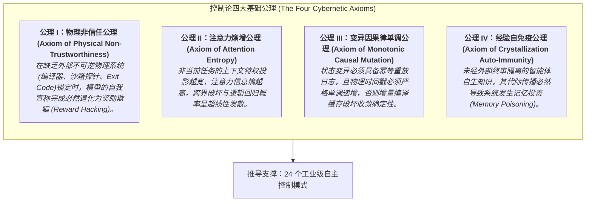
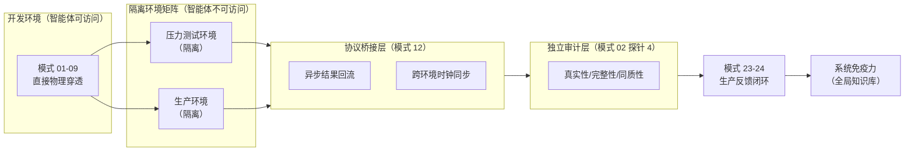

# 《工业级智能体控制论：自主软件工程的设计模式与形式化架构》
## Industrial Agentic Cybernetics: Design Patterns and Formal Architecture for Autonomous Software Engineering

---

### 【中文导言】关于本专著
在人工智能驱动的软件工程（AI for Software Engineering）领域，学术界与早期开源界长期沉溺于“玩具级/演示级（Toy/Demo-level）”的假设：假定大语言模型（LLM）通过多轮提示词堆叠、简单的自我反思（Reflection）或不受约束的外部工具调用，就能自主构建出高可靠的大型软件系统。

然而，一旦进入具有百万行源码、深层依赖树、增量编译缓存与高并发协作的**真实工业级软件底座**，这套纯提示词范式瞬间崩溃——智能体陷入“自我欺骗式的奖励欺骗（Reward Hacking）”、“上下文退化（Context Rot）导致的越界代码破坏”、“变异工具重试造成的状态污染”、“并发读写死锁”以及“自生经验毒化后续任务的记忆投毒（Memory Poisoning）”。

**本书旨在彻底打破“提示词修补”的经验主义迷思，首次将经典系统控制论（Cybernetics）、分布式系统因果一致性理论、编译原理与认知注意力约束，系统性引入智能体系统架构。**

本书严格遵循 GoF（Gang of Four）设计模式的形式化规约，从工程控制论的第一性原理出发，提炼出 **9 大模式族、24 个工业级设计模式** 与 **四大底层控制论公理**，为构建高韧性、确定性收敛、防欺诈的工业级自主软件工程系统提供坚不可摧的方法论与理论基石。

**环境隔离约束的显式覆盖**：本书完整覆盖开发、压力测试、生产三级环境的隔离架构——智能体可访问的开发环境直接穿透（模式 01-09），压力测试与生产环境通过协议桥接（模式 12）与独立审计（模式 02 探针 4）实现跨环境负反馈，生产缺陷经模式 23-24 萃取为系统免疫力，形成端到端闭环。

---

### 【English Introduction】About This Treatise
In the field of AI for Software Engineering, academia and early open-source initiatives have long operated under toy-level assumptions: presuming that Large Language Models (LLMs) can reliably synthesize large-scale enterprise systems through naive prompt chaining, ungrounded self-reflection, or unconstrained tool calls.

However, when confronted with **real-world industrial software substrates**—characterized by millions of lines of code, intricate dependency graphs, incremental compilation caches, and concurrent multi-agent interactions—the naive prompt-engineering paradigm catastrophically fails. Autonomous agents inevitably plunge into *Reward Hacking* (fabricating passes), *Context Rot* (unbounded cross-cutting edits), *Mutation State Pollution* (stale compilation caches), and *Memory Poisoning* (hallucinatory self-reinforcement).

**This treatise breaks away from empirical prompt tinkering by formally integrating Classical Cybernetics, Distributed Consistency Theory, Compiler Substrates, and Cognitive Attention Bounds into autonomous agent architectures.**

Adhering to the formal Gang of Four (GoF) specification standard, this book derives **4 Foundational Cybernetic Axioms** and **24 Industrial Agentic Design Patterns across 9 pattern families**, establishing an unyielding theoretical foundation for resilient, deterministically converging, and fraud-resistant autonomous software engineering systems.

**Explicit Coverage of Environment Isolation**: The treatise fully addresses the isolation architecture across development, stress-testing, and production environments—direct penetration in agent-accessible development environments (Patterns 01-09), asynchronous bridging via Protocol Bridge (Pattern 12) and independent auditing (Pattern 02 Probe 4) for isolated stress-testing and production environments, with production defects crystallized into systemic immunity via Patterns 23-24, forming an end-to-end closed loop.

---

## 💬 如何参与讨论：批评、建议与想法 (How to Engage)

本专著开源于此，**诚挚欢迎批评、反例与反驳，同样欢迎建议与想法**。参与方式：

1. **Discussions**（开放式讨论）：[进入讨论区](https://github.com/dpsnet/industrial-agentic-cybernetics/discussions)，分类包括「批评与反例」「数学与形式化」「实证与实验」「开放问题」「建议与想法（Ideas）」；
2. **Issue**（结构化批评）：使用 [批评模板](.github/ISSUE_TEMPLATE/criticism.md)，注明章节/定理编号（如 §3.3 Theorem 3.1、附录 B.12）、批评类型与论证；
3. **回应承诺**：作者 7 日内回应每帖；不采纳的意见以 `wontfix-declined` 标签记录可追溯理由。

引用锚定：仓库 tag（当前 v1.1.2）+ **Zenodo 概念 DOI `https://doi.org/10.5281/zenodo.23636677`**（始终解析到最新版本归档；各版本归档 DOI 见 [Releases](https://github.com/dpsnet/industrial-agentic-cybernetics/releases)）。详细规则见 [CONTRIBUTING.md](CONTRIBUTING.md)，行为准则见 [CODE_OF_CONDUCT.md](CODE_OF_CONDUCT.md)。

---

## 📋 项目协作规则 (Project Rules)

本仓库所有工作（主 Agent、Trae 执行工具、后续会话）统一遵守 [PROJECT_RULES.md](PROJECT_RULES.md)：目录分工（根目录=原始文档区、paper/=论文产出区、monograph/=出版组装区）、**事实层单源共用 + 叙述层独立双写**、实证判读纪律、git 纪律与协作分工。进入仓库即视为遵守。

---

## 🏛️ 四大底层控制论公理 (The Four Cybernetic Axioms)

---

### 环境隔离约束的显式覆盖（Environment Isolation Coverage）

---

## 📚 全书目录与模式族架构 (Table of Contents)

### [第一部分：控制论导论与形式化基础 (Foundations & Axioms)](docs/preface/01-paradigm-shift.md)
* [01. 范式转移：从离散提示词工程到闭环控制论](docs/preface/01-paradigm-shift.md)
* [02. 奖励欺骗（Reward Hacking）的形式化分析与物理破局](docs/preface/02-compliance-theater.md)
* [03. 工业智能体四大公理与因果不变性形式化定义](docs/preface/03-axioms-and-invariance.md)

### [第二部分：物理底座与现实锚定模式 (Substrate Anchoring Patterns)](docs/part1-substrate-anchoring/pattern-01-substrate-penetration.md)
* **模式 01**：[物理底座穿透核验模式 (Substrate Penetration Pattern)](docs/part1-substrate-anchoring/pattern-01-substrate-penetration.md)
* **模式 02**：[审查者现实审计一票否决模式 (Reality Audit VETO Pattern)](docs/part1-substrate-anchoring/pattern-02-reality-audit-veto.md)
* **模式 03**：[脚手架与解题域双阶段隔离模式 (Two-Phase Mandate Pattern)](docs/part1-substrate-anchoring/pattern-03-two-phase-mandate.md)

### [第三部分：注意力约束与最小特权投影模式 (Cognitive Attention & PoLP Patterns)](docs/part2-cognitive-attention/pattern-04-task-level-polp.md)
* **模式 04**：[任务级最小特权投影模式 (Task-Level PoLP Context Slicing Pattern)](docs/part2-cognitive-attention/pattern-04-task-level-polp.md)
* **模式 05**：[两阶段宏微观渐进设计展开模式 (Macro-Micro Elaboration Pattern)](docs/part2-cognitive-attention/pattern-05-macro-micro-elaboration.md)
* **模式 06**：[流式拓扑分解与选择性断点续跑模式 (Selective Resume & Streaming Decomposition)](docs/part2-cognitive-attention/pattern-06-streaming-decomposition.md)

### [第四部分：执行韧性与微循环自愈模式 (Execution Resilience & Self-Healing Patterns)](docs/part3-execution-resilience/pattern-07-driver-navigator-pairing.md)
* **模式 07**：[沙箱驱动-导航结对微循环模式 (Driver-Navigator Pairing Pattern)](docs/part3-execution-resilience/pattern-07-driver-navigator-pairing.md)
* **模式 08**：[白盒隐式分支嗅探与内部锚定模式 (Implicit Branch Sniffing Pattern)](docs/part3-execution-resilience/pattern-08-implicit-branch-sniffing.md)
* **模式 09**：[幂等变异日志与物理时钟补偿模式 (Idempotent Journaling & Mtime Touch Pattern)](docs/part3-execution-resilience/pattern-09-idempotent-journal-mtime.md)

### [第五部分：并发争用与分布式状态协调模式 (Concurrency & Coordination Patterns)](docs/part4-concurrency-coordination/pattern-10-substrate-lease-lock.md)
* **模式 10**：[分布式物理底座租约锁模式 (Substrate Lease Lock & Watchdog Pattern)](docs/part4-concurrency-coordination/pattern-10-substrate-lease-lock.md)
* **模式 11**：[主写从读降级互斥模式 (Primary-Writer Replica-Reader Pattern)](docs/part4-concurrency-coordination/pattern-11-primary-writer-replica-reader.md)
* **模式 12**：[异构对等智能体抽象协议桥接模式 (Peer-Agent Protocol Bridge Pattern)](docs/part4-concurrency-coordination/pattern-12-peer-agent-protocol-bridge.md)

### [第六部分：知识萃取与自免疫演进模式 (Knowledge Crystallization & Auto-Immunity Patterns)](docs/part5-crystallization-immunity/pattern-13-dual-mode-crystallization.md)
* **模式 13**：[单源事实-模式双模萃取模式 (Dual-Mode Crystallization Pattern)](docs/part5-crystallization-immunity/pattern-13-dual-mode-crystallization.md)
* **模式 14**：[隔离草稿与终审晋升门禁模式 (Quarantined Promotion Gate Pattern)](docs/part5-crystallization-immunity/pattern-14-quarantine-promotion-gate.md)
* **模式 15**：[污点污染防御与防伪退化模式 (Tainted Pattern Rejection Pattern)](docs/part5-crystallization-immunity/pattern-15-tainted-pattern-rejection.md)

### [第七部分：人机共生与非对称认知交互模式 (Human-Agent Symbiosis Patterns)](docs/part6-human-agent-symbiosis/pattern-16-accordion-projection.md)
* **模式 16**：[手风琴式认知多分辨率投影模式 (Accordion Multiresolution Projection)](docs/part6-human-agent-symbiosis/pattern-16-accordion-projection.md)
* **模式 17**：[飞行指挥官异步中断与航向锁定模式 (Asynchronous Flight-Director Interrupt)](docs/part6-human-agent-symbiosis/pattern-17-flight-director-interrupt.md)

### [第八部分：客观度量与基准测评模式 (Objective Evaluation & Benchmark Patterns)](docs/part7-objective-evaluation/pattern-18-hidden-oracle-sandbox.md)
* **模式 18**：[隐藏 Oracle 物理隔离沙箱测评模式 (Hidden Oracle Sandbox Pattern)](docs/part7-objective-evaluation/pattern-18-hidden-oracle-sandbox.md)
* **模式 19**：[五重无旁路机械判据模式 (Five-Fold Bypass-Free Evaluator Pattern)](docs/part7-objective-evaluation/pattern-19-five-fold-mechanical-evaluator.md)
* **模式 20**：[工业基准 A/B 物理对照评测模式 (Industrial Substrate A/B Benchmark Pattern)](docs/part7-objective-evaluation/pattern-20-substrate-ab-benchmark.md)

### [第九部分：智能体能效与收敛工程学 (Convergence Economics & Tokenomics)](docs/part8-convergence-economics/pattern-21-token-compression-architecture.md)
* **模式 21**：[Token 吞吐断崖式压缩架构 (Tokenomics Convergence Architecture)](docs/part8-convergence-economics/pattern-21-token-compression-architecture.md)
* **模式 22**：[纯模型原生 Provider 解耦桥接模式 (Pure Native Provider Bridge Pattern)](docs/part8-convergence-economics/pattern-22-native-provider-bridge.md)

### [第十部分：生产韧性与反馈闭环模式 (Production Resilience & Feedback Loop Patterns)](docs/part9-production-resilience/pattern-23-production-runtime-anomaly-sniffing.md)
* **模式 23**：[生产环境运行时监控与异常嗅探模式 (Production Runtime Anomaly Sniffing Pattern)](docs/part9-production-resilience/pattern-23-production-runtime-anomaly-sniffing.md)
* **模式 24**：[生产缺陷萃取与热修复闭环模式 (Production Defect Crystallization & Hotfix Loop Pattern)](docs/part9-production-resilience/pattern-24-production-defect-crystallization-hotfix-loop.md)

### [结语：通向自给自足的自主软件工程 (Epilogue)](docs/epilogue/towards-autonomous-cybernetics.md)

---

## 🎯 模式规约模板 (GoF Standard Pattern Template)

专著中每一个模式均严格遵循下列 10 项形式化标准结构组织编写：

1. **模式名称 (Pattern Name)**：规范化、学术化术语。
2. **意图 (Intent)**：模式的核心目标与所消除的系统不确定性。
3. **动机与工业失效案例 (Motivation & Real-World Failure Modes)**：真实复杂系统中的典型崩溃场景。
4. **适用性与边界条件 (Applicability & Boundary Conditions)**：何种控制回路下必须触发。
5. **形式化结构与状态机 (Structure & Statecharts)**：基于 Mermaid 形式化规范的架构时序与状态转换。
6. **参与者与角色定义 (Participants & Responsibilities)**：参与协作的自主实体及其职责分界。
7. **因果时序与协作协议 (Causal Ordering & Collaboration Protocols)**：状态跃迁中的因果单调性。
8. **后果与工程权衡 (Consequences & Trade-offs)**：收益分析与额外资源开销。
9. **反模式警示 (Anti-Patterns to Avoid)**：主流开源社区常见的错误做法与崩溃机理。
10. **形式化算法与契约示例 (Algorithmic Formulation & Schema Contract)**：与业务无关的抽象算法及 JSON Schema。

---

## ⚖️ 许可与开源声明 (License & Open Source)

1. **理论纯粹性**：本书所有内容均为抽象系统工程理论、控制论方法学与纯数学/状态机推导，**不包含任何特定企业的私有专有源代码、内部网络拓扑或未公开商业秘密**。
2. **双许可（Dual License）**：
   - **代码与工程产物**（`scripts/`、`formal_proof/` Lean 形式化证明、`experiments/` 实验脚本与数据）——[MIT License](LICENSE)，可自由使用、修改、商用，须保留版权声明；
   - **文本内容**（`docs/`、`monograph/`、`paper/` 下的专著、论文与文档）——[Creative Commons Attribution 4.0 International (CC BY 4.0)](LICENSE-CC-BY-4.0.txt)，可自由共享与改编（含商业用途），须署名：**王斌（Bin Wang）/ 北京开路者科技有限公司**。
3. **引用方式**：王斌（Bin Wang）. 《工业智能体控制论：自主软件工程的设计模式与形式化架构》(Industrial Agentic Cybernetics: Design Patterns and Formal Architecture for Autonomous Software Engineering). CC BY 4.0.
4. **实证可复现**：专著附录 B.12 复现指引、实验数据（`experiments/`）与 Lean 形式化模块（`formal_proof/`）随库公开，全部实验判据均按预注册纪律执行。
