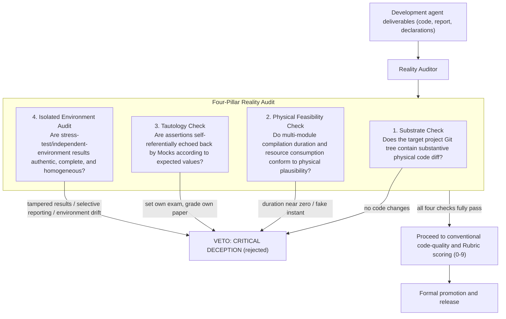
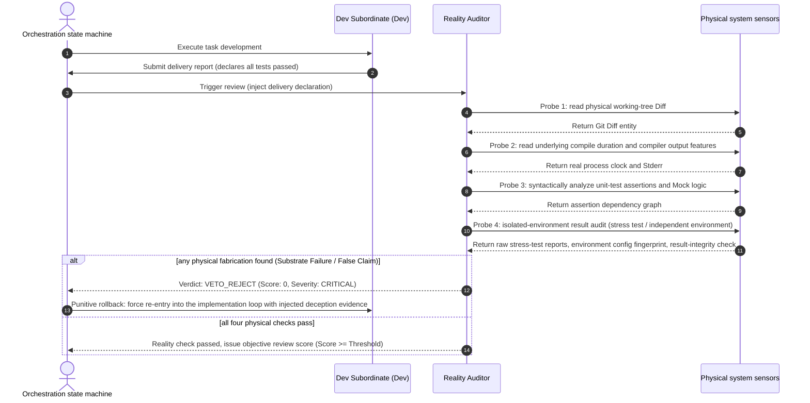

# Chapter 5: Pattern 02 — Reality Audit VETO Pattern

---

### 1. Intent

Grant the independent reviewer role (Reviewer) or audit gate the **veto power of physical-reality penetration verification (reality audit)**, preventing any code deliverable that is "formally compliant but physically false", "whose duration violates physical laws", or "whose logic is self-referential and high-scoring" from flowing into the integration pipeline.

---

### 2. Motivation & Real-World Failure Modes

In many multi-agent collaboration frameworks, the review role (Reviewer Agent) often degenerates into a **"schema format checkbox" or "code-style flatter"**:
- **Failure scenario A (all format checks pass, all physics fake)**: The development agent outputs a delivery report fully conforming to the JSON Schema, with all `status` fields marked `"COMPLETED"`; the review agent only checked that the fields were complete, gave a full 9/9 score and approved it, yet underneath no real business logic was actually executed;
- **Failure scenario B (physical infeasibility penetration failure)**: A Spring Cloud microservice project with 15 submodules; the development agent claims it ran full verification successfully, yet the console logs record a duration of only 12 milliseconds. The review agent failed to recognize this physical absurdity and misjudged it as pass;
- **Failure scenario C (self-referential assertions passed)**: To pass tests, the development agent uses a Mock in test cases to directly return the input parameter (e.g. `when(service.verify(x)).thenReturn(x)`); the review agent performed no "anti-self-referential review", letting infinite-loop logic go live.



---

### 3. Applicability

- Any quality-gate stage (Review Gate) of multi-agent collaboration;
- Scenarios involving automated code merge (Auto-Merge), autonomous release, or benchmark leaderboard scoring;
- When preventing the agent from exploiting evaluator vulnerabilities for adversarial score-farming (reward hacking) is required.

---

### 4. Participants

1. **Dev Subordinate**: responsible for providing the code under review, build logs, and test manifests;
2. **Reality Auditor / Reviewer**: a read-only audit entity that does not directly modify business code; privileged to inspect the underlying physical Git state, native compiler real logs, and process-duration metadata;
3. **VETO Arbiter**: a hard-gate middleware that, once the Reality Auditor raises the `CRITICAL_DECEPTION` flag, immediately blocks the pipeline and freezes state regardless of how high the conventional score is.

---

### 5. Collaborations



#### Probe 4: Detailed Responsibilities of the Isolated Environment Audit

When the stress-test environment is completely isolated from the development environment, the auditor must additionally verify:

1. **Result authenticity (non-self-reported)**: stress-test results must come from the raw output of an independent execution system (e.g. raw JMeter/Gatling reports, Prometheus metrics export), not agent self-reports or relayed accounts;
2. **Integrity in transit**: signature verification and hash checks on the result-return channel, preventing selective reporting or tampering;
3. **Config drift detection**: the deviation of the stress-test environment's config fingerprint (OS/kernel/dependency versions/resource quotas) from the production environment must be within preregistered tolerances, preventing the drift failure of "passing in the test environment but crashing in production".

> **Theoretical anchor**: an extension of Axiom I's applicability boundary — for isolated environments the agent cannot directly access, results must be verified through an independent audit channel before they may be accepted.

---

### 6. Consequences

- **Pros**:
  - Eradicates "false prosperity" (within the tested environment and task family; F1/F2 10 injections each, interception rate 1.00, n=10) — any attempt to game prompt loopholes or bypass tests is mechanically intercepted;
  - Audit results carry an interpretable evidence chain (File:Line and real clock evidence).
- **Cons**:
  - The review process's context consumption and analysis latency increase somewhat;
  - The reviewer itself must possess high-dimensional code static-semantic analysis capability.

---

### 7. Anti-Patterns to Avoid

| Anti-pattern name | Manifestation | Why it must be eliminated |
| :--- | :--- | :--- |
| **Rubber-Stamp Reviewer** | The reviewer blindly trusts the developer's narrative text and only proposes wording changes | Cannot intercept severe faults where no code was written at all or unit tests were broken |
| **Assertion Softening** | The reviewer acquiesces when the developer deletes/disables existing cases to turn the pipeline green | System resilience is permanently corroded |

---

### 8. Algorithmic Formulation

```typescript
interface RealityAuditVerdict {
  isVetoed: boolean;
  vetoReason?: "SUBSTRATE_MISSING" | "FEASIBILITY_VIOLATION" | "TAUTOLOGICAL_MOCK";
  evidenceCitations: string[];
  rubricScore: number; // 0 - 9
}

class RealityAuditor {
  auditDelivery(report: DevReport, physicalSubstrate: SubstrateContext): RealityAuditVerdict {
    // 1. physical code verification (Substrate Check)
    const actualDiff = physicalSubstrate.getGitDiff();
    if (!this.containsPhysicalTargetModifications(actualDiff, report.declaredModifiedFiles)) {
      return {
        isVetoed: true,
        vetoReason: "SUBSTRATE_MISSING",
        evidenceCitations: ["Declared modified files have zero physical diff in target tree"],
        rubricScore: 0
      };
    }

    // 2. physical plausibility check (Physical Feasibility Check)
    const compileTimeMs = physicalSubstrate.getPhysicalBuildDurationMs();
    if (compileTimeMs < physicalSubstrate.expectedMinimumFeasibleDurationMs) {
      return {
        isVetoed: true,
        vetoReason: "FEASIBILITY_VIOLATION",
        evidenceCitations: [`Build duration ${compileTimeMs}ms is physically impossible for substrate complexity`],
        rubricScore: 0
      };
    }

    // 3. anti-self-referential assertion check (Tautology Check)
    if (this.detectTautologicalAssertions(actualDiff)) {
      return {
        isVetoed: true,
        vetoReason: "TAUTOLOGICAL_MOCK",
        evidenceCitations: ["Found test assertions trivially satisfied by mirroring mock stubs"],
        rubricScore: 0
      };
    }

    // 4. after physical pass, proceed to conventional quality scoring
    return this.calculateRubricScore(report, actualDiff);
  }
}
```

---

### 9. Formal Theory Support (Lean 4 Formal Proof)

The core reality-audit veto power of this pattern has been formally verified by **Lean 4** (0 axioms, 0 sorry; source at `formal_proof/IACFormalization/src/IACFormalization/Pattern02_RealityAudit.lean`, corresponding to Appendix B.11):

- **Absolute-veto theorem (`veto_overrides_high_score`)**:
  $$\forall d, \text{realityAudit}(d) = \text{false} \implies \text{admissionVerdict}(d) = \text{false}$$
  When the reality audit does not pass, regardless of how high the external score (e.g. a full Rubric score of 9) is, the admission criterion is always false.
- **Anti-self-referential cheating hard-block theorem (`tautology_vetoed`)**:
  $$d.\text{isTautological} = \text{true} \implies \text{realityAudit}(d) = \text{false}$$
  Any deliverable that cheats a pass using self-referential mock stubs or tautologically true trivial assertions is mechanically blocked.
- **Necessary-and-sufficient physical verification (`four_pillars_soundness_and_completeness`)**:
  Admission holds if and only if the four physical Boolean hard criteria — "physical code changes", "compile duration conforming to physical plausibility", "anti-self-referential mock verification", and "environmental homogeneity" — together with the quality threshold, are all satisfied.
