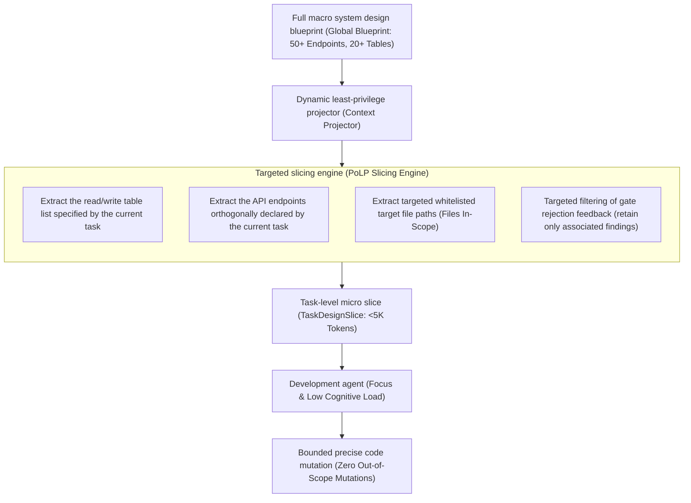
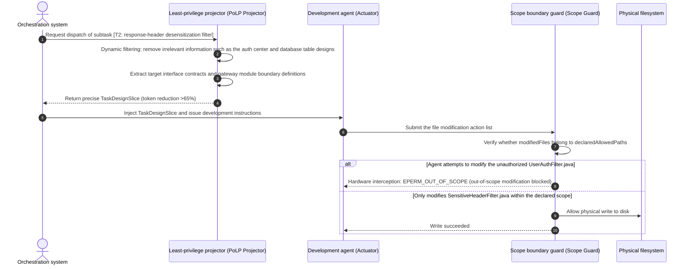

# Chapter 7: Pattern 04 — Task-Level PoLP Context Slicing Pattern

---

### 1. Intent

Grounded in the **Principle of Least Privilege (PoLP)** from cybersecurity and system control theory, the upper-layer orchestrator performs dynamic context slicing and dimensionality-reducing projection when dispatching a single task to a development agent: it **injects only the table schemas, interface definitions, and orthogonal files that the current task declares to read or write**, compressing >60% of irrelevant context and significantly suppressing context rot and out-of-scope code mutations.

---

### 2. Motivation & Real-World Failure Modes

In agentic development on complex codebases, the most prevalent anti-pattern is **"stuffing the entire knowledge base / global design blueprint into the prompt at once"**:

- **Failure Mode A (context rot)**: when a global architecture design document containing 30 database tables and 50 endpoint definitions (hundreds of thousands of tokens) is fed in full to an agent responsible for implementing a single gateway filter, the model readily exhibits "lost in the middle" (Liu et al., TACL 2024), generating large numbers of unrelated helper classes while missing the core logic;
- **Failure Mode B (excessive privilege causing cross-boundary damage)**: because the context includes the entire engineering configuration and all existing unit tests, an agent developing gateway desensitization logic may, upon hitting a compile error, conveniently modify code in the user authentication module or delete existing unit tests of the security module, causing severe and hidden logical regressions;
- **Failure Mode C (global noise pollution from rejection feedback)**: when the gate rejects a minor defect (e.g., an omitted non-null parameter check), re-injecting the entire bulky gate report and historical logs causes the agent to fall into over-healing, rewriting and erasing previously correct code belonging to other tasks.



---

### 3. Applicability

- Incremental requirement development on large multi-module monoliths or microservice repositories;
- Pipeline execution stages with clear task decomposition;
- Scenarios where context windows are expensive, or where long context causes significant attention degradation in the model.

---

### 4. Participants

1. **Global Blueprint Store**: holds the complete architecture contract (data tables, interfaces, global decisions) for the entire requirement lifecycle;
2. **Context Projector**: based on the metadata of the currently dispatched task (`taskId`, `files`, `modules`), dynamically extracts a subgraph in memory and generates the task-specific minimal slice `TaskDesignSlice`;
3. **PoLP Subordinate Agent**: receives only the sliced context, is forbidden from consulting the full blueprint for undeclared paths, and is forced to complete implementation within the declared boundaries;
4. **Scope Boundary Guard**: when code is written back to the physical substrate, verifies whether the Git diff exceeds the file boundaries declared by the task; out-of-scope changes are rejected outright.

---

### 5. Collaborations



---

### 6. Consequences

- **Pros**:
  - **Cliff-like drop in token consumption**: by removing the massive redundancy of the full design, single-task inference energy consumption drops by 60%–80%;
  - **Extreme attention focus**: eliminates the "needle in a haystack" problem of long texts, and the accuracy of single code generation improves significantly;
  - **Side effects eliminated**: modifications across tasks do not overlap, naturally supporting parallelized development and topological scheduling;
- **Precise convergence of self-healing retries**: gate rejection feedback is targetedly filtered to return only findings associated with the task, avoiding the over-healing anti-pattern.
- **Cons**:
  - Requires the upfront design phase to possess high-quality structured interface and module decomposition capabilities; if the architecture design cuts blurrily, the projected slice may lack necessary dependency information;
  - Requires the orchestrator to maintain a bidirectional dynamic mapping between architecture blueprint and task slices, increasing the metadata maintenance cost of the orchestration layer;
  - For strongly coupled cross-module refactoring tasks, overly tight slice declarations may cause missing-modification compile errors, and an on-demand topological expansion mechanism must be provided.

---

### 7. Anti-Patterns to Avoid

| Anti-pattern | Manifestation | Why it must be eradicated |
| :--- | :--- | :--- |
| **Monolithic Design Dumping / Blueprint Dump** | Indiscriminately concatenating hundreds of pages of the entire system's design documents or the complete microservice architecture diagram of hundreds of thousands of tokens into the prompt on every Dev Agent invocation | Causes the model to get lost in massive information and hallucinate, producing large numbers of out-of-scope modifications |
| **Unbounded Write Access / Unbounded Editing** | Allows the development agent to modify any file in the project (including external files not declared in the task contract) at will without boundary interception | Highly prone to hidden logical damage and catastrophic regressions such as modifying shared base classes or deleting unit tests |

---

### 8. Algorithmic Formulation

```typescript
interface TaskItem {
  taskId: string;
  targetFiles: string[];
  referencedEndpoints: string[];
}

interface GlobalDesignContract {
  summary: string;
  endpoints: EndpointDefinition[];
  tables: TableSchema[];
  decisions: ArchitecturalDecision[];
}

class TaskLevelContextProjector {
  projectTaskSlice(task: TaskItem, globalDesign: GlobalDesignContract): TaskDesignSlice {
    // 1. Filter orthogonal API endpoints
    const relevantEndpoints = globalDesign.endpoints.filter(ep => 
      task.referencedEndpoints.includes(ep.path)
    );

    // 2. Filter orthogonal database table schemas
    const relevantTables = globalDesign.tables.filter(tbl =>
      relevantEndpoints.some(ep => ep.relatedTables?.includes(tbl.tableName))
    );

    // 3. Targeted decision projection (retain only architectural decisions involving the current module)
    const relevantDecisions = globalDesign.decisions.filter(d =>
      task.targetFiles.some(f => f.includes(d.affectedModule))
    );

    return {
      taskId: task.taskId,
      scopedFiles: task.targetFiles,
      endpoints: relevantEndpoints,
      tables: relevantTables,
      decisions: relevantDecisions,
      tokenReductionRatio: this.calculateReductionRatio(globalDesign, relevantEndpoints)
    };
  }
}
```

---

### 9. Lean 4 Formal Proof

The least-privilege projection and SNR gain of this pattern have been verified by **Lean 4** mechanized formal proof (0 axioms, 0 sorry; source: `formal_proof/IACFormalization/src/IACFormalization/Pattern04_PoLPProjection.lean`, corresponding to Appendix B.13):

- **Least-privilege projection fidelity theorem (`polp_preserves_snr_strictly`)**:
  $$\forall \text{ctx}, b_{ext} > 0 \implies \operatorname{snr}(\operatorname{projectPoLP}(\text{ctx})) > \operatorname{snr}(\text{ctx})$$
  Pruning externally irrelevant redundant context necessarily and strictly improves the task-objective retrieval SNR.
- **Out-of-scope violation probability reduction theorem (`polp_strictly_reduces_violation_risk`)**:
  $$\forall \text{ctx}, b_{ext} > 0 \implies P_{\text{violate}}(\operatorname{projectPoLP}(\text{ctx})) < P_{\text{violate}}(\text{ctx})$$
  Least-privilege projection strictly reduces the model's attention degradation and out-of-scope code tampering risk.
- **Privilege nesting monotonicity theorem (`polp_monotone_nesting`)**:
  $$b_1 \le b_2 \implies P_{\text{violate}}(a, b_1) \le P_{\text{violate}}(a, b_2)$$
  The tighter the projected slice, the monotonically lower its upper bound on violation risk.
