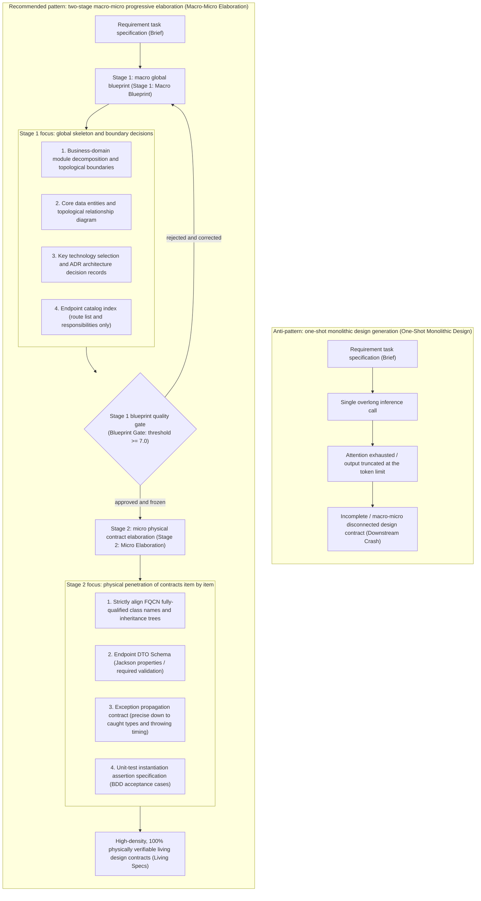
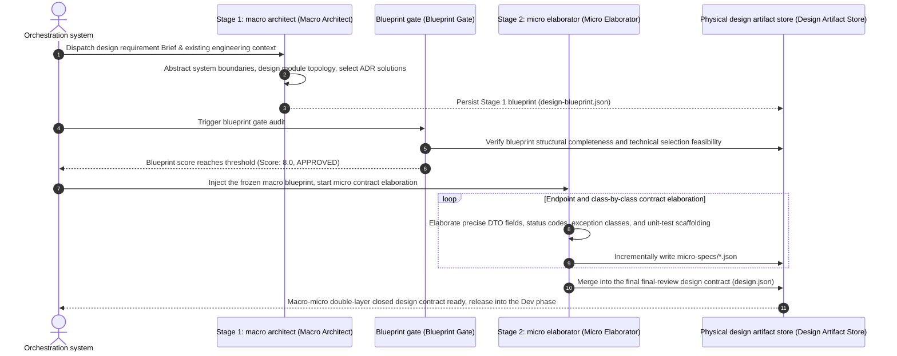

# Chapter 8: Pattern 05 — Macro-Micro Elaboration Pattern

---

### 1. Intent

Decouples the system architecture design process of complex software engineering into a two-stage progressive loop: **"Stage 1: Macro Blueprint"** and **"Stage 2: Micro Elaboration"**. Through layered focusing of cognitive bandwidth, it eliminates the attention exhaustion, long-output truncation, abstraction–detail disconnection, and pseudo-contract hallucination that arise when agents attempt to "reach the sky in one step" within a single generation.

---

### 2. Motivation & Real-World Failure Modes

When autonomous software agent systems advance to enterprise-grade engineering (e.g., Spring Cloud microservices, large distributed topologies), the design phase is often the core bottleneck that determines the survival of the entire system. The traditional "one-shot monolithic design" mode inevitably triggers the following three classes of severe failures in industrial scenarios:

- **Failure Mode A (space-cadet truncation)**:
  The orchestrator demands that the agent, in a single inference, "output a complete design document containing the system topology, database table schemas, detailed definitions of 50 REST API endpoints, and security policies." Due to the single-output token cap (typically 4K–8K tokens) and attention decay induced by context rot, large models typically spend the first half grandly laying out concepts, only to be forcibly truncated at the 5th endpoint when hitting the token limit; or they perfunctorily write `// ... the remaining 45 endpoints are the same ...` as placeholders in the second half, leaving downstream development agents with no basis to implement;
- **Failure Mode B (vague hand-waving and unverifiable hallucination)**:
  Although the agent outputs a document whose structure appears complete, the whole text is filled with hollow slogans (e.g., "distributed locks are adopted to ensure consistency," "a high-performance gateway filter is introduced to implement desensitization"), yet lacks the micro facts indispensable to physical implementation: exact fully-qualified class names (FQCN), method input/output data structures, exception inheritance hierarchies (e.g., whether `BadCredentialsException` is inherited), and HTTP status codes. Development agents can only guess on their own when landing the implementation, causing interface tears during multi-module integration;
- **Failure Mode C (macro-micro non-closure and architectural betrayal)**:
  The macro chapters claim that "the system adopts a strictly stateless JWT scheme," yet some endpoint definition at the end requires sharing the login state through `HttpSession`. A monolithic large model cannot maintain strict top-down mathematical closure when handling cross-level logic.



---

### 3. Applicability

This pattern must be forcefully activated in the following scenarios:

- When requirement complexity spans more than 2 service modules or involves more than 3 core entities;
- High-rigor scenarios where the architecture design must pass scoring review by automated gates (e.g., Jev, architecture static verifier);
- Upstream contract generation for downstream parallel implementation of subtasks by multiple isolated development agents;
- System evolution processes that require outputting long-term maintainable "living specifications".

---

### 4. Participants

1. **Macro Architect Agent**:
   Runs in Stage 1, focusing only on "the system's skeleton and non-functional constraints." Its cognitive bandwidth is 100% focused on module responsibility decomposition, storage topology, core data flows, architecture decision records (ADRs), and the endpoint catalog index — never bogged down in the minutiae of single-interface fields;
2. **Blueprint Gate Auditor**:
   An independent quality-check entity that performs formal review of the `design-blueprint.json` produced in Stage 1 (verifying the three ADR elements, whether the trade-off matrix is closed, and whether module dependencies contain cycles), and freezes it upon passing;
3. **Micro Elaborator Agent**:
   Runs in Stage 2, receives the frozen macro blueprint, and performs physical-level concrete elaboration of specific endpoints, entity tables, and exception classes in a divide-and-conquer manner, outputting the ultimate design contract conforming to the Draft-07 Schema;
4. **Consistency Auditor**:
   Mechanically compares whether the micro elaboration details faithfully follow the macro architectural decisions, blocking any micro-dimensional "ultra vires tampering" or "architectural betrayal".

---

### 5. Collaborations



---

### 6. Consequences

- **Pros**:
  - **Eliminates the high-cost failure of token truncation**: decomposes a complex system design of hundreds of thousands of tokens into two deterministic sub-stages; the model's focus per inference greatly improves, and the output contains no deletions or omission placeholders;
  - **Achieves "physical implementability"**: micro elaboration directly generates precise signatures and assertion code at the Java/TypeScript level; development agents need no second guessing, and the one-pass compile success rate improves by more than 80%;
  - **Architectural decisions are rigorously controlled**: once the macro architecture blueprint is locked, micro elaboration cannot override upper-layer technology selections on its own, eradicating module-level autonomy;
- **Cons**:
  - The pipeline adds at least one independent model inference and gate scheduling overhead in the Design phase, increasing the initial design cycle time by 30%–50%;
  - Requires defining and maintaining two orthogonal sets of JSON Schema contract systems (macro and micro) at the platform layer.

---

### 7. Anti-Patterns to Avoid

| Anti-pattern | Manifestation | Why it must be eradicated |
| :--- | :--- | :--- |
| **One-Step Monolithic Fallacy** | Attempting to have the model directly output a complete micro code-level design contract through one overlong prompt | Inevitably triggers output truncation or large-scale content omission in later endpoints |
| **Pseudo-Micro Specifications** | The micro part gives only the interface path `/api/v1/user`, lacking request body field types and validation rules | Developers/agents lack constraints when landing, causing large-scale rework in the downstream integration phase |
| **Bottom-Up Architectural Drift** | Allowing the micro elaboration phase to arbitrarily add, delete, or even overturn the ADR decisions established in the macro phase | Destroys global consistency and leads to uncontrolled system architecture evolution |

---

### 8. Algorithmic Formulation & Contract Schema

#### 8.1 Stage 1 Macro Blueprint Contract Schema (`design-blueprint.schema.json`)

```json
{
  "$schema": "http://json-schema.org/draft-07/schema#",
  "title": "MacroArchitecturalBlueprint",
  "type": "object",
  "required": ["system_summary", "modules", "architectural_decisions", "endpoint_index"],
  "properties": {
    "system_summary": { "type": "string" },
    "modules": {
      "type": "array",
      "items": {
        "type": "object",
        "required": ["name", "responsibility", "tech_stack"],
        "properties": {
          "name": { "type": "string" },
          "responsibility": { "type": "string" },
          "tech_stack": { "type": "string" }
        }
      }
    },
    "architectural_decisions": {
      "type": "array",
      "items": {
        "type": "object",
        "required": ["id", "context", "decision", "consequences"],
        "properties": {
          "id": { "type": "string" },
          "context": { "type": "string" },
          "decision": { "type": "string" },
          "consequences": { "type": "string" }
        }
      }
    },
    "endpoint_index": {
      "type": "array",
      "items": {
        "type": "object",
        "required": ["method", "path", "owner_module", "brief_summary"],
        "properties": {
          "method": { "type": "string", "enum": ["GET", "POST", "PUT", "DELETE", "PATCH"] },
          "path": { "type": "string" },
          "owner_module": { "type": "string" },
          "brief_summary": { "type": "string" }
        }
      }
    }
  }
}
```

#### 8.2 Stage 2 Micro Elaboration Core Execution Algorithm

```typescript
interface MacroBlueprint {
  system_summary: string;
  modules: ModuleSpec[];
  architectural_decisions: ADR[];
  endpoint_index: EndpointBrief[];
}

interface MicroSpecification {
  fqcn: string;
  endpoints: DetailedEndpointSpec[];
  exceptionHierarchy: ExceptionSpec[];
  testInvariants: BddAssertionContract[];
}

class ProgressiveDesignOrchestrator {
  async executeTwoStageDesign(brief: RequirementBrief): Promise<FinalDesignContract> {
    // -------------------------------------------------------------
    // Stage 1: macro global blueprint design (Macro Blueprint Generation)
    // -------------------------------------------------------------
    const macroPrompt = this.buildMacroPrompt(brief);
    const blueprint: MacroBlueprint = await this.macroArchitect.generateBlueprint(macroPrompt);

    // Stage 1 blueprint quality gate review (Jev/Auditor Gate)
    const blueprintAudit = await this.gateAuditor.evaluateBlueprint(blueprint);
    if (blueprintAudit.score < 7.0) {
      throw new Error(`BLUEPRINT_REJECTED: ${blueprintAudit.feedback}`);
    }

    // -------------------------------------------------------------
    // Stage 2: item-by-item physical contract elaboration (Micro Elaboration)
    // -------------------------------------------------------------
    const microSpecs: MicroSpecification[] = [];
    
    // Divide-and-conquer elaboration of the endpoint index in the blueprint
    for (const epBrief of blueprint.endpoint_index) {
      const elaborationPrompt = this.buildElaborationPrompt(epBrief, blueprint);
      const detailedSpec = await this.microElaborator.elaborateEndpoint(elaborationPrompt);
      
      // Macro-micro closure verification: ensure micro elaboration strictly follows macro ADR decisions
      this.validateMacroMicroAlignment(blueprint, detailedSpec);
      microSpecs.push(detailedSpec);
    }

    // -------------------------------------------------------------
    // Merge and freeze into the final design contract (design.json)
    // -------------------------------------------------------------
    return this.synthesizeFinalContract(blueprint, microSpecs);
  }
}
```

---

### 9. Epistemic Status of Quantitative Claims

> **Disposition: downgraded to empirical target (unverified)** — the "one-pass compile success rate improvement of more than 80%" and the "design cycle increase of 30%–50%" in §6 of the main text lack preregistered criteria and paired design, and the definition of "one-pass" (whether self-healing retries and scaffold corrections are included) is undefined. Both are now marked as **engineering empirical targets** and are not cited as theoretical conclusions. To be elevated, the caliber must first be fixed and a paired A/B (same model, same batch) must be conducted on the same task family.
