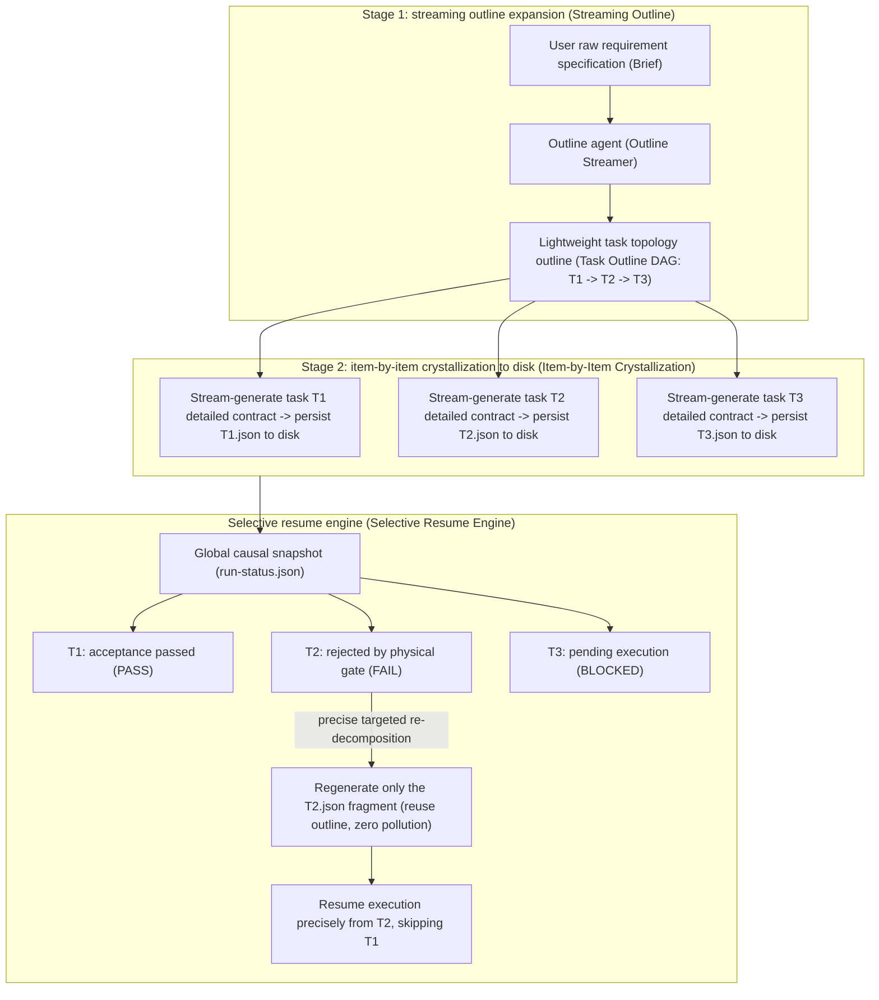
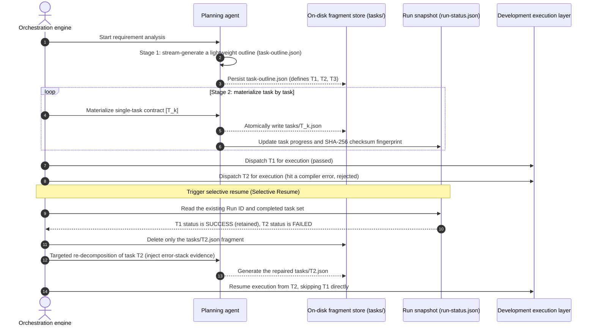

# Chapter 9: Pattern 06 — Streaming Decomposition & Selective Resume Pattern

---

### 1. Intent

Restructures the requirement decomposition process of large engineering tasks from one-shot global batch generation into **streaming incremental decomposition**, and combines it with a directed acyclic graph (DAG) topological state machine to achieve **selective resume**, effectively countering context rot in overlong task generation (Liu et al., 2024) and achieving precise targeted self-healing with zero redundant computation on environment crashes or task retries.

---

### 2. Motivation & Real-World Failure Modes

When facing industrial-grade requirements containing dozens of subtasks (e.g., full-stack microservice feature migration), the traditional one-shot global planning exhibits significant failure:

- **Failure Mode A (context rot at the planning level)**:
  The orchestrator demands that the product manager agent (PM Agent) output in one shot a complete JSON list of 15 tasks (including each task's dependencies, acceptance criteria, and file scope). Due to context rot and lost in the middle, the model typically shows rapid attention fatigue after completing the first 3 tasks, with the latter half of tasks exhibiting large-scale content repetition, garbled dependency cycles, or missing Schema fields;
- **Failure Mode B (high overhead of cascading re-run)**:
  In the execution phase, suppose the 12th task is rejected by the gate due to a micro assertion error. In a system lacking incremental state topology, the orchestrator often triggers a global re-run, pushing all of the first 11 tasks that already passed strict compilation and testing through from scratch, causing millions of tokens of wasted computation and physical workspace pollution;
- **Failure Mode C (crash recovery failure after unexpected interruption)**:
  In long-cycle engineering runs, the underlying host may be interrupted by network fluctuations, OOM, or service restarts. Without fine-grained streaming persistence and causal state snapshots, the system cannot recover the scene, causing permanent loss of engineering progress.



---

### 3. Applicability

- Complex software engineering tasks containing more than 3 strongly dependent sub-steps;
- Long-cycle autonomous pipelines prone to external environment jitter, model inference timeouts, or server restarts;
- Cost-sensitive enterprise systems that need strict control of token energy consumption and avoid recomputation of already-passed tasks.

---

### 4. Participants

1. **Outline Streamer**: responsible for the global skeleton topology deduction in the first stage, producing only task identifiers, dependency predecessors, and one-sentence responsibilities, blocking the model from sinking into details early on;
2. **Fragment Materializer**: invokes sub-agents one by one in topological order to materialize each task, immediately persisting an independent fragment contract to disk (`tasks/T{N}.json`) as each task is generated;
3. **Resume Snapshot Coordinator**: maintains a monotonically increasing causal state file `run-status.json`, recording the current lifecycle of each task (`PENDING`, `IN_PROGRESS`, `SUCCESS`, `FAILED`);
4. **Targeted Healing Re-trier**: upon receiving a downstream gate rejection signal, locates the minimal closure of polluted tasks through DAG topology analysis, marks only the failed task as `STALE` and triggers local re-decomposition, strictly reusing undamaged fragments.

---

### 5. Collaborations



---

### 6. Consequences

- **Pros**:
  - **Avoids context rot**: each task's materialization prompt contains only the outline and the current slice, with context length constantly controlled in the low-entropy band;
  - **Instant fault recovery (Instant MTTR)**: thanks to independent per-task on-disk fragments (`T1.json`, `T2.json`), after a system crash and restart the recovery point can be located at millisecond level, skipping already-passed high-score gates;
  - **Self-healing computation overhead minimized**: local rejection only re-decomposes the single task, saving more than 70% of retry tokens.
- **Cons**:
  - Requires the orchestrator's underlying layer to maintain state snapshots and lock mechanisms based on the filesystem or distributed KV;
  - Cross-task data sharing between subtasks must be transmitted through explicitly declared output contracts.

---

### 7. Anti-Patterns to Avoid

| Anti-pattern | Manifestation | Why it must be eradicated |
| :--- | :--- | :--- |
| **Monolithic Task Dumping** | Demands the model directly output all subtask details in one overlong array | Triggers context rot (Liu et al., 2024), causing the quality of later tasks to decline sharply |
| **All-or-Nothing Cascade** | When a micro unit test fails, resetting the entire pipeline to its initial state and regenerating | Extremely wasteful of energy and destroys the stability of already-verified code assets |

---

### 8. Algorithmic Formulation

```typescript
interface TaskOutline {
  tasks: Array<{ id: string; title: string; dependencies: string[] }>;
}

class StreamingDecompositionEngine {
  async planAndResume(brief: string, workDir: string, resumeMode: boolean): Promise<TaskQueue> {
    const outlinePath = path.join(workDir, "task-outline.json");
    let outline: TaskOutline;

    // 1. Outline generation or reuse (Stage 1)
    if (resumeMode && fs.existsSync(outlinePath)) {
      outline = JSON.parse(fs.readFileSync(outlinePath, "utf8"));
    } else {
      outline = await this.pmAgent.generateOutline(brief);
      fs.writeFileSync(outlinePath, JSON.stringify(outline, null, 2));
    }

    // 2. Streaming item-by-item materialization (Stage 2)
    const materializedTasks: TaskItem[] = [];
    for (const taskStub of outline.tasks) {
      const fragmentPath = path.join(workDir, "tasks", `${taskStub.id}.json`);
      
      if (resumeMode && fs.existsSync(fragmentPath)) {
        // Resume point hit: reuse the on-disk fragment, zero model calls
        materializedTasks.push(JSON.parse(fs.readFileSync(fragmentPath, "utf8")));
        continue;
      }

      // Stream-materialize the single-task fragment
      const detailedTask = await this.pmAgent.elaborateSingleTask(taskStub, outline, brief);
      fs.writeFileSync(fragmentPath, JSON.stringify(detailedTask, null, 2));
      materializedTasks.push(detailedTask);
    }

    return new TaskQueue(materializedTasks);
  }
}
```

---

### 9. Epistemic Status of Quantitative Claims

> **Supplementary measurement result (2026-10-21, offline analytical accounting, zero quota)**: script `experiments/attention_growth/e_p06_resume_savings.py`, results in `e_p06_resume_savings.json`.
>
> **Caliber (key point)**: what is actually saved is **no longer re-entering the breakpoint** — the historical cost of already-passed tasks has been paid and is not refunded; resume only re-executes the failed task and its successors. Let task costs be $c_1,\dots,c_N$ and the breakpoint position be $k$, then
> $$s=\frac{\sum_{i<k}c_i}{\sum_{i\le N}c_i}$$
> i.e., the **cost-weighted prefix fraction**; under equal costs it degenerates to $(k-1)/N$.
>
> | Cost profile | Expected savings at $N=32$ | Breakpoint position required to reach 70% |
> | :--- | ---: | ---: |
> | Equal cost | 48.4% | $k/N\ge0.75$ |
> | Linear front-loaded (early-heavy) | 64.6% | $k/N\ge0.50$ |
> | Exponential front-loaded $r=1.2$ | **81.5%** | $k/N\ge0.25$ |
> | Exponential front-loaded $r=1.5$ | 90.6% | $k/N\ge0.125$ |
> | Linear back-loaded (late-heavy) | 32.3% | $k/N\ge0.875$ |
>
> **Ruling**: 70% is not a constant independent of cost structure, but the result of a cost-weighted position. When costs are front-loaded (blueprint / scaffold / major changes dominate, $r\gtrsim1.2$), a mid-segment breakpoint already recovers more than 70% — consistent with measured breakpoint-retry results in external engineering systems. The property that **historical overhead is not refunded** is carried by the formula itself: $s$ counts only the prefix and does not deduct paid costs.
>
> Therefore the main text should rewrite "saving more than 70%" into a conditional statement: "under a front-loaded cost decomposition structure, a mid-segment breakpoint already recovers more than 70%; under an equal-cost structure the expectation is about 50%, requiring the breakpoint to lie in the last 25%." This conclusion is an analytical identity, independent of model calls. The empirical source is external engineering practice (not reproduced in this repository), serving only as an empirical fact to be explained, and does not constitute a reasoning premise of this system.
