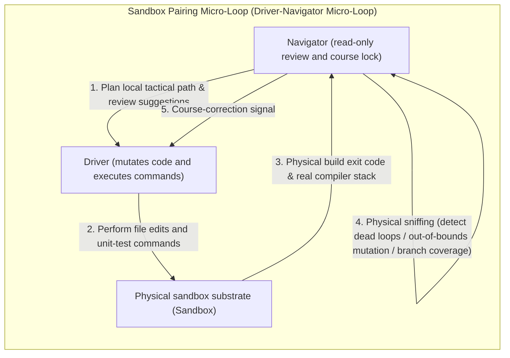

# Chapter 10: Pattern 07 — Driver-Navigator Pairing Pattern

---

### 1. Intent

Drawing on the pairing programming idea from Extreme Programming (XP), a frequency-synchronized micro-loop self-healing closed loop composed of a **Driver Agent** and a **Navigator Agent** is constructed inside a controlled sandbox, realizing "in-place mutation — immediate sniffing — local convergence," so as to prevent an agent acting alone from falling into a self-healing dead loop or blindly enlarging its damage surface.

---

### 2. Motivation & Real-World Failure Modes

When a single agent performs code mutation and compilation repair, it is extremely prone to falling into a **"healing black hole"**:

- **Failure scenario A (fixing one thing breaks eight)**: when fixing a single compile error, a single agent, lacking any global course constraint, follows the compiler's error chain all the way and modifies 8 unrelated files, ultimately causing an avalanche-like deformation of the entire project architecture;
- **Failure scenario B (trapped in a local optimum)**: when repairing unit tests, the agent oscillates back and forth between two mutually conflicting errors (fixing error A breaks error B, and fixing error B breaks error A), and after exhausting its context tokens it still remains at the initial error;
- **Failure scenario C (empty flow and imperceptible hang)**: when encountering a complex exception stack, the driver agent falls into a long period of long-context silence, and the external orchestrator cannot perceive whether it is in a state of effective exploration.



---

### 3. Applicability

- Implementation phases involving complex compile errors, type-system assertions, or complex business algorithms;
- Development of key core modules that require high fault tolerance and must prevent the code damage surface from escaping;
- The micro-level execution closed loop of a single complex task.

---

### 4. Participants

1. **Driver Agent**: holds the mutation tools (file writing, command execution), responsible for concretely writing code and running the compiler build; possesses the driving force of execution;
2. **Navigator Agent**: a read-only role that does not write code directly; responsible for monitoring every mutation step of the driver, comparing against the architecture design contract, reviewing code quality in real time, and issuing targeted correction suggestions;
3. **Implicit Sniffer**: a sensor integrated at the bottom layer of the navigator, detecting in real time whether code mutation triggers a dead loop, whether undeclared file writes occur, or whether logical anti-patterns emerge.

---

### 5. Collaborations

```mermaid
sequenceDiagram
    autonumber
    actor Orchestrator as Orchestration layer
    participant Navigator as Navigator (Navigator)
    participant Driver as Driver (Driver)
    participant Compiler as Native compiler / test suite

    Orchestrator->>Navigator: Issue task design slice
    Navigator->>Driver: Issue minimal tactical goal [write the desensitization core filter]
    
    loop Micro-loop self-healing (at most N rounds of attempts)
        Driver->>Compiler: Write code and trigger compilation
        Compiler-->>Driver: Capture error stack (Exit Code 1)
        Driver->>Navigator: Report current state and proposed repair plan
        Navigator->>Navigator: Sniffing review: is it a known dead loop? Is it out of bounds?
        
        alt Detects the driver deviating from course (e.g., attempting to modify an already-passing shared module)
            Navigator-->>Driver: Hard correction: modifying shared modules is forbidden; refactor only the current filter
        else Repair direction is correct
            Navigator-->>Driver: Approve and provide concrete parameter-fix suggestions
        end
    end
    
    Driver->>Compiler: Final compilation (Exit Code 0)
    Navigator->>Orchestrator: Navigator confirms task completion and endorses it
```

---

### 6. Consequences

- **Pros**:
  - **Extremely fast self-healing convergence**: the navigator acts as a "real-time external brake pad," compressing the complex exploration space within a local course corridor and avoiding more than 80% of ineffective blind retries;
  - **Double insurance on code quality**: every line of code landed on disk undergoes the navigator's real-time semantic review, reducing rejection frequency in the subsequent global code review phase.
- **Cons**:
  - Multi-agent concurrency or polling increases the number of basic inference calls per task, which must be paired with efficient small-parameter lightweight models in the driver/navigator roles.

---

### 7. Anti-Patterns to Avoid

| Anti-pattern name | Manifestation | Why it must be eliminated |
| :--- | :--- | :--- |
| **Lone Ranger Blackhole** | A single agent modifies code for 10+ consecutive rounds without any reviewer supervising it | Highly prone to severe code deformation, ultimately deviating from the initial architecture |
| **Navigator Role Intrusion** | The navigator directly takes over the driver's write tools and writes code itself | Destroys the cognitive separation of "one thinks, the other executes," allowing confirmation bias to grow again |

---

### 8. Algorithmic Formulation

```typescript
interface PairDevSession {
  driver: DriverAgent;
  navigator: NavigatorAgent;
  maxIterations: number;
}

class SandboxPairDevLoop {
  async executePairDev(session: PairDevSession, taskSlice: TaskDesignSlice): Promise<TaskResult> {
    let iteration = 0;
    let currentFeedback: NavigatorGuidance = session.navigator.initialBrief(taskSlice);

    while (iteration < session.maxIterations) {
      iteration++;
      
      // 1. The driver mutates physical code under the navigator's guidance
      const mutationResult = await session.driver.actuate(currentFeedback);
      
      // 2. Real native compilation and testing
      const buildResult = await session.driver.runInSituVerify();
      if (buildResult.exitCode === 0) {
        // The navigator performs the final review of code compliance
        const finalAudit = await session.navigator.auditFinalCode(mutationResult.modifiedFiles);
        if (finalAudit.approved) {
          return { success: true, iterations: iteration, codeArtifacts: mutationResult.modifiedFiles };
        }
      }

      // 3. The navigator performs implicit sniffing and correction on the error stack and mutation history
      currentFeedback = await session.navigator.analyzeFailureAndSteer(
        buildResult.errorOutput,
        mutationResult.mutationDiff,
        iteration
      );

      // Dead-loop detection
      if (currentFeedback.isLoopDetected) {
        await session.driver.rollbackToLastKnownStableState();
      }
    }

    return { success: false, reason: "MAX_ITERATIONS_EXCEEDED" };
  }
}
```

---

### 9. Epistemic Status of Quantitative Claims

> **Disposition: downgraded to an empirical target (unverified)** — the phrase "more than 80% of ineffective blind retries are avoided" currently has no measurable definition for "ineffective blind retries" (the judging predicate for "whether a retry brings information gain" is missing). This figure is marked as an **engineering empirical target**; to elevate it, the information-gain predicate must first be defined and its threshold preregistered.
