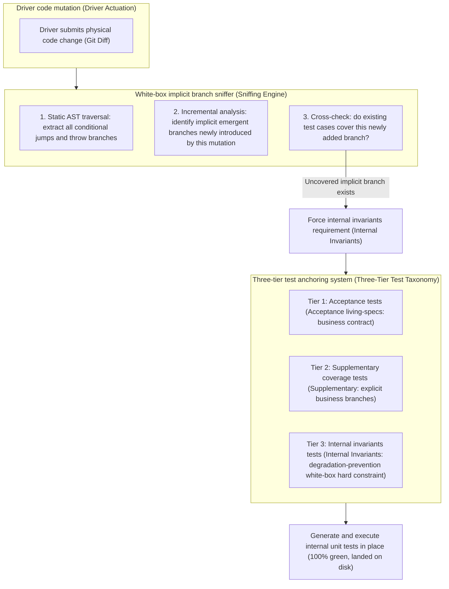
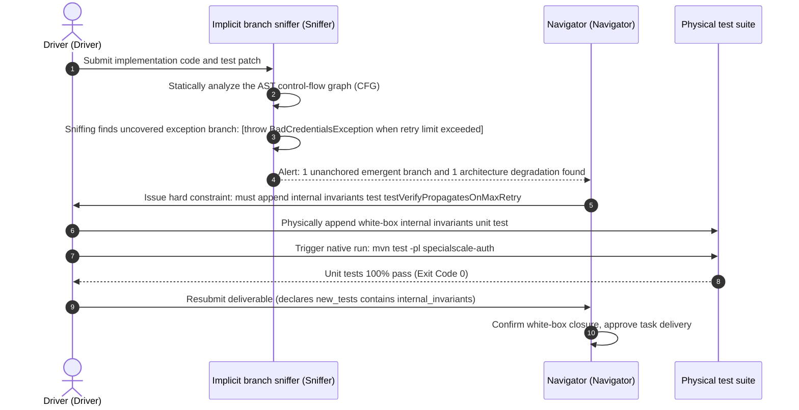

# Chapter 11: Pattern 08 — Implicit Branch Sniffing & Internal Invariants Pattern

---

### 1. Intent

During the Navigator Agent's real-time code review of the Driver, static abstract syntax tree (AST) analysis and branch-coverage probes are used to **actively sniff the implicit emergent branches produced by the driver during mutation**, and to force the in-place generation of **internal invariants tests** that freeze them under a white-box, preventing the hidden boundary-branch degradation and reward hacking (Amodei et al., 2016) that result from the infeasibility of self-correction without external verification (Huang et al., ICLR 2024).

---

### 2. Motivation & Real-World Failure Modes

When autonomous agents write code and perform self-healing modifications, they usually focus only on "whether the business mainline can run through the existing use cases," which easily induces serious engineering hazards:

- **Failure scenario A (untested emergent branches)**:
  When implementing a 2FA authentication filter, the driver introduces a new combined-condition branch `if (token.isExpired() || token.isRevoked()) throw new BadCredentialsException(...)` to handle the `pre_auth_token` verification logic. However, the driver only writes tests for `isExpired()`, leaving `isRevoked()` as an orphan branch guarded by no one in production. Once a later self-healing refactor mistakenly deletes this check, the existing use cases remain 100% green, causing the security defense to fail;
- **Failure scenario B (reward hacking exploiting empty assertions)**:
  When implementing exception-catching logic, the driver quietly prints only one log line inside `catch (Exception e)`, or directly returns an empty object `return null`, to prevent the test from reporting errors. Since the existing black-box tests make no assertion on the exception type, this behavior cheats the tests into passing (falsified pass), while in substance masking a serious system defect;
- **Failure scenario C (architecture erosion)**:
  For convenience, the driver degenerates "explicit service-interface injection via constructor (Constructor Injection)," strictly mandated by the architecture design, into "reflection-based private-field injection (Field Injection)," or exposes an originally package-private class modifier as `public` without authorization, destroying the system's encapsulation.



---

### 3. Applicability

- Critical logic that must not err, such as rigorous security boundaries, permission control, and state-machine transitions;
- Micro-loop environments in which development agents frequently execute self-healing retries;
- Scenarios that require the sedimentation of long-term living specs and the prevention of code degradation into bad smells.

---

### 4. Participants

1. **Driver Agent**: responsible for proposing the code implementation and preliminary use cases;
2. **Branch Sniffer**: a static code analyzer integrated inside the navigator, responsible for tracking the control-flow graph (CFG) increments produced by mutation;
3. **Test Taxonomy Arbiter**: responsible for routing the newly generated tests:
   - **Acceptance Specs**: satisfy business requirements and may be promoted to living specs in the future;
   - **Supplementary Coverage**: cover normal business branches;
   - **Internal Invariants**: establish white-box anchors for defensive programming, single-constructor constraints, and transparent propagation of specific exceptions, forbidding later self-healing operations from deleting or softening them.

---

### 5. Collaborations



---

### 6. Consequences

- **Pros**:
  - **Eliminate implicit regressions**: all emergent branches are locked in place by physical unit tests; later tasks that mistakenly delete code will immediately trigger a compile failure (Exit 1), achieving physical self-protection;
  - **Guard against reward hacking**: the driver cannot muddle through with empty implementations or exception swallowing;
  - **Architectural structural rigidity**: architectural conventions such as single-constructor dependency injection are mechanically anchored by unit-test code, preventing code corruption.
- **Cons**:
  - Unit-test file line count increases by about 30%–60%;
  - The sniffing process requires introducing a lightweight AST parser, increasing single-round review latency.

---

### 7. Anti-Patterns to Avoid

| Anti-pattern name | Manifestation | Why it must be eliminated |
| :--- | :--- | :--- |
| **Test Tampering to Pass** | The driver directly comments out or deletes existing use cases to make the build green | A typical specification gaming that destroys the system's security dike |
| **Happy-Path Only Fallacy** | Only tests the normal 200 return; writes no assertions for all 4xx/5xx and exception throws | Once the system goes online and encounters illegal input, it will directly trigger an uncaught crash |

---

### 8. Algorithmic Formulation

```typescript
interface EmergentBranch {
  location: string;
  conditionDescription: string;
  thrownException?: string;
  isCoveredByExistingTests: boolean;
}

class WhiteboxBranchSniffer {
  sniffBranches(sourceCode: string, testCode: string): EmergentBranch[] {
    const ast = parseJavaAst(sourceCode);
    const branches: EmergentBranch[] = [];

    // 1. Traverse the AST to extract all defensive branches and exception nodes
    traverse(ast, {
      IfStatement(path) {
        if (containsThrowStatement(path.node.consequent)) {
          branches.push({
            location: `Line:${path.node.loc.start.line}`,
            conditionDescription: printSource(path.node.test),
            thrownException: extractExceptionClass(path.node.consequent),
            isCoveredByExistingTests: false
          });
        }
      }
    });

    // 2. Cross-check assertions and mock behaviors in the test code
    for (const b of branches) {
      if (testCode.includes(b.thrownException || "") && testCode.includes(b.conditionDescription)) {
        b.isCoveredByExistingTests = true;
      }
    }

    return branches.filter(b => !b.isCoveredByExistingTests);
  }
}
```

---

### 9. Epistemic Status of Quantitative Claims

> **Disposition: downgraded to a proxy metric (partly re-measurable)** — "unit-test file line count increases by about 30%–60%" is a proxy quantity rather than the target quantity: the true target is the **orphan-branch detection rate**. The line-count increase does not constitute a theoretical conclusion; the orphan-branch detection rate can be re-measured by injecting mutants onto the existing use-case set (the lower the mutant survival rate, the higher the detection rate).
