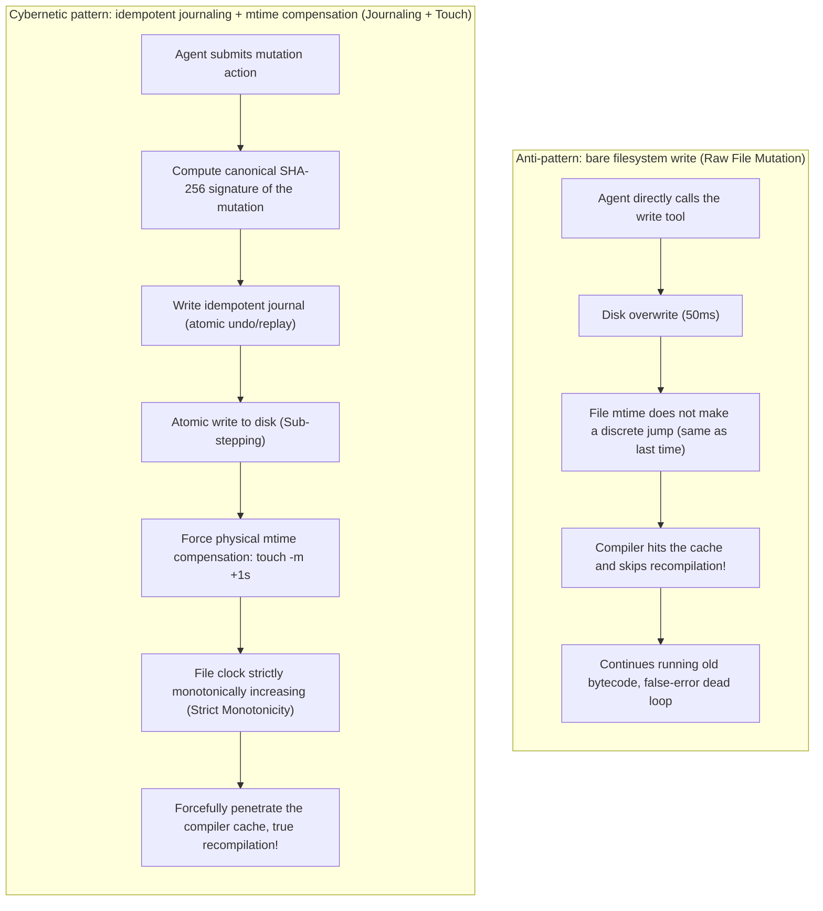
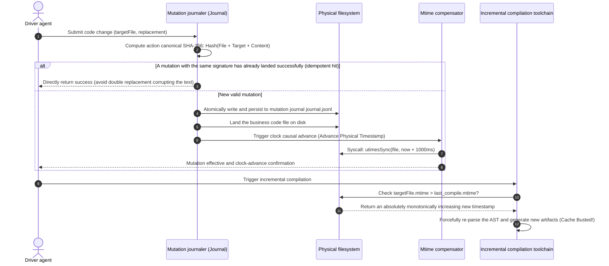

# Chapter 12: Pattern 09 — Idempotent Journaling & Mtime Touch Pattern

---

### 1. Intent

Establish a **canonical SHA-256 signed journal (Idempotent Journaling)** and a **physical filesystem clock compensation mechanism (Mtime Touch Compensation)** for every write operation an agent performs on the physical substrate, resolving mutation superposition misalignment during the agent's self-healing retries, and eliminating the false build state caused by modern compiler cache hits (stale cache) due to millisecond-level high-frequency overwrites.

---

### 2. Motivation & Real-World Failure Modes

In real industrial software engineering, the filesystem and the compiler are strictly causal and time-sensitive:

- **Failure scenario A (retry mutation superposition misalignment)**: an agent invokes the `replace_file_content` tool to repair a line of code; if the first call is interrupted by a network timeout and the agent triggers a retry, the second replacement based on the same line number or text will, because the previous round may have already partially written, cause the target text not to be found, or a double insertion to occur, destroying the code file;
- **Failure scenario B (mtime stagnation causing compiler fake-death)**: when fixing a bug, an agent consumes only 200 milliseconds from reading the file, through analysis, to writing back; the modification time (mtime) of the written file and the previous write fall within the same operating-system timestamp (especially in certain filesystems or packaging tools with second-level timestamp granularity). When `mvn compile` or `webpack` is subsequently triggered, the build tool detects `mtime <= last_build_time` of the file and **directly skips recompilation of that file**, continuing to run the old `.class` bytecode, trapping the agent in the false predicament of "the code was clearly changed but the errors are unchanged";
- **Failure scenario C (empty flow and implicit state loss)**: after an agent performs a write and encounters an exception, it cannot accurately trace back to which historical snapshot the physical disk actually stays at, leaving the self-healing rollback operation with no starting point.



---

### 3. Applicability

- Any modern compiled-language project with an incremental build cache (Java, C++, Rust, Go, TypeScript);
- Involving automatic retry mechanisms or multi-step complex self-healing loops;
- Where absolutely reliable physical state snapshots and rollback support are required.

---

### 4. Participants

1. **Mutation Journal Manager**: computes a canonical content hash and target-file context fingerprint for every write operation, maintaining a forward replay and backward rollback stack;
2. **Atomic Sub-stepper**: decomposes write operations into atomic sub-steps (write to a temporary file, atomic rename move), preventing file corruption caused by half-writes;
3. **Mtime Touch Compensator**: after the write is complete, directly calls low-level operating-system syscalls (such as `fs.utimes` or `touch`), explicitly advancing the target file's `mtime` to the current clock plus 1 second, breaking the incremental compiler's cache-hit condition.

---

### 5. Collaborations



---

### 6. Consequences

- **Pros**:
  - **Eliminate compiler ghost errors**: ensure every code modification triggers physical compilation 100%, ending the debugging nightmare of "the code changed but the bytecode did not";
  - **State replay safely idempotent**: when a network interruption or an agent's mistaken retry trigger occurs, the target source syntax will absolutely not be corrupted.
- **Cons**:
  - Introduces slight filesystem syscall overhead (a few milliseconds per step);
  - Requires system privileges for modifying file metadata in the sandbox environment.

---

### 7. Anti-Patterns to Avoid

| Anti-pattern name | Manifestation | Why it must be eliminated |
| :--- | :--- | :--- |
| **Raw String Replacement** | Directly performing non-idempotent regex replacement on the original file | On retry, since the original characters have already been replaced, the second retry inevitably throws an "anchor not found" exception |
| **Blind System Clock Trust** | Assuming the compiler will naturally perceive the file after it is written | Under modern multi-core and high-frequency mutation, mtime staying within the same second is extremely common, causing incremental compilation to miss files |

---

### 8. Algorithmic Formulation

```typescript
import * as fs from "fs";
import * as crypto from "crypto";

interface MutationEntry {
  journalId: string;
  filePath: string;
  sha256: string;
  appliedTimestamp: number;
}

class IdempotentSubstrateMutator {
  private journal: Map<string, MutationEntry> = new Map();

  async applyMutation(filePath: string, originalContent: string, newContent: string): Promise<boolean> {
    // 1. Compute the mutation fingerprint (Canonical SHA-256)
    const signature = crypto.createHash("sha256")
      .update(filePath)
      .update(originalContent)
      .update(newContent)
      .digest("hex");

    if (this.journal.has(signature)) {
      // Idempotent defense: an exactly identical mutation has already been executed; skip safely
      return true;
    }

    // 2. Atomically write the physical file
    const tmpPath = `${filePath}.tmp.${Date.now()}`;
    await fs.promises.writeFile(tmpPath, newContent, "utf8");
    await fs.promises.rename(tmpPath, filePath);

    // 3. Physical mtime compensation (force timestamp monotonic increase, penetrate the compile cache)
    const compensatedTime = (Date.now() + 1000) / 1000;
    fs.utimesSync(filePath, compensatedTime, compensatedTime);

    // 4. Record into the persistent journal
    this.journal.set(signature, {
      journalId: signature,
      filePath,
      sha256: signature,
      appliedTimestamp: Date.now()
    });

    return true;
  }
}
```
