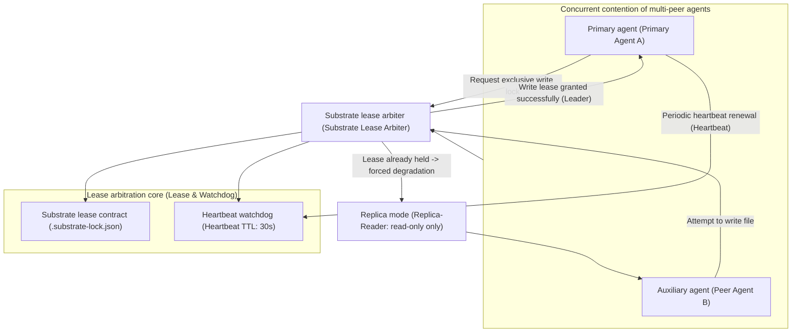
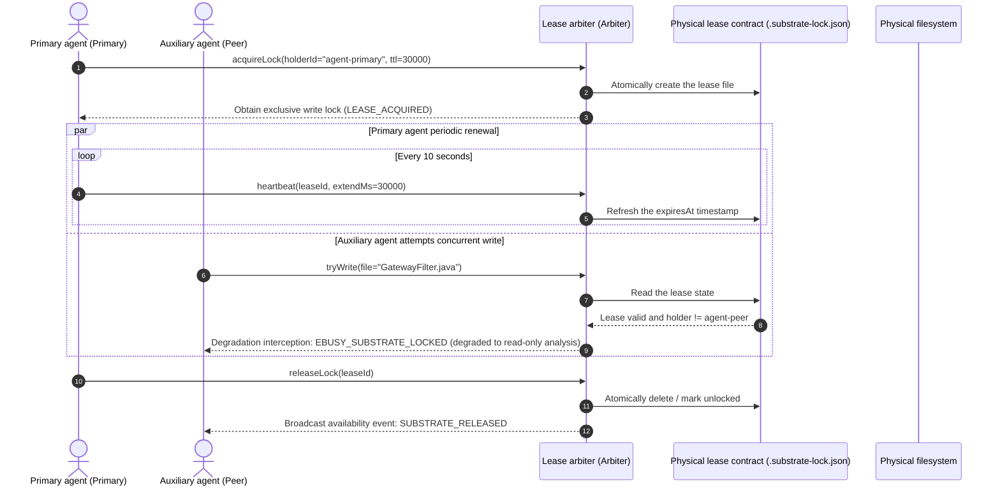

# Chapter 13: Pattern 10 — Substrate Lease Lock & Watchdog Pattern

---

### 1. Intent

In multi-peer-agent (Peer Agents) or heterogeneous extended-agent collaboration scenarios, an exclusive write-lock mechanism based on a lease protocol (Lease Protocol), heartbeat watchdog, and state tamper-proofing verification is established for shared resources of the physical substrate, forcibly degrading agents not holding the lock to primary-writer replica-reader, preventing concurrent code write-write conflicts and deadlocks.

---

### 2. Motivation & Real-World Failure Modes

When an agent system evolves from a monolith into multi-agent concurrent coordination (for example, a pipeline primary agent working concurrently with an IDE-side auxiliary agent, or a code-generation agent with a concurrent unit-test completion agent), traditional lock-free designs inevitably collapse:

- **Failure scenario A (write-write contention causing code tearing)**: two agents edit the same Java class at nearly the same moment concurrently, causing unresolved physical conflict markers (`<<<<<<< HEAD`) to appear in the Git working tree, after which neither side can continue to resolve the syntax;
- **Failure scenario B (deadlock and orphan locks)**: the agent holding the write lock terminates unexpectedly due to model generation timeout, network interruption, or process crash; but because the lock has no timeout renewal mechanism, the entire project is permanently locked (Deadlock), and all subsequent pipeline tasks hang forever;
- **Failure scenario C (unauthorized surreptitious run)**: a secondary agent (such as an auxiliary Q&A agent) directly modifies the code being compiled without authorization, destroying the purity of the environment the primary agent is verifying.



---

### 3. Applicability

- Scenarios where multiple autonomous agents share the same code repository or physical workspace;
- Environments where IDE client plugins (such as Cline, Trae, Cursor) collaborate concurrently with background autonomous pipelines;
- Systems where long-cycle tasks and asynchronous background self-healing tasks run in parallel.

---

### 4. Participants

1. **Lease Arbiter**: an arbitration entity based on file locks or atomic distributed primitives, responsible for lock issuance, renewal, and release;
2. **Lease Contract**: metadata strictly constrained by a machine Schema (including holder ID, holder role, grant timestamp, TTL expiry milliseconds, and verification fingerprint);
3. **Heartbeat Watchdog**: a background asynchronous inspector that, upon detecting that the holder has not sent a heartbeat within the TTL due to a crash, automatically and safely reclaims the lease (Safe Eviction);
4. **Replica-Reader Interceptor**: intercepts write-mutation syscalls from non-lock-holders, converting them into read-only analysis views or in-memory shadow simulation, and forbidding landing on disk.

---

### 5. Collaborations



---

### 6. Consequences

- **Pros**:
  - **Absolute consistency of the physical substrate**: eliminates code tearing and Git conflicts caused by multi-agent concurrent writes (lease mutual exclusion is mechanized in the kernel, Appendix B.4);
  - **Automatic fault immunity and self-healing**: relying on the TTL watchdog mechanism, the unexpected crash of any single-point agent will not deadlock the entire project.
- **Cons**:
  - Requires implementing a periodic heartbeat background coroutine (Goroutine/Timer) at the agent SDK layer;
  - Secondary agents incur a certain queuing latency while waiting for the exclusive lock.

---

### 7. Anti-Patterns to Avoid

| Anti-pattern name | Manifestation | Why it must be eliminated |
| :--- | :--- | :--- |
| **Indefinite Mutex Trap** | Creates the lock only on entry and deletes it only on exit, with no TTL set | Once the agent process is killed by OOM, residual lock files will cause a permanent system deadlock |
| **Optimistic Blind Mutation** | Allows multiple agents to freely overwrite, relying on Git merge afterward | LLMs have extremely poor ability to handle Git conflict markers and easily destroy valid code |

---

### 8. Algorithmic Formulation

```typescript
interface SubstrateLease {
  leaseId: string;
  holderId: string;
  role: string;
  grantedAt: number;
  expiresAt: number;
  checksum: string;
}

class SubstrateLockManager {
  private readonly lockFilePath = ".substrate-lock.json";
  private readonly defaultTtlMs = 30000;

  acquireLock(holderId: string, role: string): boolean {
    const now = Date.now();
    if (fs.existsSync(this.lockFilePath)) {
      const currentLease: SubstrateLease = JSON.parse(fs.readFileSync(this.lockFilePath, "utf8"));
      // Check whether the lease is still valid
      if (now < currentLease.expiresAt && currentLease.holderId !== holderId) {
        return false; // Held by someone else; acquisition failed
      }
    }

    // Issue a new lease
    const newLease: SubstrateLease = {
      leaseId: crypto.randomUUID(),
      holderId,
      role,
      grantedAt: now,
      expiresAt: now + this.defaultTtlMs,
      checksum: this.computeChecksum(holderId, now)
    };

    fs.writeFileSync(this.lockFilePath, JSON.stringify(newLease, null, 2), "utf8");
    return true;
  }

  heartbeat(leaseId: string, holderId: string): boolean {
    if (!fs.existsSync(this.lockFilePath)) return false;
    const lease: SubstrateLease = JSON.parse(fs.readFileSync(this.lockFilePath, "utf8"));
    if (lease.leaseId === leaseId && lease.holderId === holderId) {
      lease.expiresAt = Date.now() + this.defaultTtlMs;
      fs.writeFileSync(this.lockFilePath, JSON.stringify(lease, null, 2), "utf8");
      return true;
    }
    return false;
  }
}
```
