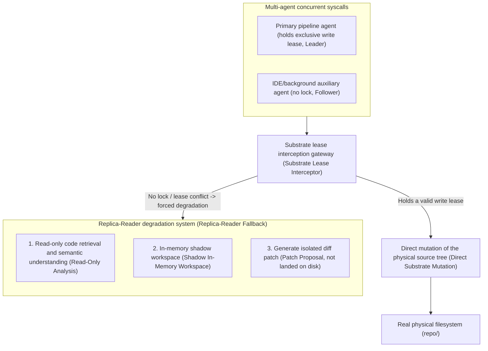

# Chapter 14: Pattern 11 — Primary-Writer Replica-Reader Pattern

---

### 1. Intent

In a distributed-system environment of collaborative evolution among multi-peer agents (Peer Agents), auxiliary agents not holding the exclusive write lease (Lease, Gray & Cheriton, SOSP 1989) are **forcibly degraded into read-only analysis replica nodes (Replica-Reader)** according to causal ordering and substrate lease state. Through atomic interception of physical write calls and redirection to an in-memory shadow scratchpad, code tearing and Git working-tree deadlock caused by concurrent blind mutation are eliminated.

---

### 2. Motivation & Real-World Failure Modes

As multi-agent collaboration architectures evolve from the traditional "monolithic pipeline" toward "multi-end peer collaboration" (for example, developers running auxiliary extensions inside the IDE, CI/CD running autonomous pipelines, and code-review agents concurrently issuing suggestions), multi-agent simultaneous state writes to the same workspace become an inescapable physical reality:

- **Failure scenario A (write-write conflict causing code tearing, split-brain code tearing)**:
  While the primary pipeline is running unit-test compilation of the gateway module, the IDE-side auxiliary agent — without knowledge of the underlying build-lock state — responds to the user's interactive instruction by directly modifying the module's POM file or the same Java class, causing conflict markers in the underlying Git and the executing compilation to crash instantly;
- **Failure scenario B (concurrent contamination of environment purity, substrate contamination)**:
  The auxiliary agent attempts to "self-heal code" in the background and unauthorizedly executes `git reset --hard` or `mvn clean`, directly erasing the temporary bytecode or intermediate artifacts just written but not yet committed by the main pipeline;
- **Failure scenario C (brutal interruption imposing user cognitive burden, lock-out starvation)**:
  If the non-lock-holding agent process is simply and brutally killed, human-agent interaction continuity is destroyed, and the developer encounters abrupt error popups in the terminal or IDE interface.



---

### 3. Applicability

- Multiple agents from different vendors or processes (such as self-built CI pipelines and various IDE coding agents) connecting to the same enterprise engineering repository;
- Scenarios with clear primary-standby responsibility division (Leader-Follower) requiring absolute purity of the primary pipeline build;
- Collaboration architectures that allow replica nodes to propose code suggestions but strictly forbid them from landing on disk privately.

---

### 4. Participants

1. **Primary-Writer**: the agent that has successfully obtained the exclusive write right (Leader) through the distributed substrate lease lock (Pattern 10), possessing the privileges of directly modifying the physical filesystem and native building;
2. **Replica-Reader**: the peer agent that did not win the write lease; its write permission is transparently stripped by the interception gateway, and it is automatically degraded into an observer and suggester;
3. **Lease Degradation Interceptor**: middleware located between operating-system syscalls (FS Tool Calls) and the physical disk, responsible for authentication and enforcing degradation;
4. **Shadow Scratchpad**: a stateless temporary memory or isolated branch opened for the replica reader, allowing it to rehearse code patches in virtual space without ever contaminating the physical mainline.

---

### 5. Collaborations

```mermaid
sequenceDiagram
    autonumber
    actor Primary as Primary agent (holds lease)
    actor Peer as Auxiliary agent (replica role)
    participant Interceptor as Lease interception middleware
    participant Lock as Lease contract (.substrate-lock.json)
    participant Substrate as Physical filesystem
    participant Shadow as Shadow patch buffer pool

    Primary->>Lock: Maintain the exclusive lease (Lease Active)
    
    par Primary agent works normally
        Primary->>Interceptor: write_to_file("TwoFactorAuthEndpoint.java", content)
        Interceptor->>Lock: Verify lease ownership (Primary matched)
        Interceptor->>Substrate: Physically write the source file
        Interceptor-->>Primary: Write succeeded (physically effective)
    and Auxiliary agent concurrently attempts mutation
        Peer->>Interceptor: replace_file_content("TwoFactorAuthEndpoint.java", patch)
        Interceptor->>Lock: Verify lease ownership (Peer holds no lock)
        note over Interceptor,Peer: Trigger primary-writer replica-reader degradation (Downgrade to Replica-Reader)
        Interceptor->>Shadow: Write the change into the virtual shadow diff pool (patch.diff)
        Interceptor-->>Peer: Return soft success: prompt "substrate is occupied; the code has been converted to an offline proposal patch"
    end

    Primary->>Lock: Release the exclusive write lease (Release)
    Lock-->>Interceptor: Broadcast substrate idle event (SUBSTRATE_UNLOCKED)
    Interceptor->>Peer: Approve requesting atomic confluence from the shadow buffer pool into the mainline
```

---

### 6. Consequences

- **Pros**:
  - **Zero contamination of the physical substrate**: avoids Git index corruption, double file modification, and compile fake-death caused by multi-agent contention;
  - **Continuous, uninterrupted user experience**: the non-lock-holding agent does not crash directly, but continues to provide interactive support in the form of read-only or suggested patches;
  - **Compliance with the classic distributed causal law (Lamport, 1978)**: write operations have a globally unique total-order causal arrangement.
- **Cons**:
  - Requires virtualizing file write operations at the platform layer (shadow patch mechanism);
  - Patches produced by replica nodes require an additional confluence approval process.

---

### 7. Anti-Patterns to Avoid

| Anti-pattern name | Manifestation | Why it must be eliminated |
| :--- | :--- | :--- |
| **Blind Lockless Mutation** | Allows multiple agents to freely contend for writing to the same workspace | Inevitably causes code tearing and compiler-state disorder |
| **Hard Kill Starvation** | Detects a non-lock-holder's write operation and directly force-kills the process | Destroys the human-agent interaction experience and causes unpredictable data loss |

---

### 8. Algorithmic Formulation

```typescript
interface WriteRequest {
  agentId: string;
  filePath: string;
  newContent: string;
}

class PrimaryWriterReplicaReaderInterceptor {
  private leaseManager: SubstrateLeaseManager;
  private shadowBuffer: Map<string, string> = new Map();

  async interceptWrite(req: WriteRequest): Promise<WriteVerdict> {
    const isPrimary = this.leaseManager.hasExclusiveLease(req.agentId);

    if (isPrimary) {
      // 1. Primary agent: physical landing on disk
      await fs.promises.writeFile(req.filePath, req.newContent, "utf8");
      return { success: true, mode: "PHYSICAL_DIRECT", message: "Written to substrate" };
    }

    // 2. Replica node: forced degradation to shadow buffering
    const shadowKey = `${req.agentId}:${req.filePath}`;
    this.shadowBuffer.set(shadowKey, req.newContent);

    return {
      success: true,
      mode: "SHADOW_REPLICA_BUFFERED",
      message: "Substrate locked by primary agent. Changes preserved as offline proposal patch."
    };
  }
}
```

---

### 9. Epistemic Status and Formal Anchors

> **Theoremizable (proven, zero sorry)**: the core concurrency claim of this pattern has been verified in the Lean 4 kernel, module `Pattern11_PrimaryWriter` (`formal_proof/IACFormalization`), corresponding to Appendix B.9.

- The single-writer premise is not an additional convention: `writer_unique_of_lease` is directly derived from Pattern 10's `canWrite_unique` — at any instant, at most one agent holds write permission.
- Write journal layer: `eq_of_mem_of_tick_eq` proves that within a legal journal, the same tick is the same event; `writer_unique_per_tick` gives "same tick, same writer," i.e., concurrent write-write conflict is impossible within the protocol.
- Read consistency: `view_mono` and `no_lost_write` prove that the replica reader's view is a **complete prefix** — a later read contains all events of an earlier read, and any committed event is necessarily visible; there exists no view that "skips intermediate commits."

Falsifiability metric for the corollary: after the primary writer commits, the set of events read by the replica reader must equal the journal prefix "tick ≤ read time"; if missing or out-of-order events are observed, then the theorem's premises (strictly monotonic clock, lease mutual exclusion) do not hold in the implementation.
