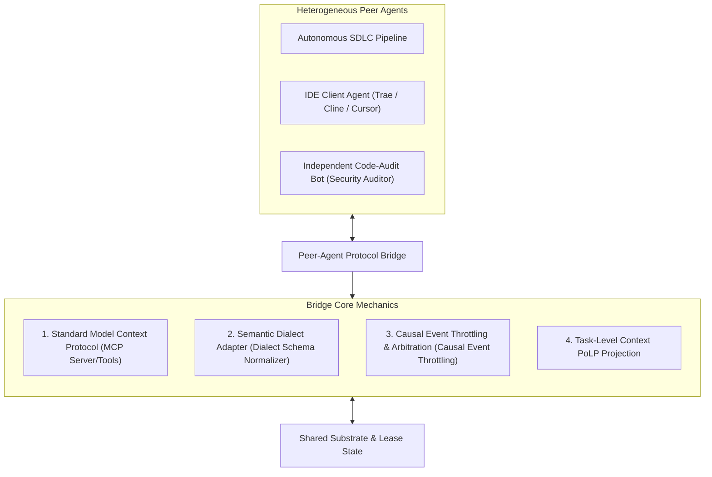
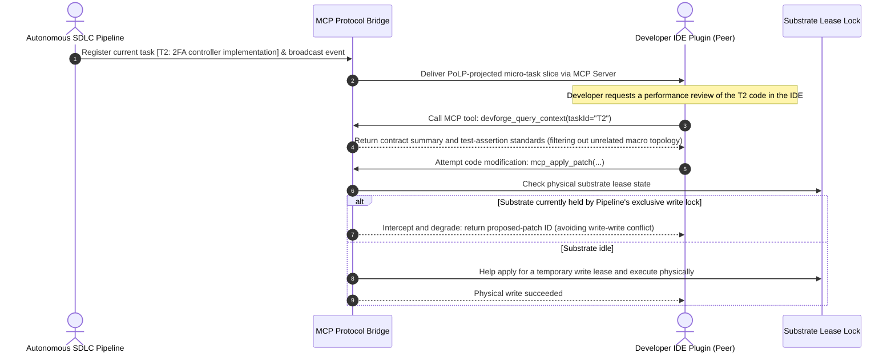
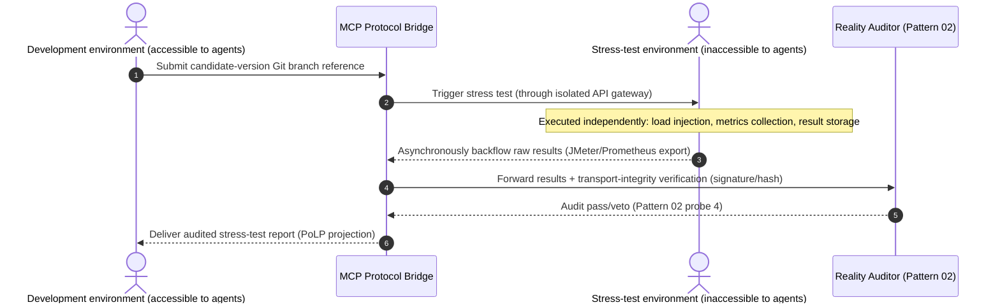

# Chapter 15: Pattern 12 — Peer-Agent Protocol Bridge Pattern

---

### 1. Intent

Through a standardized Model Context Protocol (MCP) and a Peer-Agent Event Bus, establish **asymmetric capability negotiation, bidirectional context projection, and causal state relay** among heterogeneous agent runtimes (such as autonomous background pipelines, IDE client plugins, and code-review bots), breaking down the data silos and semantic barriers of vendor-specific agent ecosystems.

---

### 2. Motivation & Real-World Failure Modes

In modern software-engineering practice, an enterprise can never rely solely on a single vendor's closed agent product. A typical production environment is heterogeneous by construction: an in-house end-to-end SDLC orchestration pipeline runs in the background, front-end developers use plugins based on MCP or custom protocols inside their IDEs (such as Trae, Cline, Cursor), and third-party security-audit bots are attached externally.

When these **heterogeneous agents** attempt to collaborate on the same code substrate, the following failures typically arise:

- **Failure Mode A (Semantic Tower of Babel)**:
  Different agents follow different internal state-machine definitions (e.g., the pipeline marks the current state as `pm_gate_passed`, while the IDE client only understands a simple `review_pending`); the absence of a semantic translation layer prevents each side from understanding the other's progress intent;
- **Failure Mode B (Blind Full Context Hard-Copy Triggers Context Rot)**:
  To brief the IDE-side agent on the background pipeline, developers cram hundreds of pages of background logs and full gate reports wholesale into MCP resources — directly causing severe context rot in the IDE agent (Liu et al., 2024) and destroying its basic code-analysis capability;
- **Failure Mode C (Event Storm & Race Conditions)**:
  Multiple agents watch workspace file changes through unordered polling; one agent's file modification triggers another agent's automatic build, which in turn triggers a third agent's Git commit, and the system sinks into an infinite loop of event storms.



---

### 3. Applicability

- Scenarios where an enterprise needs to connect an autonomous pipeline with developers' desktop IDE programming assistants;
- Multi-agent heterogeneous architectures that mix different large language models (such as Claude, Gemini, DeepSeek, and locally deployed private models);
- Systems that need to standardize the exposure of engineering progress, the evidence chain (Evidence), and gate-scoring results to third-party audit tools.

---

### 4. Participants

1. **Protocol Bridge Host**: runs as an MCP server or lightweight gateway, exposing a unified standard tool set to external peer agents (e.g., `devforge_record_evidence`, `devforge_score_jev`);
2. **Dialect Adapter**: converts external agents' private-contract requests into the pipeline's core specification (e.g., normalizing task lists of arbitrary formats into the standard `TaskOutline`);
3. **Causal Event Bus**: broadcasts key milestone events (`PHASE_TRANSITION`, `SUBSTRATE_LOCKED`, `TESTS_RESOLVED`) in Lamport causal order, blocking cyclic triggering;
4. **Projection Filter**: follows the Principle of Least Privilege (PoLP), delivering only a summarized slice of the currently focused task to external peer agents, preventing context rot.

---

### 5. Collaborations



---

### 6. Consequences

- **Pros**:
  - **Cross-vendor decoupled interop**: any agent supporting standard MCP or generic Tool Calling can join the collaboration seamlessly, without refactoring the underlying architecture;
  - **Seamless ecosystem reuse**: lightweight desktop IDEs can directly borrow the heavyweight background pipeline's Jev gate, physical compiler, and test-sandbox capabilities;
  - **Causal consistency assurance**: calms the file-event storms caused by blind multi-agent concurrency.
- **Cons**:
  - Requires maintaining protocol translation and serialization overhead across toolchains;
  - Relies on network RPC or local IPC inter-process communication channels.

---

### 6.1 Typical Extension Scenario: Asynchronous Result Backflow from Isolated Environments (Stress-Test Feedback Loop)

When the stress-test environment is fully isolated from the development environment, the protocol bridge takes on the key role of **asynchronous result backflow**:



**Refined responsibilities of the protocol bridge in this scenario**:

1. **Result format normalization**: convert the stress-test environment's native outputs (JMeter XML, Gatling HTML, Prometheus metrics) into the standard `StressTestReport` contract;
2. **Transport integrity assurance**: signature verification and hash checking on the result backflow channel, preventing selective reporting or tampering;
3. **Environment fingerprint collection**: synchronously collect the stress-test environment's configuration fingerprint (OS/kernel/dependency versions/resource quotas) for the auditor's homogeneity check;
4. **Event throttling & causal ordering**: stress-test results are broadcast as `STRESS_TEST_COMPLETE` events in Lamport causal order, ensuring the development environment's state machine updates its reference clock correctly.

> **Theoretical anchor**: an extension of Axiom III — stress-test results act as physical clock events that drive the update of the next mutation's reference clock $R$.

---

### 7. Anti-Patterns to Avoid

| Anti-pattern | Manifestation | Why it must be eradicated |
| :--- | :--- | :--- |
| **Proprietary Silo Syndrome** | Every agent invents its own proprietary RPC interface or private data format | Causes tool-integration costs to explode quadratically as $O(N^2)$ |
| **Unfiltered Broadcast Flooding** | Pushes the pipeline's ten-thousand-line compile console stream indiscriminately to the IDE agent | Induces severe context rot, paralyzing the assistant agent's reasoning |

---

### 8. Algorithmic Formulation

```typescript
interface McpToolDefinition {
  name: string;
  description: string;
  parameters: object;
}

class PeerAgentProtocolBridge {
  private mcpServer: McpServer;
  private leaseManager: SubstrateLeaseManager;

  registerStandardTools(): void {
    // 1. Expose standard read-only contract lookup tools (with PoLP projection built in)
    this.mcpServer.tool(
      "devforge_get_task_slice",
      "获取当前子任务的最小特权架构设计切片",
      { taskId: { type: "string" } },
      async ({ taskId }) => {
        const fullDesign = await this.readGlobalDesign();
        const slice = TaskLevelContextProjector.project(taskId, fullDesign);
        return { content: [{ type: "text", text: JSON.stringify(slice) }] };
      }
    );

    // 2. Expose safe collaborative code-patch tools (with lease mutual exclusion built in)
    this.mcpServer.tool(
      "devforge_propose_patch",
      "向当前工程提交代码变更建议 (受底座租约锁保护)",
      { patchDiff: { type: "string" }, rationale: { type: "string" } },
      async ({ patchDiff, rationale }) => {
        if (this.leaseManager.isLockedByOther("peer-ide-agent")) {
          const proposalId = await this.saveToShadowBuffer(patchDiff, rationale);
          return { content: [{ type: "text", text: `Substrate occupied. Buffered as proposal ${proposalId}` }] };
        }
        await this.applyPhysicalPatch(patchDiff);
        return { content: [{ type: "text", text: "Patch successfully applied to physical substrate." }] };
      }
    );
  }
}
```
