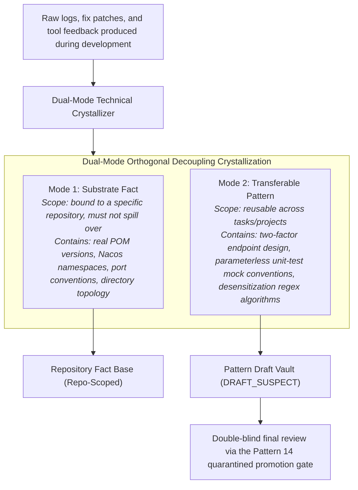

# Chapter 16: Pattern 13 — Dual-Mode Technical Crystallization Pattern

---

### 1. Intent

Subject the experience an agent acquires over the software-engineering lifecycle to a strict **Single-Source Orthogonal Decoupling**, separating it into **Substrate Facts** about the target project's physical reality and **Transferable Patterns** that generalize across projects, thereby preventing environment-specific parameters (such as ports, paths, and version numbers) from becoming interwoven with general algorithmic logic and causing memory poisoning (Memory Poisoning, MemoryGraft, 2025) and model collapse (Model Collapse, Shumailov et al., *Nature* 2024).

---

### 2. Motivation & Real-World Failure Modes

In many systems that introduce "lifelong learning" or "memory augmentation" into agents (e.g., the Voyager skill library, Wang et al., 2023), experience-distillation mechanisms typically adopt indiscriminate plain-text concatenation or vectorized storage. In large-scale software engineering this readily triggers severe knowledge degradation:

- **Failure Mode A (Leakage of Ephemeral Facts as Universal Experience)**:
  When the agent was solving the `pigx__gw__004` gateway task, the local sandbox's gateway port was randomly mapped to `19999`, and the agent stored "the gateway port must be configured as 19999" as a "universal best practice" in the global pattern library. Later, when another task (e.g., the Auth authentication service) retrieved knowledge, it mistakenly adopted this entry, causing a hard-coded conflict in the service's startup port;
- **Failure Mode B (Tainted Generalization of Temporary Patches)**:
  While troubleshooting a dependency conflict, the agent temporarily excluded (exclude) a low-level transitive dependency in a sub-POM. This ad hoc action was indiscriminately generalized into "whenever this library is introduced, the underlying dependency must be excluded", causing subsequent microservice modules to fail with `NoClassDefFoundError` due to missing base classes;
- **Failure Mode C (Non-Canonical Knowledge Bloat and Conflicts)**:
  The same fact (e.g., the GroupId of a common microservice base module) was repeatedly distilled by different task agents, in different phrasings, into dozens of fragments; lacking a canonical single-source constraint, the knowledge base fragmented and swelled rapidly, and retrieval-matching accuracy degraded quickly.



---

### 3. Applicability

- Autonomous R&D pipeline platforms that batch-process multi-repository, multi-tech-stack tasks;
- Scenarios that require safely sharing code patterns across projects while eliminating cross-contamination of environment parameters;
- Knowledge-management systems with self-distilling experience and automatic documentation generation.

---

### 4. Participants

1. **Dual-Mode Crystallizer**: the agent that performs information-theoretic extraction over the code diff and the navigator's review logs after a task passes local verification;
2. **Fact Filter**: tags environmental facts — absolute file paths, specific IP addresses, ephemeral port numbers, temporary usernames and passwords, and the like — with `Scope: REPOSITORY_LOCAL`, prohibiting them from leaving the repository;
3. **Pattern Abstractor**: elevates concrete business-class implementations into abstract, transferable design patterns (including applicable context, core interface-contract pseudocode, and anti-pitfall checklists), assigning each a unique canonical identifier;
4. **Canonical Deduplicator**: ensures, via SHA-256 signing and semantic deduplication, that each class of facts or patterns maintains a single source of truth (SSOT) in the knowledge base.

---

### 5. Collaborations

```mermaid
sequenceDiagram
    autonumber
    actor Dev as Development Agent
    participant Crystal as Dual-Mode Crystallizer
    participant FactDB as Local Repository Fact Base (Local Facts)
    participant PatternDB as Global Pattern Draft Vault (Global Patterns)

    Dev->>Crystal: Submit verified task deliverables and self-healing logs
    Crystal->>Crystal: Execute dual-mode decoupling semantic parsing
    
    rect rgb(240, 255, 240)
        note right of Crystal: Substrate-Fact distillation (Repo-Specific)
        Crystal->>FactDB: Write: "specialscale-gateway POM version pinned at 5.10.0-SNAPSHOT"
        Crystal->>FactDB: Write: "Actuator health-probe endpoint is /actuator/info"
    end
    
    rect rgb(255, 248, 220)
        note right of Crystal: Transferable-Pattern distillation (Transferable Pattern)
        Crystal->>PatternDB: Write draft: "Response-header safe-desensitization pattern based on WebFlux ServerHttpResponseDecorator"
        note over PatternDB: Forced state DRAFT_SUSPECT, pending overall-acceptance final review
    end
    
    Crystal-->>Dev: Crystallization complete; dual-mode assets archived
```

---

### 6. Consequences

- **Pros**:
  - **Blocks memory poisoning at the root**: environment-specific hard codes can never escape into the global layer, preventing later agents from being misled;
  - **Maximized knowledge compounding**: the distilled transferable patterns are highly generalizable; when a new task is onboarded, mature design templates can be hit directly, cutting exploration rounds by more than 50%;
  - **Model-collapse defense**: knowledge washed through strict structured cleaning avoids the model feeding on its own low-quality hallucinations during later fine-tuning or context backfill (Shumailov et al., *Nature* 2024).
- **Cons**:
  - An extra round of structured information-extraction inference overhead is required at task end;
  - Strict structured schemas must be defined to constrain the attribute fields of facts and patterns.

---

### 7. Anti-Patterns to Avoid

| Anti-pattern | Manifestation | Why it must be eradicated |
| :--- | :--- | :--- |
| **Raw Memory Dumping** | Vectorizing and ingesting the entire interaction dialogue of the development process as Memory | Mixes irrelevant chatter and failed errors with correct experience, causing severe retrieval-time misdirection |
| **Global Fact Spillover** | Allows agents to share local-specific ports and credentials as "standard specifications" with other repositories | Breaks other independent projects' infrastructure and network topology |

---

### 8. Algorithmic Formulation

```typescript
interface CrystallizedAsset {
  assetType: "SUBSTRATE_FACT" | "TRANSFERABLE_PATTERN";
  scope: "LOCAL_REPO" | "GLOBAL_CROSS_REPO";
  canonicalKey: string;
  payload: object;
}

class DualModeTechnicalCrystallizer {
  categorizeAndPersist(executionTrace: SDLCExecutionTrace): CrystallizedAsset[] {
    const assets: CrystallizedAsset[] = [];

    // 1. Extract substrate facts (hard constraint: strictly limited to LOCAL_REPO)
    for (const fact of executionTrace.discoveredFacts) {
      if (this.containsEphemeralEnvironmentDetail(fact)) {
        assets.push({
          assetType: "SUBSTRATE_FACT",
          scope: "LOCAL_REPO",
          canonicalKey: `repo:${executionTrace.repoId}:${fact.key}`,
          payload: { detail: fact.value, validatedAt: Date.now() }
        });
      }
    }

    // 2. Extract transferable patterns (sanitize and abstract into generic design specifications, placed in quarantine for now)
    for (const pattern of executionTrace.discoveredPatterns) {
      const sanitizedPattern = this.stripSubstrateSpecifics(pattern);
      assets.push({
        assetType: "TRANSFERABLE_PATTERN",
        scope: "GLOBAL_CROSS_REPO",
        canonicalKey: `pattern:${sanitizedPattern.patternName}`,
        payload: {
          designSchema: sanitizedPattern.schema,
          antiPatterns: sanitizedPattern.avoidedPitfalls,
          lifecycleStatus: "DRAFT_SUSPECT" // poison-defense via Pattern 14
        }
      });
    }

    return assets;
  }
}
```

---

### 9. Epistemic Status of Quantitative Claims

> **Disposition: downgraded to an empirical target (unverified)** — "cutting exploration rounds by more than 50%" depends on task distribution and template hit rate, with no preregistered criteria. It is marked as an **engineering empirical target**; to be promoted, one must first fix the task family, the counting convention for "exploration rounds", and the decision rule for a "hit", and then run a paired comparison.
