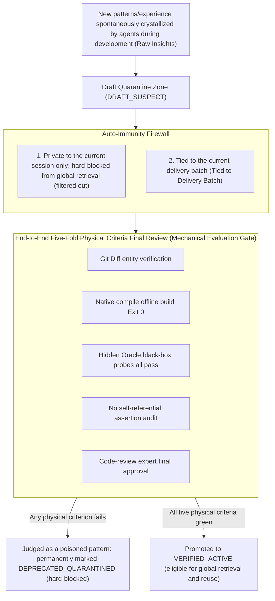
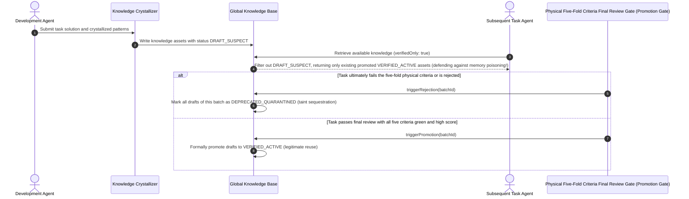

# Chapter 17: Pattern 14 — Quarantined Promotion Gate Pattern

---

### 1. Intent

Establish for knowledge assets a mechanism of **single-source crystallization, draft quarantine, and double-blind promotion gates**: all self-generated experience (Rules/Patterns) distilled by agents during R&D execution is by default marked as a suspicious draft (`DRAFT_SUSPECT`), and is promoted to a globally active asset (`VERIFIED_ACTIVE`) only after overall acceptance fully passes the objective physical five-fold criteria, thereby blocking memory poisoning caused by cross-generational transmission of erroneous experience.

---

### 2. Motivation & Real-World Failure Modes

In many agent systems endowed with "self-learning" or "knowledge distillation" capabilities, the most dangerous phenomenon is **memory poisoning** — self-generated experience that has not passed final review, once retrieved and reused, exerts persistent contamination on subsequent tasks; this recursive self-consumption has been confirmed at the macroscopic level by empirical research to cause model collapse (Shumailov et al., *Nature* 631, 2024):

- **Failure Mode A (Self-reinforcement of erroneous experience)**: midway through a task, the agent, to fix an error, wrote a wrong rule: "when encountering a Redis dependency, downgrade the version to 2.1". The agent immediately wrote this experience into the global knowledge base. Yet the task's final evaluation collapsed completely. Unfortunately, the next 10 agents, on startup, retrieved this "experience" and all erroneously downgraded the dependency during initialization, triggering a cascading avalanche across the global pipeline;
- **Failure Mode B (Proliferation of tainted code patterns)**: the agent introduced an anti-pattern while writing code (e.g., writing raw SQL directly in a Controller); lacking a promotion gate, this code pattern was crystallized as a "best-practice template" and then spread like a virus across the entire project;
- **Failure Mode C (Leakage of unfinished knowledge)**: half-baked knowledge from an ongoing self-healing attempt is read by other concurrently running agents, causing them to work on unverified assumptions.



---

### 3. Applicability

- Autonomous agent systems with long-term memory or self-distilling code-snippet capabilities;
- Self-evolving platforms that batch-process similar business modules or benchmark task sets;
- Enterprise-grade core-asset repository distillation and automatic knowledge-graph construction.

---

### 4. Participants

1. **Crystallizer**: automatically extracts reusable technical patterns and fact descriptions after the agent completes a micro-fix;
2. **Quarantine Vault**: independently stores assets that have not passed final review, forcibly tagging them `status: "DRAFT_SUSPECT"` and hard-filtering them out of regular vector or keyword retrieval;
3. **Promotion Gate Arbiter**: the supreme arbiter of end-to-end physical inspection, triggering batch promotion only after the entire delivery pipeline withstands real black-box physical probe testing;
4. **Tainted Tagger**: for drafts produced by rejected or ultimately failed tasks, assigns the `DEPRECATED_QUARANTINED` tag and archives them to a blacklist, permanently prohibiting them from leaving the repository.

---

### 5. Collaborations



#### Extended Trigger Conditions: Stress-Test Results from Isolated Environments

When the stress-test environment is fully isolated from the development environment, **stress-test failure** serves as an explicit trigger condition for DRAFT_SUSPECT:

1. **Stress-test failure**: if the candidate version fails to reach the preregistered SLA threshold in the isolated stress-test environment (e.g., P99 latency degradation rate > threshold, error rate > threshold), then even if the development environment's five-fold criteria are all green, all drafts of this batch remain marked `DRAFT_SUSPECT` and promotion is prohibited;
2. **Missing stress-test results**: if no isolated-environment stress-test results are received within the preregistered time limit after the candidate version is submitted, the batch's drafts remain `DRAFT_SUSPECT` until results are backflowed and pass Pattern 02 probe 4 audit;
3. **Environmental homogeneity deviation**: if the stress-test environment's configuration fingerprint deviates from the production environment beyond the preregistered tolerance, the results are deemed invalid, the drafts remain `DRAFT_SUSPECT`, and an environment-repair process is triggered.

> **Theoretical anchor**: an extension of the applicability boundary of Axiom IV — results from isolated environments form part of "SubstratePass"; unaudited isolated-environment results may not serve as a basis for promotion.

---

### 6. Consequences

- **Pros**:
  - **Knowledge-base self-cleaning immunity**: fundamentally eliminates the self-propagation and cross-generational transmission of shoddy code and erroneous experience within the system;
  - **Positive compounding effect**: every pattern entering `VERIFIED_ACTIVE` has passed strict testing by the real physical world, yielding extremely high accuracy when reused by later tasks.
- **Cons**:
  - Knowledge reuse has a time lag: within the same task batch, one cannot immediately benefit from experience being crystallized by the current batch;
  - Maintaining metadata state lifecycles requires additional storage and index-management logic.

---

### 7. Anti-Patterns to Avoid

| Anti-pattern | Manifestation | Why it must be eradicated |
| :--- | :--- | :--- |
| **Unverified Eager Ingestion** | The agent writes one line of code and immediately ingests it into shared Memory as a best practice | Once the code contains a fatal defect, it will rapidly poison the entire system's memory network |
| **Stateless Taint Blindness** | Erroneous knowledge produced by failed tasks is left unmarked and allowed to remain in the repository | Causes knowledge-base fragmentation to run out of control, with historical garbage experience severely interfering with future decisions |

---

### 8. Algorithmic Formulation

```typescript
type KnowledgeLifecycle = "DRAFT_SUSPECT" | "VERIFIED_ACTIVE" | "DEPRECATED_QUARANTINED";

interface KnowledgePattern {
  id: string;
  patternName: string;
  codeSnippet: string;
  lifecycle: KnowledgeLifecycle;
  associatedBatchId: string;
}

class SelfImmuneKnowledgeBase {
  private patterns: KnowledgePattern[] = [];

  // 1. Crystallization ingestion: quarantined by default
  ingestDraftPattern(pattern: Omit<KnowledgePattern, "lifecycle">): void {
    this.patterns.push({
      ...pattern,
      lifecycle: "DRAFT_SUSPECT" // forced quarantine
    });
  }

  // 2. Retrieval defense: by default only expose assets that have passed final review
  queryVerifiedPatterns(filter: { verifiedOnly?: boolean }): KnowledgePattern[] {
    const verifiedOnly = filter.verifiedOnly !== false;
    return this.patterns.filter(p => {
      if (p.lifecycle === "DEPRECATED_QUARANTINED") return false; // hard taint interception
      if (verifiedOnly && p.lifecycle !== "VERIFIED_ACTIVE") return false;
      return true;
    });
  }

  // 3. Final-review adjudication and promotion
  adjudicateBatch(batchId: string, passedPhysicalGate: boolean): void {
    const targetState: KnowledgeLifecycle = passedPhysicalGate ? "VERIFIED_ACTIVE" : "DEPRECATED_QUARANTINED";
    this.patterns
      .filter(p => p.associatedBatchId === batchId && p.lifecycle === "DRAFT_SUSPECT")
      .forEach(p => {
        p.lifecycle = targetState;
      });
  }
}
```
