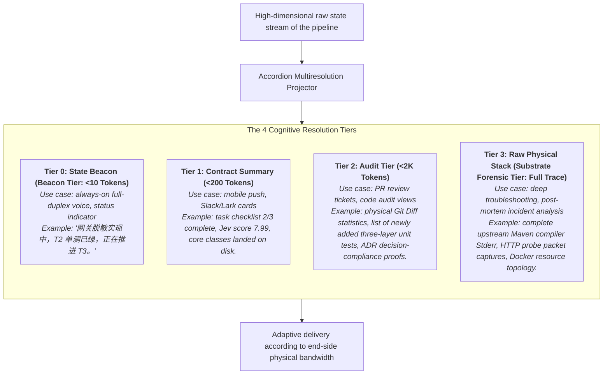
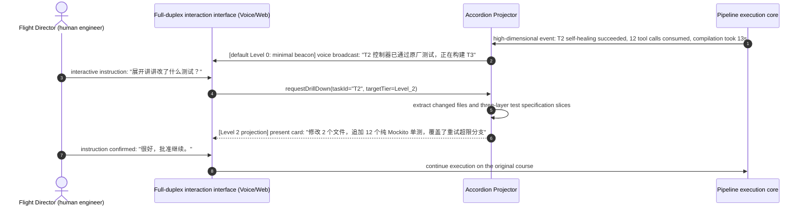

# Chapter 19: Pattern 16 — Accordion Multiresolution Projection Pattern

---

### 1. Intent

Establish a **dynamic multiresolution asymmetric cognitive projection mechanism** between human engineers and the autonomous agent system. According to the physical bandwidth of the interaction channel (e.g., full-duplex real-time voice, mobile notifications, desktop console) and the human attention state, the high-volume, high-dimensional engineering execution state is freely stretched like an accordion into a **"One-Sentence Beacon"**, a **"Phase Summary"**, or a **"Full Physical Trace"**, eliminating context rot and cognitive overload in human–machine interaction.

---

### 2. Motivation & Real-World Failure Modes

In end-to-end autonomous software engineering systems, a single requirement evolution by an agent may produce tens of thousands of lines of compiler console output, hundreds of tool-call logs, and complex dependency-graph analyses. Without cognitive-resolution management for human–machine interaction, severe failures polarize into two extremes:

- **Failure Mode A (Console Vomiting)**:
  At every step the pipeline executes, it regurgitates to the human user tens of thousands of characters of raw upstream compiler Stderr, Maven download progress, and the full JSON state. Faced with this flood of scrolling information, a human engineer cannot possibly grasp the core issue within seconds (e.g., a missing critical permission class), and is forced to spend dozens of minutes searching manually — completely losing the agility of "autonomous collaboration";
- **Failure Mode B (Context Rot in Voice/Mobile Interaction)**:
  When progress is reported to an engineer through a voice assistant or a mobile device, if the agent mechanically reads aloud long class names and code diffs, human working memory collapses within 10 seconds. Meanwhile, the verbose text severely blocks bidirectional interaction on the full-duplex voice channel;
- **Failure Mode C (Opaque Gloss-Over — Reporting Only Good News)**:
  The opposite extreme is over-simplification: the agent merely replies "一切正常", while concealing from the human the high-risk physical fact that "three compile self-healing rollbacks have already been triggered and sensitive security configurations are being modified" — causing the system to slip out of human course control.



---

### 3. Applicability

- Autonomous systems connected to a real-time voice dialogue channel (e.g., full-duplex WebRTC / mobile voice assistants);
- Enterprise collaboration platforms that must support multi-device linkage (phone for summaries, IDE for assertions, terminal for physical logs);
- "Air Traffic Control" scenarios in which a senior engineer supervises dozens of autonomous agents working in parallel.

---

### 4. Participants

1. **Substrate Telemetry Aggregator**: collects in real time the physical metrics of each pipeline stage (stage name, Jev score, exit code, affected files);
2. **Accordion Projector**: according to the `ResolutionTier` requested by the caller, applies information-theoretic summarization algorithms for lossless dimensionality reduction or full expansion;
3. **Attention & Bandwidth Detector**: senses the type of the current interaction device (Voice, Mobile Push, Web GUI, CLI Terminal) and the user's idle state, dynamically negotiating the default resolution tier;
4. **Progressive Drill-Down Controller**: supports an interactive "Zoom-In" protocol — when the human raises a question about the Level 0 summary, it smoothly expands to Level 2 or Level 3, keeping the mental model coherent.

---

### 5. Collaborations



---

### 6. Consequences

- **Pros**:
  - **Extreme human–machine collaboration bandwidth**: frees the human engineer's eyes and hands; macro-level situational awareness of the entire engineering fleet via minimal voice beacons;
  - **On-demand retrieval without cognitive overload**: eliminates context rot, ensuring that key decision information reaches the human brain at optimal information density;
  - **Hard evidence always verifiable on the spot**: although the daily presentation is minimal, the underlying Level 3 raw physical stack can be inspected locally at any time — fully transparent.
- **Cons**:
  - The platform layer must implement multi-level formatting of state metadata and a dynamic template engine;
  - Maintaining streaming drill-down session state requires lightweight in-memory session management.

---

### 7. Anti-Patterns to Avoid

| Anti-pattern name | Manifestation | Why it must be avoided |
| :--- | :--- | :--- |
| **Unfiltered Log Spewing** | Indiscriminately dumping full screens of raw build logs onto every terminal | Causes human information overload; when a truly severe alert arrives, it cannot be recognized |
| **Black-Box Hand-Waving** | Merely announcing "完成了", yet unable to produce a physical file diff and test list when the human asks for evidence | Loses explainability and the foundation of trust; violates the substrate-anchoring principle |

---

### 8. Algorithmic Formulation

```typescript
type ResolutionLevel = "L0_BEACON" | "L1_SUMMARY" | "L2_AUDIT" | "L3_FORENSIC";

interface PipelineStateTelemetry {
  currentPhase: string;
  subtaskProgress: string;
  jevScore?: number;
  changedFiles: string[];
  newTestsDeclared: string[];
  rawBuildStderr: string;
}

class AccordionMultiresolutionProjector {
  projectState(state: PipelineStateTelemetry, targetLevel: ResolutionLevel): string {
    switch (targetLevel) {
      case "L0_BEACON":
        // Minimal voice-grade beacon (<10 words)
        return `[${state.currentPhase}] 进度 ${state.subtaskProgress}，物理单测全绿。`;

      case "L1_SUMMARY":
        // Mobile-card-grade contract summary
        return `阶段: ${state.currentPhase} | 进度: ${state.subtaskProgress} | Jev门禁: ${state.jevScore ?? "N/A"}\n已落盘文件: ${state.changedFiles.length} 个`;

      case "L2_AUDIT":
        // Reviewer audit tier (file list + three-layer test white-box assertions)
        return JSON.stringify({
          files: state.changedFiles,
          tests: state.newTestsDeclared,
          gateScore: state.jevScore
        }, null, 2);

      case "L3_FORENSIC":
        // Full physical trace (debugging / troubleshooting)
        return state.rawBuildStderr;
    }
  }
}
```

---

### 9. Epistemic Status

> **Engineering Convention**: This pattern is an unfalsifiable operational specification, not a theoretical conclusion. Its correctness can only be judged by "whether the implementation follows the prescribed projection protocol"; the pattern itself provides no statistical criteria, nor does it constitute a corollary of Axioms I–IV or Theorem 3.1.

The three-level Token budgets (<10 / <200 / <2K) are design constants, not validated effect sizes. If they are to be treated as conclusions, measurable operational definitions of "projection fidelity" and "decision sufficiency" must first be defined and thresholds preregistered. In the validation report §8 matrix, this pattern is classified as an engineering convention; its statements must not be used as a reasoning premise for other patterns.
