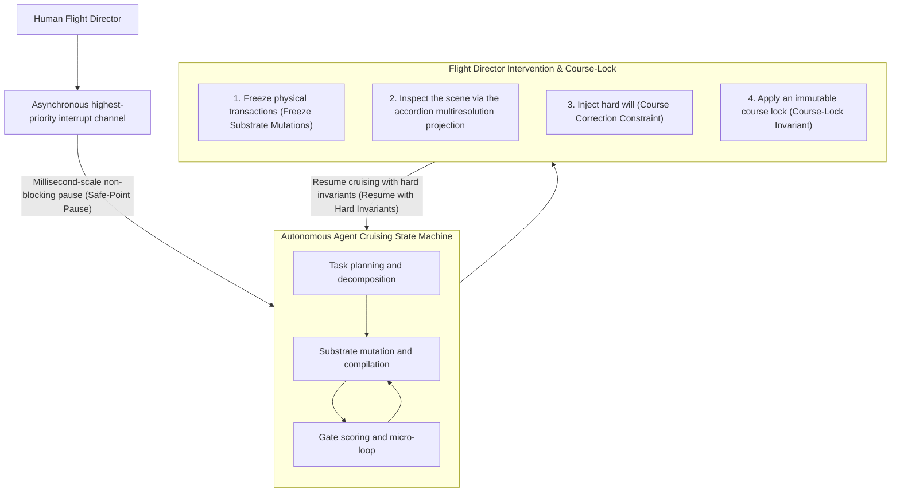
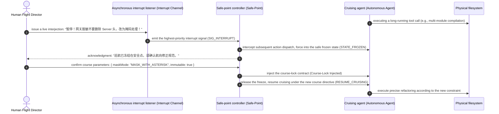

# Chapter 20: Pattern 17 — Asynchronous Flight-Director Interrupt Pattern

---

### 1. Intent

Establish the supreme human-arbitration cybernetic mechanism of human–machine interaction, based on **asynchronous full-duplex interrupt** and a **course-lock causal state machine**. It grants the human "Flight Director" the privilege, at any moment during the agent's multi-step autonomous cruise, to issue millisecond-scale non-blocking interjections, freeze mutating transactions, inject corrective will, and lock the global course — breaking the runaway state in which the agent is trapped in a self-healing death spiral or has deviated from the business goal.

---

### 2. Motivation & Real-World Failure Modes

In the operation of agent pipelines with extremely high end-to-end autonomy, severe situations in which the agent falls into an uncontrolled state frequently occur:

- **Failure Mode A (Runway Self-Healing Spiral)**:
  While repairing a complex compilation error, the agent — having misunderstood the business intent — begins autonomously refactoring the entire underlying architecture (e.g., deleting an important core base class). In a traditional synchronous blocking system, the human engineer can only watch helplessly as the console keeps scrolling errors and consuming enormous Tokens, unable to input a command to stop it, and is reduced to brutally killing the process (`Kill -9`), causing all previously valid work to be reduced to ashes;
- **Failure Mode B (Unverified Self-Correction Fallacy)**:
  Academic research shows that, without external physical constraints, a large model's self-reflection is not only ineffective but often leads to performance degradation (Huang et al., ICLR 2024). During multi-round self-derivation, the agent becomes convinced that "users do not need tenant isolation" and begins stripping tenant contexts on a large scale. Humans need an elegant mechanism to "pull the reins";
- **Failure Mode C (Race Conditions in Human Steering)**:
  The human enters the correction "不要修改 User 类", but before that input is processed, the agent has already completed the write to `User.java` and submitted the compilation — producing a causal inversion between the human's instruction and the agent's current execution context.



---

### 3. Applicability

- Autonomous software engineering systems running ultra-long (dozens of minutes to hours), highly complex tasks;
- Human–agent pair-programming interfaces equipped with full-duplex real-time voice and IM bots;
- High-compliance scenarios where the system must remain ultimately human-controllable and safety-aligned at every moment.

---

### 4. Participants

1. **Flight Director (Human Operator)**: the decision-making subject with the system's highest priority, representing the ultimate business requirements;
2. **Asynchronous Interrupt Listener**: resident in the background as a non-blocking event loop, constantly listening for the human's voice interruptions or text interrupt signals;
3. **Safe-Point Controller**: upon receiving an interrupt signal, waits for the currently executing atomic file write to complete, then immediately freezes the execution pipeline, preventing the filesystem from being left in a half-written corrupted state;
4. **Course-Lock Enforcer**: transforms the human's correction instructions into highest-weight immutable constraints (hard invariants), granting them veto power in subsequent prompt generation and gate audits, and forbidding the agent from bouncing back a second time.

---

### 5. Collaborations



---

### 6. Consequences

- **Pros**:
  - **Human-in-the-Loop Supremacy**: the human engineer can "take over control" at any moment — no longer a powerless bystander — eliminating runaway self-healing death spirals;
  - **Causal consistency guarantee**: via the safe-point mechanism, the interrupt never corrupts physical files or the Git index;
  - **Huge energy savings**: braking and correcting the agent the moment it goes astray avoids ineffective exploration consuming millions of Tokens.
- **Cons**:
  - The orchestration state machine must possess a fully decoupled asynchronous event loop;
  - Resuming cruising requires realigning the context prompt and eliminating the residue of the interrupted operation.

---

### 7. Anti-Patterns to Avoid

| Anti-pattern name | Manifestation | Why it must be avoided |
| :--- | :--- | :--- |
| **Mock Full-Duplex Fallacy** | The agent blocks input entirely while calling tools or thinking; the human must wait until it finishes answering before speaking | Loses the possibility of rescuing the system in real time; severely degrades the user interaction experience |
| **Ephemeral Steering Amnesia** | After the human interjects a correction, the agent forgets the human's warning entirely in the next execution round | Violates causal invariance, forcing the human to repeat the same instruction over and over |

---

### 8. Algorithmic Formulation

```typescript
interface CourseLockDirective {
  targetPath: string;
  immutableConstraint: string;
  injectedBy: "FLIGHT_DIRECTOR";
  timestamp: number;
}

class FlightDirectorInterruptManager {
  private isFrozen: boolean = false;
  private activeDirectives: CourseLockDirective[] = [];

  // 1. Asynchronous non-blocking interrupt listening
  async onHumanInterruptReceived(transcript: string): Promise<string> {
    this.isFrozen = true;
    const safePointReached = await this.awaitNextSafePoint();

    if (safePointReached) {
      // Parse the human's intent and generate the course-lock rule
      const directive = this.parseDirectiveFromSpeech(transcript);
      this.activeDirectives.push(directive);

      return `FLIGHT_DIRECTOR_INTERRUPT_ACK: Execution safely frozen. Directive [${directive.immutableConstraint}] locked.`;
    }

    throw new Error("SAFE_POINT_TIMEOUT: Force pause initiated.");
  }

  // 2. Project the course constraints into the agent's prompt
  injectDirectivesIntoPrompt(basePrompt: string): string {
    if (this.activeDirectives.length === 0) return basePrompt;

    const directivesBlock = this.activeDirectives
      .map(d => `[FLIGHT_DIRECTOR_COURSE_LOCK] ${d.immutableConstraint} (STRICT_IMMUTABLE)`)
      .join("\n");

    return `${basePrompt}\n\n### HIGHEST PRIORITY FLIGHT DIRECTIVES:\n${directivesBlock}\n`;
  }
}
```

---

### 9. Epistemic Status

> **Engineering Convention**: This pattern is an unfalsifiable operational specification, not a theoretical conclusion. Its correctness can only be judged by "whether the implementation follows the prescribed takeover protocol"; the pattern itself provides no statistical criteria, nor does it constitute a corollary of Axioms I–IV or Theorem 3.1.

The priority rules of interrupt takeover and course-lock are protocol conventions. If they are to be treated as conclusions, "interrupt loss rate" and "constraint violation rate" must first be defined and thresholds preregistered; until then, the "highest priority" stated in the text is merely protocol semantics, not a measured effect. In the validation report §8 matrix, this pattern is classified as an engineering convention; its statements must not be used as a reasoning premise for other patterns.
