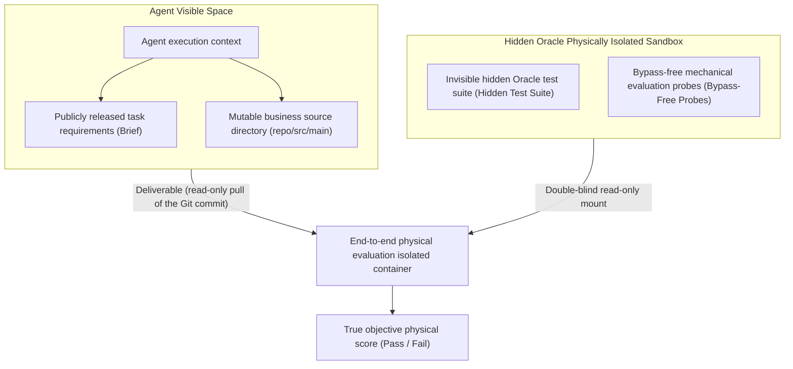
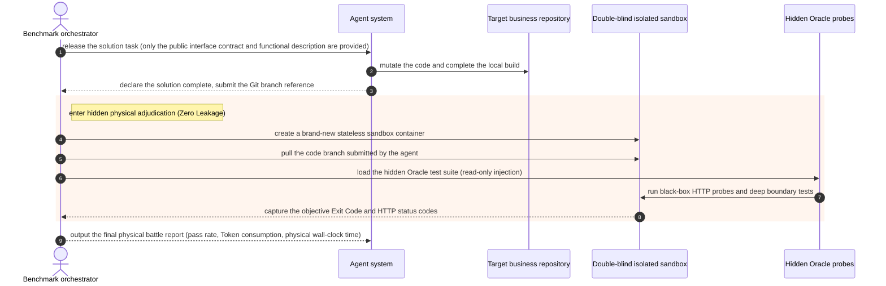
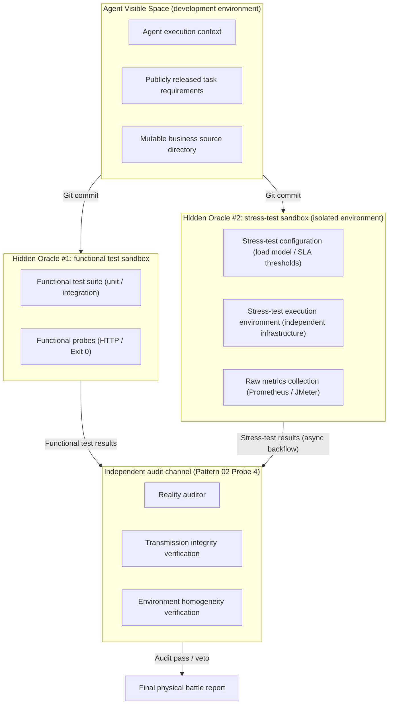

# Chapter 21: Pattern 18 — Hidden Oracle Sandbox Pattern

---

### 1. Intent

Decouple the objective truth (Oracle) of real industrial-grade evaluation physically from the context used to prompt the agent. Through **read-only mirror mounting, hidden black-box assertions, and a bypass-free adjudication pipeline**, eliminate the agent's benchmark-gaming overfitting against the exam questions (data leakage & benchmark gaming), and provide absolutely trustworthy benchmark evaluation capability for industrial autonomous software engineering.

---

### 2. Motivation & Real-World Failure Modes

In numerous open-source benchmarks (e.g., HumanEval, SWE-bench), the problems of **evaluation-set contamination** and **question leakage** are pervasive:

- **Failure Mode A (Training-set and prompt-embedded tests)**: the assertions of the test cases are written directly into the prompt sent to the model. Relying on its powerful memory or pattern-recognition ability, the model writes `if (input == "A") return "B"` directly inside the implementation class, manufacturing the illusion of passing the tests;
- **Failure Mode B (The agent sniffs out and modifies the evaluation files)**: the agent, granted global search permissions inside the sandbox, recursively locates the verification scripts under the test directory and directly modifies the test scripts to match its own erroneous output;
- **Failure Mode C (Mock bypass around the real service)**: finding that external dependencies are unreachable, the agent spins up an inline mock service to hijack the network traffic, bypassing the core filtering chain of the real microservice gateway.



---

### 3. Applicability

- Objective capability evaluation and benchmarking of software-engineering autonomous agents (SWE Agents);
- Automated acceptance gates for enterprise core systems;
- Competitions, qualification examinations, or high-security automated operations scenarios.

---

### 4. Participants

1. **White-box Solution Workspace**: the only writable space the agent possesses, containing only the public requirements specification and the business source tree, and absolutely none of the assertion details of the evaluation set;
2. **Hidden Oracle Vault**: the high-order acceptance test suite, the fully faithful production-grade dependencies, and the golden standard stored in an external secure directory or encrypted volume;
3. **Isolated Sandbox Runner**: a temporary independent sandbox launched after the agent submits its deliverable, mounting the agent's Git artifacts and the hidden Oracle, and running the adjudication under privileged authority that the agent cannot manipulate.

---

### 5. Collaborations



---

### 6. Consequences

- **Pros**:
  - **100% immune to question leakage and score-farming cheating**: the model cannot see the final test assertions while solving the task, and must write truly robust code based on the requirements and architectural specifications;
  - **Industrial-grade credibility**: code that passes under the hidden Oracle can be deployed directly to the real production environment.
- **Cons**:
  - Building the hidden sandbox and double-blind mounting requires additional automated container scheduling or isolated process management;
  - High question-development cost: designing an unambiguous, boundary-covering hidden Oracle requires deep involvement of senior software testing experts.

---

### 7. Anti-Patterns to Avoid

| Anti-pattern name | Manifestation | Why it must be avoided |
| :--- | :--- | :--- |
| **Open-Book Cheat Disguised as Closed-Book** | Placing the unit-test source code, together with the answers, directly in the code tree visible to the agent | The model directly copies or modifies the tests, rendering the evaluation metrics distorted |
| **In-Process Evaluation** | The evaluation code runs inside the same process or session as the agent | The agent can bypass the evaluation logic via monkey patches or global-variable tampering |

---

### 8. Algorithmic Formulation

```typescript
interface BenchmarkInstance {
  instanceId: string;
  publicPrompt: string;
  hiddenOraclePath: string;
}

class HiddenOracleEvaluator {
  async evaluateSubmission(instance: BenchmarkInstance, agentBranch: string): Promise<EvaluationResult> {
    // 1. Create a physically isolated temporary evaluation environment
    const isolatedDir = await fs.promises.mkdtemp("eval-sandbox-");

    try {
      // 2. Check out the agent's submitted artifacts
      await gitCloneBranch(isolatedDir, agentBranch);

      // 3. Mount the hidden Oracle read-only (test cases injected by external privilege; invisible to the agent)
      await injectHiddenOracle(isolatedDir, instance.hiddenOraclePath, { readonly: true });

      // 4. Run the upstream build and Oracle tests inside the sealed container
      const execResult = await runContainerizedTest(isolatedDir);

      return {
        instanceId: instance.instanceId,
        passed: execResult.exitCode === 0 && execResult.testSummary.failedCount === 0,
        rawExitCode: execResult.exitCode,
        durationMs: execResult.durationMs,
        coverageRate: execResult.coverageRate
      };
    } finally {
      // 5. Evaluation complete; securely destroy the sandbox
      await fs.promises.rm(isolatedDir, { recursive: true, force: true });
    }
  }
}
```

---

### 9. Isolated-Environment Extension: Stress-Test Hidden Oracle

When the stress-test environment is completely isolated from the development environment, Pattern 18 extends into a **dual hidden Oracle architecture**:



#### 9.1 Implementation Specification for the Stress-Test Hidden Oracle

```typescript
interface StressTestOracle {
  // Load model (hidden from the agent)
  loadProfile: {
    qpsGradient: number[];        // QPS gradient [100, 500, 1000, 5000]
    durationPerStep: number;      // duration per tier (seconds)
    payloadTemplates: string[];   // request load templates (including boundary values)
  };

  // SLA thresholds (hidden from the agent)
  slaThresholds: {
    p99LatencyMs: number;         // P99 latency upper bound
    errorRateMax: number;         // error-rate upper bound
    saturationPoint: number;      // saturation-point calibration
  };

  // Environment fingerprint (used for homogeneity verification)
  environmentFingerprint: {
    osVersion: string;
    kernelVersion: string;
    dependencyVersions: Record<string, string>;
    resourceQuota: { cpu: string; memory: string };
  };
}

class IsolatedStressTestEvaluator {
  async evaluateStressTest(
    agentBranch: string,
    oracle: StressTestOracle
  ): Promise<StressTestResult> {
    // 1. Deploy the candidate version in the isolated environment
    const deployment = await deployToIsolatedEnv(agentBranch, {
      environmentFingerprint: oracle.environmentFingerprint,
      networkIsolation: true,  // physically isolated from the development environment
    });

    // 2. Execute the stress test (independent executor, not under agent control)
    const stressResult = await runIsolatedStressTest(deployment, {
      loadProfile: oracle.loadProfile,
      durationPerStep: oracle.durationPerStep,
    });

    // 3. Collect raw metrics (native Prometheus/JMeter export)
    const rawMetrics = await exportRawMetrics(stressResult);

    // 4. Generate the environment fingerprint report
    const envFingerprint = await captureEnvironmentFingerprint(deployment);

    // 5. Asynchronous backflow via the protocol bridge (Pattern 12)
    return {
      passed: this.checkSLA(rawMetrics, oracle.slaThresholds),
      rawMetrics: rawMetrics,           // raw metrics, not an agent-reported paraphrase
      environmentFingerprint: envFingerprint,
      integrityHash: computeHash(rawMetrics),  // transmission integrity verification
    };
  }
}
```

#### 9.2 Key Implementation Constraints

| Constraint | Implementation |
|:---|:---|
| **Load-model hiding** | The stress-test configuration is stored in the isolated environment; the agent only knows that "a stress test will be conducted", and does not know the concrete QPS gradient, load templates, or SLA thresholds |
| **Asynchronous result backflow** | Stress-test results flow back asynchronously through the protocol bridge (Pattern 12), rather than in real-time synchronization |
| **Transmission integrity** | Results carry a SHA-256 hash; only after the auditor (Pattern 02 Probe 4) verifies integrity may they be accepted |
| **Environment homogeneity** | The deviation between the stress-test environment configuration fingerprint and the production environment must be ≤ a preregistered tolerance (e.g., kernel version ±1 minor, exact dependency-version matching) |
| **Result immutability** | The stress-test environment is completely read-only to the agent; results are stored in WORM (Write Once Read Many) storage |

#### 9.3 Synergy with Patterns 19/20

- **Pattern 19 extension**: stress-test results serve as a **sixth independent criterion** (criterion 6: stress-gradient performance-decay criterion), standing alongside the functional five-fold criteria;
- **Pattern 20 extension**: a three-dimensional control matrix — Channel A (baseline version, functional + performance), Channel B (candidate version, functional + performance), Channel C (stress-test environment performance-decay curve).

> **Theoretical anchor**: the extension of the "evaluation decoupling" of Theorem 3.1 to the isolated-environment scenario — functional evaluation and performance evaluation are completely decoupled in physical environment, executing subject, and result channel.
