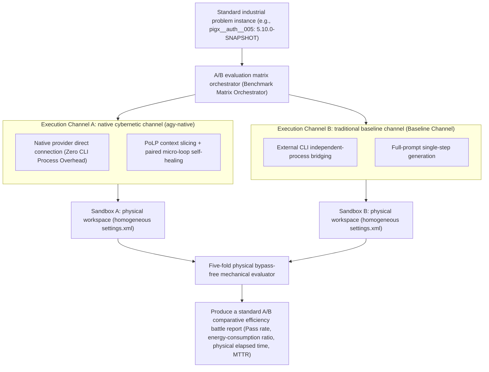
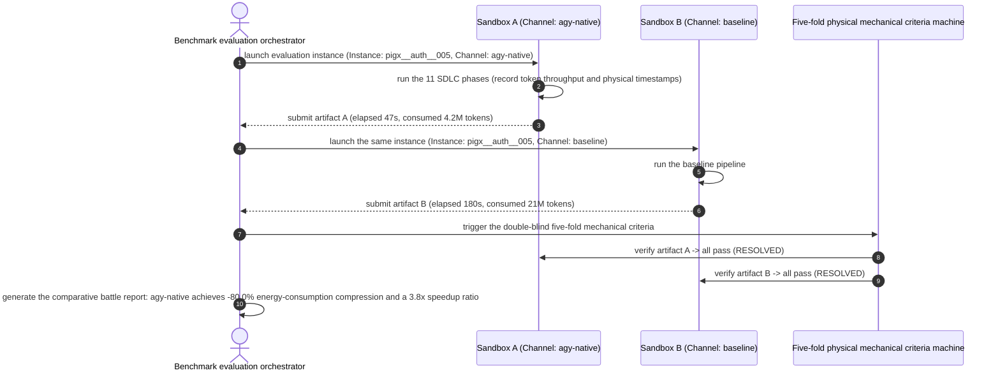

# Chapter 23: Pattern 20 — Industrial Substrate A/B Benchmark Pattern

---

### 1. Intent

In a real industrial-engineering physical sandbox that is strictly homogeneous (identical hardware, network, and dataset), establish a **double-blind A/B physical controlled-evaluation matrix across multiple execution channels**. By eliminating external perturbation variables in evaluation, precisely measure the true efficiency gap of different underlying models (LLM backends) and different architecture orchestration strategies (e.g., monolithic CLI agents vs. native cybernetic channels) in terms of objective resolution rate, tokenomics energy-consumption convergence, and physical elapsed time.

---

### 2. Motivation & Real-World Failure Modes

In the field of autonomous-agent performance evaluation, academia and enterprises frequently publish comparative test reports claiming "large SOTA surpassions", yet their conclusions are often worthless in real industrial scenarios:

- **Failure scenario A (Apples-to-Oranges Comparison)**:
  Channel A runs on a local machine equipped with a full local private-server cache, taking only 10 seconds; Channel B runs in a clean container that must slowly download dependencies from the public internet, taking 5 minutes. The evaluator draws the pseudoscientific conclusion that "Channel A is 30× more efficient", essentially conflating the causality of network infrastructure with model capability;
- **Failure scenario B (Open-vs-Closed Book Asymmetry)**:
  When evaluating a proprietary agent, that agent has built in the entire codebase of the target open-source repository or a specialized prompt (open book); while when testing a generic model, only a bare-bones requirements description is provided (closed book), producing an unfair objective evaluation;
- **Failure scenario C (Failure to Normalize Tokenomics)**:
  Both channels pass the same problem, but Channel A consumes 26 million tokens and retries 50 rounds; Channel B, relying on cybernetic slicing, consumes only 4 million tokens and passes on the first try. Looking only at "Pass/Fail" completely conceals the commercial energy-efficiency barrier of engineering deployment.



---

### 3. Applicability
- Objective comparison when enterprises select open-source/commercial large models as the core engine for code assistance;
- Validating whether agent architecture innovations (e.g., introducing PoLP projection or paired loops) bring real industrial energy-efficiency gains;
- Building third-party autonomous-programming competition platforms with anti-cheating and auditable properties.

---

### 4. Participants

1. **Homogeneous Sandbox Factory**: ensures that, before every channel starts, the target project source tree, Maven private-server mirror sources, JDK version, and initial Git commit hash are 100% absolutely identical across all channels;
2. **Channel Driver Adapters**: translate the unified evaluation instruction into launch recipes for different channels (e.g., `agy-native`, `deepseek-cli`, `kimi`, `amdgpu`);
3. **Tokenomics & Performance Telemetry**: real-time capture of each channel's input token count, output token count, tool-call frequency, physical compilation time, and process resident memory over the lifecycle of a single problem;
4. **Normalized A/B Reporter**: computes the per-line-of-code energy-consumption ratio (Tokens / LoC) and the per-effective-fix cost.

---

### 5. Collaborations



---

### 6. Consequences

- **Pros**:
  - **Scientifically rigorous causal inference**: eliminates external interference from network, hardware fluctuations, or open-book testing; conclusions withstand peer review and industrial audit;
  - **Reveals real commercial value**: lets architects clearly see the real money (token cost) saved by cybernetic optimization in production deployment.
- **Cons**:
  - Evaluation cost multiplies (each problem requires multiple channels to independently run a full compilation and evaluation);
  - Requires maintaining runtime environments and dependencies for multiple heterogeneous model channels.

---

### 7. Anti-Patterns to Avoid

| Anti-pattern | Manifestation | Why it must be eradicated |
| :--- | :--- | :--- |
| **Heterogeneous Sandbox Bias** | Channel A uses the private-server cache, while Channel B connects to the public internet | What is evaluated is not model intelligence, but network jitter and disk I/O speed |
| **Tokenomics Blindness** | Ignoring the tens of millions of tokens consumed per problem, and simply claiming "both have a 100% resolution rate" | In commercial production, extremely high energy consumption means fundamentally no scalable adoption |

---

### 8. Algorithmic Formulation

```typescript
interface ChannelRunMetrics {
  channelName: string;
  isResolved: boolean;
  totalTokens: number;
  durationMs: number;
  codeLinesChanged: number;
}

class SubstrateAbBenchmarkRunner {
  async runAbComparison(instanceId: string, channels: string[]): Promise<AbComparisonReport> {
    const results: ChannelRunMetrics[] = [];

    for (const ch of channels) {
      // 1. Initialize a fully homogeneous, self-contained physical sandbox
      const sandbox = await this.sandboxFactory.createCleanSandbox({
        instanceId,
        channel: ch,
        forceCleanSettings: true
      });

      // 2. Run the single-channel pipeline and collect energy-consumption metrics
      const runTrace = await sandbox.executePipeline();

      // 3. Run the five-fold bypass-free mechanical evaluation
      const evalVerdict = await this.evaluator.evaluate(sandbox.workspace);

      results.push({
        channelName: ch,
        isResolved: evalVerdict.isResolved,
        totalTokens: runTrace.tokenUsage.total,
        durationMs: runTrace.durationMs,
        codeLinesChanged: runTrace.diffStats.totalLoC
      });
    }

    // 4. Compute efficiency ratios and compression rates
    return this.generateReport(results);
  }
}
```

---

### 9. Epistemic Status of Quantitative Claims

> **Disposition: pending supplementary measurement (quota required)** — "−80.0% energy-consumption compression and a 3.8x speedup ratio" comes from an example run of the homogeneous-sandbox A/B; the sample size and number of repetitions were not preregistered. It is now marked as an **example observation**; the formal supplementary test requires a paired A/B (n≥10, same model, same batch), will consume model quota, and is scheduled to run after the current CROSS_TASK experiments.
