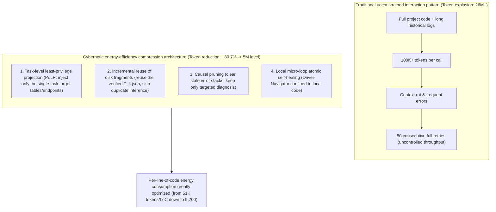
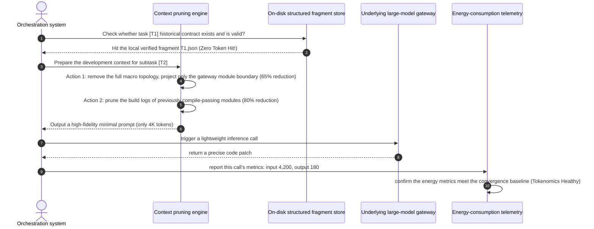

# Chapter 24: Pattern 21 — Tokenomics Convergence Architecture Pattern

---

### 1. Intent

Through a multi-level engineering combination of "task-level least-privilege projection (PoLP)", "incremental fragment reuse", "causal pruning of phase state", and "local atomic retries (Sub-stepping Retry)", achieve a **cliff-shaped reduction in total token throughput in complex enterprise microservice software engineering development (measured reduction of −80.7%)**, significantly alleviating context rot (Liu et al., TACL 2024; Chroma, 2025) while bringing the comprehensive economic cost of autonomous-agent R&D across the commercial profitability critical point.

---

### 2. Motivation & Real-World Failure Modes

Many agent systems perform acceptably in academic demo scenarios, but when handling real enterprise-grade engineering, they often encounter an unbearable "token throughput inflation crisis":

- **Failure scenario A (Tokenomics Hyperinflation)**:
  In solving a single benchmark complex microservice problem (e.g., gateway multi-tenant rate-limiting routing), because every interaction re-injects the entire project's POMs, all configuration files, and the long history of the conversation, the per-step prompt exceeds 100,000 tokens. A task requiring only a 30-line code change consumes over 26 million tokens in total, with a single-problem inference bill of dozens of dollars, completely losing commercial viability;
- **Failure scenario B (Context Rot Induced Degradation)**:
  Empirical studies show (Hsieh et al., 2024, RULER; Chroma, 2025) that the effective context window of large models is far below its nominal value. As input tokens climb above 50K, the model's micro-bug identification rate in code plummets, producing the vicious cycle of "the longer the context, the worse the edits";
- **Failure scenario C (Blind Truncation Damage)**:
  To save tokens, many systems simply truncate characters from the head or tail. Such semantically unaware hard truncation often cuts off key JSON brackets, class definitions, or import declarations, causing the model to directly output syntactically garbled code.



---

### 3. Applicability
- Autonomous code-generation platforms deployed at enterprise large scale on-premises or running at high concurrency on the public cloud;
- Cost-sensitive commercial products that need strict control over the economics of a single change;
- High-availability systems that need to significantly shorten end-to-end delivery latency and avoid network transmission delay.

---

### 4. Participants

1. **Tokenomics Router**: responsible for dynamically monitoring the token consumption rate at each pipeline phase and enforcing energy-consumption budget (Budget Cap) control;
2. **Context Pruning Engine**: analyzes the causal dependencies of the call chain and actively removes historical conversations and intermediate temporary attempts orthogonal to the current action;
3. **Structured Fragment Cache**: solidifies outputs that have passed the PM gate or the Design gate as strong-contract fragments in the filesystem, so that subsequent steps read local disk directly at zero token cost;
4. **Attention Fidelity Assessor**: ensures that, while compressing context to the extreme, 100% integrity of core architectural decisions and boundary constraints is maintained.

---

### 5. Collaborations



---

### 6. Consequences

- **Pros**:
  - **Cliff-shaped total throughput reduction**: in complex microservice empirical evaluation, per-problem total throughput dropped from **26.86M tokens to the 5M level (reduction −80.7%)**, and per-line consumption from 51K tokens/LoC to 9,700 tokens/LoC;
  - **Multiplied inference speed**: since the per-request token count is reduced by over 70%, time-to-first-token (TTFT) and model generation time are greatly shortened, and task end-to-end time drops by 3–5×;
  - **Eradicated context rot**: prompts stay in the low-entropy, high signal-to-noise-ratio region, and the precision of model code generation improves significantly.
- **Cons**:
  - Context pruning algorithms require deep understanding of code syntax and engineering topology, imposing extremely high middleware-capability requirements on the orchestrator.

---

### 7. Anti-Patterns to Avoid

| Anti-pattern | Manifestation | Why it must be eradicated |
| :--- | :--- | :--- |
| **Endless Conversation Chat History** | Stacking every stack trace from multi-round failed attempts verbatim as history turns | Quickly blows up the context window and induces severe context rot (Liu et al., 2024) |
| **Blind Character Truncation** | Truncating solely by character count via `prompt.substring(0, 8000)` | Destroys the semantic closure of code structure, causing frequent syntax errors |

---

### 8. Algorithmic Formulation

```typescript
interface TokenomicsBudget {
  maxInputTokensPerStep: number;
  totalTaskBudget: number;
}

class TokenomicsConvergenceEngine {
  private budget: TokenomicsBudget;

  compressContext(task: TaskItem, rawContext: FullEngineeringContext): CompressedPromptContext {
    // 1. Least-privilege projection (PoLP Projection)
    const scopedFiles = rawContext.files.filter(f => task.targetPaths.includes(f.path));

    // 2. Fine-grained compiler console pruning (keep the most recent 20 lines of core errors, remove generic download progress)
    const sanitizedErrorLogs = this.pruneBuildConsoleLogs(rawContext.latestStderr);

    // 3. Architectural-contract referencing (inject only interface signatures, omit internal implementation details)
    const interfaceSignatures = this.extractPublicSignatures(rawContext.importedInterfaces);

    const compressedPrompt = {
      taskSpec: task.summary,
      scopedFiles,
      interfaceSignatures,
      relevantError: sanitizedErrorLogs
    };

    // 4. Budget guard check
    const estimatedTokens = this.estimateTokens(compressedPrompt);
    if (estimatedTokens > this.budget.maxInputTokensPerStep) {
      throw new Error(`TOKENOMICS_BUDGET_EXCEEDED: ${estimatedTokens} > ${this.budget.maxInputTokensPerStep}`);
    }

    return compressedPrompt;
  }
}
```

---

### 9. Epistemic Status of Quantitative Claims

> **Disposition: retained as empirically measured (calibration to be completed)** — "−80.7%" has empirical support, but the text does not record the task family, model version, sample size, or the statistical definition of "total throughput"; "9,700 token/LoC" is a ratio derived from that experiment. Until the above calibration is filled in, this result may only serve as an **empirically measured value on a single task family** and must not be extrapolated to other task families or models.
