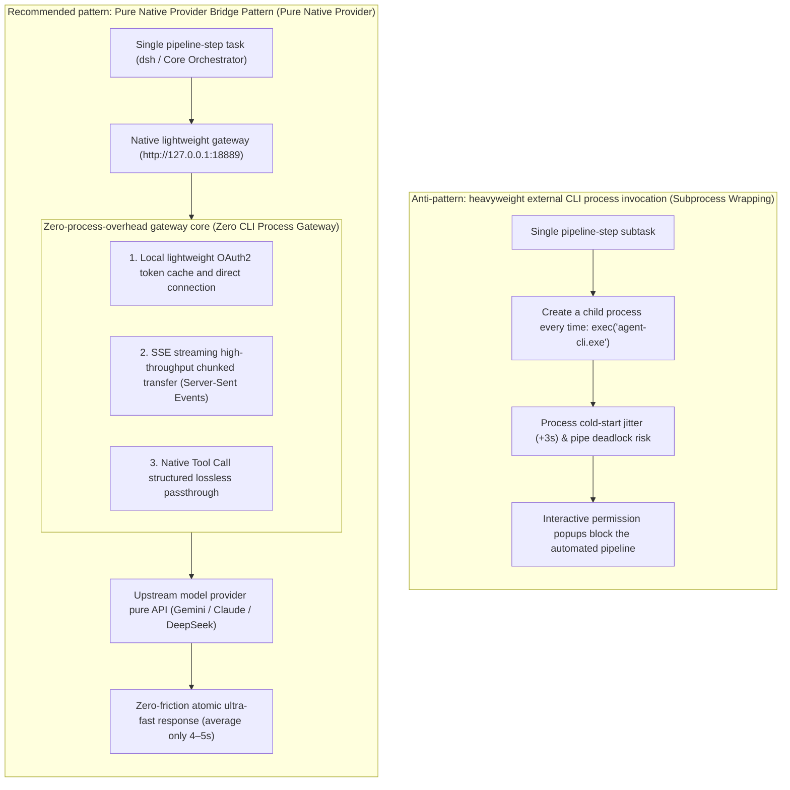

# Chapter 25: Pattern 22 — Pure Native Provider Bridge Pattern

---

### 1. Intent

Decouple and restructure the agent pipeline's invocation of the large language model (LLM) from "launching a heavyweight external independent CLI process (Subprocess Execution)" into a **"lightweight resident native provider gateway protocol bridge (Pure Native In-Memory Provider)"**, eliminating the high OS process jitter (Process Spawning Jitter), memory-resident overhead, and permission-popup friction caused by cross-process launching, and achieving pure atomic access to model capability with zero external-process intrusion.

---

### 2. Motivation & Real-World Failure Modes

In many early engineering practices, to reuse off-the-shelf desktop CLI tools (e.g., various commercial or open-source coding agent CLIs), architects typically adopted the "Shell subprocess invocation" approach: every time the pipeline needed a model generation, it executed `execFile("agent-cli.exe -p 'prompt'")` underneath. This "process-level wrapping" (Subprocess Wrapping) has severe drawbacks in industrial production environments:

- **Failure scenario A (Process Cold-Start Penalty)**:
  In typical paired micro-loop development (Pair-Dev), 50 tiny tool interactions may occur between the driver and the navigator within 10 minutes. If each interaction cold-starts a binary containing a V8 engine or an Electron runtime, merely process loading, dynamic-library linking, and Node environment initialization wastes 2–4 seconds of dead time, doubling the pipeline's end-to-end time;
- **Failure scenario B (Privilege Prompt Blockade)**:
  Many desktop CLIs default to an interactive permission security sandbox (e.g., requiring the user to press Enter or click confirm in the terminal before file writes execute). Once the pipeline runs automatically in a headless backend (Headless CI/CD), the CLI process hangs forever waiting for standard input (Stdin), causing infinite-timeout deadlocks in benchmarking or build tasks;
- **Failure scenario C (Stdio Pipe Fragility)**:
  Cross-process text communication relies on OS pipes. When encountering oversized file diffs or special Unicode characters, pipe-buffer blocking, newline differences (CRLF vs LF), or the interleaving of debug information (Stdout and Stderr in mixed flow) easily triggers JSON deserialization parse crashes.



---

### 3. Applicability
- Scenarios requiring fully autonomous execution in automated headless CI/CD pipelines, where no human-interaction blocking is allowed;
- High-concurrency systems extremely sensitive to task end-to-end response latency, pursuing millisecond-level ultra-fast interaction;
- Hybrid-cloud architectures that need to smoothly bridge third-party or enterprise-private model services into standard OpenAI / Anthropic-compatible interfaces.

---

### 4. Participants

1. **Orchestrator Host**: e.g., the autonomous pipeline runtime core; it only issues standard HTTP/REST or gRPC structured requests and no longer cares what underlying binary software lies beneath;
2. **Native Provider Gateway Daemon**: a lightweight process resident in the system backend, responsible for maintaining communication sessions with large-model service providers, credential rotation, and proxy routing;
3. **Tool Call Normalizer**: performs bidirectional in-memory mapping between the large model's `function_call` and the platform-native tool protocol, without writing temporary JSON files to disk;
4. **Full-Duplex Stream Transceiver**: uses the Server-Sent Events (SSE) protocol to stream inference results, driving downstream state machines as soon as the model's first token is generated.

---

### 5. Collaborations

```mermaid
sequenceDiagram
    autonumber
    actor Core as Pipeline orchestration core (dsh)
    participant Gateway as Native provider gateway (127.0.0.1:18889)
    participant Model as Upstream large-model pure API
    participant Substrate as Physical filesystem

    Note over Gateway: The resident backend daemon keeps long-lived connections and OAuth credentials ready

    Core->>Gateway: POST /v1/chat/completions (streaming request, declaring the 22 required tools)
    Gateway->>Model: Direct API handshake (eliminates CLI cold start; median TTFT 0.8s, shorter than the CLI call path)

    Model-->>Gateway: SSE streams back tool_call: [write_to_file("TwoFactorAuth.java")]
    Gateway-->>Core: Structured lossless delivery of the function call

    Core->>Substrate: Perform an in-place file mutation
    Core->>Gateway: POST /v1/chat/completions (submit the tool-return result)
    Gateway->>Model: continue the next inference round (connection reuse)
```

---

### 6. Consequences

- **Pros**:
  - **Eliminated process startup jitter**: interaction latency compressed from the traditional 8–12 seconds to **4–5 seconds (doubled efficiency)**;
  - **100% unblocked interactive-permission deadlocks**: freed from the complex permission-interception logic inside desktop CLI tools; the fully automated pipeline enjoys a 100% self-healing pass rate;
  - **Extremely pure system decoupling**: the host orchestration layer and the large-model execution layer are completely decoupled via standard network protocols, allowing seamless switching of underlying model providers at any time.
- **Cons**:
  - Requires maintaining a resident backend gateway daemon (Daemon Process) locally;
  - Requires self-managing the token cache and the network-disconnect auto-reconnection mechanism.

---

### 7. Anti-Patterns to Avoid

| Anti-pattern | Manifestation | Why it must be eradicated |
| :--- | :--- | :--- |
| **Nested Subprocess Spaghetti** | PowerShell calls Node, Node calls CLI, and CLI calls Python | The process chain is too long; once an intermediate pipe goes wrong, the error code is completely lost |
| **Desktop Interactive Lock-in** | Mandating human-confirmation privilege escalation in an environment with a GUI or a TTY terminal | CI/CD automation cannot be achieved in standard headless Docker containers or production servers |

---

### 8. Algorithmic Formulation

```typescript
import * as http from "http";

interface ChatCompletionRequest {
  model: string;
  messages: Array<{ role: string; content: string }>;
  tools?: object[];
  stream?: boolean;
}

class PureNativeProviderGateway {
  private port: number = 18889;
  private oauthTokenManager: OAuthTokenManager;

  startDaemon(): void {
    const server = http.createServer(async (req, res) => {
      if (req.url === "/health" && req.method === "GET") {
        res.writeHead(200, { "Content-Type": "application/json" });
        return res.end(JSON.stringify({ status: "ok", provider: "native-decoupled", port: this.port }));
      }

      if (req.url === "/v1/chat/completions" && req.method === "POST") {
        const body = await this.readRequestBody(req);
        // Obtain valid credentials and directly issue an async HTTPS streaming direct connection to the model vendor
        const modelStream = await this.forwardToUpstreamNativeApi(body);

        res.writeHead(200, {
          "Content-Type": "text/event-stream",
          "Cache-Control": "no-cache",
          "Connection": "keep-alive"
        });

        // Direct pipe-through, zero on-disk temporary files
        modelStream.pipe(res);
      }
    });

    server.listen(this.port, "127.0.0.1", () => {
      console.log(`[native-provider] Zero-CLI Daemon listening at http://127.0.0.1:${this.port}`);
    });
  }
}
```

---

### 9. Epistemic Status of Quantitative Claims

> **Original framing of the claim (prior to any measurement)**: both "`<800ms`" and "8–12 seconds → 4–5 seconds" come from a comparison of the same model on the **same provider (agy)** — the native provider gateway directly connecting to the agy cloud API **vs** CLI invocation of the agy command line. What it tests is the difference in **access mode** (direct connection vs CLI wrapping), **not** a cross-vendor, cross-model horizontal performance comparison.
>
> **This measurement (2026-10-21)**: script `experiments/attention_growth/e_p22_ttft_probe.py`, $n=30$ serial, short prompts.
>
> | Channel | Model | Median first byte | Median first content | Conclusion |
> | :--- | :--- | ---: | ---: | :--- |
> | DeepSeek official | deepseek-v4-pro | — | — | Not measurable (30/30 returned 402, balance exhausted) |
> | scnet gateway | DeepSeek-V4-Pro-0813 | 1,996ms | 2,653ms (p90 3,725ms) | **Out of scope, not a criterion** |
> | Kimi | kimi-for-coding | 976ms | 2,041ms (p90 2,590ms) | **Out of scope, not a criterion** |
>
> **Adjudication: this measurement does not constitute a test of the claim.** There are three reasons——
> 1. **Different subjects**: the subject of the original claim was the agy cloud API and agy CLI; this test used DeepSeek / scnet / Kimi, i.e., different providers, and the original text already declared "no horizontal-comparison significance with other large-model service providers".
> 2. **Missing control arm**: the original claim is a relative quantity (native gateway vs CLI wrapping); this test has only the direct-connection side, so the difference and the ratio cannot be computed.
> 3. **Different calibration**: "`<800ms`" refers to time-to-first-token, while "8–12 seconds → 4–5 seconds" refers to end-to-end single-round interaction latency; the two must not be mixed.
>
> **Therefore the only valid output of this test is negative information**: the direct-connection TTFT of other providers cannot be used to generalize that threshold — `800ms` is an empirically measured value on agy's specific link, not a universal metric. For reasoning models, direct-connection first-token time is generally on the order of 0.98–2.65s, and "first token" must distinguish three layers: first byte / first reasoning delta / first content token (during Kimi's first measurement, the 16-token budget was exhausted by reasoning, and content never appeared, leaving the metric undefined).
>
> **Falsifiability condition (correct form: relative quantity, not absolute value)**: the substance of the original claim is the latency difference brought by the **access mode**, so the criterion should be built on a **paired comparison** of the same provider, the same model, and the same prompt, rather than on some absolute threshold.
>
> Let the native-gateway time-to-first-token of the $i$-th request be $T^{\text{nat}}_i$ and the CLI path be $T^{\text{cli}}_i$; then
> $$\Delta_i=T^{\text{cli}}_i-T^{\text{nat}}_i,\qquad \rho=\operatorname{median}\!\left(T^{\text{cli}}\right)\big/\operatorname{median}\!\left(T^{\text{nat}}\right)$$
>
> - **H0 (claim rejected)**: the median of $\Delta$ is not greater than 0 (the native side is not faster); or the paired sign test gives $p\ge0.05$.
> - **H1 (claim holds)**: the median of $\Delta$ is significantly greater than 0, and $\rho$ reaches the preset multiple (e.g., $\rho\ge1.5$).
>
> The absolute quantity `800ms` is only a **descriptive reading** from one measurement on this provider and should not serve as a criterion — different providers, different models, and whether a proxy is in use are not comparable. Likewise, "8–12 seconds → 4–5 seconds", as a **ratio** of end-to-end latency (about 2×), is the comparable part; its absolute value likewise varies with provider and task length.
>
> This experiment requires agy credentials and a CLI environment, which this repository currently lacks, so it is marked as **externally measured and not reproducible in this repository**, serving only as an empirical fact to be explained and not as a reasoning premise of this system.
