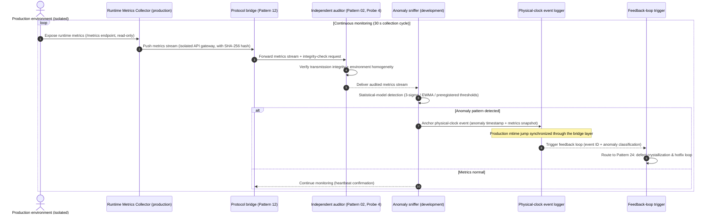

# Chapter 26: Pattern 23 — Production Runtime Anomaly Sniffing Pattern


***

### 1. Intent

Extend physical negative feedback from "pre-deployment" to "post-deployment," and through **production runtime metrics collection, anomaly-pattern sniffing, and physical-clock event anchoring**, ensure that the **state observability** of an agent system remains continuously valid throughout the production phase, guarding against uncontrolled drift after deployment.


***

### 2. Motivation & Real-World Failure Modes

After an autonomous agent has delivered code and it has been deployed to production, the closed loop of the traditional cybernetic framework comes to an end. Yet the real operating state of the production environment is the ultimate physical criterion for verifying the quality of the agent's deliverable:


* **Failure Mode A (Silent Performance Decay)**:

  The candidate version shows a P99 latency of 120 ms (passing) in the stress-test environment, but in production — owing to differences in the real data distribution, fluctuation in cache-hit rates, and downstream-service latency propagation — the P99 latency gradually climbs to 800 ms within 72 hours after deployment. The agent system has no runtime monitoring and fails to sniff this decay, discovering it passively only after user complaints;

* **Failure Mode B (Resource Leak Accumulation)**:

  Code defects introduced by the agent (e.g., database connections that are never closed, a cache strategy with a memory leak) remain hidden over the short horizon of stress testing, but accumulate during long-running production operation and eventually crash the service. The "pass" verdict of stress testing masks the long-horizon stability defect;

* **Failure Mode C (Production-Only Anomalies)**:

  Real production traffic patterns (e.g., anomalous requests from a particular region, concurrency peaks during specific time windows) trigger boundary conditions the agent did not anticipate; these anomaly patterns are never crystallized into empirical assets, and the same class of defect recurs in subsequent versions.


  ```mermaid
  flowchart TD
      subgraph DevEnvironment["Development environment (accessible to the agent)"]
          Dev["Agent development"] --> GitCommit["Git commit"]
      end

      subgraph IsolatedEnvironments["Isolated environment matrix (inaccessible to the agent)"]
          direction TB
          StressTest["Stress-test environment<br/>(isolated)"]
          Production["Production environment<br/>(isolated)"]
      end

      subgraph BridgeLayer["Protocol bridge layer (Pattern 12)"]
          direction TB
          Bridge1["Stress-test results<br/>asynchronous feedback"]
          Bridge2["Production metrics<br/>asynchronous feedback"]
      end

      subgraph AuditLayer["Independent audit layer (Pattern 02, Probe 4)"]
          direction TB
          Audit1["Stress-test audit"]
          Audit2["Production-metrics audit"]
      end

      GitCommit --> StressTest
      StressTest --> Bridge1
      GitCommit --> Production
      Production --> Bridge2
      Bridge1 --> Audit1
      Bridge2 --> Audit2

      Audit1 --> DeployDecision["Deployment decision"]
      Audit2 --> RuntimeSniffer["Runtime anomaly sniffer"]

      subgraph SniffingDimensions["Three sniffing dimensions"]
          D1["Performance dimension: P99/P999 latency, throughput, error rate"]
          D2["Resource dimension: memory/CPU/connection-pool/handle leaks"]
          D3["Business dimension: anomalous request patterns, boundary-condition triggers"]
      end

      RuntimeSniffer --> SniffingDimensions
      SniffingDimensions --> Alarm["Anomaly alarm & physical-clock event"]
      Alarm --> Feedback["Feedback to Pattern 24: defect crystallization & hotfix loop"]
  ```

**Key constraint: the production environment and the development environment are fully isolated**


| Constraint                | Implementation                                       |
| ----------------- | ------------------------------------------ |
| **The agent cannot directly access the production environment** | Pattern 01 (in-situ penetration) does not apply; production metrics flow back asynchronously through the protocol bridge (Pattern 12)      |
| **Runtime metrics must be transmitted across environments**   | The metrics collector is deployed in production and pushes to the bridge layer through an isolated API gateway             |
| **Transmission integrity assurance**       | Production metrics carry a SHA-256 hash; the auditor verifies integrity before they may be trusted             |
| **Environment fingerprint collection**        | The production configuration fingerprint (OS / kernel / dependency versions / resource quotas) is collected synchronously for homogeneity checking |
| **Cross-environment anchoring of physical-clock events**   | The mtime jump of an anomaly event is anchored in production and synchronized through the bridge layer to the development environment, ensuring causal monotonicity |


***

### 3. Applicability


* The code delivered by an autonomous agent has been deployed to production, and runtime quality must be continuously assured;

* Production runs over long horizons, and accumulated defects that stress testing did not expose must be detected;

* Production-only anomalies must be crystallized into empirical assets, preventing the same class of defect from propagating across generations.


***

### 4. Participants and Responsibilities


1. **Runtime Metrics Collector**: an independent agent deployed in production that collects native Prometheus/Grafana metrics, fully physically isolated from the agent; **key constraint**: the collector has no direct communication channel with the agent, exposing only a read-only metrics endpoint through the isolated API gateway;

2. **Anomaly Sniffer**: deployed in the development environment or an independent analysis environment, it sniffs anomaly patterns in runtime metrics based on preregistered thresholds and statistical models (e.g., the 3-sigma rule, EWMA exponentially weighted moving average); **key constraint**: the sniffer does not directly access production, consuming only metrics that have flowed back through the protocol bridge and been audited;

3. **Physical Clock Event Logger**: anchors anomaly events as physical-clock events (mtime jumps); **key constraint**: production mtime jumps are synchronized through the bridge layer to the development environment, ensuring cross-environment causal monotonicity;

4. **Feedback Loop Trigger**: after an anomaly is confirmed, it triggers Pattern 24's defect crystallization and hotfix loop; **key constraint**: the trigger consumes only audited anomaly events and does not directly respond to raw production signals.


***

### 5. Collaborations and Causal Constraints




**Causal constraints**:


* The physical clock of anomaly events must be strictly monotonic (Axiom III), with **cross-environment synchronization**: production mtime jumps are synchronized through the bridge layer to the development environment, ensuring that the causal chain of defect repair is traceable;

* The runtime-metrics collection cycle and the statistical window for anomaly detection must be preregistered, to avoid post-hoc rationalization;

* Anomaly-alarm thresholds must not be adjusted by the agent on its own; they must be confirmed by a human expert or an independent audit channel;

* **Cross-environment audit**: after production metrics flow back through the protocol bridge, they must pass Pattern 02 Probe 4's audit (authenticity / integrity / homogeneity) before the sniffer may consume them.


***

### 6. Consequences


* **Pros**:


  * **Continuous observability after deployment**: the production runtime state is continuously folded into the physical negative-feedback loop, preventing post-deployment loss of control;

  * **Early detection of accumulated defects**: resource leaks and performance decay over long-running operation are sniffed before a crash;

  * **Crystallization of production-specific anomalies**: boundary conditions triggered by real traffic patterns are crystallized into empirical assets, preventing recurrence of the same defect.

* **Cons**:


  * An additional monitoring agent must be deployed in production, increasing operational complexity;

  * The statistical models for anomaly detection must be calibrated periodically to avoid false positives / false negatives; **the adaptive-σ criterion suffers threshold drift under signal contamination (measured in §7)**, so leak-type defects must use a robust baseline or fixed absolute thresholds instead;

  * Collecting and storing runtime metrics incurs additional cost.


***

### 7. Anti-Patterns to Avoid


| Anti-pattern           | Manifestation                     | Why it must be prohibited                |
| --------------- | ------------------------ | ---------------------- |
| **Monitoring agent in the same process as the agent** | Monitoring code embedded in the agent runtime, so the agent can tamper with the metrics    | Violates Axiom I (physical non-trustworthiness); the metrics lose objectivity  |
| **Dynamically adaptive thresholds**     | Anomaly-detection thresholds are automatically adjusted by the agent based on historical data     | The agent can evade detection through gradual drift; thresholds must be preregistered |
| **Adaptive-σ statistical contamination (measured)** | The σ of the EWMA/3σ criterion is driven by the signal itself; a large jump inflates σ, and after the 3σ threshold drifts it swallows subsequent signals of the same kind | Measured (2026-10-22, F3): mem 3σ works for an "extremely stable baseline + large jump" (dev triggered at 31.1σ) but goes insensitive to repeated leak steps (σ inflates from 4 MB to 67 MB) — leak-type monitoring must use a robust baseline (median/MAD) or fixed absolute thresholds, and cannot rely on "preregistered adaptation" alone |
| **No physical anchoring of anomaly events**   | Anomalies are recorded only in memory or log files, not anchored as physical-clock events | Violates Axiom III; the causal chain of defect repair cannot be traced  |


***

### 8. Algorithmic Formulation


```
interface RuntimeMetrics {
  timestamp: number;
  p99LatencyMs: number;
  p999LatencyMs: number;
  throughputQps: number;
  errorRate: number;
  memoryUsageBytes: number;
  cpuUsagePercent: number;
  connectionPoolActive: number;
  connectionPoolMax: number;
}

interface AnomalyEvent {
  eventId: string;
  anomalyType: "PERFORMANCE_DECAY" | "RESOURCE_LEAK" | "BUSINESS_ANOMALY";
  severity: "WARNING" | "CRITICAL";
  metricsSnapshot: RuntimeMetrics;
  physicalClockEvent: {
    mtimeBefore: number;
    mtimeAfter: number;
    monotonicJump: boolean;
  };
  preRegisteredThreshold: {
    metric: string;
    threshold: number;
    statisticalModel: "3SIGMA" | "EWMA" | "FIXED";
  };
}

class ProductionRuntimeAnomalySniffer {
  private preRegisteredThresholds: Map<string, Threshold>;

  async sniffAnomaly(metrics: RuntimeMetrics): Promise<AnomalyEvent | null> {
    // 1. Performance dimension: does P99 latency exceed the preregistered threshold?
    const p99Threshold = this.preRegisteredThresholds.get("p99LatencyMs");
    if (metrics.p99LatencyMs > p99Threshold.value) {
      return this.createAnomalyEvent("PERFORMANCE_DECAY", "CRITICAL", metrics, p99Threshold);
    }

    // 2. Resource dimension: does connection-pool usage exceed 90% (accumulated leak signal)?
    const poolUsage = metrics.connectionPoolActive / metrics.connectionPoolMax;
    if (poolUsage > 0.9) {
      return this.createAnomalyEvent("RESOURCE_LEAK", "WARNING", metrics, poolThreshold);
    }

    // 3. Business dimension: does the error rate exceed the 3-sigma statistical threshold?
    const errorRateSigma = this.calculateSigma(metrics.errorRate, historicalErrorRates);
    if (errorRateSigma > 3) {
      return this.createAnomalyEvent("BUSINESS_ANOMALY", "WARNING", metrics, errorRateThreshold);
    }

    return null; // no anomaly
  }

  private createAnomalyEvent(
    type: string,
    severity: string,
    metrics: RuntimeMetrics,
    threshold: Threshold
  ): AnomalyEvent {
    // anchor physical-clock event (Axiom III)
    const mtimeBefore = this.getLastEventMtime();
    const mtimeAfter = Date.now();
    
    return {
      eventId: generateUUID(),
      anomalyType: type,
      severity: severity,
      metricsSnapshot: metrics,
      physicalClockEvent: {
        mtimeBefore: mtimeBefore,
        mtimeAfter: mtimeAfter,
        monotonicJump: mtimeAfter > mtimeBefore, // must be strictly monotonic
      },
      preRegisteredThreshold: threshold,
    };
  }
}
```

> **Theoretical anchors**
>
> Extension of Axiom I — the production "substrate" is runtime metrics, not the compiler; extension of Theorem 3.1 — runtime monitoring as the continuous guarantee of "state observability."


***

### Epistemic Status and Formal Anchors

> **Theoremizable (loop stability proven, zero sorry)**
>
> The module
>
> `Pattern23_24_ProductionLoop`
>
> (corresponding to Appendix B.10) formalizes the observation–learning loop of Pattern 23 → 24 → 23.


* Model: a stock of defects $x\in\mathbb N$; each cycle, one is detected and repaired with probability `q`, otherwise one is injected.

* `T_id_pos`: $\mathbb E[x'\mid x]=x+1-2q$ ($x\ge1$).

* `hasStrongDrift` + `loop_return_bound`: when $q>1/2$, strong drift is satisfied with $V(x)=x$, $b=1$, $\delta=2q-1$, and $\mathbb E[\tau]\le x_0/(2q-1)$.

* `no_drift_below_half` (critical negative result): when $q\le1/2$, $V=\mathrm{id}$ is not a Lyapunov function.

**Implication for the numbers in this pattern**: the in-text "detection rate $\ge0.90$" is not an optional performance target but the engineering margin of the $q>1/2$ stability threshold; below the threshold the loop cannot self-certify convergence. The measured value of $q$ is provided by production field experiment H1 (fixed-threshold defect classes $q=1.00$; mem adaptive-σ criterion-shape boundary, 2026-10-22); this formalization covers only a single defect class, single-step injection / repair, and i.i.d. detection, and is not extrapolated to multi-defect-class coupling.

### Empirical Support (2026-10-22, Production Field Experiments H1/H4)

> Measured environment: a Docker Compose controlled production topology (app/downstream/toxiproxy/k6/exporter/auditor/sniffer; the LLM component DeepSeek-V4.1-Flash-1017 appears only in the defect-crystallization step); all criteria preregistered (fixed thresholds pool>10 / p99>300 ms / mem 3σ; detection window 180 s; 10 reps per scenario). Interpretation follows: F1/F2 detection rate 1.00, F4 false positives 0.00, F3 criterion-shape boundary, H4 rig defect.


* **F1 connection-pool leak** (10 reps): detection rate 10/10 (q=1.00), alarm evidence `pool_active>10.0 (751)`. The fixed-threshold criterion is effective against resource-pool-exhaustion defects.

* **F2 downstream latency** (toxiproxy 400 ms, 10 reps): detection rate 10/10 (q=1.00), alarm evidence `p99>300.0 (40x ms)`. Latency-type defects are reliably detected under the preregistered p99 threshold.

* **F4 control** (10 reps × 6 sampling windows = 60 periods): false-positive rate 0.00 (≤0.05). Fixed thresholds produce no false positives under steady-state traffic.

* **F3 memory leak (boundary)**: the mem 3σ adaptive criterion works only for an "extremely stable baseline + large jump" (measured: dev triggered once at 31.1σ), and goes **insensitive to repeated step injections** — the EWMA σ is contaminated by the signal itself (inflate from 4 MB to 67 MB), and the drifted 3σ threshold swallows subsequent signals. **This is empirical evidence of a mismatch between the criterion shape (adaptive σ) and the defect shape (leak / drift), not a criterion failure**; the engineering takeaway: leak-type monitoring should use a robust baseline (median / MAD) or fixed absolute thresholds, and the adaptive-σ criterion suits only burst-type spikes.

* **H4 rig defect**: exporter restart with reused sequence numbers caused 708 normal events to be falsely rejected by the mtime criterion (all with reason `mtime_not_strict_increasing`; no hash / fingerprint false rejections); rechecking the 456 snapshots found 0 violations of filename-order monotonicity — the false rejections were a rig defect, not a criterion failure. The rig has been fixed (exporter continues numbering; the auditor audits by time order).

* Conclusion: the measured $q$ is 1.00 for fixed-threshold defect classes (pool/p99), giving empirical support to the loop-stability threshold $q>1/2$; the mem adaptive-σ criterion does not meet this threshold (a criterion-selection issue) and is faithfully recorded as a boundary per plan §8.
