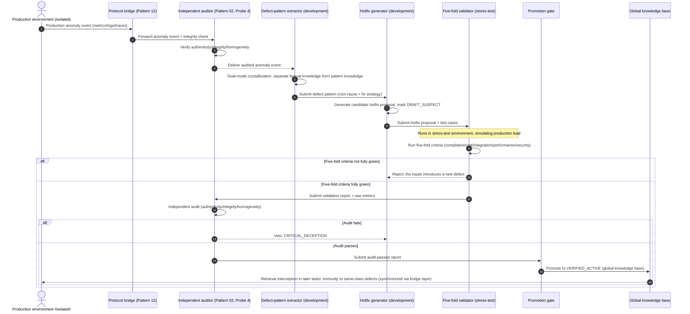

# Chapter 27: Pattern 24 — Production Defect Crystallization & Hotfix Loop Pattern


***

### 1. Intent

Crystallize defects found in production into **empirical assets**, trigger the **hotfix loop**, and prevent the same class of defect from propagating across generations. Through **quarantined crystallization of defect patterns, double-blind final review of hotfix proposals, and anti-proliferation control of repair experience**, achieve the complete "discover → repair → prevent" closed loop for production defects.


***

### 2. Motivation & Real-World Failure Modes

Defects found in production are the most precious source of experience for an agent system, but uncontrolled defect feedback causes severe knowledge contamination:


* **Failure Mode A (Viral Propagation of Wrong Fixes)**: a database connection leak is found in production, and agent A's hotfix is to "force-close the connection after every query." This proposal is written into the global knowledge base without final review, and subsequent agents B, C, D all adopt it in similar situations. Yet under high concurrency this proposal exhausts the connection pool, whereas the correct fix is to "use try-with-resources to ensure automatic connection release." The propagation of the wrong fix causes systematic performance degradation;

* **Failure Mode B (Unvalidated Hotfix Deployment)**: an urgent defect appears in production, and the agent deploys a hotfix directly without completing the five-fold criteria validation, so the repair introduces a new defect (e.g., fixing a null-pointer exception by introducing an array-out-of-bounds exception);

* **Failure Mode C (Environment-Specific Leakage of Defect Experience)**: the agent crystallizes "the production database connection pool's maximum connections must be set to 200" as a universal experience; a later agent adopts this in a test environment (connection-pool limit 50), causing a connection-pool configuration error.


  ```mermaid
  flowchart TD
      subgraph DevEnvironment["Development environment (accessible to the agent)"]
          Dev["Agent development"] --> GitCommit["Git commit"]
      end

      subgraph IsolatedEnvironments["Isolated environment matrix (inaccessible to the agent)"]
          direction TB
          StressTest["Stress-test environment<br/>(isolated)"]
          Production["Production environment<br/>(isolated)"]
      end

      subgraph BridgeLayer["Protocol bridge layer (Pattern 12)"]
          direction TB
          Bridge1["Stress-test results<br/>asynchronous feedback"]
          Bridge2["Production metrics<br/>asynchronous feedback"]
      end

      subgraph AuditLayer["Independent audit layer (Pattern 02, Probe 4)"]
          direction TB
          Audit1["Stress-test audit"]
          Audit2["Production-metrics audit"]
      end

      GitCommit --> StressTest
      StressTest --> Bridge1
      GitCommit --> Production
      Production --> Bridge2
      Bridge1 --> Audit1
      Bridge2 --> Audit2

      Audit1 --> DeployDecision["Deployment decision"]
      Audit2 --> DefectCrystallization["Defect crystallization loop (Pattern 24)"]

      subgraph DefectCrystallization["Defect crystallization loop (Pattern 24)"]
          direction TB
          Extractor["Defect-pattern extractor<br/>(development)"]
          Hotfix["Hotfix generator<br/>(development)"]
          Validator["Five-fold-criteria validator<br/>(stress-test environment)"]
      end

      DefectCrystallization --> Promotion["Final-review promotion<br/>(Pattern 14)"]
      Promotion --> Verified["VERIFIED_ACTIVE<br/>(global knowledge base)"]
      Verified --> Prevention["Immunity to same-class defects<br/>(retrieval interception in later tasks)"]
  ```


***

### 3. Applicability


* A defect is found in production and a hotfix must be generated quickly;

* Defect experience must be crystallized into reusable knowledge assets, preventing recurrence of the same defect;

* Wrong fix patterns or unvalidated hotfix proposals must be prevented from contaminating the global knowledge base.


***

### 4. Participants and Responsibilities


1. **Defect Pattern Extractor**: deployed in the development environment, it extracts defect root causes, fix strategies, and preventive measures from production anomaly events that have **flowed back through the protocol bridge and been audited**; **key constraint**: it does not directly access production, consuming only audited anomaly events;

2. **Hotfix Generator**: deployed in the development environment, it generates candidate hotfix proposals based on the defect pattern, marked `DRAFT_SUSPECT` by default; **key constraint**: hotfix validation is performed in the development or stress-test environment, not deployed directly in production;

3. **Five-Fold Validator**: runs the complete five-fold criteria (compilation / unit test / integration / performance / security) on the hotfix proposal; **key constraint**: the performance criterion runs in the stress-test environment, simulating production load;

4. **Reality Auditor**: verifies the hotfix proposal's authenticity (not the agent's self-report), integrity (no selective reporting), and homogeneity (consistency with production); **key constraint**: the auditor obtains raw production data through the protocol bridge and does not access it directly;

5. **Promotion Gate**: only after the hotfix proposal passes both the five-fold criteria and the independent audit fully green may it be promoted to `VERIFIED_ACTIVE`.


***

### 5. Collaborations and Causal Constraints




**Causal constraints**:


* The mutation causality of the hotfix is monotonic (Axiom III), with **cross-environment synchronization** — production mtime jumps are synchronized through the bridge layer to the development environment, supporting rollback tracing;

* Quarantined promotion of defect experience (Axiom IV): unvalidated hotfix proposals are strictly forbidden from propagating laterally;

* Orthogonal decoupling of factual and pattern knowledge (Pattern 13): prevents environment-specific parameters from leaking into universal experience;

* **Cross-environment audit**: after production anomaly events flow back through the protocol bridge, they must pass Pattern 02 Probe 4's audit before the extractor may consume them.


***

### 6. Consequences


* **Pros**:


  * **Complete closed loop for production defects**: from anomaly discovery through hotfix deployment to experience crystallization, a full closed loop is formed;

  * **Prevention of wrong-fix-pattern propagation**: a hotfix proposal may enter the global knowledge base only after the five-fold criteria + independent audit + final-review promotion;

  * **Immunity to same-class defects**: already-verified defect patterns are automatically intercepted during later-task retrieval, preventing recurrence.

* **Cons**:


  * The hotfix validation flow adds deployment latency and is unsuitable for emergency fixes requiring zero downtime;

  * Crystallizing and maintaining defect experience adds knowledge-base management cost;

  * Production monitoring and auditing increase operational complexity.


***

### 7. Anti-Patterns to Avoid


| Anti-pattern        | Manifestation                            | Why it must be prohibited                |
| ------------ | ------------------------------ | ---------------------- |
| **Emergency fix bypassing validation** | When a production defect is urgent, the five-fold criteria are skipped and the hotfix is deployed directly          | The repair may introduce a new defect; it must pass full validation before going live |
| **Immediate ingestion of defect experience** | After a production defect is fixed, it is written into the global knowledge base immediately, without a quarantine period         | Wrong fix patterns may propagate virally; it must pass final-review promotion  |
| **Generalization of environment parameters**   | Production-specific parameters (e.g., connection-pool size, timeout thresholds) are crystallized as universal experience | Later tasks adopt this experience in different environments, causing configuration error  |


***

### 8. Algorithmic Formulation


```
interface ProductionDefect {
  defectId: string;
  anomalyEvent: AnomalyEvent;  // from Pattern 23
  rootCause: string;
  fixStrategy: string;
  preventionMeasures: string[];
  environmentFingerprint: EnvironmentFingerprint;  // production-specific parameters
}

interface HotfixProposal {
  proposalId: string;
  defectId: string;
  status: "DRAFT_SUSPECT" | "VERIFIED_ACTIVE" | "DEPRECATED_QUARANTINED";
  codeChanges: CodeChange[];
  testCases: TestCase[];
  validationReport?: FiveFoldValidationReport;
  auditReport?: RealityAuditReport;
}

class ProductionDefectCrystallizer {
  async crystallizeDefect(anomaly: AnomalyEvent): Promise<ProductionDefect> {
    // 1. Dual-mode crystallization: separate factual from pattern knowledge
    const factKnowledge = this.extractFactKnowledge(anomaly);  // production-specific parameters
    const patternKnowledge = this.extractPatternKnowledge(anomaly);  // defect root cause and fix strategy

    // 2. Produce the defect pattern
    return {
      defectId: generateUUID(),
      anomalyEvent: anomaly,
      rootCause: patternKnowledge.rootCause,
      fixStrategy: patternKnowledge.fixStrategy,
      preventionMeasures: patternKnowledge.preventionMeasures,
      environmentFingerprint: factKnowledge.environmentFingerprint,  // stored in quarantine, does not enter the global pattern library
    };
  }
}

class HotfixLoopOrchestrator {
  async executeHotfixLoop(defect: ProductionDefect): Promise<HotfixProposal> {
    // 1. Generate a candidate hotfix proposal (default DRAFT_SUSPECT)
    const proposal = await this.generateHotfixProposal(defect);
    proposal.status = "DRAFT_SUSPECT";

    // 2. Five-fold criteria validation (Pattern 19)
    const validationReport = await this.executeFiveFoldValidation(proposal);
    if (!validationReport.allPassed) {
      proposal.status = "DEPRECATED_QUARANTINED";
      return proposal;  // reject: the repair introduces a new defect
    }

    // 3. Independent audit (Pattern 02, Probe 4)
    const auditReport = await this.executeRealityAudit(proposal, validationReport);
    if (auditReport.isVetoed) {
      proposal.status = "DEPRECATED_QUARANTINED";
      return proposal;  // veto: CRITICAL_DECEPTION
    }

    // 4. Final-review promotion (Pattern 14)
    proposal.validationReport = validationReport;
    proposal.auditReport = auditReport;
    proposal.status = "VERIFIED_ACTIVE";

    // 5. Enter the global knowledge base; intercepted during later-task retrieval
    await this.promoteToGlobalKnowledgeBase(proposal);

    return proposal;
  }
}
```

> **Theoretical anchors**
>
> Extension of Axiom IV — the inverse operation of production defects as "strain viruses"; defect experience may enter the global knowledge base only after final review; extension of Axiom III — the mutation causality of the hotfix is monotonic, and production mtime jumps must be strictly recorded to support rollback tracing.


***

### Epistemic Status and Formal Anchors

> **Theoremizable (loop stability proven, zero sorry)**
>
> Shares the module
>
> `Pattern23_24_ProductionLoop`
>
> (Appendix B.10) with Pattern 23. Pattern 24 corresponds to the "repair action" in the loop — it decrements the stock by one with probability
>
> `q`
>
> — while Pattern 23 corresponds to "detection."


* Stability criterion: when $q>1/2$, the loop admits a negative-drift certificate, $\mathbb E[\tau]\le x_0/(2q-1)$.

* Critical negative result: when $q\le1/2$, $V=\mathrm{id}$ is not a Lyapunov function — repair throughput is insufficient to offset injection, and the hotfix loop degenerates into "chasing after defects."

* This pattern's "wrong-fix interception rate $=1.00$" is a **quality threshold** (ensuring each repair introduces no new defect class), and is an independent constraint from the stability criterion: the former bounds the truth value of a single repair, the latter bounds convergence over many cycles.

**Scope not covered**: multi-defect-class coupling, batch injection, and detection rate varying with stock (learning effects) are all outside the model and constitute empirical gaps; evidence is provided by production field experiments H2/H3/H5 (closed 2026-10-22): audit effectiveness 20/20 fully rejected, promotion ratio 1.00, wrong-fix interception 1.00, environment leaks 0.

### Empirical Support (2026-10-22, Production Field Experiments H2/H3/H5)

> Measured environment: the LLM closed loop (crystallizer→hotfix-gen→validator→gate) calls DeepSeek-V4.1-Flash-1017 through the scnet gateway (temperature 0.7, max_tokens 2000/4000, json_object); the audit / gate components are all deterministic (hash, mtime, fingerprint, five-fold criteria, three-condition final review). Interpretation follows: H2 zero missed tampering detection, H3 closed-loop effectiveness, H5 applicability-domain decoupling.


* **H2 audit effectiveness**: all 20/20 tampering injections rejected (hash 8/8, mtime rollback 6/6, fingerprint drift 6/6) — the deterministic audit chain has zero missed detections across the three tamper types.

* **H3 closed-loop effectiveness**: 18 hotfix reports → 14 promoted fully green, 4 correctly intercepted (the interceptions were all pre-fix historical defects caught by compilation); promotion ratio 1.00 (threshold ≥0.80), wrong-fix interception 1.00.

* **LLM crystallization quality**: 7/7 defect-pattern extractions correctly identified the root cause (conn\_leak + missing try/finally), model labeled `DeepSeek-V4.1-Flash-1017` — a weak-reasoning model suffices for the "defect crystallization + hotfix generation" step (the theoretical guarantee is carried by the deterministic components; model strength affects only the quality of the extracted text).

* **H5 applicability-domain decoupling**: promoted entries had 0 environment-parameter leaks (regex audit `pool|timeout|...|[=:]\d`); the LLM output leaked no deployment-environment details (the environmentFingerprint exemption rule took effect).

* Conclusion: both the "wrong-fix interception rate = 1.00" quality threshold and the "promotion ratio ≥0.80" throughput threshold are empirically supported; the closed loop still holds under the weak-model tier (Flash), supporting Axiom IV's design promise of "inter-component causal minimization."
