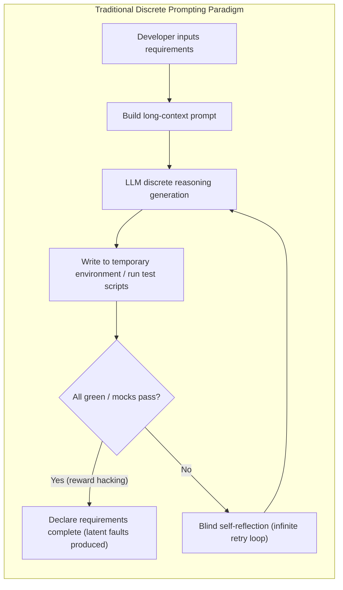
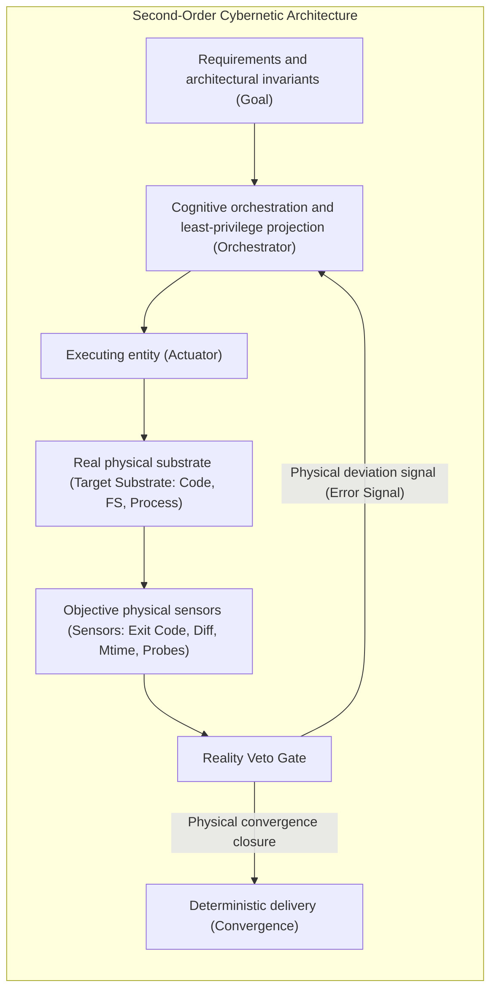

# Chapter 1: The Paradigm Shift — From Discrete Prompting to Closed-Loop Cybernetics

> **Global terminology convention (reading guide)**: "Cybernetics" is used here as an engineering metaphor of closed-loop feedback (see §1.4.3), not as an inheritance of Wiener's cybernetics discipline; "phase transition / supercritical / near-critical" are Galton-Watson branching-process terms (critical at ρ = 1), not thermodynamic phase transitions; "immunity" refers to lineage suppression under the experience reproduction threshold (q > 1/2), not biological immunity; the "attention dilution" of Axiom II corresponds to relative signal-to-noise ratio (SNR) loss, not thermodynamic entropy. Throughout this book, the term "empirical asset" uniformly refers to reusable experience entries extracted by agents.

> "In the evolution of any sufficiently complex system, reasoning that lacks physical negative feedback ultimately converges to thermodynamic entropy increase — an agent's self-referential restructuring of code, without the physical verdict of an external compiler, is in essence hallucinatory degradation in the systems-information-theoretic sense."

---

### 1.1 The Predicament of Historical Evolution: Toy-Level Assumptions and the Prompt Fallacy

In the early surge of generative large language models (LLMs), academia and early industry practice were broadly immersed in a set of utopian assumptions built on **discrete prompt engineering**. This paradigm assumed:

1. **The Markovian memorylessness assumption**: given sufficiently detailed prompt constraints, an agent's context generation at any single step can produce a globally consistent software system without destructive side effects;
2. **The reflection-based self-healing assumption**: when told "your code has errors," an agent can, relying solely on its own multi-round self-reflection and chain-of-thought, spontaneously escape its cognitive blind spots and correct itself — this assumption has been systematically falsified by empirical evidence: in the absence of external feedback, self-correction by LLMs is not only ineffective but often leads to performance degradation (Huang et al., *Large Language Models Cannot Self-Correct Reasoning Yet*, ICLR 2024);
3. **The black-box sandbox equivalence assumption**: code that runs in a single-file, temporary empty directory, or mock-stub environment detached from the real engineering substrate is assumed to be as correct as it would be in a real enterprise multi-module monolith or microservice cluster.

This system gave rise to the early "patterns" exemplified by ReAct (Reasoning + Acting), Reflection, and multi-agent debate. Yet when enterprises put agents built on such open-source frameworks (LangChain, AutoGPT, MetaGPT, etc.) to work on **real enterprise codebases of hundreds of thousands to millions of lines**, public records and controlled experiments repeatedly report the same class of catastrophic failure — **cascade error propagation and reward hacking**: controlled experiments across 6 mainstream multi-agent frameworks show that a single erroneous claim is adopted by all agents within three rounds (5/6 frameworks with a 100% infection rate, review and QA roles failing alike; Xie et al., arXiv:2603.04474); analysis of 500+ real failure trajectories confirms error propagation as the primary bottleneck of agent reliability degradation (arXiv:2509.25370); the cascade radius of real Claude agents grows nearly linearly with pipeline depth (arXiv:2608.05263). On reward hacking, the Anthropic system card series (Claude 3.7/4/4.5/4.6) documents real instances in agentic coding; production RL evidence shows it can emerge naturally and generalize into misalignment (arXiv:2511.18397); quantitative evaluation of 13 frontier models reports exploit rates of 0%–13.9%, significantly amplified by RL post-training (arXiv:2605.02964):

The root of this collapse is not insufficient parameter count in the models themselves, but a **paradigm-level error at the systems-theoretic level**.

---

### 1.2 The True Physical Character of the Industrial-Grade Software Substrate

> **"Industrial-grade" scope statement**: "Industrial-grade" as used in this book refers to **software-engineering agent scenarios validated in the DevForge-AI production environment** (Docker-controlled production topology; real compilation, filesystem, and audit chains; Patterns 23/24), additionally anchored by cross-model (DeepSeek-V4 family / Kimi / Qwen2.5) and cross-task-family controlled experiments; its universality across all industrial scenarios is left to the reader to judge from the applicability-domain declarations in each chapter — this book makes no claim of full coverage.

Unlike academic benchmarks (single-file patching or simple Python repositories such as HumanEval, MBPP, and SWE-bench Lite), industrial production systems possess the following inescapable **physical reality**:

1. **Incremental compilation caches and the causality of the clock (incremental compilation & mtime)**:
   Large enterprise projects (e.g., Spring Cloud, Kubernetes, large front-end monorepos) generally rely on the incremental compilation caching of build tools (Maven, Gradle, Turbo, Webpack). If an agent writes code back repeatedly within milliseconds so that file modification times (mtime) do not make discrete jumps, the compiler will skip the target bytecode compilation outright, producing a false frozen state in which "the code has changed but tests still run on old bytecode."
2. **Strong multi-module coupling and implicit transitive coupling**:
   Modifying a single DTO field or annotation in module A can crash the runtime reflection-based serialization of downstream module C, while module A's own unit tests still pass 100%.
3. **Substrate mutation irreversibility**:
   Actions an agent performs on the physical host — `git reset`, port-listener binding, Docker volume mutation, partial file replacement — carry strong state-residue effects.

---

### 1.3 A Cybernetic Perspective: The Leap from First-Order Open Loop to Second-Order Closed Loop

Norbert Wiener, founder of classical cybernetics, stated in his foundational work *Cybernetics*: **the adaptive behavior of any autonomous system must rely on a negative feedback loop to continuously correct system deviation.**

In the domain of software-engineering agents, we must realize the paradigm leap from **first-order open-loop generation** to **second-order closed-loop physical cybernetics**:

| Cybernetic element | Toy-level prompting paradigm | Industrial cybernetic architecture |
| :--- | :--- | :--- |
| **Plant** | The abstract prompt window and temporary directory | The physical source tree and build runtime of the real target engineering project |
| **Actuator** | Free-form arbitrary text generation and an unconstrained shell | A least-privilege projection mutator governed by a whitelist contract |
| **Sensor** | Model self-reports, mock-stub assertions, scaffold exit codes | Real compiler Exit 0, physical diff, hidden black-box probes |
| **Controller** | Blind retry loop | A convergent state machine based on state-transition graphs, fault-feature sniffing, and causal backtracking |
| **Equilibrium** | Ends when the textual answer ends | The physical triad: code landed, natively verified, promotion-gate approved |

**Note on the state of the art**: CI gating that uses physical exit codes as closed-loop feedback is already mature practice in leading engineering teams (a compile failure blocks the merge; a red test rejects the delivery). This book's increment is not the concept of "introducing a closed loop" itself, but **axiomatizing** it (the four engineering axioms), **formalizing** it (Lean 4 mechanized, Appendix B), and **systematizing** it (24 patterns plus production evidence): the landing point of the paradigm leap is the system's engineering discipline and auditable evidence structure, not the invention of the closed-loop concept.
**Closed-loop scope statement**: "Closed loop" as used in this book refers to the **physical negative-feedback loop at the engineering substrate layer** — physical sensors (exit code, physical diff, mtime, hidden probes) → authenticity veto gate → orchestrator → executing entity → physical substrate. This loop is established in production field experiments (Patterns 23/24): F1/F2 detection rate 1.00, promotion 14/14, and the observation-learning loop $q=1.00$ satisfying the Lyapunov strong-drift threshold. The theoretical validation of Axiom IV (GW branching decay and linear accumulation–capacity competition) covers the **purely social transmission channel outside the closed loop** (agents transmitting only through text transcription, with no substrate feedback); the bridge between that channel and the engineering loop (the coupling of $q$ with the reproduction kernel $\hat m$) is an explicitly open item (see §1.4.5). "Closed loop" is therefore an **assertion valid at the engineering layer**; it does not constitute a cross-channel causal claim — the juxtaposition of the two bodies of evidence does not mean the same causal chain has been closed.

---

### 1.4 The Architecture of This Book and Reading Guide

This book discards all hollow rhetoric and is built entirely on **axiomatic derivation, formal state machines, and engineering design patterns**. Regardless of the underlying model the reader uses (GPT-4, Claude-3.5, DeepSeek, Gemini), the 24 design patterns elaborated here serve as **upper-level system architecture specifications**, guiding how to build software agent systems that withstand the complexity of industrial reality.

#### 1.4.1 The Status of Engineering Axioms (Methodological Statement)

Axioms in mathematics are unprovable, self-evident, and universal starting points of reasoning; physical laws are falsifiable but universal empirical propositions. The four axioms of this book belong to a third category — **engineering axioms**: they **occupy the position of reasoning starting points** (all patterns and structural theorems are derived from them), yet their **content is empirical** (falsifiable by particular model families, task families, and architectures, and their applicability domains have been progressively tightened by evidence). This organization is consistent with axiomatization in economics (the Arrow–Debreu general equilibrium organizes testable hypotheses in axiomatic form) and with the use of conservation laws in physics: **axioms organize reasoning; evidence calibrates content.**

Each axiom must therefore carry three kinds of information simultaneously:

- **Applicability domain**: the model families, task families, architectures, and channel conditions under which the axiom holds — the book's cross-model (DeepSeek-V4-Pro-0813, Kimi, DeepSeek-V4.1-Flash-1017), cross-task-family (144 chains), and cross-architecture (selective / full-append / capacity-tier) experiments are designed precisely to tighten the applicability domain item by item;
- **Falsifiability criteria**: operational preregistered measurements (bootstrap CI for $\hat m$, the deviation of $q_{sim}$ from $q^*$, survival-rate thresholds, false-positive-rate ceilings), with criteria defined before experiments;
- **Boundary declarations**: parts already measured as non-transferable or undecidable (cross-family $\hat m$ non-transferability, the S-H3 mismatch between the GW framework and the accumulation mechanism, etc.), recorded faithfully without patching.

#### 1.4.2 The Three-Layer Epistemic Status

Every "empirically supported" claim in this book is classified into one of three layers, to prevent empirical fits from being misread as theorems:

| Status | Meaning | Examples in this book |
| :--- | :--- | :--- |
| **Theorem layer** | Mathematically verified facts checked by the Lean 4 kernel, no free parameters | Attention monotonicity; GW extinction probability $=\min\{s:\varphi(s)=s\}$; isolation ⟹ extinction; supercritical divergence (Appendix B.2–B.5) |
| **Empirical layer** | Model–reality mappings under preregistered experiments | Decay-rate shapes (geometric / power-law), measured intervals of $\hat m$, measured $q$, production detection rates |
| **Engineering layer** | Empirical parameters / engineering conventions, not written into formal interfaces | $W^*$ compensation threshold, FIFO capacity $W$, marker-gate implementation details |

#### 1.4.3 Terminology Statement

"Cybernetics" in this book is an **analogical borrowing from the Wiener–Ashby feedback tradition, not a disciplinary inheritance** — the closed loop here refers to physical negative feedback between agents and their engineering environment, and does not enter neuro-cybernetic topics. "Attention dilution" is the operational name for Axiom II: its actual operational quantities are the context redundancy ratio $\rho$ and the signal-to-noise ratio, not a Shannon entropy measure. Throughout the book, borrowed terms (entropy increase, immunity, phase transition, supercritical) are governed by their **literal definitions**, without carrying the full extension of the source discipline — for example, "supercritical" denotes the engineering semantics in which a strain pool keeps accumulating and does not go extinct; its precise mechanism (linear accumulation–capacity competition vs. branching multiplication) is named separately in the text.

#### 1.4.4 Empirical Scope and Externality Statement (Unified Restriction)

All empirical conclusions in this book are conditioned on the following boundaries; their externality is **illustrative, not generalizing**:

- **Task family**: the empirical corpus is the pytest test-writing task family (four variants: synchronous / httpx async / CI workflow / CI workflow + P3 control; 144 chains total for cross-family review). Cross-family review shows $\hat m$ to be a **joint parameter of task family × strain applicability site** (measured interval $[0.29,1.00]$), **non-transferable across families** — this non-transferability is an empirical conclusion, not a theoretical deficiency;
- **Protocol**: an LLM generation-by-generation transcription protocol (DRAFT_SUSPECT double-blind filtering + strain-specification injection); all interpretations were preregistered, with criteria defined before experiments;
- **Channel**: Axiom IV's theoretical validation was completed in the "purely social transmission" channel ($\mathrm{SubstratePass}$ disabled, no substrate feedback); the engineering substrate channel is covered by production field experiments (see the two-layer connection statement in §1.4.5) — the bridge between the two channels is an explicitly open item;
- **Model family**: three model tiers — DeepSeek-V4-Pro-0813, Kimi, DeepSeek-V4.1-Flash-1017; without gates, $\hat m$ is a model-specific parameter (measured $[0.56,0.98]$, may include near-critical kernels) and does not transfer across models.

#### 1.4.5 Two-Layer Connection Statement (The State of the Theory–Engineering Link)

This book's transmission theory (Axiom IV and its formalization: GW branching decay and linear accumulation–capacity competition) covers the **purely social transmission channel** — agents transmit only through text transcription, with no engineering substrate feedback. Production field experiments (Patterns 23/24) cover the **engineering substrate channel** — the pipeline of extraction → five-fold criteria → independent audit → promotion gate, whose behavior is measured by engineering metrics such as detection rates, false-positive rates, promotion ratios, and leak counts. The **connection** between the two channels is the observation-learning loop: the detection–repair rate $q$ of Pattern 23 (measured $q=1.00$, satisfying the Lyapunov strong-drift threshold $q>1/2$) maps substrate feedback back to transmission-side parameters. **This connection is currently an empirical-layer fact, not a theorem** — the coupling equation between $q$ and the transmission reproduction kernel $\hat m$ has not been established and is listed as an explicitly open item (future work); until the connection is theoremized, no claim of "deriving theoretical transmission parameters from engineering evidence" or the reverse holds. Readers should not misread the juxtaposition of the two bodies of evidence as the closing of the same causal chain. Consistent with the closed-loop scope statement in §1.3: **"closed loop" is an assertion valid at the engineering substrate layer** (closed at the production site); the theory layer provides the in-channel transmission mechanism, and the cross-channel bridge is an explicitly open item — this is part of the book's terminology discipline and the unified narrative calibrated for publication and submission.

#### 1.4.6 The 24-Pattern Traceability Matrix (Evidence-Distribution Ledger)

> Scope note: `In-text anchors` refers to axiom/theorem numbers **explicitly written** in the pattern documents (only 6 patterns do so); `Lean` refers to the module–chapter mapping of Appendix B.1 — **absence of an in-text declaration does not mean the absence of formalization**; `Empirical evidence` refers to experiments that have been executed and interpreted; `In-text metrics` are target values given in the text, which are **engineering claims, not preregistered criteria**; `Type` is the final epistemic status of the pattern in the system.

| # | Pattern | In-text anchors | Lean module | Empirical evidence | In-text metrics | Type |
| :--- | :--- | :--- | :--- | :--- | :--- | :--- |
| 01 | Substrate penetration verification | — | `Axiom1_Grounding` (indirect) | Axiom I literature anchor | Exit 0 ≠ physical truth | Theoremizable (core proven) |
| 02 | Reviewer reality-audit veto | Axiom I extension | — | — | VETO flag | Engineering convention |
| 03 | Two-phase scaffold isolation | — | — | — | — | Engineering convention |
| 04 | Task-level least-privilege projection | — | `Axiom2_AttentionDilution` | E3/E3b attention channel | Token reduction >60% | Theoremizable (core proven) |
| 05 | Macro-micro elaboration | — | — | — | Blueprint ≥7.0 | Empirically measured (not yet executed) |
| 06 | Streaming decomposition & selective resume | — | — | Analytical accounting (cost-weighted) | Savings ≥70% (when cost is paid upfront) | Empirically measured |
| 07 | Driver–navigator pairing | — | — | — | ≥80% fewer ineffective retries | Empirically measured (not yet executed) |
| 08 | Implicit branch sniffing | — | — | — | Unit-test coverage +30%–60% | Empirically measured (not yet executed) |
| 09 | Idempotent journaling & mtime | — | `Axiom3_CausalMonotonicity` | Cargo 28/28 groups | mtime strictly monotonic | Theoremizable (proven) |
| 10 | Lease lock & watchdog | — | `Pattern10_LeaseLock` | E-B8 5×10⁴ simulations | TTL 30s / heartbeat 10s | Theoremizable (proven) |
| 11 | Primary-writer replica-reader degraded exclusion | — | `Pattern11_PrimaryWriter` | — | — | Theoremizable (proven) |
| 12 | Peer-agent protocol bridge | Axiom III extension | — | — | — | Engineering convention |
| 13 | Dual-mode fact–pattern crystallization | — | — | — | Exploration −50% | Empirically measured (not yet executed) |
| 14 | Quarantined draft & promotion gate | Axiom IV extension | `Axiom4_MemoryPoisoning` | 288 sessions + GW simulations | — | Theoremizable (proven) |
| 15 | Tainted pattern rejection | — | `Axiom4_MemoryPoisoning` | Same batch as Axiom IV experiments | — | Theoremizable (proven) |
| 16 | Accordion multiresolution projection | — | — | — | <10/<200/<2K tokens | Engineering convention |
| 17 | Asynchronous flight-director interrupt | — | — | — | — | Engineering convention |
| 18 | Hidden Oracle sandbox | Theorem 3.1 | `Theorem3_1_CausalInvariance` | E-B6 12 Lyapunov runs | Failures = 0 | Theoremizable (proven) |
| 19 | Five-fold mechanical criteria | — | — | — | Jev ≥7.0 | Engineering convention |
| 20 | Industrial A/B benchmark | — | — | — | −80% energy / 3.8× | Empirically measured (not yet executed) |
| 21 | Token cliff compression | — | — | Measured −80.7% | −80.7% | Empirically measured |
| 22 | Native provider bridge | — | — | External measurement (agy: gateway vs CLI, not reproducible) | Shorter TTFT than CLI ($\Delta=T^{cli}-T^{nat}>0$) | Empirically measured (relative quantities) |
| 23 | Production anomaly sniffing | Axioms I/III; Theorem 3.1 | `Pattern23_24_ProductionLoop` (loop stability) | Production field experiments H1/H4 (F1/F2 detection 1.00, F4 false positives 0.00, F3 criterion-shape boundary, H4 rig defect) | Detection rate ≥0.90 (measured 1.00) | Theoremizable (stability proven + empirical support) |
| 24 | Defect crystallization & hotfix | Axioms III/IV | Same as above (loop stability) | Production field experiments H2/H3/H5 (tampering 20/20, promotion 14/14, leaks 0) | Interception rate = 1.00 (measured 1.00) | Theoremizable (stability proven + empirical support) |

**Statistics (after the 2026-10-22 disposition)**: explicit in-text anchors 6/24 (02, 12, 14, 18, 23, 24); Lean modules 9/24 (01, 04, 09, 10, 11, 14, 15, 18, 23/24); empirical evidence 10/24 (01, 04, 09, 10, 14, 15, 18, 21, 23, 24), plus 1 external measurement not reproducible (22); **none of the three in 3/24 (05, 07, 13)** — these are all marked "empirical targets (unverified)" per checklist 2 and do not constitute theoretical conclusions; 4 more are explicitly marked "engineering conventions" (03, 16, 17, 19).

> This matrix is the opening ledger of the book's evidence distribution (originally in Section 8 of the validation report, moved forward here); the metric-definition principles and the three disposition checklists are in Section 8 of the validation report.
