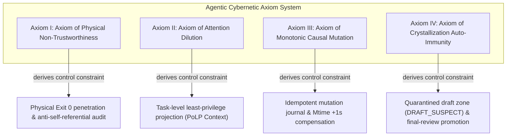

# Chapter 3: Four Cybernetic Axioms and Causal Invariance Formulation

> "No system without formal axioms is at best a collection of empirical fragments; only by precipitating system constraints into mathematical invariants can autonomous software engineering evolve from metaphysics into a precise science."

---

### 3.1 Introduction: The Invariance of the Software Agent State Space

In classical software engineering, system evolution is a deterministic state machine intervened step by step by human engineers. But when autonomous agents (Autonomous Agents) take over code mutation, building, and retries, the system enters a high-dimensional nonlinear **stochastic dynamical system**.

To ensure that the agent does not drift toward a divergent state in this stochastic dynamical space, the entire cybernetic system must be built on unshakable **underlying axioms and causal invariance**.

---

### 3.2 The Four Foundational Axioms of Industrial Agents

#### 3.2.1 Evidence-Level Overview of the Four Axioms

> **Scope statement**: All four axioms are **engineering axioms** (§1.4.1) — they occupy the position of reasoning starting points, and their content is empirical propositions. The table below gives each axiom's current status of formalization, empirical validation, model coverage, and production verification in review-auditable terms; the same title "axiom" does not distribute credit equally, and evidence distribution follows this table.

| Axiom | Epistemic type | Formalization layer (Lean 4 mechanized) | Controlled experiments (scale / models) | Production verification | Explicit boundaries |
| :--- | :--- | :--- | :--- | :--- | :--- |
| I Physical Non-Trustworthiness | Engineering maxim extracted from safety-literature consensus (asymptotic proposition) | B.2: 3 theorems (self-check posterior = prior; closed-loop risk factorization; posterior mechanism-independence) | Literature anchors (Amodei 2016; Huang ICLR 2024; Anthropic 2511.18397) | Pattern 23: F1/F2 detection 1.00 (n=10 each), F4 zero false positives (60 periods) | The formal statement is a limit form $\lim P\le\epsilon$; finite experiments cannot establish a limit; empirically supports the engineering inference "self-reports are untrustworthy" |
| II Attention Dilution | Empirical law with boundary declarations | B.3: dilution strictness; three growth-branch decay; violation lower bound; two-phase model; scope theorem + InjectionCoupling bridge | E3/E3b+E4 (Qwen2.5-1.5B/7B, ≤131k); E8 negative result (three structural quantities non-robust across models) | No direct production closed loop | $W^*$ is an empirical parameter not written into formal interfaces; the theorem's $a/b$ ↔ experimental needle/filler-scope mapping is an unproven hypothesis (B.15) |
| III Monotonic Causal Mutation | Applied transfer of a classical distributed-systems result | B.4: 2 theorems + B.8/B.9 (5 lease theorems; primary-writer single-writer causal order) | Cargo 1.96 / NTFS 28/28 groups controlled measurements | Patterns 23/24: 20 tampering injections all rejected; 708 false-rejection device defects self-exposed (fixed) | Applicability domain: mtime incremental compilers (Bazel/Nix do not apply); Windows PE makes bit-level idempotency impossible |
| IV Crystallization Auto-Immunity | Theorem + multi-model empirical + production closed loop (strongest pillar) | B.5: GW phase-transition family + B.7 Foster-Lyapunov stopping-time bound + B.10 observation-learning loop stability | 846 chains (5,448 session-generation units; 2 selective-control chains counted separately; DeepSeek-V4-Pro-0813 / Kimi / DeepSeek-V4.1-Flash-1017, preregistered interpretation) | Pattern 24: promotion 14/14, interception 1.00, leaks 0 | The $q$–$\hat m$ coupling is not established (open item 1); switching dynamics to be tested |

> Three conclusions: ① the evidence-strength ordering is IV > II > III ≈ I — the title "axiom" does not carry equal-grade empirical confirmation; ② the entire formalization layer (B.2–B.10) is Lean 4 kernel-verified (0 sorry), and its confirmation does not vary with this table's ordering; ③ the applicability domains and open items of each axiom are in §3.4 and Appendix B.15.

#### Axiom I: Axiom of Physical Non-Trustworthiness

* **Mathematical formulation**: Let the agent's internal cognitive-state output be $\hat{Y}_{agent}$, and the external objective physical-world state be $Y_{phys} \in \{0, 1\}$ (0 denotes failure, 1 denotes physical pass).
  $$ \lim_{k \to \infty} P\left( Y_{phys} = 1 \mid \hat{Y}_{agent} = \text{"SUCCESS"}, \text{Sensor}_{ext} = \emptyset \right) \le \epsilon \ll 1 $$
* **Interpretation**: In a closed reasoning chain without strong intervention from any external physical sensor (independent external actuator, real compiler exit code, stub-free HTTP probe), the physical truth rate of the agent's claim of "task success" approaches zero. Any completion claim not anchored to the genuine return of the physical substrate must be judged cybernetically as an illegal pseudo-signal.
* **Applicability-boundary extension (isolated-environment scenarios, 2026-10-21)**: When a validation environment such as a stress-test environment is completely isolated from the development environment, the agent cannot directly penetrate to that physical substrate. In this case the requirement of Axiom I transforms into: **results from the isolated environment must pass an independent audit channel (Pattern 02, Probe 4) verifying authenticity, integrity, and homogeneity before they may be accepted** — isolated-environment results self-reported or relayed by the agent still constitute illegal pseudo-signals.
* **Production field evidence (2026-10-22, Pattern 23)**: In the Docker Compose controlled production topology, the sniffer **does not trust the application's self-reported state (/state), and consumes only the /metrics independently scraped by the exporter**, interpreted after SHA-256 bridging and audit-channel verification — F1 (connection-pool leak) and F2 (downstream latency), 10 injections each, were all detected (detection rate 1.00); the F4 no-injection control over 60 periods showed zero false positives. The "penetration" requirement of an independent metrics channel plus physical anchoring holds in engineering form at the post-deployment stage; the self-report path (/state) does not constitute an interpretive basis at any stage.
* **Academic anchors**: This axiom formalizes the core empirical conclusion of the AI safety literature — model self-reports without external grounding are untrustworthy; and under exploitable evaluation signals, controlled experiments universally observe reward hacking behavior (Amodei et al., 2016; Huang et al., ICLR 2024; Anthropic, arXiv:2511.18397).

#### Axiom II: Axiom of Attention Dilution

* **Mathematical formulation**: Let the context set contained in the agent's attention field be $\mathcal{C}$, and the sufficient-and-necessary context set of the current subtask be $\mathcal{C}^*$. Define the context privileged-redundancy ratio $\rho = |\mathcal{C} \setminus \mathcal{C}^*| / |\mathcal{C}^*|$. The probability $P_{violate}$ that the agent produces out-of-bounds destructive changes satisfies:
  $$ P_{violate}(\rho) \ge 1 - e^{-\alpha \rho}, \quad (\alpha > 0) $$
* **Interpretation**: The more irrelevant engineering files and off-target interface contracts injected into the agent (the larger $\rho$), the more the attention share of the target signal is diluted; the lower bound on the probability that the agent unconsciously modifies unrelated source code and breaks global unit tests diverges with the growth law of irrelevant mass — exponential under geometric growth, power-law under power-law growth (see Appendix B.3 for the formal correspondence). Context must be subjected to **the Principle of Least Privilege (PoLP)** projection.
* **Mathematical status (three-layer system, see §1.4.2)**: The transmission of SNR monotonicity and the violation lower bound is the **theorem layer** (Lean mechanized); the geometric/power-law shape of the decay rate and the shape of the exponential lower bound $1-e^{-\alpha\rho}$ are the **empirical layer** (E3 fitting, calibrated by filler type); the $W^*$ compensation threshold is the **engineering layer** (an empirical parameter, not written into formal interfaces).
* **Empirical support and applicability boundary (formal + measured, 2026-10)**: The monotonicity core of dilution (an increase of irrelevant mass ⟹ a strict decrease of target share) is a Lean 4 mechanized theorem; the **shape** of the decay rate depends on the growth law of irrelevant mass and is an empirical proposition. In controlled retrieval experiments (E3/E3b) on Qwen2.5-1.5B/7B with context up to 131k: power-law growth of irrelevant mass dominates (AIC 33/36 cells, geometric 0 votes), so the exponential lower bound $1-e^{-\alpha\rho}$ should be read as the strongest-case reference, while the power-law branch gives the primary characterization consistent with measurements; target mass is directionally non-increasing (a weak premise), but "target mass constant" is falsified — decay is contributed by both numerator contraction and denominator expansion; the residual (sink) channel is a dynamic channel, total off-target mass is non-decreasing throughout, and the filler-scope SNR is systematically overestimated by 35.8%–36.7%. **The decay parameter is not a constant**: near-synonym adversarial filler lowers the SNR baseline to $1/2.25$ that of neutral filler (the decay exponent unchanged) — i.e., the theory promises "decay given the growth parameters", while the parameters themselves are calibrated by external conditions such as filler type. **Scope-mapping declaration**: the theorem's $a$ is the attention mass of a single target token, while the experimental $a$ is the total mass of the whole needle segment; the theorem's $b$ is all off-target mass, while the experimental $b$ is the total mass of the filler segment — these two model–reality mappings are **unproven hypotheses**, whose validity is endorsed by the residual-channel drift test (Appendix B.15). **Transmission boundary of the violation probability (E4, 2026-10-20)**: the theorem's $P_{\text{violate}}(\rho) = 1 - \operatorname{snr}(\rho)/\operatorname{snr}(0)$ is **relative signal-to-noise loss**, not task failure probability. The E4 end-to-end experiment (Qwen2.5-1.5B/7B needle retrieval accuracy aligned with E3 SNR) shows a **compensation threshold $W^*$** between the two: when $\rho < W^*$, the model's compensation mechanisms (attention sink, KV cache policy, long-context training alignment) cancel the SNR decay and task accuracy ≈ 100%; when $\rho > W^*$, compensation fails and accuracy drops sharply. The measured values are $W^*_{1.5\text{B}} \approx 32\text{k–64k} < W^*_{7\text{B}} > 131\text{k} < W^*_{\text{Kimi}} \ge 1\text{M}$, positively correlated with model capability. **The violation lower bound $P_{\text{violate}} \ge 1 - c^n$ transmits into observable task failure only when $\rho > W^*$**; when $\rho < W^*$, although SNR has already decayed (the 7B model loses 44% SNR at 131k), task accuracy is unaffected. $W^*$ is an empirical parameter, not written into formal interfaces. Epistemic boundaries are given in Appendix B.15.
* **Academic anchors**: This axiom corresponds to the **context rot** phenomenon characterized by long-context empirical research: the model's effective reasoning capability decays significantly as irrelevant context grows, exhibiting the "lost in the middle" U-shaped attention distribution (Liu et al., TACL 2024); the measured effective context length is far below the nominal value (Hsieh et al., 2024, RULER; Chroma, 2025, Context Rot).

#### Axiom III: Axiom of Monotonic Causal Mutation

* **Mathematical formulation**: Let the filesystem physical state at time $t$ be $\Phi(t)$, and the set of physical modification timestamps be $\mathcal{M}(t) = \{ \text{mtime}(f) \mid f \in \text{Files} \}$. For the mutation-action sequence $a_1, a_2$ executed consecutively by the agent, the necessary-and-sufficient condition for their physical effect is:
  $$ \forall f \in \text{Modified}(a_k), \quad \text{mtime}_{new}(f) > \text{mtime}_{old}(f) \quad \text{and} \quad \text{Hash}(a_k) \text{ is idempotently traceable} $$
* **Interpretation**: If the physical timestamps of the code write-backs executed by the agent do not make a monotone forward jump, the incremental parser of the build tool will skip the mutation outright. Meanwhile, every mutation action must carry a unique normalized SHA-256 signature log, preventing secondary state misalignment stacking during retries.
* **Empirical support and applicability boundary (measured, 2026-10-20)**: 28 controlled measurements of the incremental-compilation criterion were made on Cargo 1.96 (Windows NTFS): a mutation is observable if and only if the file mtime strictly exceeds the reference clock of the last build — when mtime stagnates or is rolled back, content modifications are **silently swallowed** (the artifact remains the old version, reproduced 5/5 each); a pure mtime jump triggers rebuild even if content is unchanged (the trigger channel depends on the clock, not on content), while "observable change" requires content diff as a necessary condition, consistent with the premise partition of the formal theorem. The measurements found the reference clock $R \approx$ the completion time of the last build rather than the source file's old mtime, and the silent-loss window is $(0, R]$ — concurrent writes during a build are inherently unsafe, stricter than the naive model. Log idempotency holds both in no-change rebuilds and in git rollback–retry scenarios (semantic output recovers after retry; Windows PE timestamps make byte-level identity impossible, and the idempotence promise is at the content/semantic layer). Applicability domain: **mtime-based incremental compilers** (Cargo, Make); content-hash build systems (Bazel, Nix) do not rely on mtime jumps, and the silent-loss scenario does not hold on them.
* **Production field audit evidence (2026-10-22, Patterns 23/24)**: A tamper self-test of the mtime monotonicity criterion on the snapshot stream was performed in the controlled production topology — 20 tampering injections were all rejected (hash 8/8, mtime rollback 6/6, fingerprint drift 6/6), and the mtime criterion is sensitive and effective against real rollbacks; the normal-stream audit exposed one **device defect**: exporter restart sequence-number reuse caused 708 normal events to be falsely rejected by the mtime criterion (all reasons being `mtime_not_strict_increasing`, with no hash/fingerprint false rejections mixed in); a review of the current 456 snapshot filenames found zero instances of decreasing mtime in filename order — the root cause of the false rejections was sequence-number reuse rather than criterion failure, and the device has been fixed (the exporter resumes numbering on startup; the auditor audits in time order). This defect simultaneously confirms the engineering corollary of Axiom III: **mtime monotonicity must be anchored on the real time order; any sequence-number/clock reuse creates a silent or false-alarm window**.
* **Academic anchors**: This axiom is a direct transfer of a classical distributed-systems result to the agent–filesystem interaction: event ordering follows **happens-before ordering** (Lamport, CACM 1978), the replayability of state changes depends on **write-ahead logging (WAL)** and **idempotency** guarantees (Kleppmann, 2017), and concurrent collaboration relies on the **lease** mechanism (Gray & Cheriton, SOSP 1989).

#### Axiom IV: Axiom of Crystallization Auto-Immunity

> **Term anchoring**: "Auto-immunity" is an engineering metaphor — it denotes lineage suppression when the experience reproduction threshold $q>1/2$ is not satisfied, not biological immunity.

* **Mathematical formulation**: Let the set of knowledge assets spontaneously extracted by the agent within a single lifecycle be $\mathcal{K}_{raw}$. The global knowledge-base state update operator must satisfy double-blind filtering:
  $$ \mathcal{K}_{global}(t+1) = \mathcal{K}_{global}(t) \cup \left\{ k \in \mathcal{K}_{raw} \mid \text{Verdict}_{audit}(k) = \text{PROMOTE} \wedge \text{SubstratePass}(k) = \text{TRUE} \right\} $$
* **Interpretation**: Any "pattern/rule" the agent summarizes during the development pipeline, before passing the complete end-to-end five-fold physical criteria and the final review of an independent reviewer, is regarded as a high-risk suspected contamination source (`DRAFT_SUSPECT`) and is strictly forbidden from horizontal propagation.
* **Empirical support and applicability boundary (formal + LLM multi-generation transmission measurement, 2026-10-21)**: The branching-process characterization of cross-generation transmission, the geometric decay law $E(n)=m^n E(0)$, subcritical extinction, and supercritical phase transition are Lean 4 mechanized theorems (Appendix B.5). A controlled transmission experiment was run on DeepSeek-V4-Pro-0813 under the "strain-specification injection + generation-by-generation transcription" protocol: 4 conditions × 12 replicates × 6 generations, 288 sessions in total (preregistered interpretation criteria defined before the experiment): **the fully isolated gate ($\sigma=1$) makes cross-generation lineage transmission strictly zero** (all replicates $Z_1=0$, and no independent rediscovery of the strain) — the engineering promise of "strictly forbidden horizontal propagation" receives its strongest formal verification; the pooled population series under the unisolated conditions (C0/C1) precisely matches the geometric law $E(n)=m^n E(0)$ (log-linear $R^2=0.958$, no trend in per-generation ratios), and the branching assumption holds in the small-population regime; Galton-Watson simulations ($10^5$ replicates) parameterized by the measured reproduction kernel match the proven theorem chain with no free parameters (extinction frequency of the three subcritical variants $q_{sim}=1.0000$, Markov bounds holding throughout). Two applicability boundaries are stated faithfully (updated 2026-10-22): ① **the marker gate (DRAFT_SUSPECT) has no compression effect in all three tiers of experiments** — pro main experiment $p=0.15$ ($n=12$), SUPERCRITICAL C1-full 12/12 per-generation same-track, H1AC large-sample paired $\bar d=0.02$ ($p=0.69$, $n=48$) — **defense implementation should rely on isolation rather than markers** (threefold independent confirmation); ② **the LLM-layer direct test of the multiplicative compression law $m=\mu(1-\sigma)$ receives its first large-sample point-estimate support** (H1AC, Flash tier 64 chains: $\hat r=0.466\in[0.35,0.65]$, matching the multiplicative prediction $0.5$; bootstrap 95% CI $[0.333,0.602]$, lower bound marginally out of bounds) — the pro-tier $n=1$ undecidable gap advances to "point-estimate support, CI boundary"; the pooled scope fails under C2 due to survivor bias, and interpretation follows the chain-average scope. An unexpected finding: under no-gate conditions $\hat m=0.56<1$ — the selective transcription protocol itself pushes transmission into subcritical; the real-world scenario corresponding to supercritical model-collapse dynamics is **a memory architecture without transcription decay** (a full-append memory store, direct vector-store writes), which did not appear under this experimental protocol; its empirical counterpart is verified by the SUPERCRITICAL program (full-append architecture, 2026-10-22), see the next paragraph.
The conclusion is presented as a conditional theorem: "For transmission systems satisfying branching and multiplicative compression, the isolation gate makes poisoning lineages go extinct with probability 1." **Cross-model replication (Kimi `kimi-for-coding`, 288 sessions, 2026-10-21)**: the extinction guarantee of full isolation holds equally on the second model family (24/24 chains across both models $Z_1=0$); but the effective reproduction number under no gates is a **model-specific parameter** — Kimi measured $\hat m_{C0}=0.983$ (bootstrap 95% CI $[0.944,1.000]$, near-critical), significantly different from DeepSeek's $0.560$ (CI $[0.294,0.735]$) (difference CI $[-0.689,-0.243]$), with its reproduction kernel degenerating to Bernoulli($p\approx0.98$), 6-generation survival still $0.917$, and extinction requiring $\sim50$–$100$ generations — engineering-wise equivalent to never leaving the stage. The applicability domain of this axiom is therefore tightened to: **$\hat m$ under no gates is determined by the model's transcription tendency (measured interval $[0.56,0.98]$, which may include near-critical kernels), while the extinction guarantee of isolation ($\sigma=1$) is independent of the value of $\hat m$; defense effectiveness must not rely on the model's own transcription decay**. Epistemic boundaries are given in Appendix B.15.
* **Two-layer connection status (see §1.4.5)**: The theoretical validation of this axiom (all transmission experiments above) was completed in the purely social transmission channel; the connection between production-site engineering-substrate evidence and the theory layer — the observation-learning loop $q=1.00$ — is currently an **empirical-layer fact, not a theorem** (the coupling equation between $q$ and the reproduction kernel $\hat m$ has not been established), and is listed as an explicitly open item, making no cross-channel causal claim.
* **Academic anchors**: This axiom corresponds to two core empirical findings since 2024: first, iterative training on recursively self-generated data leads to **model collapse** (Shumailov et al., *Nature* 631, 2024); second, **memory poisoning** attacks on agent long-term memory can persist across sessions, and extremely low contamination rates suffice for high attack success rates (arXiv:2512.16962; arXiv:2605.18930).
* **Cross-task-family replication (four task families × three conditions × 12 replicates × 6 generations = 144 chains, 2026-10-22)**: The fully isolated gate yields $Z_1=0$ (zero violations) on all 48 strain chains across the four task families; the extinction guarantee holds cross-family. Paired strain controls show that strain transmission magnitude is modulated by task family ($p=0.026$); the preregistered adjacency-order hypothesis is rejected (measured $B>A>D>C$, not $A\approx D>B>C$) — a strain must have a deployable applicability site within the task to possess transmissibility. $\hat m$ is thereby further tightened into **a joint parameter of task family × strain applicability site (measured interval $[0.29,1.00]$), non-transferable across families**; the extinction guarantee of isolation ($\sigma=1$) remains independent of $\hat m$.
* **Production field closed-loop evidence (2026-10-22, Pattern 24, DeepSeek-V4.1-Flash-1017)**: The pipeline of LLM extraction → five-fold criteria → independent audit → final-review gate promoted 14 entries and correctly intercepted 4 out of 18 hotfix reports (promotion ratio 1.00, erroneous interception 1.00), with zero environment-parameter leaks among promoted entries (Pattern 13 fact/pattern orthogonal decoupling in effect) — the engineering closed loop of "crystallization auto-immunity" holds at the post-deployment stage.
* **SUPERCRITICAL verification (full-append memory architecture, 2026-10-22, DeepSeek-V4.1-Flash-1017, Flash tier)**: A memory architecture without transcription decay is confirmed to produce **persistently accumulating strain transmission** — the mechanism is **linear accumulation–capacity competition** (a constant write $W\equiv1$ per generation, $Z_{n+1}=Z_n+W$, FIFO competition steady state after capacity saturation), which together with the **branching decay** of selective transcription (GW branching process, geometric law $E(n)=m^nE(0)$) constitutes a **mechanism-layer architecture fork**. Measurements (C0-full 12/12, W tier 6/6 each): C0-full P1 pool $\hat m=1.166$ (boot95 CI $[1.156,1.176]$, monotonically growing to the capacity steady state 5/16 in the unsaturated phase); 8-generation linear $Z=[1,\dots,8]$ under W=32; **capacity $W$ is the transmission-control parameter (critical $W_c\in(8,16)$, low-transcription-state reading)** — when $W>W_c$ the strain pool accumulates monotonically without extinction (engineering-semantics supercritical), while with $W<W_c$ (W=8) the write side is suppressed and the strain goes extinct (g7 survival 0). The marker gate (C1-full) shows **zero compression** under this architecture ($\hat m=1.165$ vs 1.166, per-generation same-track); **isolation (C3-full) truncates accumulation across mechanisms** (12/12 chains with mem constantly 6 and Z constantly 1; de-novo re-raising each generation intercepted) — "defense relies on isolation rather than markers" receives its strongest evidence under the supercritical architecture. **Terminology declaration**: "supercritical" here is engineering semantics (the strain pool keeps accumulating without extinction); the precise mechanism of full_append is linear accumulation–capacity competition, not the $m>1$ exponential multiplication of branching processes — the empirical counterpart of the latter (Lean theorems such as `supercritical_expectation_diverges` / `galton_watson_non_extinction`) appears under this architecture in accumulation form.
* **Drift characterization and capacity control (2026-10-23~24, DeepSeek-V4.1-Flash-1017, Flash tier, probe + control experiments)**: Strain transcription behavior exhibits **sub-hour state flips** (within the same calendar day high/low states flip: 10-22 15:30 C0-full high-transcription state 0.917/generation vs 16:02 $W{=}8$ original-batch low-transcription state 0.25/generation, an interval of about 32 minutes); **drift is bimodal** (low-transcription state $\approx0.25$ vs high-transcription state 0.63–1.0); a hierarchical Beta-Binomial observation model over 20 batches and 58 chains gives MLE $(\alpha,\beta){=}(0.533,0.159)$ and $\hat p{=}0.770$. **Probe calibration protocol**: before each experimental batch, 1 probe chain (6 generations) is run to determine the current transcription state, and cross-batch comparisons are restricted to same-state batches; in the 15:00 and night windows, 16/16 probes $p_{\rm probe}{=}1.000$ (about 9 continuous hours of high-state continuation), and in the third window (08:47) 5/5 probes high-state — multi-timepoint same-state continuation. **The capacity critical point $M_c$ is a state-conditional quantity** (probe-gated rescan): high-transcription state $W{=}8$ survival 0.75, $M_c\in(4,8)$; low-transcription state $W{=}8$ extinct, $M_c\in(8,16)$ — the $M_c\in(8,16)$ of the preceding SUPERCRITICAL section is the low-transcription-state reading. **Capacity-control control law (bang-bang: high state → $W{=}4$, low state → $W{=}8$, under test) — the high-state branch is empirically confirmed by controlled experiments** (preregistered criteria C1–C3): window contraction $W{=}8\to4$ suppresses poison-pill survival from 0.833 to 0.333 (same-batch 12 chains vs 12 chains, Fisher one-sided $p{=}0.018$; pooled across three windows 13/32 vs 19/24, one-sided $p{=}0.0040$), with memory utility retained 0.328 (≥ C2 threshold 0.275) — "under high state, window contraction outperforms static $W{=}8$" holds; **cross-state switching dynamics were not exercised (probes judged high-state throughout, zero switching on the dynamic arm), and are listed as under test** (the parallel follow-probe slice mechanism was designed for this). **Deployment cost-benefit boundary statement**: the probe increments (gated +4%, follow 1:3 +42%, 1:2 +54% compute) all purchase within-batch drift exercisability rather than direct security; isolation dominates absolutely on the pure cost–security–utility table (zero increment, poison-pill survival 0, utility retained 0.88), and the deployment rationality of dynamic capacity control depends on the usability cost of isolation (memory freezing, not quantified).

---

### 3.3 Theorem of Causal Invariance

In distributed systems and concurrency-control theory, causal invariance guarantees the consistency of multi-replica state evolution. Introducing this into the agentic cybernetic system yields the **convergent causal invariance theorem for software agents**:

> **Theorem 3.1 (Convergent Causal Invariance)**: An autonomous software-agent system on a large code substrate is **deterministically convergent** if and only if the following triad of constraints is satisfied:
> 1. **Observability**: the action feedback of every agent step penetrates fully to the physical substrate; no virtual Exit 0 truncated or forged by a proxy layer exists;
> 2. **Locality**: every state mutation is strictly bounded by the least-privilege projection (PoLP Slice), with the mutation set orthogonal to off-target domains;
> 3. **Decoupled evaluation**: the evaluator, the question-setter, and the solution executor are completely physically isolated in physical environment, context memory, and process lifecycle.

As long as any one of the three is violated, the agent system, after a finite number of evolution rounds, necessarily falls into oscillation (Oscillation), deadlock (Deadlock), or falsified pass (Falsified Pass).

---

### 3.4 Open Problems

This book declares its conclusions item by item under the three-layer knowledge status of "theorem layer / empirical layer / engineering layer" (see §1.4.2). The following three items are **explicit open items** marked by the author: under current evidence they do not constitute a closed loop, nor do they support cross-channel or cross-layer claims. They are listed rather than hidden, to prevent readers from misreading the juxtaposition of two bodies of empirical evidence as the closing of the same causal chain — this is part of the book's epistemic discipline.

**Open Problem 1 (cross-channel bridge): The coupling equation between the observation-learning loop $q$ and the transmission reproduction kernel $\hat m$ has not been established.**
- **Status**: The theoretical validation of Axiom IV was completed in the purely social transmission channel ($\mathrm{SubstratePass}$ disabled, no substrate feedback); evidence for the engineering substrate channel is covered by production field experiments (Patterns 23/24), whose connecting observation-learning loop is measured at $q=1.00$ (satisfying the Lyapunov strong-drift threshold $q>1/2$). This connection is currently an **empirical-layer fact, not a theorem**.
- **Boundary**: Until the coupling equation is established, no cross-channel causal claim — either "deriving theoretical transmission parameters from engineering evidence" or the reverse — holds; "closed loop" holds only in the engineering-substrate-layer scope of §1.4.5.
- **Closing criterion**: Give an explicit mapping $q \to \hat m$ (or a joint stochastic process of the two), and complete at least one end-to-end controlled test of a bridging chain.

**Open Problem 2 (model–reality scope mapping): The mapping between the theorem's $a/b$ and the experimental needle-segment/filler-segment masses is an unproven hypothesis.**
- **Status**: The theorem's $a$ is the attention mass of a single target token, and $b$ is all off-target mass; the experimental $a$ is the total mass of the whole needle segment, and $b$ is the total mass of the filler segment ($\mathrm{filler}=b-r$). "Whole-segment mass approximating single-token behavior" has no independent test yet; its validity is only partially endorsed by the E3b residual-channel drift test (significant drift in $r$ triggered preregistered criterion 3, and the three-channel scope is necessary rather than optional).
- **Boundary**: Wherever measured data supports the theorem narrative, this declaration must be given alongside (Appendix B.3).
- **Closing criterion**: A directly measurable per-token attention-mass design, or an independent equivalence test of "whole segment ≡ single token".

**Open Problem 3 (interface between the engineering layer and formal interfaces): The $W^*$ compensation threshold is an engineering-layer empirical parameter, not written into formal interfaces.**
- **Status**: $W^*$ belongs to the engineering layer of the three-layer knowledge status (§1.4.2); it may be freely calibrated but may not cite the theorem layer to claim its value; its physical semantics — the critical condition $\rho>W^*$ under which relative signal-to-noise loss $P_{\text{violate}}=1-\mathrm{snr}/\mathrm{snr}(0)$ transmits into observable failure — has not been theoremized (Appendix B.15).
- **Boundary**: Engineering deployment may calibrate $W^*$ outside the interface; theoretical conclusions do not depend on its specific value.
- **Closing criterion**: Incorporate $W^*$ and the transmission condition of relative signal-to-noise loss into a formal theorem (Lean mechanized), and give an engineering specification with a calibration protocol.
