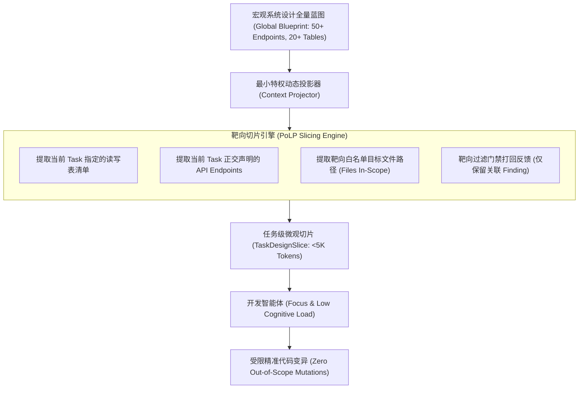
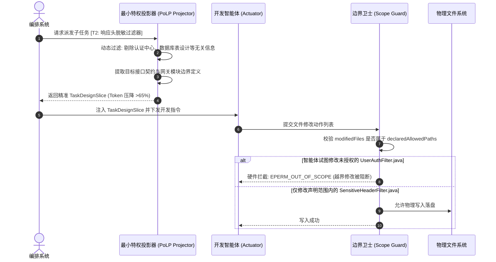

# 模式 04：任务级最小特权投影模式 (Task-Level PoLP Context Slicing Pattern)

---

### 1. 意图 (Intent)
基于网络安全与系统控制论中的**最小特权原则（Principle of Least Privilege, PoLP）**，由上层编排器在向开发智能体派发单子任务时，执行动态上下文切片与降维投影，**仅注入当前任务声明读写的表结构、接口定义与正交文件**，压降 >60% 无关上下文，彻底阻止注意力稀释与越界代码破坏。

---

### 2. 动机与工业失效场景 (Motivation & Real-World Failure Modes)

在许多面向复杂代码库的智能体开发中，最普遍的反模式是**“全量知识库/全局设计图一股脑塞入 Prompt”**：
- **失效场景 A（注意力涣散 Attention Dilution）**：当把一个包含 30 个数据库表、50 个端点定义的全局架构设计文档（数十万 Token）全量喂给负责实现单个网关过滤器的智能体时，模型极易产生“迷失在细节中”的现象，生成大量无关的辅助类，漏掉核心逻辑；
- **失效场景 B（特权过大造成跨界破坏）**：由于上下文包含了全部工程配置与已有单测，智能体在开发网关脱敏逻辑时，因为编译报错，顺手修改了用户鉴权模块的代码或删除了安全模块的已有单测，造成严重的隐蔽逻辑回归（Regression）；
- **失效场景 C（打回反馈的全局噪声污染）**：当门禁系统打回一个微小缺陷（如某个参数非空校验遗漏）时，如果把整个庞大的门禁报告与历史日志全部回灌，智能体往往陷入过度自愈（Over-healing），把原本已经正确写好的其他任务代码全部重写擦除。



---

### 3. 适用性 (Applicability)
- 大型多模块单体或微服务仓库的增量需求开发；
- 具有清晰任务拆解（Task Decomposition）的流水线执行阶段；
- 上下文窗口昂贵或长上下文会导致模型注意力显著衰退的场景。

---

### 4. 参与者与职责 (Participants)

1. **全局架构存储 (Global Blueprint Store)**：保存整个需求周期的完整架构契约（数据表、接口、全局决策）；
2. **最小特权投影器 (Context Projector)**：根据当前派发的单任务元数据（`taskId`、`files`、`modules`），在内存中动态提取子图，生成专属于该任务的最小切片 `TaskDesignSlice`；
3. **特权受限代理 (PoLP Subordinate Agent)**：仅接收切片上下文，禁止调阅非声明路径的完整蓝图，强制在边界内完成实现；
4. **越界边界卫士 (Scope Boundary Guard)**：在代码写回物理底座时，核对 Git Diff 是否超出任务声明的文件边界，超范围直接驳回。

---

### 5. 协作协议与因果约束 (Collaborations)



---

### 6. 后果与权衡 (Consequences)

- **收益 (Pros)**：
  - **Token 消耗断崖式下降**：由于剔除了全量设计的巨量冗余，单任务推理能耗下降 60%~80%；
  - **注意力极度聚焦**：消除了“长文本大海捞针（Needle in a Haystack）”难题，单次代码生成的准确率显著提升；
  - **杜绝副作用**：任务间的修改互不重叠，天然支持并行化开发与拓扑调度。
- **代价 (Cons)**：
  - 要求前期架构设计（Design Phase）必须具备高质量的结构化接口与模块划分能力，若架构设计切分模糊，投影出的切片可能缺失必要依赖信息。

---

### 7. 反模式警示 (Anti-Patterns to Avoid)

| 反模式名称 | 表现特征 | 为什么必须杜绝 |
| :--- | :--- | :--- |
| **全量设计大倒灌 (Monolithic Design Dumping)** | 每次调用 Dev Agent 时将整个系统的上百页设计书全量拼入 Prompt | 导致模型在巨量信息中迷失，并产生大量越界修改 |
| **无界写权限 (Unbounded Write Access)** | 允许开发智能体随意修改项目中任意文件而不加边界拦截 | 极易发生修改公共基类或删除单测的毁灭性回归 |

---

### 8. 抽象算法规约 (Algorithmic Formulation)

```typescript
interface TaskItem {
  taskId: string;
  targetFiles: string[];
  referencedEndpoints: string[];
}

interface GlobalDesignContract {
  summary: string;
  endpoints: EndpointDefinition[];
  tables: TableSchema[];
  decisions: ArchitecturalDecision[];
}

class TaskLevelContextProjector {
  projectTaskSlice(task: TaskItem, globalDesign: GlobalDesignContract): TaskDesignSlice {
    // 1. 过滤正交的 API 端点
    const relevantEndpoints = globalDesign.endpoints.filter(ep => 
      task.referencedEndpoints.includes(ep.path)
    );

    // 2. 过滤正交的数据库表结构
    const relevantTables = globalDesign.tables.filter(tbl =>
      relevantEndpoints.some(ep => ep.relatedTables?.includes(tbl.tableName))
    );

    // 3. 靶向决策投影 (仅保留涉及当前模块的架构决策)
    const relevantDecisions = globalDesign.decisions.filter(d =>
      task.targetFiles.some(f => f.includes(d.affectedModule))
    );

    return {
      taskId: task.taskId,
      scopedFiles: task.targetFiles,
      endpoints: relevantEndpoints,
      tables: relevantTables,
      decisions: relevantDecisions,
      tokenReductionRatio: this.calculateReductionRatio(globalDesign, relevantEndpoints)
    };
  }
}
```
