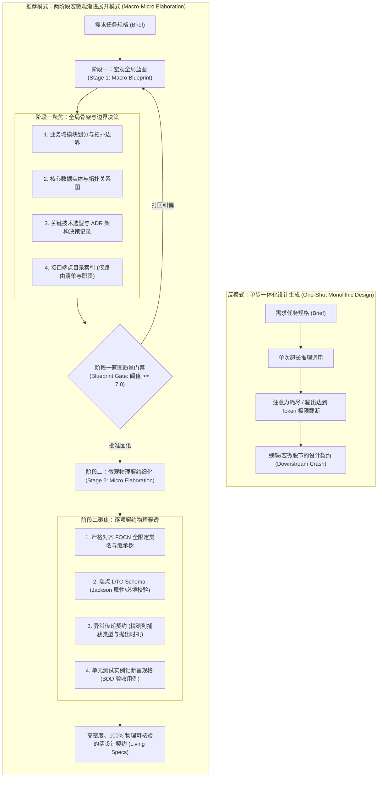
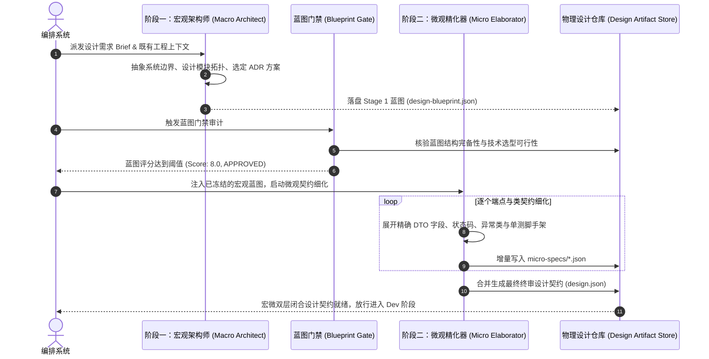

# 模式 05：两阶段宏微观渐进设计展开模式 (Macro-Micro Elaboration Pattern)

---

### 1. 意图 (Intent)
将复杂软件工程的系统架构设计过程解耦为**“阶段一：宏观全局蓝图（Stage 1: Macro Blueprint）”**与**“阶段二：微观物理契约细化（Stage 2: Micro Elaboration）”**的两阶段递进回路。通过认知带宽的分层聚焦，消除智能体在单次生成中试图“一步登天”所导致的注意力衰竭、长文本输出截断、抽象与细节脱节以及伪契约幻觉。

---

### 2. 动机与工业失效场景 (Motivation & Real-World Failure Modes)

在自主软件智能体系统推进至企业级工程（如 Spring Cloud 微服务、大型分布式拓扑）时，设计阶段往往是决定整个系统生死的核心瓶颈。传统的“单步设计生成（One-Shot Monolithic Design）”模式在工业场景中必然触发以下三类严重失效：

- **失效场景 A（架构宇航员与细节截断 Space-Cadet Truncation）**：
  编排器要求智能体在单次推理中“输出包含系统拓扑、数据库表结构、50 个 REST API 端点详细定义及安全策略的完整设计书”。大模型由于单次输出 Token 上限（通常为 4K~8K Tokens）与长距离依赖注意力稀释，往往在前半部分宏伟铺陈概念，而在输出到第 5 个端点时便因达到 Token 极限被强制截断，或者在后半段草草写出 `// ... 其余 45 个端点同上 ...` 的敷衍占位符，导致下游开发智能体无据可依；
- **失效场景 B（假大空与不可核验幻觉 Vague Hand-Waving）**：
  智能体虽然输出了一篇结构看似完备的文档，但通篇充斥着空洞的口号（如“采用分布式锁保证一致性”、“引入高性能网关过滤器实现脱敏”），却缺失物理实现必不可少的微观事实：缺乏确切的全限定类名（FQCN）、方法入参出参数据结构、异常继承体系（如是否继承 `BadCredentialsException`）与 HTTP 状态码。开发智能体在落地时只能全凭脑补，导致多模块集成时接口撕裂；
- **失效场景 C（宏微不闭合与设计背叛 Architectural Betrayal）**：
  在宏观章节中声称“系统采用严格的无状态 JWT 方案”，但在末尾的某个端点定义中却要求通过 `HttpSession` 共享登录态。单体大模型在处理跨层级逻辑时，无法保持自顶向下的严格数学闭合性。



---

### 3. 适用性 (Applicability)
在以下场景必须强行激活本模式：
- 需求复杂度跨越 2 个以上服务模块或涉及 3 个以上核心实体时；
- 架构设计需要经受自动化门禁（如 Jev、架构静态核验器）打分评审的高严密性场景；
- 下游由多个相互隔离的开发智能体并行实现子任务的前置契约生成；
- 需要输出长期可维护的“活设计文档（Living Specifications）”的系统演进过程。

---

### 4. 参与者与职责 (Participants)

1. **宏观架构师 (Macro Architect Agent)**：
   运行于阶段一，只关注“系统的骨架与非功能性约束”。其认知带宽 100% 聚焦于模块职责划分、存储拓扑、核心数据流、架构决策记录（ADR）以及端点目录索引，绝不陷入单接口字段的细枝末节；
2. **蓝图门禁核验器 (Blueprint Gate Auditor)**：
   独立质检实体，对阶段一产出的 `design-blueprint.json` 进行形式化审核（核验 ADR 三要素、权衡矩阵是否闭合、模块依赖是否存在环路），合格后予以冻结；
3. **微观精化器 (Micro Elaborator Agent)**：
   运行于阶段二，接收已冻结的宏观蓝图，以“分而治之（Divide and Conquer）”的方式对具体端点、实体表、异常类进行物理级具象化展开，输出符合 Draft-07 Schema 的终极设计契约；
4. **宏微一致性审计器 (Consistency Auditor)**：
   机械比对微观细化细节是否忠实于宏观架构决策，阻断任何微观维度的“越权篡改”或“设计背叛”。

---

### 5. 协作协议与状态跃迁 (Collaborations)



---

### 6. 后果与权衡 (Consequences)

- **收益 (Pros)**：
  - **彻底消灭 Token 截断灾难**：将数十万 Token 的复杂系统设计拆解为两个确定性子阶段，模型单次推理聚焦度大幅提升，输出内容无任何删减或省略占位符；
  - **实现“物理可落地性”**：微观细化直接生成 Java/TypeScript 级别的精确签名与断言代码，开发智能体无需二次猜测，代码一次性编译通过率提升 80% 以上；
  - **架构决策严密受控**：宏观架构蓝图一旦锁定，微观细化无法擅自推翻上层技术选型，杜绝了模块各自为政。
- **代价 (Cons)**：
  - 流水线在 Design 阶段增加了至少一次独立的模型推理与门禁调度开销，初始设计周期的耗时增加 30%~50%；
  - 需要在平台层定义并维护宏观与微观两套正交的 JSON Schema 契约体系。

---

### 7. 反模式警示 (Anti-Patterns to Avoid)

| 反模式名称 | 表现特征 | 为什么必须杜绝 |
| :--- | :--- | :--- |
| **一步全量大泥球 (One-Step Monolithic Fallacy)** | 试图通过一个超长 Prompt 让模型直接输出完整的微观代码级设计契约 | 必然触发输出截断或末尾接口的大面积内容省略 |
| **虚假微观 (Pseudo-Micro Specifications)** | 微观部分仅给出接口路径 `/api/v1/user`，缺少请求体字段类型与校验规则 | 开发人员/智能体落地时缺乏约束，导致下游联调阶段大面积推倒重来 |
| **自下而上反噬 (Bottom-Up Architectural Drift)** | 允许微观细化阶段随意增删甚至推翻宏观阶段确立的 ADR 决策 | 破坏全局一致性，导致系统架构演化失控 |

---

### 8. 抽象算法规约与契约 Schema (Algorithmic Formulation)

#### 8.1 阶段一宏观蓝图契约 Schema (`design-blueprint.schema.json`)
```json
{
  "$schema": "http://json-schema.org/draft-07/schema#",
  "title": "MacroArchitecturalBlueprint",
  "type": "object",
  "required": ["system_summary", "modules", "architectural_decisions", "endpoint_index"],
  "properties": {
    "system_summary": { "type": "string" },
    "modules": {
      "type": "array",
      "items": {
        "type": "object",
        "required": ["name", "responsibility", "tech_stack"],
        "properties": {
          "name": { "type": "string" },
          "responsibility": { "type": "string" },
          "tech_stack": { "type": "string" }
        }
      }
    },
    "architectural_decisions": {
      "type": "array",
      "items": {
        "type": "object",
        "required": ["id", "context", "decision", "consequences"],
        "properties": {
          "id": { "type": "string" },
          "context": { "type": "string" },
          "decision": { "type": "string" },
          "consequences": { "type": "string" }
        }
      }
    },
    "endpoint_index": {
      "type": "array",
      "items": {
        "type": "object",
        "required": ["method", "path", "owner_module", "brief_summary"],
        "properties": {
          "method": { "type": "string", "enum": ["GET", "POST", "PUT", "DELETE", "PATCH"] },
          "path": { "type": "string" },
          "owner_module": { "type": "string" },
          "brief_summary": { "type": "string" }
        }
      }
    }
  }
}
```

#### 8.2 阶段二微观细化核心执行算法
```typescript
interface MacroBlueprint {
  system_summary: string;
  modules: ModuleSpec[];
  architectural_decisions: ADR[];
  endpoint_index: EndpointBrief[];
}

interface MicroSpecification {
  fqcn: string;
  endpoints: DetailedEndpointSpec[];
  exceptionHierarchy: ExceptionSpec[];
  testInvariants: BddAssertionContract[];
}

class ProgressiveDesignOrchestrator {
  async executeTwoStageDesign(brief: RequirementBrief): Promise<FinalDesignContract> {
    // -------------------------------------------------------------
    // 阶段一：宏观全局蓝图设计 (Macro Blueprint Generation)
    // -------------------------------------------------------------
    const macroPrompt = this.buildMacroPrompt(brief);
    const blueprint: MacroBlueprint = await this.macroArchitect.generateBlueprint(macroPrompt);

    // 阶段一蓝图质量门禁审查 (Jev/Auditor Gate)
    const blueprintAudit = await this.gateAuditor.evaluateBlueprint(blueprint);
    if (blueprintAudit.score < 7.0) {
      throw new Error(`BLUEPRINT_REJECTED: ${blueprintAudit.feedback}`);
    }

    // -------------------------------------------------------------
    // 阶段二：微观物理契约逐项具象化 (Micro Elaboration)
    // -------------------------------------------------------------
    const microSpecs: MicroSpecification[] = [];
    
    // 对蓝图中的端点索引执行分而治之的细化展开
    for (const epBrief of blueprint.endpoint_index) {
      const elaborationPrompt = this.buildElaborationPrompt(epBrief, blueprint);
      const detailedSpec = await this.microElaborator.elaborateEndpoint(elaborationPrompt);
      
      // 宏微闭合性核验：确保微观细化严格遵守宏观 ADR 决策
      this.validateMacroMicroAlignment(blueprint, detailedSpec);
      microSpecs.push(detailedSpec);
    }

    // -------------------------------------------------------------
    // 合并固化为最终设计契约 (design.json)
    // -------------------------------------------------------------
    return this.synthesizeFinalContract(blueprint, microSpecs);
  }
}
```
