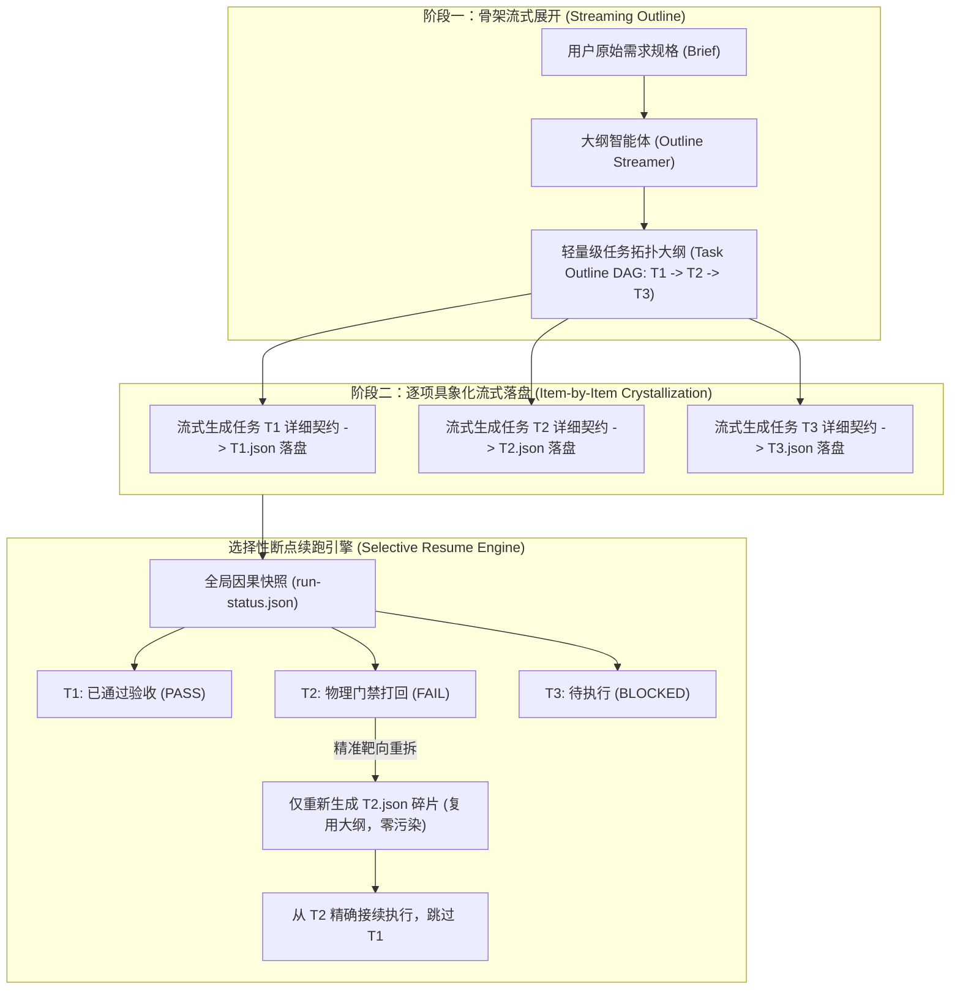
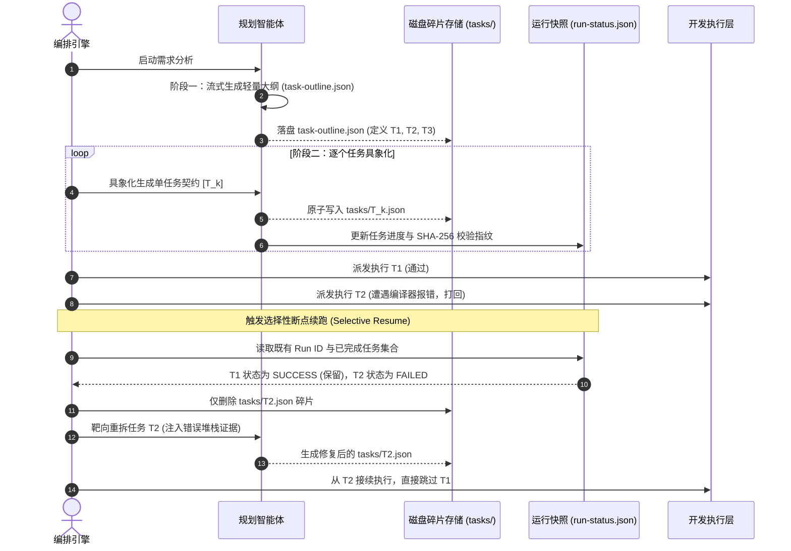

# 模式 06：流式拓扑分解与选择性断点续跑模式 (Streaming Decomposition & Selective Resume Pattern)

---

### 1. 意图 (Intent)
将大型工程任务的需求拆解过程由一次性全局批量生成重构为**“流式渐进分解（Streaming Incremental Decomposition）”**，并结合有向无环图（DAG）拓扑状态机实现**“选择性断点续跑（Selective Resume）”**，有效对抗超长任务生成中的上下文退化（Context Rot, Liu et al., 2024），并在环境崩溃或任务重试时实现零冗余计算的精准靶向自愈。

---

### 2. 动机与工业失效场景 (Motivation & Real-World Failure Modes)

在面对包含数十个子任务的工业级需求（如微服务全栈功能迁移）时，传统的单步全局规划（One-Shot Global Planning）存在显著失效：

- **失效场景 A（规划层面的上下文退化 Context Rot）**：
  编排器要求产品经理智能体（PM Agent）一次性输出 15 个任务的完整 JSON 列表（包含每个任务的依赖关系、验收标准与文件范围）。由于上下文退化与迷失在中间（Lost in the Middle）现象，模型通常在完成前 3 个任务后注意力迅速疲劳，后半部分任务出现大面积内容重复、依赖环路错乱或 Schema 字段缺失；
- **失效场景 B（全量重跑的灾难性开销 Cascading Re-run Overhead）**：
  在执行阶段，假设第 12 个任务因为某个微观断言错误被门禁打回。在缺乏增量状态拓扑的系统中，编排器往往触发全局重跑，将前 11 个已经通过严格编译与测试验证的任务全部推倒重来，造成数百万 Token 的计算浪费与物理工作区污染；
- **失效场景 C（意外中断后的状态丢失 Crash Recovery Failure）**：
  在长时间运行的长周期工程中，底层宿主可能因网络波动、OOM 或服务重启而中断。若无细粒度流式落盘与因果状态快照，系统无法恢复现场，导致工程进展永久丢失。



---

### 3. 适用性 (Applicability)
- 包含 3 个以上强依赖子步骤的复杂软件工程任务；
- 易发生外部环境抖动、模型推理超时或服务器重启的长周期自主流水线；
- 需要严格控制 Token 能耗、避免对已通过任务重复计算的成本敏感型企业系统。

---

### 4. 参与者与职责 (Participants)

1. **大纲流式器 (Outline Streamer)**：负责第一阶段的全局骨架拓扑推演，仅产出任务标识符、依赖前驱与一句话职责，阻断模型在早期陷入细节；
2. **碎片流式生成器 (Fragment Materializer)**：按拓扑顺序逐个调用子代理具象化每个任务，每生成一个任务即刻在磁盘落盘独立的碎片契约（`tasks/T{N}.json`）；
3. **断点快照协调器 (Resume Snapshot Coordinator)**：维护单调递增的因果状态文件 `run-status.json`，记录每个任务的当前生命周期（`PENDING`, `IN_PROGRESS`, `SUCCESS`, `FAILED`）；
4. **靶向自愈重试器 (Targeted Healing Re-trier)**：在接收到下游门禁打回信号时，通过 DAG 拓扑分析定位受污染任务的最小闭包，仅将失效任务标记为 `STALE` 并触发局部重拆，严格复用无损碎片。

---

### 5. 协作协议与因果约束 (Collaborations)



---

### 6. 后果与权衡 (Consequences)

- **收益 (Pros)**：
  - **规避上下文退化（Context Rot）**：每个任务的具象化提示词仅包含大纲与当前切片，上下文长度恒定受控在低熵区间；
  - **极速故障恢复（Instant MTTR）**：由于采用单任务独立磁盘碎片（`T1.json`, `T2.json`），系统崩溃重启后可在毫秒级定位恢复点，跳过已通过的高分门禁；
  - **自愈计算开销最小化**：局部打回仅重拆单任务，节省 70% 以上的重试 Token。
- **代价 (Cons)**：
  - 需要在编排器底层维护基于文件系统或分布式 KV 的状态快照与锁机制；
  - 子任务间的跨任务数据共享必须通过显式声明的输出契约进行传递。

---

### 7. 反模式警示 (Anti-Patterns to Avoid)

| 反模式名称 | 表现特征 | 为什么必须杜绝 |
| :--- | :--- | :--- |
| **全量一次性大清单 (Monolithic Task Dumping)** | 要求模型在一个超长数组中直接输出所有子任务详情 | 触发上下文退化（Liu et al., 2024），导致后半部分任务质量急剧下降 |
| **一损俱损的全量推倒 (All-or-Nothing Cascade)** | 某个微观单测未过，便将整个流水线重置为初始状态重新生成 | 极度浪费能耗，且破坏了已验证代码资产的稳定性 |

---

### 8. 抽象算法规约 (Algorithmic Formulation)

```typescript
interface TaskOutline {
  tasks: Array<{ id: string; title: string; dependencies: string[] }>;
}

class StreamingDecompositionEngine {
  async planAndResume(brief: string, workDir: string, resumeMode: boolean): Promise<TaskQueue> {
    const outlinePath = path.join(workDir, "task-outline.json");
    let outline: TaskOutline;

    // 1. 大纲生成或复用 (Stage 1)
    if (resumeMode && fs.existsSync(outlinePath)) {
      outline = JSON.parse(fs.readFileSync(outlinePath, "utf8"));
    } else {
      outline = await this.pmAgent.generateOutline(brief);
      fs.writeFileSync(outlinePath, JSON.stringify(outline, null, 2));
    }

    // 2. 流式逐项具象化 (Stage 2)
    const materializedTasks: TaskItem[] = [];
    for (const taskStub of outline.tasks) {
      const fragmentPath = path.join(workDir, "tasks", `${taskStub.id}.json`);
      
      if (resumeMode && fs.existsSync(fragmentPath)) {
        // 断点命中：复用磁盘碎片，零模型调用
        materializedTasks.push(JSON.parse(fs.readFileSync(fragmentPath, "utf8")));
        continue;
      }

      // 流式具象化生成单任务碎片
      const detailedTask = await this.pmAgent.elaborateSingleTask(taskStub, outline, brief);
      fs.writeFileSync(fragmentPath, JSON.stringify(detailedTask, null, 2));
      materializedTasks.push(detailedTask);
    }

    return new TaskQueue(materializedTasks);
  }
}
```
