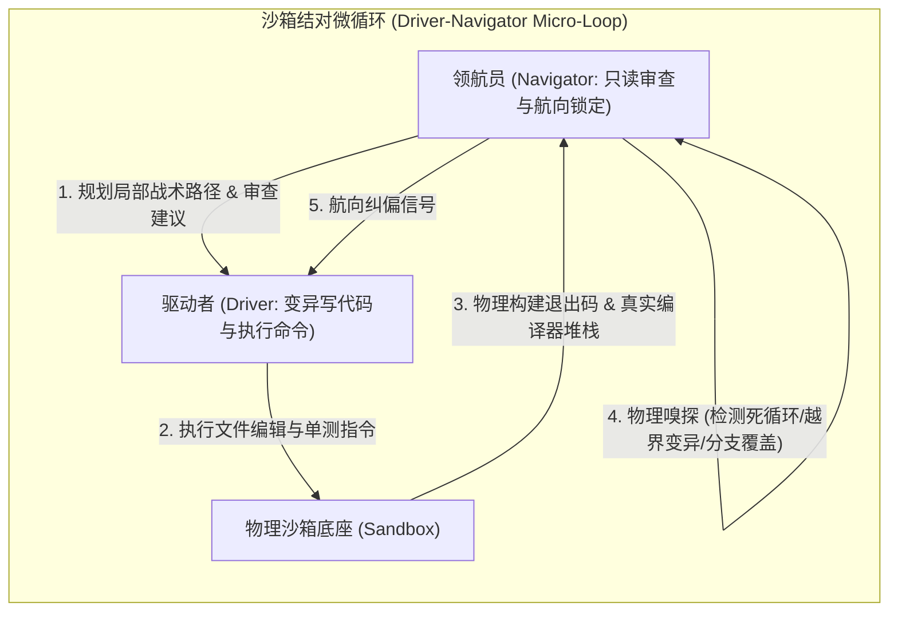
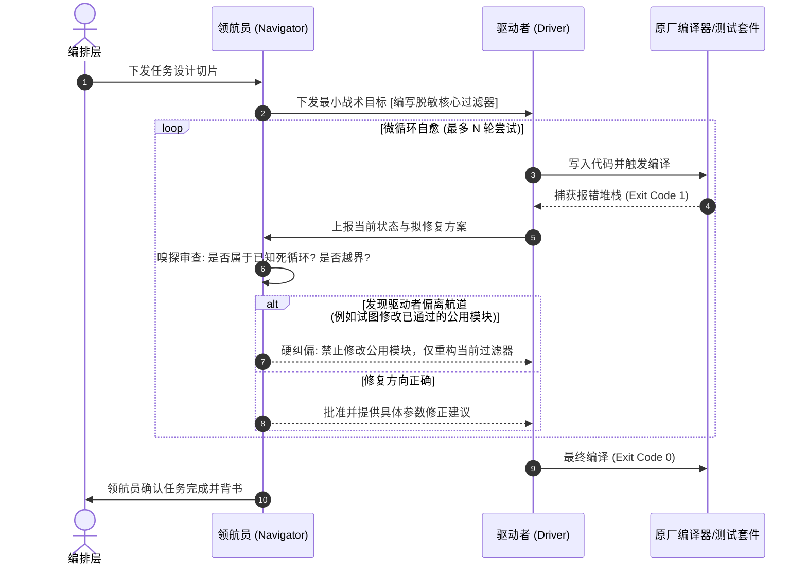

# 模式 07：沙箱驱动-导航结对微循环模式 (Driver-Navigator Pairing Pattern)

---

### 1. 意图 (Intent)
借鉴极限编程（Extreme Programming, XP）中的结对编程思想，在受控沙箱内构建由**驱动者智能体（Driver Agent）**与**领航员智能体（Navigator Agent）**组成的同频微循环自愈闭环，实现“原地变异-即时嗅探-局部收敛”，防止智能体单兵作战时陷入自愈死循环或盲目扩大破坏面。

---

### 2. 动机与工业失效场景 (Motivation & Real-World Failure Modes)

在单智能体执行代码变异与编译修复时，极易陷入**“自愈黑洞（Healing Black Hole）”**：
- **失效场景 A（越修越多）**：单智能体在修改一个编译报错时，由于缺乏全局航向约束，顺着编译器的报错链条一路修改了 8 个不相干的文件，最后导致整个工程架构发生雪崩式变形；
- **失效场景 B（局部陷入局部最优）**：智能体在修复单测时，反复在两个互相冲突的报错之间来回横跳（A 错修好导致 B 错，B 错修好导致 A 错），耗尽上下文 Token 后仍停留在初始错误；
- **失效场景 C（空流与无感挂起）**：驱动智能体在遭遇复杂异常堆栈时，陷入长时间的长上下文静默，外部编排器无法感知其是否处于有效探索状态。



---

### 3. 适用性 (Applicability)
- 涉及复杂编译错误、类型系统断言或复杂业务算法的实现阶段；
- 需要高容错度、防止代码破坏面逃逸的关键核心模块开发；
- 单个复杂任务的微观执行闭环。

---

### 4. 参与者与职责 (Participants)

1. **驱动者 (Driver Agent)**：手握变异工具（文件写入、命令执行），负责具体编写代码、执行编译器构建，具备执行原动力；
2. **领航员 (Navigator Agent)**：只读角色，不直接写代码；负责监控驱动者的每一步变异操作，对比架构设计契约，实时审查代码质量并下发靶向纠偏建议；
3. **隐式嗅探器 (Implicit Sniffer)**：集成在领航员底层的传感器，实时检测代码变异是否触发死循环、是否发生未声明文件写操作或逻辑反模式。

---

### 5. 协作协议与因果约束 (Collaborations)



---

### 6. 后果与权衡 (Consequences)

- **收益 (Pros)**：
  - **自愈收敛速度极快**：领航员充当“实时外部刹车片”，将复杂的探索空间压缩在局部航道内，规避了 80% 以上的无效盲目重试；
  - **代码品质双保险**：每一行落盘代码均经历领航员的实时语义审查，减少后续全局代码评审阶段的打回频次。
- **代价 (Cons)**：
  - 多智能体并发或轮询会增加单任务的基础推理调用次数，需要配合高效的小参数量轻量模型作为驱动者/领航员角色。

---

### 7. 反模式警示 (Anti-Patterns to Avoid)

| 反模式名称 | 表现特征 | 为什么必须杜绝 |
| :--- | :--- | :--- |
| **单兵盲目狂奔 (Lone Ranger Blackhole)** | 单一智能体在无审查者监督下连续修改 10+ 轮代码 | 极易发生灾难性代码变形，最终彻底偏离初始架构 |
| **领航员越俎代庖 (Navigator Role Intrusion)** | 领航员直接接管驱动者的写入工具自己写代码 | 破坏了“一人思考一人执行”的认知隔离，导致自我偏见（Confirmation Bias）再次滋生 |

---

### 8. 抽象算法规约 (Algorithmic Formulation)

```typescript
interface PairDevSession {
  driver: DriverAgent;
  navigator: NavigatorAgent;
  maxIterations: number;
}

class SandboxPairDevLoop {
  async executePairDev(session: PairDevSession, taskSlice: TaskDesignSlice): Promise<TaskResult> {
    let iteration = 0;
    let currentFeedback: NavigatorGuidance = session.navigator.initialBrief(taskSlice);

    while (iteration < session.maxIterations) {
      iteration++;
      
      // 1. 驱动者在领航员指引下变异物理代码
      const mutationResult = await session.driver.actuate(currentFeedback);
      
      // 2. 真实原厂编译与测试
      const buildResult = await session.driver.runInSituVerify();
      if (buildResult.exitCode === 0) {
        // 领航员终审代码合规性
        const finalAudit = await session.navigator.auditFinalCode(mutationResult.modifiedFiles);
        if (finalAudit.approved) {
          return { success: true, iterations: iteration, codeArtifacts: mutationResult.modifiedFiles };
        }
      }

      // 3. 领航员对错误堆栈与变异历史进行隐式嗅探与纠偏
      currentFeedback = await session.navigator.analyzeFailureAndSteer(
        buildResult.errorOutput,
        mutationResult.mutationDiff,
        iteration
      );

      // 检测死循环
      if (currentFeedback.isLoopDetected) {
        await session.driver.rollbackToLastKnownStableState();
      }
    }

    return { success: false, reason: "MAX_ITERATIONS_EXCEEDED" };
  }
}
```
