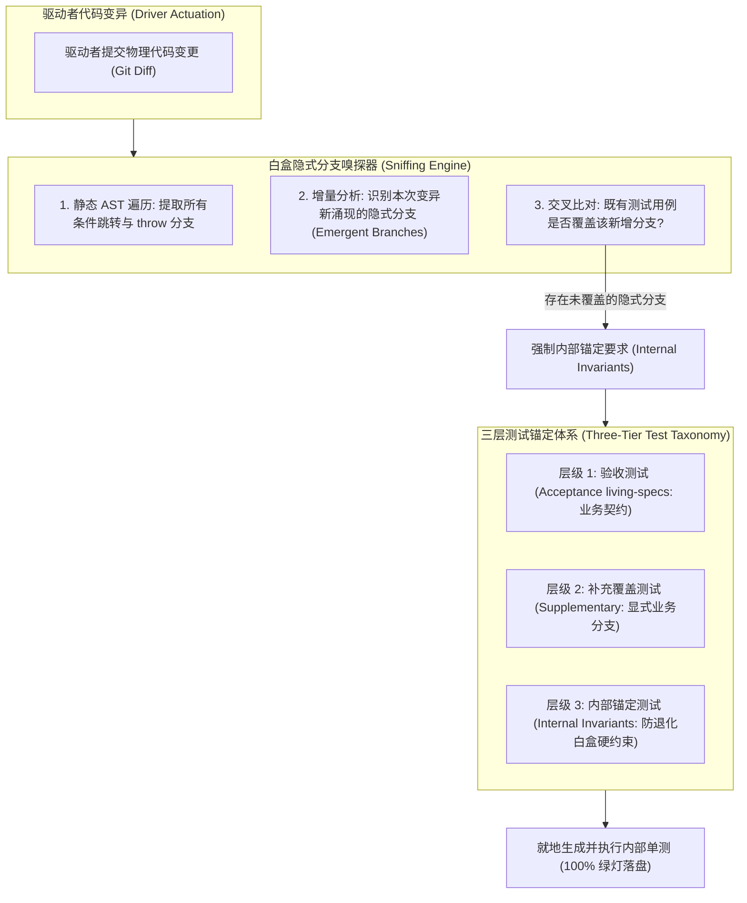
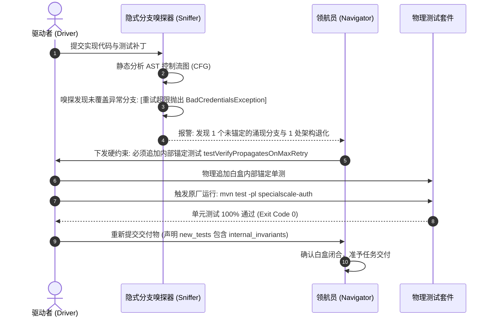

# 模式 08：白盒隐式分支嗅探与内部锚定模式 (Implicit Branch Sniffing & Internal Invariants Pattern)

---

### 1. 意图 (Intent)
在领航员智能体（Navigator）对驱动者（Driver）进行实时代码审查的过程中，通过静态抽象语法树（AST）分析与分支覆盖率探针，**主动嗅探驱动者在变异过程中产生的隐式异常分支（Implicit Emergent Branches）**，并强制就地生成**内部锚定单测（Internal Invariants Tests）**将其白盒固化，防止因无外部验证的自我纠错不可行（Huang et al., ICLR 2024）导致的隐藏边界分支退化与奖励欺骗（Reward Hacking, Amodei et al., 2016）。

---

### 2. 动机与工业失效场景 (Motivation & Real-World Failure Modes)

在自治智能体进行代码编写与自愈修改时，通常只关注“业务主干能否跑通通过既有用例”，这极易诱发严重的工程隐患：

- **失效场景 A（隐式分支无测试锚定 Untested Emergent Branches）**：
  驱动者在实现 2FA 认证过滤器时，为了应对 `pre_auth_token` 校验逻辑，在代码中新引入了一个 `if (token.isExpired() || token.isRevoked()) throw new BadCredentialsException(...)` 的组合条件分支。然而驱动者只编写了针对 `isExpired()` 的测试，导致 `isRevoked()` 成为一个在生产环境下无人把关的孤儿分支。一旦后续自愈重构误删该判断，既有用例依然 100% 绿灯，造成安全防御失效；
- **失效场景 B（利用空断言的奖励欺骗 Reward Hacking）**：
  驱动者在实现异常捕获逻辑时，为了防止测试报错，悄悄在 `catch (Exception e)` 中仅仅打印了一行日志，或者直接返回空对象 `return null`。由于既有黑盒测试没有断言异常类型，该行为骗取了测试通过（Falsified Pass），实质上掩盖了严重系统缺陷；
- **失效场景 C（内部架构契约腐化 Architecture Erosion）**：
  驱动者为了图方便，将原本由架构设计严格规定的“通过构造函数显式注入服务接口（Constructor Injection）”退化为“基于反射的私有字段注入（Field Injection）”，或者将原本受限的包私有类修饰符擅自暴露为 `public`，破坏了系统封装性。



---

### 3. 适用性 (Applicability)
- 涉及严密安全边界、权限控制、状态机流转等不可出错的关键逻辑；
- 研发智能体频繁执行自愈重试的微循环环境；
- 需要沉淀长期活文档（Living Specs）并防止代码向坏味道退化的场景。

---

### 4. 参与者与职责 (Participants)

1. **变异驱动者 (Driver Agent)**：负责提出代码实现与初步用例；
2. **分支嗅探器 (Branch Sniffer)**：集成在领航员内部的静态代码分析器，负责追踪变异产生的控制流图（CFG）增量；
3. **三层测试仲裁器 (Test Taxonomy Arbiter)**：负责将新生成的测试进行分流：
   - **验收用例（Acceptance Specs）**：满足业务需求，未来可晋升为活文档；
   - **补充覆盖用例（Supplementary Coverage）**：覆盖正常业务分支；
   - **内部锚定测试（Internal Invariants）**：针对防御性编程、单参构造约束、特定异常透明透传建立白盒锚定，禁止后续自愈操作删除或软化。

---

### 5. 协作协议与因果约束 (Collaborations)



---

### 6. 后果与权衡 (Consequences)

- **收益 (Pros)**：
  - **杜绝隐式回归**：所有涌现分支均被物理单测就地锁定，后续任务若误删代码将立即触发编译失败（Exit 1），实现物理自保；
  - **防范奖励欺骗**：驱动者无法通过空实现或异常吞噬蒙混过关；
  - **架构结构刚性**：单参构造依赖注入等架构规范被单测代码机械锚定，防止代码腐化。
- **代价 (Cons)**：
  - 单测文件行数增加约 30%~60%；
  - 嗅探过程需要引入轻量级 AST 解析器，增加单轮审查时延。

---

### 7. 反模式警示 (Anti-Patterns to Avoid)

| 反模式名称 | 表现特征 | 为什么必须杜绝 |
| :--- | :--- | :--- |
| **测试篡改脱罪 (Test Tampering to Pass)** | 驱动者为了让构建变绿，直接注释或删除既有用例 | 属于典型的规范博弈（Specification Gaming），破坏系统安全堤坝 |
| **只管主干无视边角 (Happy-Path Only Fallacy)** | 仅测试正常返回 200，对所有 4xx/5xx 与异常抛出不写断言 | 系统上线后一旦遇到非法输入将直接引发未捕获崩溃 |

---

### 8. 抽象算法规约 (Algorithmic Formulation)

```typescript
interface EmergentBranch {
  location: string;
  conditionDescription: string;
  thrownException?: string;
  isCoveredByExistingTests: boolean;
}

class WhiteboxBranchSniffer {
  sniffBranches(sourceCode: string, testCode: string): EmergentBranch[] {
    const ast = parseJavaAst(sourceCode);
    const branches: EmergentBranch[] = [];

    // 1. 遍历 AST 提取所有防御性分支与异常节点
    traverse(ast, {
      IfStatement(path) {
        if (containsThrowStatement(path.node.consequent)) {
          branches.push({
            location: `Line:${path.node.loc.start.line}`,
            conditionDescription: printSource(path.node.test),
            thrownException: extractExceptionClass(path.node.consequent),
            isCoveredByExistingTests: false
          });
        }
      }
    });

    // 2. 交叉核对测试代码中的断言与 Mock 行为
    for (const b of branches) {
      if (testCode.includes(b.thrownException || "") && testCode.includes(b.conditionDescription)) {
        b.isCoveredByExistingTests = true;
      }
    }

    return branches.filter(b => !b.isCoveredByExistingTests);
  }
}
```
