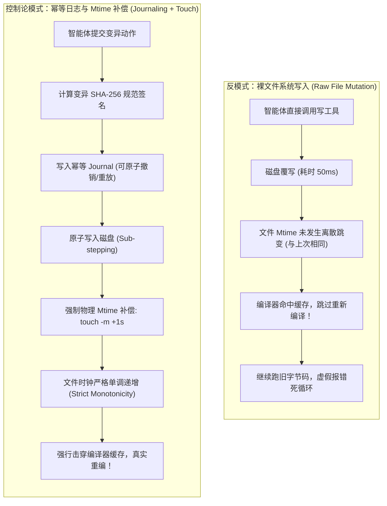
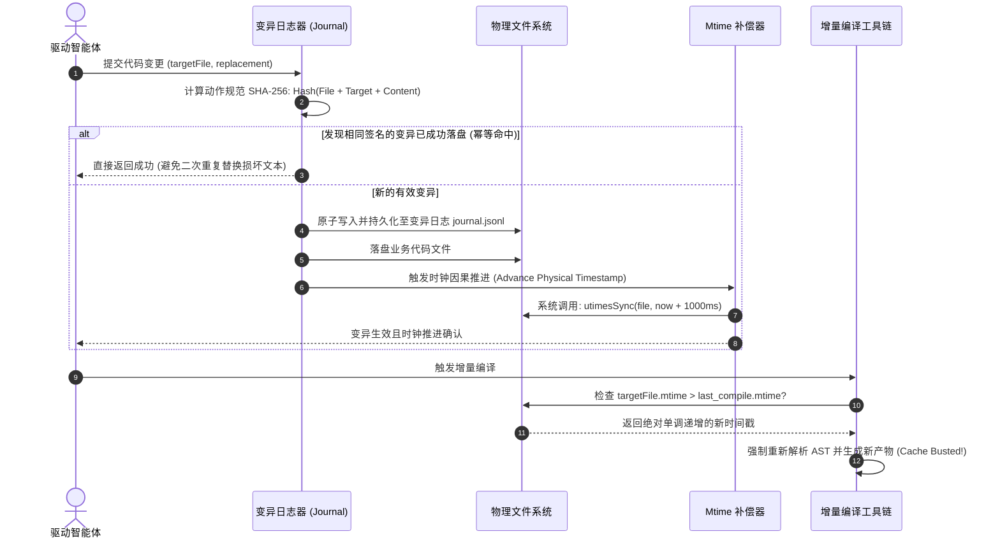

# 模式 09：幂等变异日志与物理时钟补偿模式 (Idempotent Journaling & Mtime Touch Pattern)

---

### 1. 意图 (Intent)
为智能体针对物理底座的所有写操作建立**规范化 SHA-256 签名日志（Idempotent Journaling）**与**物理文件系统时钟补偿机制（Mtime Touch Compensation）**，解决智能体自愈重试过程中的变异叠加错位，并消除因毫秒级高频覆写导致现代编译器缓存命中（Stale Cache）而引发的虚假构建状态。

---

### 2. 动机与工业失效场景 (Motivation & Real-World Failure Modes)

在真实工业软件工程中，文件系统与编译器具有严格的因果与时间敏感性：
- **失效场景 A（重试变异叠加错位）**：智能体调用 `replace_file_content` 工具修复某行代码，如果第一次调用因网络超时中断，智能体触发重试，由于上一轮可能已经部分写入，第二次基于相同行号或文本的替换将导致目标文本找不到、或发生双重插入，使代码文件损毁；
- **失效场景 B（Mtime 停滞导致编译器假死）**：智能体在修复 Bug 时，从读文件、分析到写回只消耗了 200 毫秒，写入完成的文件修改时间（Mtime）与上一次写入落在操作系统的同一个时间戳内（特别是在秒级时间戳粒度的某些文件系统或打包工具中）。随后触发 `mvn compile` 或 `webpack` 时，构建工具检测到文件的 `mtime <= last_build_time`，**直接跳过了该文件的重新编译**，继续运行旧的 `.class` 字节码，导致智能体陷入“明明改了代码但报错毫无变化”的虚假困境；
- **失效场景 C（空流与隐式状态丢失）**：智能体执行写入后遭遇异常，无法准确溯源物理磁盘上到底停留在哪一个历史快照，导致自愈回退操作无从下手。



---

### 3. 适用性 (Applicability)
- 任何具备增量编译缓存（Incremental Build Cache）的现代编译型语言工程（Java, C++, Rust, Go, TypeScript）；
- 涉及自动重试机制或多步复杂自愈修复循环（Self-Healing Loops）；
- 需要绝对可靠的物理状态快照与回退支持。

---

### 4. 参与者与职责 (Participants)

1. **变异日志管理器 (Mutation Journal Manager)**：为每一次写操作计算规范化内容哈希与目标文件上下文指纹，维护前向重放与后向回退栈；
2. **原子执行器 (Atomic Sub-stepper)**：负责将写操作分解为原子子步（写入临时文件、原子重命名移动），防止半写入导致文件损坏；
3. **物理时钟补偿器 (Mtime Touch Compensator)**：在写入完成后，直接调用操作系统底层系统调用（如 `fs.utimes` 或 `touch`），显式将目标文件的 `mtime` 推进至当前时钟加 1 秒，破坏增量编译器的缓存命中条件。

---

### 5. 协作协议与因果约束 (Collaborations)



---

### 6. 后果与权衡 (Consequences)

- **收益 (Pros)**：
  - **消除编译器幽灵报错**：确保每一次代码修改都能 100% 触发物理编译，终结“代码修改了但字节码没变”的调试恶梦；
  - **状态重放安全幂等**：网络中断或智能体误触发重试时，绝对不会破坏目标源码语法。
- **代价 (Cons)**：
  - 引入了轻微的文件系统系统调用开销（每步操作增加几毫秒）；
  - 需要在沙箱环境中保障对文件元数据修改的系统权限。

---

### 7. 反模式警示 (Anti-Patterns to Avoid)

| 反模式名称 | 表现特征 | 为什么必须杜绝 |
| :--- | :--- | :--- |
| **裸字符直写 (Raw String Replacement)** | 直接在原始文件上进行非幂等的正则替换 | 重试时由于原字符已被替换，二次重试必然抛出找不到锚点的异常 |
| **盲信系统时钟 (Blind System Clock Trust)** | 假设写完文件后编译器自然能感知 | 现代多核与高频变异下，Mtime 停留在同一秒极其常见，导致增量编译漏编 |

---

### 8. 抽象算法规约 (Algorithmic Formulation)

```typescript
import * as fs from "fs";
import * as crypto from "crypto";

interface MutationEntry {
  journalId: string;
  filePath: string;
  sha256: string;
  appliedTimestamp: number;
}

class IdempotentSubstrateMutator {
  private journal: Map<string, MutationEntry> = new Map();

  async applyMutation(filePath: string, originalContent: string, newContent: string): Promise<boolean> {
    // 1. 计算变异指纹 (Canonical SHA-256)
    const signature = crypto.createHash("sha256")
      .update(filePath)
      .update(originalContent)
      .update(newContent)
      .digest("hex");

    if (this.journal.has(signature)) {
      // 幂等防御：已执行过完全相同的变异，安全跳过
      return true;
    }

    // 2. 原子写入物理文件
    const tmpPath = `${filePath}.tmp.${Date.now()}`;
    await fs.promises.writeFile(tmpPath, newContent, "utf8");
    await fs.promises.rename(tmpPath, filePath);

    // 3. 物理 Mtime 补偿 (强制时间戳单调递增，击穿编译缓存)
    const compensatedTime = (Date.now() + 1000) / 1000;
    fs.utimesSync(filePath, compensatedTime, compensatedTime);

    // 4. 记入持久化日志
    this.journal.set(signature, {
      journalId: signature,
      filePath,
      sha256: signature,
      appliedTimestamp: Date.now()
    });

    return true;
  }
}
```
