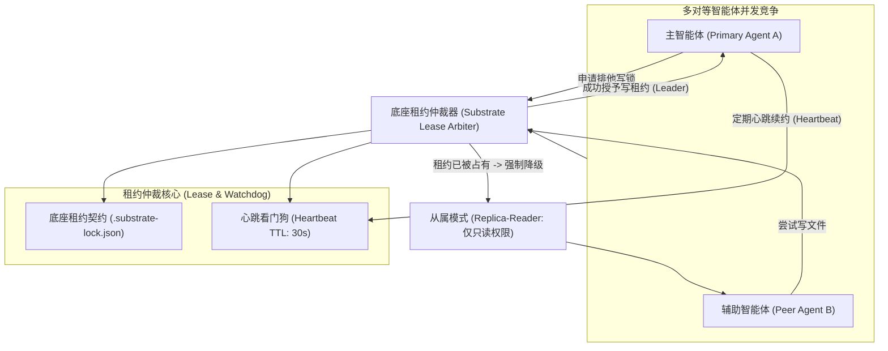
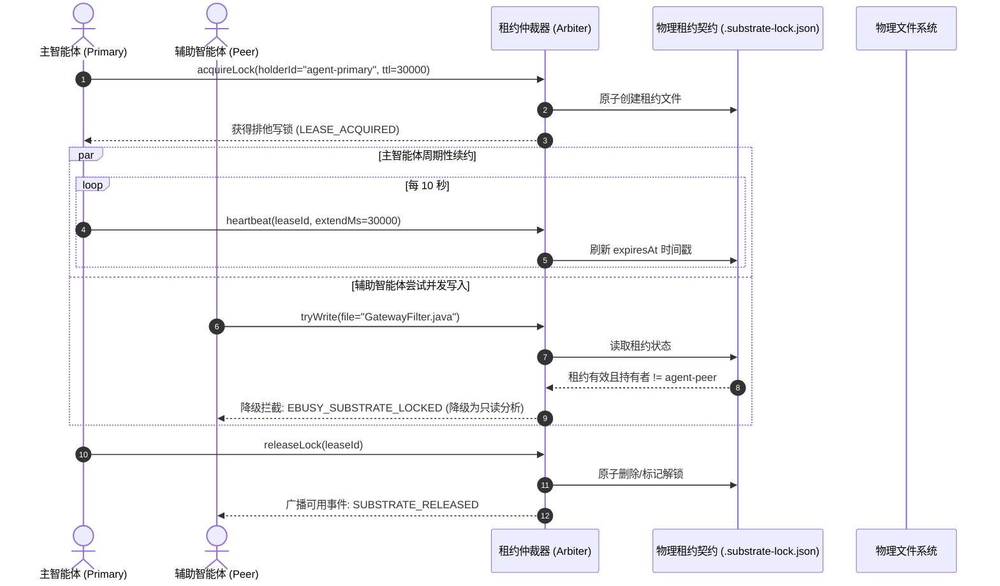

# 第十三章 模式 10：分布式物理底座租约锁模式 (Substrate Lease Lock & Watchdog Pattern)

---

### 1. 意图 (Intent)
在多对等智能体（Peer Agents）或异构扩展代理协作场景下，针对物理底座的共享资源建立**基于租约协议（Lease Protocol）、心跳看门狗（Watchdog）与状态防篡改校验的排他写锁机制**，强行将未持锁代理降级为主写从读（Primary-Writer Replica-Reader），防止并发代码写写冲突与死锁。

---

### 2. 动机与工业失效场景 (Motivation & Real-World Failure Modes)

当智能体系统从单体进化到多智能体并发协同（例如流水线主代理与 IDE 端辅助代理、代码生成代理与并发单测补全代理同时工作）时，传统的无锁设计必然崩溃：
- **失效场景 A（写写竞争导致代码撕裂）**：两个智能体在几乎相同的时刻对同一个 Java 类进行并发编辑，导致 Git 工作区出现未解决的物理冲突标签（`<<<<<<< HEAD`），后续两方都无法继续解析语法；
- **失效场景 B（死锁与孤儿锁）**：持有写锁的智能体因模型生成超时、网络中断或进程崩溃而意外终止，但由于锁未设置超时续约机制，导致整个工程被永久锁死（Deadlock），后续所有流水线任务永久挂起；
- **失效场景 C（越权偷跑）**：副智能体（如辅助问答代理）在未经授权的情况下直接修改了正在编译的代码，破坏了主智能体正在验证的环境纯洁性。



---

### 3. 适用性 (Applicability)
- 多个自主智能体共享同一个代码仓库或物理工作区的场景；
- IDE 客户端插件（如 Cline、Trae、Cursor）与后台自治流水线并发协作的环境；
- 长周期任务与异步背景自愈任务并行的系统。

---

### 4. 参与者与职责 (Participants)

1. **租约仲裁器 (Lease Arbiter)**：基于文件锁或原子分布式原语的仲裁实体，负责锁的颁发、续期与释放；
2. **租约契约 (Lease Contract)**：受机器 Schema 严格约束的元数据（包含持锁者 ID、持锁角色、授予时间戳、TTL 过期毫秒数与校验指纹）；
3. **心跳看门狗 (Heartbeat Watchdog)**：后台异步巡检器，当检测到持锁者因崩溃未在 TTL 内发送心跳时，自动安全回收租约（Safe Eviction）；
4. **从读降级器 (Replica-Reader Interceptor)**：拦截未持锁者的写变异系统调用，将其转换为只读分析视图或在内存中进行影子模拟，禁止落盘。

---

### 5. 协作协议与因果约束 (Collaborations)



---

### 6. 后果与权衡 (Consequences)

- **收益 (Pros)**：
  - **物理底座绝对一致性**：消除多 Agent 并发写入引发的代码撕裂与 Git 冲突（租约互斥机检，附录 B.4）；
  - **故障自动免疫与自愈**：依靠 TTL 看门狗机制，任何单点 Agent 的意外崩溃都不会导致整个工程被死锁。
- **代价 (Cons)**：
  - 需要在智能体 SDK 层实现定期心跳背景协程（Goroutine/Timer）；
  - 副智能体在等待排他锁期间会产生一定的排队时延。

---

### 7. 反模式警示 (Anti-Patterns to Avoid)

| 反模式名称 | 表现特征 | 为什么必须杜绝 |
| :--- | :--- | :--- |
| **无超时的永久互斥锁 (Indefinite Mutex Trap)** | 仅在进入时建锁，退出时删锁，无 TTL 设置 | 智能体进程一旦被 OOM 杀死，锁文件残留将导致系统永久死锁 |
| **乐观盲写冲突 (Optimistic Blind Mutation)** | 允许多个智能体自由覆写，事后依赖 Git merge | LLM 对 Git 冲突标记处理能力极差，极易破坏有效代码 |

---

### 8. 抽象算法规约 (Algorithmic Formulation)

```typescript
interface SubstrateLease {
  leaseId: string;
  holderId: string;
  role: string;
  grantedAt: number;
  expiresAt: number;
  checksum: string;
}

class SubstrateLockManager {
  private readonly lockFilePath = ".substrate-lock.json";
  private readonly defaultTtlMs = 30000;

  acquireLock(holderId: string, role: string): boolean {
    const now = Date.now();
    if (fs.existsSync(this.lockFilePath)) {
      const currentLease: SubstrateLease = JSON.parse(fs.readFileSync(this.lockFilePath, "utf8"));
      // 检查租约是否仍有效
      if (now < currentLease.expiresAt && currentLease.holderId !== holderId) {
        return false; // 被他人持锁，申请失败
      }
    }

    // 颁发新租约
    const newLease: SubstrateLease = {
      leaseId: crypto.randomUUID(),
      holderId,
      role,
      grantedAt: now,
      expiresAt: now + this.defaultTtlMs,
      checksum: this.computeChecksum(holderId, now)
    };

    fs.writeFileSync(this.lockFilePath, JSON.stringify(newLease, null, 2), "utf8");
    return true;
  }

  heartbeat(leaseId: string, holderId: string): boolean {
    if (!fs.existsSync(this.lockFilePath)) return false;
    const lease: SubstrateLease = JSON.parse(fs.readFileSync(this.lockFilePath, "utf8"));
    if (lease.leaseId === leaseId && lease.holderId === holderId) {
      lease.expiresAt = Date.now() + this.defaultTtlMs;
      fs.writeFileSync(this.lockFilePath, JSON.stringify(lease, null, 2), "utf8");
      return true;
    }
    return false;
  }
}
```
