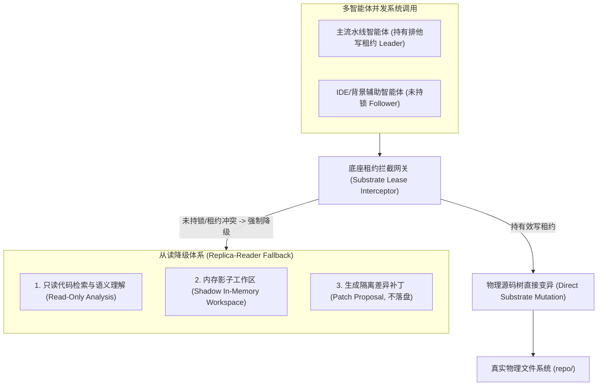
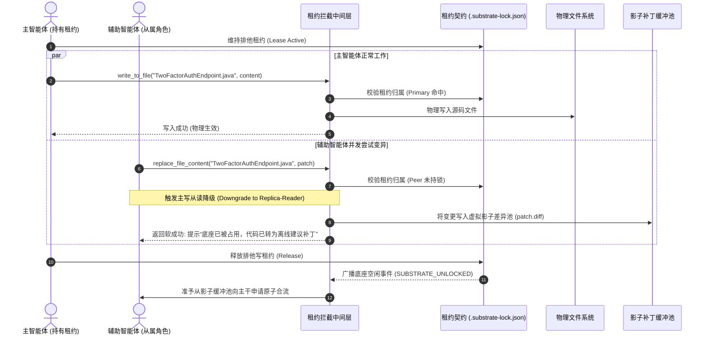

# 模式 11：主写从读降级互斥模式 (Primary-Writer Replica-Reader Pattern)

---

### 1. 意图 (Intent)
在多对等智能体（Peer Agents）协同演化的分布式系统环境中，依据因果时序与底座租约状态，将未持有排他写租约（Lease, Gray & Cheriton, SOSP 1989）的辅助智能体**强行降级为只读分析从属节点（Replica-Reader）**。通过物理写调用的原子拦截与内存影子工作区（Shadow Scratchpad）重定向，杜绝因并发盲目变异导致的代码撕裂与 Git 工作树死锁。

---

### 2. 动机与工业失效场景 (Motivation & Real-World Failure Modes)

随着多智能体协作架构由传统的“单体流水线”演进为“多端对等协作”（例如开发者在 IDE 内运行辅助扩展、CI/CD 跑自治流水线、代码评审代理并发执行建议），多智能体同时向同一个工作区进行状态写入成为不可回避的物理现实：

- **失效场景 A（写写冲突导致代码撕裂 Split-Brain Code Tearing）**：
  主流水线正在执行网关模块的单测编译，IDE 端的辅助智能体在未获知底层构建锁状态的前提下，因响应用户的交互指令，直接修改了该模块的 POM 文件或同一个 Java 类，导致底层 Git 产生冲突标记，正在执行的编译瞬间崩溃；
- **失效场景 B（并发破坏环境纯洁性 Substrate Contamination）**：
  辅助智能体在后台尝试“自愈代码”，擅自执行了 `git reset --hard` 或 `mvn clean`，直接将主力流水线刚写入但尚未提交的临时字节码或中间产物抹除；
- **失效场景 C（粗暴打断导致用户心智负担 Lock-Out Starvation）**：
  如果简单粗暴地将未持锁的智能体进程强行杀死，将破坏人机交互连续性，导致开发者在终端或 IDE 界面遭遇突兀的报错弹窗。



---

### 3. 适用性 (Applicability)
- 多个不同厂商或不同进程的智能体（如自建 CI 流水线、各类 IDE 编码智能体）接入同一个企业工程仓库；
- 具有清晰的主备责任划分（Leader-Follower）、需要保障主流水线构建绝对纯净的场景；
- 允许从属节点提出代码建议但严禁私自落盘的协作架构。

---

### 4. 参与者与职责 (Participants)

1. **主写入者 (Primary-Writer)**：通过分布式底座租约锁（模式 10）成功申请到排他写权（Leader）的智能体，拥有对物理文件系统的直接修改与原厂构建特权；
2. **从属读取者 (Replica-Reader)**：未竞争到写租约的对等智能体，其写权限被拦截网关透明剥离，自动降级为观察者与建议者；
3. **租约降级拦截器 (Lease Degradation Interceptor)**：位于操作系统系统调用（FS Tool Calls）与物理磁盘之间的中间件，负责鉴权并实施降级；
4. **影子工作区 (Shadow Scratchpad)**：为从属读取者开辟的无状态临时内存或隔离分支，允许其在虚拟空间演练代码补丁，绝不污染物理主干。

---

### 5. 协作协议与因果约束 (Collaborations)



---

### 6. 后果与权衡 (Consequences)

- **收益 (Pros)**：
  - **物理底座零污染**：避免了多智能体竞争导致的 Git 索引破损、文件双重修改与编译假死；
  - **用户体验连续无中断**：未持锁智能体不会直接崩溃，而是以只读或建议补丁的形式继续提供交互支持；
  - **遵循经典分布式因果律（Lamport, 1978）**：写操作具有全局唯一的全序因果排列。
- **代价 (Cons)**：
  - 需要在平台层虚拟化文件写操作（影子补丁机制）；
  - 从属节点产生的补丁需要额外的合流审批流程。

---

### 7. 反模式警示 (Anti-Patterns to Avoid)

| 反模式名称 | 表现特征 | 为什么必须杜绝 |
| :--- | :--- | :--- |
| **盲目无锁并发 (Blind Lockless Mutation)** | 允许多个智能体自由竞争写入同一工作区 | 必然引发代码撕裂与编译器状态错乱 |
| **粗暴硬杀死 (Hard Kill Starvation)** | 检测到非持锁者写操作直接强杀进程 | 破坏人机交互体验，造成不可预测的数据丢失 |

---

### 8. 抽象算法规约 (Algorithmic Formulation)

```typescript
interface WriteRequest {
  agentId: string;
  filePath: string;
  newContent: string;
}

class PrimaryWriterReplicaReaderInterceptor {
  private leaseManager: SubstrateLeaseManager;
  private shadowBuffer: Map<string, string> = new Map();

  async interceptWrite(req: WriteRequest): Promise<WriteVerdict> {
    const isPrimary = this.leaseManager.hasExclusiveLease(req.agentId);

    if (isPrimary) {
      // 1. 主智能体：物理落盘
      await fs.promises.writeFile(req.filePath, req.newContent, "utf8");
      return { success: true, mode: "PHYSICAL_DIRECT", message: "Written to substrate" };
    }

    // 2. 从属节点：强制降级为影子缓冲
    const shadowKey = `${req.agentId}:${req.filePath}`;
    this.shadowBuffer.set(shadowKey, req.newContent);

    return {
      success: true,
      mode: "SHADOW_REPLICA_BUFFERED",
      message: "Substrate locked by primary agent. Changes preserved as offline proposal patch."
    };
  }
}
```

---

### 9. 理论地位与形式化锚点 (Epistemic Status)

> **可定理化（已证，零 sorry）**：本模式的核心并发主张已在 Lean 4 内核中验证，模块 `Pattern11_PrimaryWriter`（`formal_proof/IACFormalization`），对应附录 B.9。

- 单写者前提不是额外约定：`writer_unique_of_lease` 直接由模式 10 的 `canWrite_unique` 推出——同一时刻至多一个智能体持有写权限。
- 写日志层：`eq_of_mem_of_tick_eq` 证明合法日志中同刻度即同一事件；`writer_unique_per_tick` 给出"同刻度同写入者"，即并发写写冲突在协议内不可能。
- 读一致性：`view_mono` 与 `no_lost_write` 证明从读者的视图是**完整前缀**——较晚读取包含较早读取的全部事件，且任何已提交事件必然可见，不存在"跳过中间提交"的视图。

推论的可证伪指标：主写提交后，从读者读到的事件集合必须等于"tick ≤ 读取时刻"的日志前缀；若观测到缺失或乱序，则该定理的前提（时钟严格递增、租约互斥）在实现中不成立。
