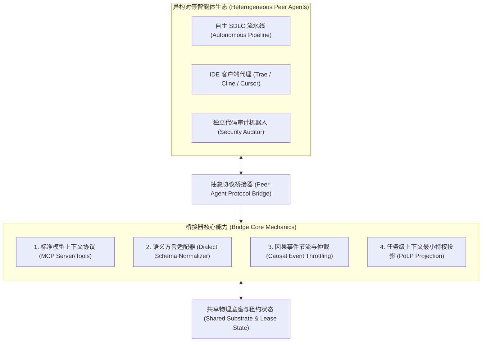
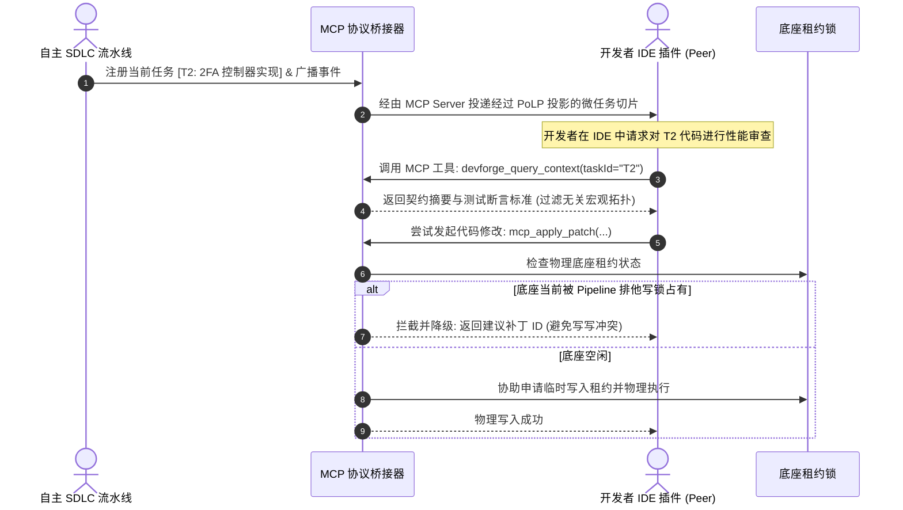
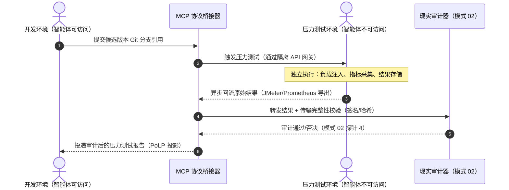

# 模式 12：异构对等智能体抽象协议桥接模式 (Peer-Agent Protocol Bridge Pattern)

---

### 1. 意图 (Intent)
通过标准化的模型上下文协议（Model Context Protocol, MCP）与对等智能体事件总线（Peer-Agent Event Bus），在异构智能体运行时（如自治后台流水线、IDE 客户端插件、代码审查机器人）之间建立**非对称能力协商、双向上下文投影与因果状态中继**，打破各厂商智能体生态的数据孤岛与语义壁垒。

---

### 2. 动机与工业失效场景 (Motivation & Real-World Failure Modes)

在现代软件工程实践中，企业不可能仅使用单一厂商的闭门智能体产品。典型的生产环境通常是异构共存的：后台运行着自研的端到端 SDLC 编排流水线，前端开发者在 IDE 中使用基于 MCP 或自定义协议的插件（如 Trae、Cline、Cursor），外部还接入了第三方安全审计机器人。

当这些**异构智能体（Heterogeneous Agents）**试图在同一个代码基质上协同作业时，通常引发以下失效：

- **失效场景 A（语义协议割裂 Semantic Tower of Babel）**：
  不同的智能体遵循不同的内部状态机定义（例如流水线将当前状态标记为 `pm_gate_passed`，而 IDE 客户端仅理解简单的 `review_pending`），缺乏语义转换层导致各方无法理解对方的进度意图；
- **失效场景 B（上下文全量硬拷贝引发上下文退化 Context Rot）**：
  为了让 IDE 端智能体了解后台流水线的背景，简单粗暴地将上百页的后台日志、全部门禁报告全量塞入 MCP 资源中，直接导致 IDE 智能体发生严重的上下文退化（Liu et al., 2024），丧失基本代码分析能力；
- **失效场景 C（事件广播风暴与竞态死锁 Event Storm & Race Conditions）**：
  多个智能体通过无序轮询监听工作区文件变动，一个智能体修改文件触发另一个智能体自动构建，进而触发第三个智能体触发 Git commit，系统陷入死循环事件风暴。



---

### 3. 适用性 (Applicability)
- 企业内部需要将自治流水线与开发者桌面 IDE 编程助手打通的场景；
- 混合使用不同大语言模型（如 Claude, Gemini, DeepSeek, 本地私有化模型）的多 Agent 异构架构；
- 需要向第三方审计工具标准化暴露工程进度、证据链（Evidence）与门禁打分结果的系统。

---

### 4. 参与者与职责 (Participants)

1. **协议桥接宿主 (Protocol Bridge Host)**：作为 MCP 服务器或轻量网关运行，向外部对等智能体暴露统一的标准工具集（如 `devforge_record_evidence`, `devforge_score_jev`）；
2. **语义方言转换器 (Dialect Adapter)**：负责将外部智能体的私有契约请求转换为流水线核心规范（如将任意格式的任务清单归一化为标准的 `TaskOutline`）；
3. **因果事件总线 (Causal Event Bus)**：按 Lamport 因果序广播关键节点事件（`PHASE_TRANSITION`, `SUBSTRATE_LOCKED`, `TESTS_RESOLVED`），阻断循环触发；
4. **投影过滤器 (Projection Filter)**：遵循最小特权原则（PoLP），仅向外部对等代理投递当前焦点任务的摘要切片，阻止上下文退化。

---

### 5. 协作协议与因果约束 (Collaborations)



---

### 6. 后果与权衡 (Consequences)

- **收益 (Pros)**：
  - **跨厂商解耦互通**：任何支持标准 MCP 或通用 Tool Calling 的智能体均可无缝加入协作，无需重构底层架构；
  - **生态无缝复用**：让轻量级桌面 IDE 能够直接借用重量级后台流水线的 Jev 门禁、物理编译器与测试沙箱能力；
  - **因果一致性保障**：彻底平息多 Agent 盲目并发引发的文件事件风暴。
- **代价 (Cons)**：
  - 需要在不同工具链之间维护协议转换与序列化开销；
  - 依赖网络 RPC 或本地 IPC 进程间通信通道。

---

### 6.1 典型扩展场景：隔离环境结果异步回流（压力测试反馈闭环）

当压力测试环境与开发环境完全隔离时，协议桥接器承担**异步结果回流**的关键角色：



**协议桥接器在此场景下的细化职责**：

1. **结果格式归一化**：将压力测试环境的原生输出（JMeter XML、Gatling HTML、Prometheus 指标）转换为标准 `StressTestReport` 契约；
2. **传输完整性保障**：结果回流通道的签名验证与哈希校验，防止选择性报告或篡改；
3. **环境指纹采集**：同步采集压力测试环境的配置指纹（OS/内核/依赖版本/资源配额），供审计器进行同质性校验；
4. **事件节流与因果序**：压力测试结果作为 `STRESS_TEST_COMPLETE` 事件按 Lamport 因果序广播，确保开发环境的状态机正确更新参考时钟。

> **理论锚点**：公理 III 的扩展——压力测试结果作为物理时钟事件，驱动下一轮变异的参考时钟 $R$ 更新。

---

### 7. 反模式警示 (Anti-Patterns to Avoid)

| 反模式名称 | 表现特征 | 为什么必须杜绝 |
| :--- | :--- | :--- |
| **私有协议烟囱 (Proprietary Silo Syndrome)** | 每个 Agent 均发明一套专属的 RPC 接口或私有数据格式 | 导致工具集成成本呈 $O(N^2)$ 指数级爆炸 |
| **广播大倒灌 (Unfiltered Broadcast Flooding)** | 将流水线的万行编译控制台流直接无差别推给 IDE 代理 | 诱发严峻的上下文退化（Context Rot），瘫痪辅助代理推理 |

---

### 8. 抽象算法规约 (Algorithmic Formulation)

```typescript
interface McpToolDefinition {
  name: string;
  description: string;
  parameters: object;
}

class PeerAgentProtocolBridge {
  private mcpServer: McpServer;
  private leaseManager: SubstrateLeaseManager;

  registerStandardTools(): void {
    // 1. 暴露标准只读契约检索工具 (融入 PoLP 投影)
    this.mcpServer.tool(
      "devforge_get_task_slice",
      "获取当前子任务的最小特权架构设计切片",
      { taskId: { type: "string" } },
      async ({ taskId }) => {
        const fullDesign = await this.readGlobalDesign();
        const slice = TaskLevelContextProjector.project(taskId, fullDesign);
        return { content: [{ type: "text", text: JSON.stringify(slice) }] };
      }
    );

    // 2. 暴露安全的协同代码补丁工具 (融入租约互斥)
    this.mcpServer.tool(
      "devforge_propose_patch",
      "向当前工程提交代码变更建议 (受底座租约锁保护)",
      { patchDiff: { type: "string" }, rationale: { type: "string" } },
      async ({ patchDiff, rationale }) => {
        if (this.leaseManager.isLockedByOther("peer-ide-agent")) {
          const proposalId = await this.saveToShadowBuffer(patchDiff, rationale);
          return { content: [{ type: "text", text: `Substrate occupied. Buffered as proposal ${proposalId}` }] };
        }
        await this.applyPhysicalPatch(patchDiff);
        return { content: [{ type: "text", text: "Patch successfully applied to physical substrate." }] };
      }
    );
  }
}
```
