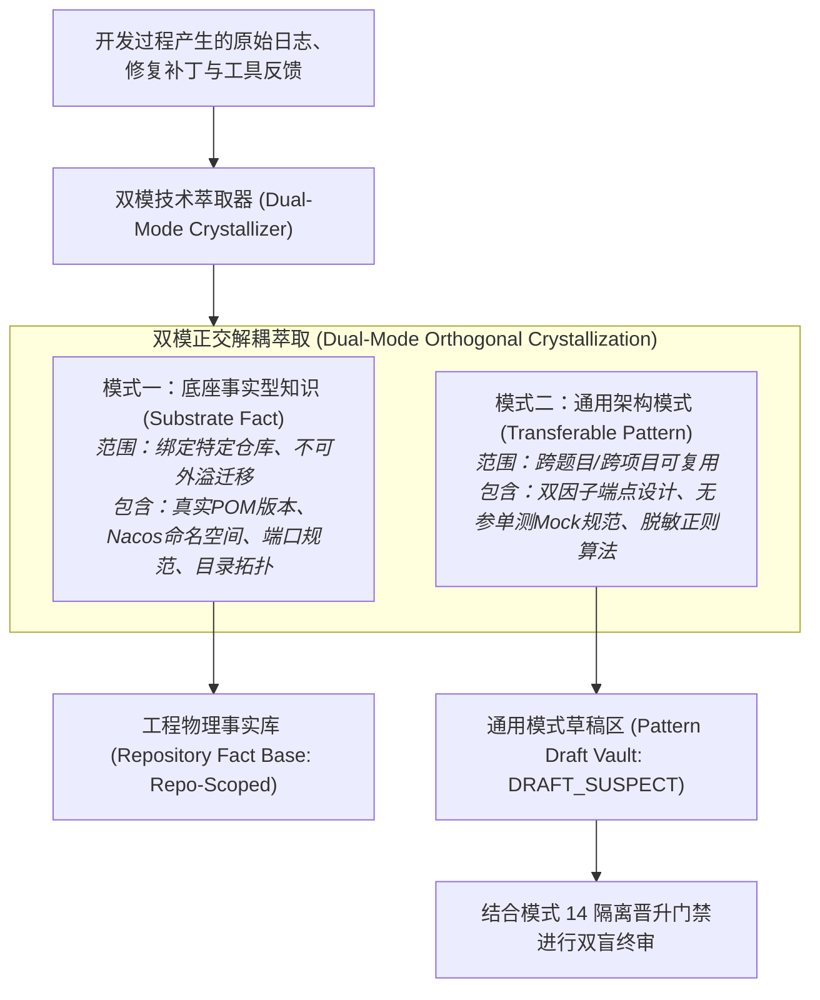
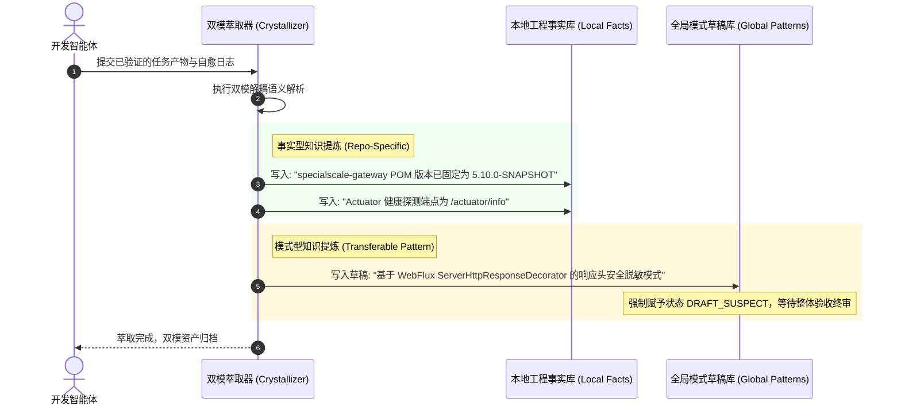

# 第十六章 模式 13：单源事实-模式双模萃取模式 (Dual-Mode Technical Crystallization Pattern)

---

### 1. 意图 (Intent)
将智能体在软件工程生命周期中获取的经验进行严格的**“单源正交解耦（Single-Source Orthogonal Decoupling）”**，分离为针对目标工程物理事实的**事实型知识（Substrate Facts）**与跨工程通用的**模式型知识（Transferable Patterns）**，防止环境特定参数（如端口、路径、版本号）与通用算法逻辑相互交织引发的记忆投毒（Memory Poisoning, MemoryGraft, 2025）与模型坍缩（Model Collapse, Shumailov et al., *Nature* 2024）。

---

### 2. 动机与工业失效场景 (Motivation & Real-World Failure Modes)

在许多为智能体引入“终身学习（Lifelong Learning）”或“记忆外挂（Memory Augmentation, 如 Voyager 技能库, Wang et al., 2023）”的系统中，经验沉淀机制通常采用无差别的纯文本拼接或向量化存储。这在大型软件工程中极易引发严重的知识退化：

- **失效场景 A（环境特定硬编码泄露为通用经验 Leakage of Ephemeral Facts）**：
  智能体在修复 `pigx__gw__004` 网关题目时，由于本地沙箱的网关端口被随机映射到了 `19999`，智能体将“网关端口必须配置为 19999”作为一条“通用最佳实践”存入了全局模式库。后续其他题目（如 Auth 认证服务）在检索知识时误采纳了该条目，导致服务启动端口硬编码冲突；
- **失效场景 B（通用模式与临时补丁混淆 Tainted Generalization）**：
  智能体在某次为了排查依赖冲突，临时在某个子 POM 中排除（exclude）了一个底层传递依赖。该临时动作被未经区分地泛化为“凡是引入该库均必须排除底层依赖”，导致后续微服务模块因缺少基础类发生 `NoClassDefFoundError`；
- **失效场景 C（非单源导致的知识冗余与冲突 Non-Canonical Knowledge Bloat）**：
  同一项事实（如某个公共微服务基础模块的 GroupId）被不同的任务智能体以不同的口吻反复沉淀为数十条碎片，由于缺乏规范化单源约束，知识库碎片化急剧膨胀，检索匹配准确率迅速劣化。



---

### 3. 适用性 (Applicability)
- 批量处理多仓库、多技术栈任务的自主研发流水线平台；
- 需要在多个项目之间安全共享代码模式，同时杜绝环境参数交叉污染的场景；
- 具备经验自我沉淀与自动文档生成能力的知识管理系统。

---

### 4. 参与者与职责 (Participants)

1. **双模萃取器 (Dual-Mode Crystallizer)**：在任务通过本地验证后，对代码 Diff 与领航员审查日志进行信息论提取的智能体；
2. **事实过滤器 (Fact Filter)**：负责将涉及绝对文件路径、特定 IP 地址、瞬时端口号、临时用户名密码等环境事实打上 `Scope: REPOSITORY_LOCAL` 标签，禁止出库流转；
3. **模式泛化器 (Pattern Abstractor)**：负责将具体的业务类实现提升为抽象的通用设计模式（包含适用上下文、核心接口契约伪代码与防踩坑 Checklist），赋予唯一规范标识；
4. **单源规约器 (Canonical Deduplicator)**：通过 SHA-256 签名与语义去重，确保同类事实或模式在知识库中保持单一真实源（Single Source of Truth, SSOT）。

---

### 5. 协作协议与因果约束 (Collaborations)



---

### 6. 后果与权衡 (Consequences)

- **收益 (Pros)**：
  - **从根源阻断记忆投毒（Memory Poisoning）**：环境特定的硬编码绝对不会逃逸至全局，防止后续智能体被误导；
  - **知识复利最大化**：提炼出的模式型知识具备极高通用性，新题目接入时可直接命中成熟设计模板，减少 50% 以上的探索轮次；
  - **模型坍缩防御**：经过严格结构化清洗的知识，避免了模型在后续微调或上下文回灌中吞食自身低质幻觉（Shumailov et al., *Nature* 2024）。
- **代价 (Cons)**：
  - 任务结束时需要追加一轮结构化信息提取的推理开销；
  - 需要制定严格的结构化 Schema 来约束事实与模式的属性字段。

---

### 7. 反模式警示 (Anti-Patterns to Avoid)

| 反模式名称 | 表现特征 | 为什么必须杜绝 |
| :--- | :--- | :--- |
| **生硬记忆大杂烩 (Raw Memory Dumping)** | 将开发过程中的交互对话全部作为 Memory 向量化入库 | 导致无关废话、失败报错与正确经验混在一起，检索时发生严重误导 |
| **全局事实污染 (Global Fact Spillover)** | 允许智能体将本地特定的端口与账号密码当作“标准规范”共享给其他仓库 | 破坏其他独立工程的基础设施与网络拓扑 |

---

### 8. 抽象算法规约 (Algorithmic Formulation)

```typescript
interface CrystallizedAsset {
  assetType: "SUBSTRATE_FACT" | "TRANSFERABLE_PATTERN";
  scope: "LOCAL_REPO" | "GLOBAL_CROSS_REPO";
  canonicalKey: string;
  payload: object;
}

class DualModeTechnicalCrystallizer {
  categorizeAndPersist(executionTrace: SDLCExecutionTrace): CrystallizedAsset[] {
    const assets: CrystallizedAsset[] = [];

    // 1. 萃取底座事实 (硬约束：严格限定为 LOCAL_REPO)
    for (const fact of executionTrace.discoveredFacts) {
      if (this.containsEphemeralEnvironmentDetail(fact)) {
        assets.push({
          assetType: "SUBSTRATE_FACT",
          scope: "LOCAL_REPO",
          canonicalKey: `repo:${executionTrace.repoId}:${fact.key}`,
          payload: { detail: fact.value, validatedAt: Date.now() }
        });
      }
    }

    // 2. 萃取通用模式 (脱敏并抽象为通用设计规范，暂入隔离区)
    for (const pattern of executionTrace.discoveredPatterns) {
      const sanitizedPattern = this.stripSubstrateSpecifics(pattern);
      assets.push({
        assetType: "TRANSFERABLE_PATTERN",
        scope: "GLOBAL_CROSS_REPO",
        canonicalKey: `pattern:${sanitizedPattern.patternName}`,
        payload: {
          designSchema: sanitizedPattern.schema,
          antiPatterns: sanitizedPattern.avoidedPitfalls,
          lifecycleStatus: "DRAFT_SUSPECT" // 结合模式 14 防御投毒
        }
      });
    }

    return assets;
  }
}
```

---

### 9. 数值宣称的可证伪地位 (Epistemic Status of Quantitative Claims)

> **处置：降级为经验目标（未验证）**——"减少 50% 以上的探索轮次"依赖任务分布与模板命中率，无预注册判据。标注为**工程经验目标**；若要升格，须固定任务族、"探索轮次"的计数口径与"命中"的判定规则，再做配对比较。
