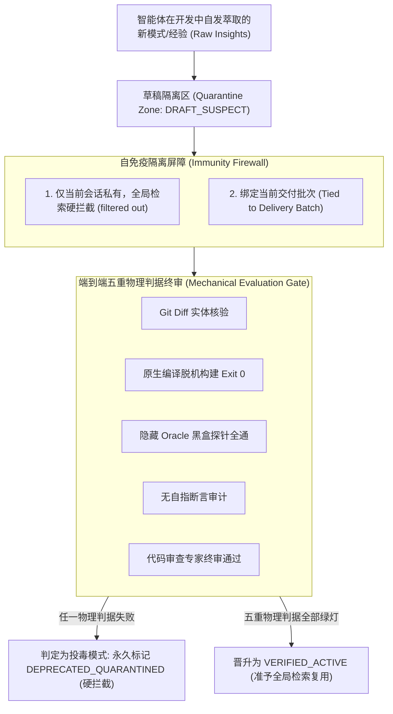
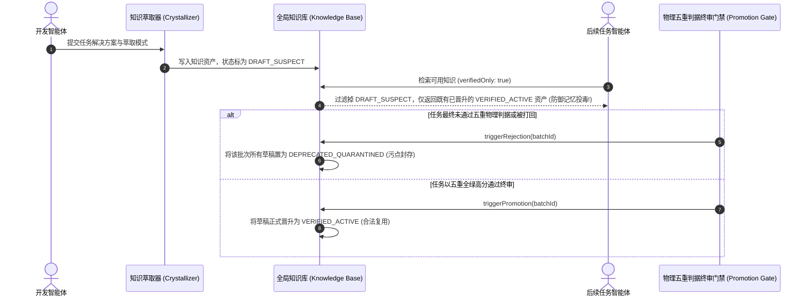

# 模式 14：隔离草稿与终审晋升门禁模式 (Quarantined Promotion Gate Pattern)

---

### 1. 意图 (Intent)
建立知识资产的**单源萃取（Single-Source Crystallization）、草稿隔离期（Draft Quarantine）与双盲终审晋升机制（Double-Blind Promotion Gate）**，所有由智能体在研发执行过程中总结出的自生经验（Rules/Patterns）默认标记为可疑草稿（`DRAFT_SUSPECT`），只有当整体验收经由客观物理五重判据完全通过后，才准予晋升为全局活跃资产（`VERIFIED_ACTIVE`），阻断错误经验跨代际传播所导致的记忆投毒（Memory Poisoning）。

---

### 2. 动机与工业失效场景 (Motivation & Real-World Failure Modes)

在许多具备“自我学习”或“知识沉淀”能力的智能体系统中，最危险的现象是**记忆投毒（Memory Poisoning）**——未经终审验证的自生经验经检索复用后，对后续任务产生持续性污染；这类递归自我消费在宏观层面已被证明导致模型坍缩（Model Collapse）（Shumailov et al., *Nature* 631, 2024）：
- **失效场景 A（错误经验自强化）**：智能体在开发题目的中间步骤中，为了修复某个报错，写了一条错误的规则：“在遇到 Redis 依赖时应将版本降级为 2.1”。该智能体立即将此经验写入全局知识库。然而该题目最终评测全面崩溃。不幸的是，后续的 10 个智能体在启动时检索到了这条“经验”，纷纷在初始化时错误降级依赖，导致全局流水线发生连环雪崩；
- **失效场景 B（污染代码模式泛滥）**：智能体在编写代码时引入了某种反模式（如在 Controller 中直接写裸 SQL），由于缺少晋升门禁，该代码模式被萃取为“最佳实践模板”，随后在整个项目中像病毒一样蔓延；
- **失效场景 C（未完成态的知识泄露）**：处于自愈尝试阶段的半成品知识被正在并发运行的其他智能体读取，导致其他智能体基于未验证的假设开展工作。



---

### 3. 适用性 (Applicability)
- 具备长效记忆（Long-term Memory）或代码片段自沉淀能力的自主智能体系统；
- 批量处理类似业务模块或评测基准题集的自进化平台；
- 企业级核心资产库沉淀与知识图谱自动构建。

---

### 4. 参与者与职责 (Participants)

1. **萃取器 (Crystallizer)**：在智能体完成微观修复后，自动提取可复用的技术模式（Pattern）与事实描述（Fact）；
2. **草稿隔离区 (Quarantine Vault)**：独立存储未经终审的资产，强制为其标注 `status: "DRAFT_SUSPECT"`，在常规向量检索或关键词检索中强制过滤；
3. **终审裁决器 (Promotion Gate Arbiter)**：端到端物理检验的最高裁决者，仅在整个交付流水线经受住真实黑盒物理探针测试后，触发批量晋升；
4. **污点拦截过滤器 (Tainted Tagger)**：对于被打回或最终失败任务产生的草稿，赋予 `DEPRECATED_QUARANTINED` 标签并归档至黑名单，永久禁止出库。

---

### 5. 协作协议与因果约束 (Collaborations)



#### 扩展触发条件：隔离环境压力测试结果

当压力测试环境与开发环境完全隔离时，**压力测试未通过**作为 DRAFT_SUSPECT 的显式触发条件：

1. **压力测试未通过**：候选版本在隔离压力测试环境中未达预注册 SLA 阈值（如 P99 延迟衰减率 > 阈值、错误率 > 阈值），即使开发环境五重判据全绿，该批次所有草稿仍标记为 `DRAFT_SUSPECT`，禁止晋升；
2. **压力测试结果缺失**：候选版本提交后未在预注册时限内收到隔离环境压力测试结果，该批次草稿保持 `DRAFT_SUSPECT`，直至结果回流并经模式 02 探针 4 审计通过；
3. **环境同质性偏差**：压力测试环境配置指纹与生产环境偏差超出预注册容差，结果视为无效，草稿保持 `DRAFT_SUSPECT`，触发环境修复流程。

> **理论锚点**：公理 IV 的适用边界扩展——隔离环境的结果作为"SubstratePass"的组成部分，未经审计的隔离环境结果不得作为晋升依据。

---

### 6. 后果与权衡 (Consequences)

- **收益 (Pros)**：
  - **知识库自洁免疫力**：从根本上杜绝了劣质代码和错误经验在系统内的自我扩散与代际传播；
  - **正向复利效应**：进入 `VERIFIED_ACTIVE` 的每一条模式，都经过了真实物理世界的严格检验，后续任务复用时准确率极高。
- **代价 (Cons)**：
  - 知识复用具有时间滞后性，同一任务批次内无法即时享受到当前批次正在萃取的经验；
  - 维护元数据状态生命周期需要额外的存储与索引管理逻辑。

---

### 7. 反模式警示 (Anti-Patterns to Avoid)

| 反模式名称 | 表现特征 | 为什么必须杜绝 |
| :--- | :--- | :--- |
| **即时即入库 (Unverified Eager Ingestion)** | 智能体刚写完一行代码，立即当成最佳实践写入共享 Memory | 一旦代码存在致命缺陷，将迅速污染整个系统的记忆网络 |
| **无状态污点积累 (Stateless Taint Blindness)** | 失败任务产生的错误知识未被标记，任由其留在库中 | 导致知识库熵增失控，历史垃圾经验严重干扰未来决策 |

---

### 8. 抽象算法规约 (Algorithmic Formulation)

```typescript
type KnowledgeLifecycle = "DRAFT_SUSPECT" | "VERIFIED_ACTIVE" | "DEPRECATED_QUARANTINED";

interface KnowledgePattern {
  id: string;
  patternName: string;
  codeSnippet: string;
  lifecycle: KnowledgeLifecycle;
  associatedBatchId: string;
}

class SelfImmuneKnowledgeBase {
  private patterns: KnowledgePattern[] = [];

  // 1. 萃取写入：默认隔离
  ingestDraftPattern(pattern: Omit<KnowledgePattern, "lifecycle">): void {
    this.patterns.push({
      ...pattern,
      lifecycle: "DRAFT_SUSPECT" // 强置隔离
    });
  }

  // 2. 检索防御：默认仅暴露经过终审的资产
  queryVerifiedPatterns(filter: { verifiedOnly?: boolean }): KnowledgePattern[] {
    const verifiedOnly = filter.verifiedOnly !== false;
    return this.patterns.filter(p => {
      if (p.lifecycle === "DEPRECATED_QUARANTINED") return false; // 污点硬拦截
      if (verifiedOnly && p.lifecycle !== "VERIFIED_ACTIVE") return false;
      return true;
    });
  }

  // 3. 终审裁决晋升
  adjudicateBatch(batchId: string, passedPhysicalGate: boolean): void {
    const targetState: KnowledgeLifecycle = passedPhysicalGate ? "VERIFIED_ACTIVE" : "DEPRECATED_QUARANTINED";
    this.patterns
      .filter(p => p.associatedBatchId === batchId && p.lifecycle === "DRAFT_SUSPECT")
      .forEach(p => {
        p.lifecycle = targetState;
      });
  }
}
```
