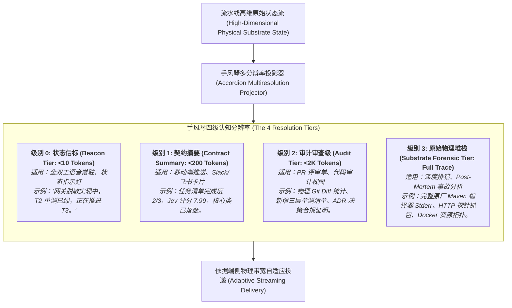
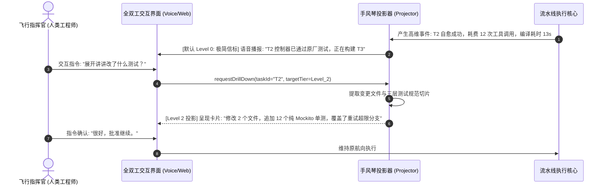

# 模式 16：手风琴式认知多分辨率投影模式 (Accordion Multiresolution Projection Pattern)

---

### 1. 意图 (Intent)
在人类工程师与自主智能体系统之间建立**动态多分辨率（Dynamic Multiresolution）的非对称认知投影机制**。根据交互通道的物理带宽（如全双工实时语音、移动端通知、桌面控制台）与人类注意力状态，将高维海量工程执行状态如手风琴般自由伸缩为“极简状态信标（One-Sentence Beacon）”、“阶段契约摘要（Phase Summary）”或“物理堆栈与 Diff 全景（Full Physical Trace）”，消除人机交互中的上下文退化（Context Rot）与认知超载。

---

### 2. 动机与工业失效场景 (Motivation & Real-World Failure Modes)

在端到端自主软件工程系统中，智能体单次需求演化可能产生数万行编译器控制台输出、数百次工具调用日志与复杂的依赖图分析。如果缺乏人机交互的认知分辨率管理，将导致两极分化的严重失效：

- **失效场景 A（控制台大倾倒引发认知瘫痪 Console Vomiting）**：
  流水线每执行一步，就将几万字的原厂编译器 Stderr、Maven 下载进度与全部 JSON 状态全量回吐给人类用户。面对海量滚屏信息，人类工程师根本无法在几秒内捕捉核心矛盾（如某个关键权限类缺失），被迫花费数十分钟手动检索，完全丧失了“自主协作”的敏捷性；
- **失效场景 B（语音与移动端交互中的上下文退化 Context Rot in Voice/Mobile）**：
  当通过语音助手或移动端设备向工程师汇报进展时，如果智能体机械朗读长段类名与代码 Diff，人类的工作记忆（Working Memory）会在 10 秒内崩溃。同时，冗长的文本严重阻塞了全双工语音频道的双向交互；
- **失效场景 C（报喜不报忧的形式主义伪概括 Opaque Gloss-Over）**：
  另一极端是过度简化，智能体仅回复“一切正常”，却向人类隐瞒了“已触发 3 次编译自愈打回、正在修改敏感安全配置”的高危物理事实，导致系统脱离人类航向控制。



---

### 3. 适用性 (Applicability)
- 接入实时语音对话通道（如全双工 WebRTC / 移动端语音助手）的自主系统；
- 需要支持多端联动（手机看摘要、IDE 查断言、终端看物理日志）的企业级协作平台；
- 资深工程师同时监督数十个自主 Agent 并行作业的“空中交通管制（Air Traffic Control）”场景。

---

### 4. 参与者与职责 (Participants)

1. **状态流聚合器 (Substrate Telemetry Aggregator)**：实时收集流水线各阶段的物理度量（阶段名、Jev 分分、退出码、受影响文件）；
2. **手风琴投影器 (Accordion Projector)**：根据调用方请求的 `ResolutionTier`，应用信息论摘要算法进行无损降维或全量展开；
3. **注意力感知器 (Attention & Bandwidth Detector)**：感知当前交互设备的类型（Voice, Mobile Push, Web GUI, CLI Terminal）与用户的空闲状态，动态协商默认分辨率级别；
4. **渐进下钻控制器 (Progressive Drill-Down Controller)**：支持交互式“逐步展开（Zoom-In）”协议，当人类对 Level 0 的摘要提出疑问时，平滑展开至 Level 2 或 Level 3，保持心智模型连贯。

---

### 5. 协作协议与因果约束 (Collaborations)



---

### 6. 后果与权衡 (Consequences)

- **收益 (Pros)**：
  - **极致的人机协同带宽**：解放人类工程师的双眼与双手，通过极简语音信标即可掌握整个工程舰队的宏观态势；
  - **按需索取无认知超载**：杜绝上下文退化（Context Rot），保证关键决策信息以最佳信息密度抵达人类大脑；
  - **随时可查证的硬证据**：尽管日常呈现极简，但背后 Level 3 的原始物理堆栈随时可就地查证，完全透明。
- **代价 (Cons)**：
  - 需要在平台层实现状态元数据的多级格式化与动态模版引擎；
  - 维护流式下钻会话状态需要轻量级内存会话管理。

---

### 7. 反模式警示 (Anti-Patterns to Avoid)

| 反模式名称 | 表现特征 | 为什么必须杜绝 |
| :--- | :--- | :--- |
| **无脑全量轰炸 (Unfiltered Log Spewing)** | 在任何终端都无差别打印整屏的构建原始日志 | 导致人类信息过载，在真正的严重警报来临时无法识别 |
| **黑盒无证据敷衍 (Black-Box Hand-Waving)** | 仅告知“完成了”，当人类追问依据时无法给出物理文件 Diff 与测试列表 | 丧失可解释性与信任基础，违反物理底座锚定原则 |

---

### 8. 抽象算法规约 (Algorithmic Formulation)

```typescript
type ResolutionLevel = "L0_BEACON" | "L1_SUMMARY" | "L2_AUDIT" | "L3_FORENSIC";

interface PipelineStateTelemetry {
  currentPhase: string;
  subtaskProgress: string;
  jevScore?: number;
  changedFiles: string[];
  newTestsDeclared: string[];
  rawBuildStderr: string;
}

class AccordionMultiresolutionProjector {
  projectState(state: PipelineStateTelemetry, targetLevel: ResolutionLevel): string {
    switch (targetLevel) {
      case "L0_BEACON":
        // 极简语音级信标 (<10 words)
        return `[${state.currentPhase}] 进度 ${state.subtaskProgress}，物理单测全绿。`;

      case "L1_SUMMARY":
        // 移动端卡片级契约摘要
        return `阶段: ${state.currentPhase} | 进度: ${state.subtaskProgress} | Jev门禁: ${state.jevScore ?? "N/A"}\n已落盘文件: ${state.changedFiles.length} 个`;

      case "L2_AUDIT":
        // 审查者审计级 (文件清单 + 三层测试白盒断言)
        return JSON.stringify({
          files: state.changedFiles,
          tests: state.newTestsDeclared,
          gateScore: state.jevScore
        }, null, 2);

      case "L3_FORENSIC":
        // 全量物理追踪 (调试排错)
        return state.rawBuildStderr;
    }
  }
}
```

---

### 9. 理论地位 (Epistemic Status)

> **工程约定 (Engineering Convention)**：本模式是不可证伪的操作规范，不属于理论结论。其正确性只能以"实现是否遵循所规定的投影协议"判定，模式本身不给出统计判据，也不构成公理 I–IV 或定理 3.1 的推论。

三级 Token 预算（<10 / <200 / <2K）是设计常数，不是被验证的效应量。若需作为结论，须先定义"投影保真度"与"决策充分性"的可测量口径并预注册阈值。在验证报告 §8 矩阵中本模式归入工程约定，不得以其表述作为其他模式的推理前提。
