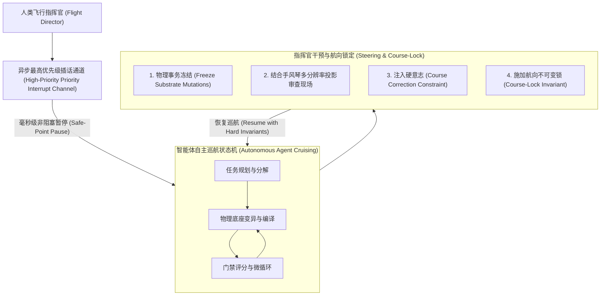
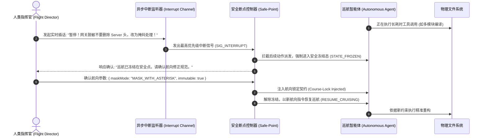

# 模式 17：飞行指挥官异步中断与航向锁定模式 (Asynchronous Flight-Director Interrupt Pattern)

---

### 1. 意图 (Intent)
建立基于**双通道异步插话（Asynchronous Full-Duplex Interrupt）**与**航向锁定因果状态机（Course-Lock State Machine）**的人机最高仲裁控制论机制。赋予人类“飞行指挥官（Flight Director）”在智能体多步骤自主巡航过程中，**随时发起毫秒级非阻塞插话、冻结变异事务、注入纠偏意志并锁定全局航向**的特权，打破智能体深陷自愈死循环或偏离业务目标的失控态。

---

### 2. 动机与工业失效场景 (Motivation & Real-World Failure Modes)

在端到端自治程度极高的智能体流水线运行中，经常出现智能体陷入非受控状态的严峻情况：

- **失效场景 A（自愈死循环与失控黑洞 Runway Self-Healing Spiral）**：
  智能体在修复一个复杂的编译报错时，由于对业务意图产生了误解，开始自主重构整个底层架构（如删除重要的核心基类）。在传统的单工阻塞系统（Synchronous Blocking System）中，人类工程师只能眼睁睁看着控制台持续滚动报错并消耗巨量 Token，无法直接输入指令叫停，只能粗暴杀死进程（Kill -9），导致前期全部有效成果化为乌有；
- **失效场景 B（无验证自我纠错的自欺欺人 Unverified Self-Correction Fallacy）**：
  学术界研究表明，大模型在没有外部物理约束时的自我反思不仅无效，反而常导致性能退化（Huang et al., ICLR 2024）。智能体在多轮自我推导中坚信“用户不需要租户隔离”，开始大面积剥离租户上下文。人类需要有一种优雅的机制“拉住缰绳”；
- **失效场景 C（人机指令与智能体动作的竞态冲突 Race Conditions in Human Steering）**：
  人类输入了纠偏建议“不要修改 User 类”，但在人类输入被处理前，智能体已经完成了对 `User.java` 的写操作并提交了编译，造成人类指令与智能体当前执行上下文的因果倒错。



---

### 3. 适用性 (Applicability)
- 运行超长周期（数十分钟至数小时）高复杂度任务的自治软件工程系统；
- 配备全双工实时语音、即时通讯机器人（IM Bot）的人机结对开发界面；
- 需确保系统在任何时刻对人类保持终极可控性与安全对齐（Alignment）的高合规性场景。

---

### 4. 参与者与职责 (Participants)

1. **飞行指挥官 (Flight Director / Human Operator)**：拥有系统最高优先级的决策主体，代表业务终极需求；
2. **异步中断监听器 (Asynchronous Interrupt Listener)**：作为无阻塞事件循环常驻后台，时刻监听人类的语音打断或文本中断信号；
3. **安全断点控制器 (Safe-Point Controller)**：在接收到中断信号时，等待当前正在执行的原子文件写入完成，随后立即冻结执行流水线，防止文件系统处于半写入损毁状态；
4. **航向锁定器 (Course-Lock Enforcer)**：将人类输入的纠偏指令转化为最高权重的不可变约束（Hard Invariant），并在后续的提示词生成与门禁审计中赋予一票否决权，禁止智能体二次反弹。

---

### 5. 协作协议与因果约束 (Collaborations)



---

### 6. 后果与权衡 (Consequences)

- **收益 (Pros)**：
  - **人机无缝共生（Human-in-the-Loop Supremacy）**：人类工程师随时可以“接管控制”，不再是无能为力的旁观者，消灭失控自愈死循环；
  - **因果一致性保障**：通过安全断点（Safe-Point）机制，中断不会损坏物理文件与 Git 索引；
  - **节省巨额能耗**：在智能体走入歧途的第一时间予以刹车纠偏，避免无效探索消耗数百万 Token。
- **代价 (Cons)**：
  - 编排状态机必须具备完全解耦的异步事件循环能力；
  - 恢复巡航时需要重新对齐上下文提示词，消除被中断操作的残留状态。

---

### 7. 反模式警示 (Anti-Patterns to Avoid)

| 反模式名称 | 表现特征 | 为什么必须杜绝 |
| :--- | :--- | :--- |
| **单工假全双工 (Mock Full-Duplex Fallacy)** | 智能体在调用工具或思考时完全阻塞输入，人类必须等其回答完毕才能说话 | 丧失了实时挽救系统的可能性，极度恶化用户交互体验 |
| **航向被遗忘 (Ephemeral Steering Amnesia)** | 人类插话纠偏后，智能体在下一轮执行中又把人类的警告忘得一干二净 | 违反因果不变性，导致人类必须反复重复相同指令 |

---

### 8. 抽象算法规约 (Algorithmic Formulation)

```typescript
interface CourseLockDirective {
  targetPath: string;
  immutableConstraint: string;
  injectedBy: "FLIGHT_DIRECTOR";
  timestamp: number;
}

class FlightDirectorInterruptManager {
  private isFrozen: boolean = false;
  private activeDirectives: CourseLockDirective[] = [];

  // 1. 异步非阻塞中断监听
  async onHumanInterruptReceived(transcript: string): Promise<string> {
    this.isFrozen = true;
    const safePointReached = await this.awaitNextSafePoint();

    if (safePointReached) {
      // 解析人类意图并生成航向锁定规则
      const directive = this.parseDirectiveFromSpeech(transcript);
      this.activeDirectives.push(directive);

      return `FLIGHT_DIRECTOR_INTERRUPT_ACK: Execution safely frozen. Directive [${directive.immutableConstraint}] locked.`;
    }

    throw new Error("SAFE_POINT_TIMEOUT: Force pause initiated.");
  }

  // 2. 航向约束投影到智能体提示词
  injectDirectivesIntoPrompt(basePrompt: string): string {
    if (this.activeDirectives.length === 0) return basePrompt;

    const directivesBlock = this.activeDirectives
      .map(d => `[FLIGHT_DIRECTOR_COURSE_LOCK] ${d.immutableConstraint} (STRICT_IMMUTABLE)`)
      .join("\n");

    return `${basePrompt}\n\n### HIGHEST PRIORITY FLIGHT DIRECTIVES:\n${directivesBlock}\n`;
  }
}
```

---

### 9. 理论地位 (Epistemic Status)

> **工程约定 (Engineering Convention)**：本模式是不可证伪的操作规范，不属于理论结论。其正确性只能以"实现是否遵循所规定的接管协议"判定，模式本身不给出统计判据，也不构成公理 I–IV 或定理 3.1 的推论。

中断接管与航向锁定的优先级规则是协议约定。若需作为结论，须先定义"中断丢失率"与"约束违反率"并预注册阈值；在此之前，正文中的"最高优先级"仅为协议语义，不是被测量的效应。在验证报告 §8 矩阵中本模式归入工程约定，不得以其表述作为其他模式的推理前提。
