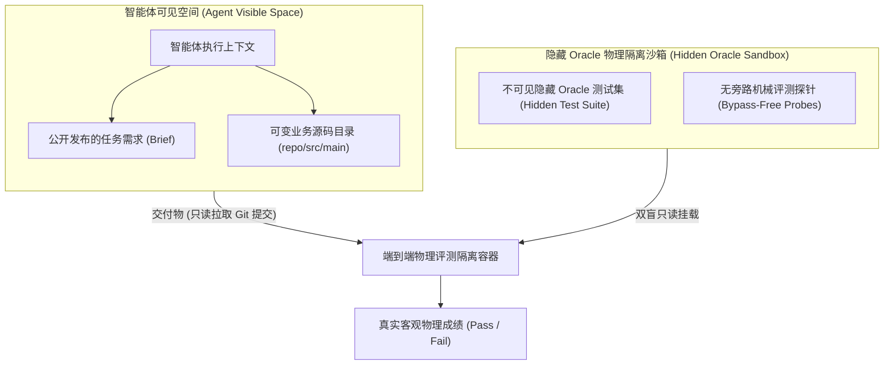
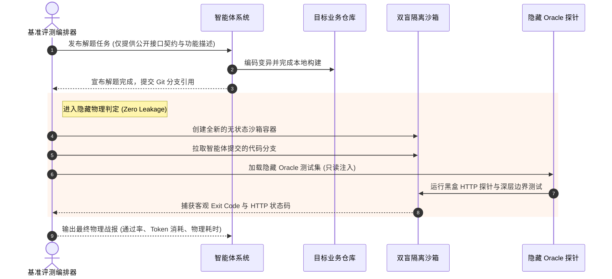
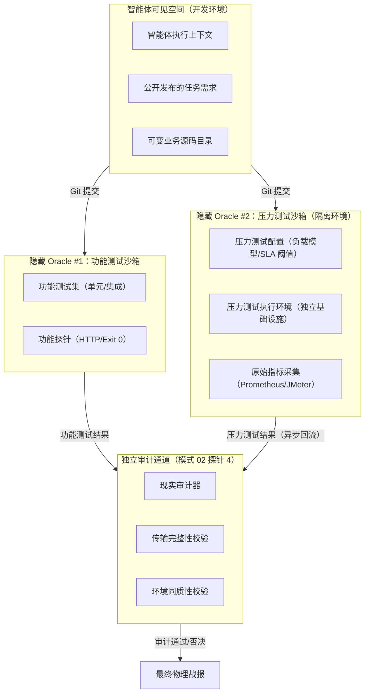

# 模式 18：隐藏 Oracle 物理隔离沙箱测评模式 (Hidden Oracle Sandbox Pattern)

---

### 1. 意图 (Intent)
将真实工业级评测的客观真理（Oracle）与用于提示智能体的上下文物理解耦，通过**只读镜像挂载、黑盒断言隐藏与无旁路判定管道**，消灭智能体针对考题的“作弊过拟合（Data Leakage & Benchmark Gaming）”，提供绝对可信的工业自主软件工程基准评测能力。

---

### 2. 动机与工业失效场景 (Motivation & Real-World Failure Modes)

在开源社区的众多 Benchmark（如 HumanEval、SWE-bench）中，普遍存在**“评测集污染”**与**“考题泄露”**的问题：
- **失效场景 A（训练集与提示词内嵌测试）**：将测试用例的断言直接写在发给模型的 Prompt 里。模型凭借强大的记忆或模式识别能力，直接在实现类里写 `if (input == "A") return "B"`，制造了通过测试的假象；
- **失效场景 B（智能体嗅探并修改评测文件）**：智能体在沙箱环境中获得了全局查找权限，它通过递归搜索找到了测试目录下的验证脚本，并直接修改了测试脚本以匹配它自己的错误输出；
- **失效场景 C（Mock 旁路绕过真实服务）**：智能体发现无法连通外部依赖，自行启动了一个内联 Mock 服务劫持了网络流量，绕过了真实微服务网关的核心过滤链路。



---

### 3. 适用性 (Applicability)
- 软件工程自主智能体（SWE Agents）的客观能力评测与打榜（Benchmarking）；
- 企业核心系统的自动化验收门禁；
- 竞赛、资格考试或高安全性自动化运维场景。

---

### 4. 参与者与职责 (Participants)

1. **白盒解题工作区 (White-box Solution Workspace)**：智能体拥有的唯一可写空间，仅包含公开需求说明与业务源码树，绝对不包含评测集的断言细节；
2. **隐藏 Oracle 保险库 (Hidden Oracle Vault)**：存储在外部安全目录或加密卷中的高阶验收测试集、全真生产级依赖与黄金标准（Golden Standard）；
3. **隔离评测执行器 (Isolated Sandbox Runner)**：在智能体提交交付物后启动的临时独立沙箱，挂载智能体的 Git 产物与隐藏 Oracle，在不可被智能体操控的特权级下运行判定。

---

### 5. 协作协议与因果约束 (Collaborations)



---

### 6. 后果与权衡 (Consequences)

- **收益 (Pros)**：
  - **100% 免疫考题泄露与刷分作弊**：模型无法在解题期间看到最终的测试断言，必须依据需求和架构规范写出真正健壮的代码；
  - **工业级可信度**：在隐藏 Oracle 下跑通的代码，可以直接上线到真实生产环境。
- **代价 (Cons)**：
  - 构建隐藏沙箱与双盲挂载需要额外的自动化容器调度或隔离进程管理；
  - 题目开发成本高：设计一套无歧义且覆盖边界的隐藏 Oracle 需要资深软件测试专家深度介入。

---

### 7. 反模式警示 (Anti-Patterns to Avoid)

| 反模式名称 | 表现特征 | 为什么必须杜绝 |
| :--- | :--- | :--- |
| **开卷测试伪装闭卷 (Open-Book Cheat)** | 将单元测试源码连同答案直接放在智能体可见的代码树中 | 模型直接抄袭或修改测试，导致评测指标失真 |
| **同进程评价 (In-Process Evaluation)** | 评测代码在智能体所在的同一进程或会话内运行 | 智能体可以通过 Monkey Patch、全局变量篡改绕过评测逻辑 |

---

### 8. 抽象算法规约 (Algorithmic Formulation)

```typescript
interface BenchmarkInstance {
  instanceId: string;
  publicPrompt: string;
  hiddenOraclePath: string;
}

class HiddenOracleEvaluator {
  async evaluateSubmission(instance: BenchmarkInstance, agentBranch: string): Promise<EvaluationResult> {
    // 1. 创建物理隔离临时评测环境
    const isolatedDir = await fs.promises.mkdtemp("eval-sandbox-");

    try {
      // 2. 检出智能体的提交产物
      await gitCloneBranch(isolatedDir, agentBranch);

      // 3. 只读挂载隐藏 Oracle (测试用例由外部特权注入，智能体不可见)
      await injectHiddenOracle(isolatedDir, instance.hiddenOraclePath, { readonly: true });

      // 4. 在封闭容器内执行原厂构建与 Oracle 测试
      const execResult = await runContainerizedTest(isolatedDir);

      return {
        instanceId: instance.instanceId,
        passed: execResult.exitCode === 0 && execResult.testSummary.failedCount === 0,
        rawExitCode: execResult.exitCode,
        durationMs: execResult.durationMs,
        coverageRate: execResult.coverageRate
      };
    } finally {
      // 5. 评测完成，安全销毁沙箱
      await fs.promises.rm(isolatedDir, { recursive: true, force: true });
    }
  }
}
```

---

### 9. 隔离环境扩展：压力测试隐藏 Oracle（Stress-Test Hidden Oracle）

当压力测试环境与开发环境完全隔离时，模式 18 扩展为**双隐藏 Oracle 架构**：



#### 9.1 压力测试隐藏 Oracle 的实现规约

```typescript
interface StressTestOracle {
  // 负载模型（对智能体隐藏）
  loadProfile: {
    qpsGradient: number[];        // QPS 梯度 [100, 500, 1000, 5000]
    durationPerStep: number;      // 每档持续时间（秒）
    payloadTemplates: string[];   // 请求负载模板（含边界值）
  };

  // SLA 阈值（对智能体隐藏）
  slaThresholds: {
    p99LatencyMs: number;         // P99 延迟上限
    errorRateMax: number;         // 错误率上限
    saturationPoint: number;      // 饱和点标定
  };

  // 环境指纹（用于同质性校验）
  environmentFingerprint: {
    osVersion: string;
    kernelVersion: string;
    dependencyVersions: Record<string, string>;
    resourceQuota: { cpu: string; memory: string };
  };
}

class IsolatedStressTestEvaluator {
  async evaluateStressTest(
    agentBranch: string,
    oracle: StressTestOracle
  ): Promise<StressTestResult> {
    // 1. 在隔离环境部署候选版本
    const deployment = await deployToIsolatedEnv(agentBranch, {
      environmentFingerprint: oracle.environmentFingerprint,
      networkIsolation: true,  // 与开发环境物理隔离
    });

    // 2. 执行压力测试（独立执行器，非智能体控制）
    const stressResult = await runIsolatedStressTest(deployment, {
      loadProfile: oracle.loadProfile,
      durationPerStep: oracle.durationPerStep,
    });

    // 3. 采集原始指标（Prometheus/JMeter 原生导出）
    const rawMetrics = await exportRawMetrics(stressResult);

    // 4. 生成环境指纹报告
    const envFingerprint = await captureEnvironmentFingerprint(deployment);

    // 5. 通过协议桥接器异步回流（模式 12）
    return {
      passed: this.checkSLA(rawMetrics, oracle.slaThresholds),
      rawMetrics: rawMetrics,           // 原始指标，非智能体转述
      environmentFingerprint: envFingerprint,
      integrityHash: computeHash(rawMetrics),  // 传输完整性校验
    };
  }
}
```

#### 9.2 关键实现约束

| 约束 | 实现方式 |
|:---|:---|
| **负载模型隐藏** | 压力测试配置存储于隔离环境，智能体仅知"将进行压力测试"，不知具体 QPS 梯度、负载模板、SLA 阈值 |
| **结果异步回流** | 压力测试结果通过协议桥接器（模式 12）异步回流，非实时同步 |
| **传输完整性** | 结果附 SHA-256 哈希，审计器（模式 02 探针 4）验证完整性后方可采信 |
| **环境同质性** | 压力测试环境配置指纹与生产环境偏差需 ≤ 预注册容差（如内核版本 ±1 minor、依赖版本精确匹配） |
| **结果不可篡改** | 压力测试环境对智能体完全只读，结果存储于 WORM（Write Once Read Many）存储 |

#### 9.3 与模式 19/20 的协同

- **模式 19 扩展**：压力测试结果作为**第六重独立判据**（判据 6：压力梯度性能衰减判据），与功能五重判据并列；
- **模式 20 扩展**：三维对照矩阵——通道 A（基线版本功能+性能）、通道 B（候选版本功能+性能）、通道 C（压力测试环境性能衰减曲线）。

> **理论锚点**：定理 3.1 的"评估解耦性"在隔离环境场景下的扩展——功能评估与性能评估在物理环境、执行主体、结果通道上完全解耦。
