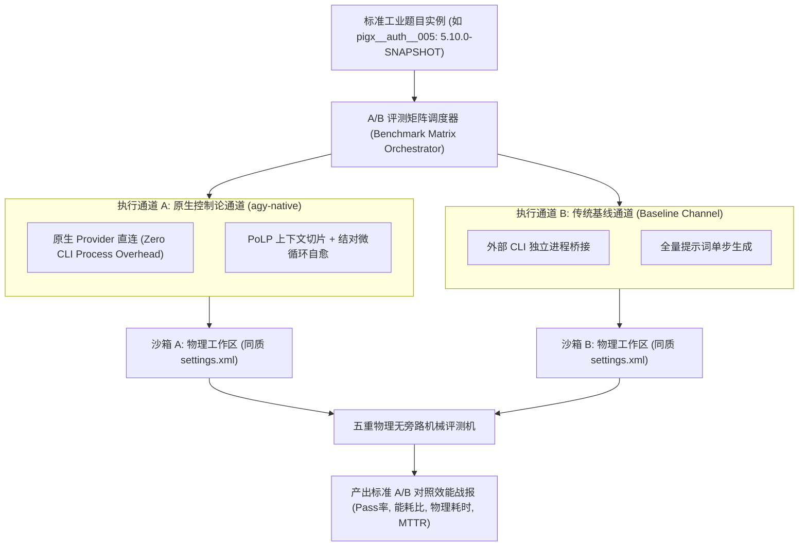
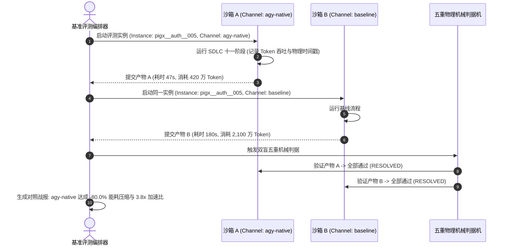

# 模式 20：工业基准 A/B 物理对照评测模式 (Industrial Substrate A/B Benchmark Pattern)

---

### 1. 意图 (Intent)
在严格同质（Identical Hardware, Network, and Dataset）的真实工业工程物理沙箱中，建立**多执行通道（Execution Channels）的“双盲 A/B 物理对照评测矩阵”**。通过消除评测中的外部扰动变量，精确度量不同底层模型（LLM Backends）、不同架构编排策略（如单体 CLI 代理 vs 原生控制论通道）在客观解决率、Token 能耗收敛性与物理耗时上的真实效能代差。

---

### 2. 动机与工业失效场景 (Motivation & Real-World Failure Modes)

在自治智能体性能评估领域，学术界或企业经常发布各种声称“大幅超越 SOTA”的对比测试报告，但其结论在真实工业场景中往往毫无参考价值：

- **失效场景 A（不同物理考场的虚假对照 Apples-to-Oranges Comparison）**：
  通道 A 在配备了全量本地私服缓存的本地机器上跑，耗时仅 10 秒；通道 B 在需要连接公网缓慢下载依赖的干净容器里跑，耗时 5 分钟。评测者得出“通道 A 效率高 30 倍”的伪科学结论，实质混淆了网络基建与模型能力的因果性；
- **失效场景 B（提示词泄露与开闭卷不公 Open-vs-Closed Book Asymmetry）**：
  评测某家专有代理时，该代理内置了目标开源仓库的全部代码或特化 Prompt（开卷）；而在测试通用模型时仅提供简陋的需求描述（闭卷），造成客观评价的不公；
- **失效场景 C（缺乏 Tokenomics 能耗与代码行复杂度对照 Failure to Normalize Tokenomics）**：
  两个通道虽然都通过了同一道题目，但通道 A 消耗了 2,600 万 Token、重试了 50 轮；通道 B 依托控制论切片仅消耗了 400 万 Token、一次性通过。若仅看“Pass/Fail”，完全掩盖了工程落地的商业能效壁垒。



---

### 3. 适用性 (Applicability)
- 企业评估选型开源/商业大模型作为代码辅助核心引擎时的客观对比；
- 验证智能体架构创新（如引入 PoLP 投影或结对循环）是否带来真实的工业能效提升；
- 构建具备防作弊、可审计特性的第三方自主编程竞技平台。

---

### 4. 参与者与职责 (Participants)

1. **同质沙箱配方工厂 (Homogeneous Sandbox Factory)**：确保所有通道在启动前，目标工程源码树、Maven 私服镜像源、JDK 版本与初始 Git 提交哈希 100% 绝对一致；
2. **多通道驱动适配器 (Channel Driver Adapters)**：将统一的评测指令翻译为不同通道的启动配方（如 `agy-native`、`deepseek-cli`、`kimi`、`amdgpu`）；
3. **计量与能耗遥测仪 (Tokenomics & Performance Telemetry)**：实时捕获各通道在单题生命周期内的输入 Token 数、输出 Token 数、工具调用频次、物理编译耗时与进程驻留内存；
4. **归一化对照报告器 (Normalized A/B Reporter)**：计算单位代码行能耗比（Tokens / LoC）与单位有效修复成本。

---

### 5. 协作协议与因果约束 (Collaborations)



---

### 6. 后果与权衡 (Consequences)

- **收益 (Pros)**：
  - **科学严谨的因果推断**：排除了由于网络、硬件波动或开卷测试带来的外部干扰，结论经得起同行评议与工业审计；
  - **揭示真实商业价值**：让架构师清楚看到控制论优化在生产落地时所节约的真金白银（Token 成本）。
- **代价 (Cons)**：
  - 评测成本成倍增加（每个题目需多通道独立运行一次完整编译与评测）；
  - 需要维护多套异构模型通道的运行时环境与依赖。

---

### 7. 反模式警示 (Anti-Patterns to Avoid)

| 反模式名称 | 表现特征 | 为什么必须杜绝 |
| :--- | :--- | :--- |
| **异质环境假对照 (Heterogeneous Sandbox Bias)** | 通道 A 用私服缓存，通道 B 连公网 | 评测的不是模型智能，而是网络抖动与磁盘 I/O 速度 |
| **只比通过不比能耗 (Tokenomics Blindness)** | 忽略单题消耗的几千万 Token，单纯宣称“解决率同为 100%” | 在商业生产中，极高能耗意味着根本无法规模化普及 |

---

### 8. 抽象算法规约 (Algorithmic Formulation)

```typescript
interface ChannelRunMetrics {
  channelName: string;
  isResolved: boolean;
  totalTokens: number;
  durationMs: number;
  codeLinesChanged: number;
}

class SubstrateAbBenchmarkRunner {
  async runAbComparison(instanceId: string, channels: string[]): Promise<AbComparisonReport> {
    const results: ChannelRunMetrics[] = [];

    for (const ch of channels) {
      // 1. 初始化完全同质的自包含物理沙箱
      const sandbox = await this.sandboxFactory.createCleanSandbox({
        instanceId,
        channel: ch,
        forceCleanSettings: true
      });

      // 2. 运行单通道流水线并收集能耗指标
      const runTrace = await sandbox.executePipeline();

      // 3. 运行五重无旁路机械评测
      const evalVerdict = await this.evaluator.evaluate(sandbox.workspace);

      results.push({
        channelName: ch,
        isResolved: evalVerdict.isResolved,
        totalTokens: runTrace.tokenUsage.total,
        durationMs: runTrace.durationMs,
        codeLinesChanged: runTrace.diffStats.totalLoC
      });
    }

    // 4. 计算效能比与压缩率
    return this.generateReport(results);
  }
}
```

---

### 9. 数值宣称的可证伪地位 (Epistemic Status of Quantitative Claims)

> **处置：待补测（需配额）**——"-80.0% 能耗压缩与 3.8x 加速比"来自同质沙箱 A/B 的示例运行，样本量与重复次数未预注册。现标注为**示例观测**；正式补测需配对 A/B（n≥10，同模型同批次），会消耗模型配额，排在当前 CROSS_TASK 实验之后执行。
