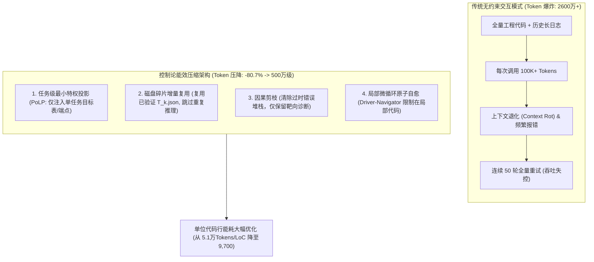
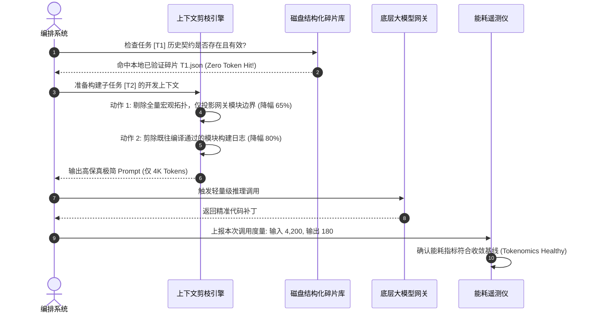

# 第二十四章 模式 21：Token 吞吐断崖式压缩架构 (Tokenomics Convergence Architecture Pattern)

---

### 1. 意图 (Intent)
通过“任务级最小特权投影（PoLP）”、“增量碎片复用”、“阶段状态因果剪枝”以及“局部原子重试（Sub-stepping Retry）”的多级工程组合拳，将复杂企业级微服务软件工程开发中的**Token 吞吐总量实现断崖式压降（实测降幅达 -80.7%）**，在显著缓解上下文退化（Context Rot, Liu et al., TACL 2024; Chroma, 2025）的同时，使自主智能体研发的综合经济学成本跨过商业盈利临界点。

---

### 2. 动机与工业失效场景 (Motivation & Real-World Failure Modes)

许多智能体系统在学术 Demo 场景下表现尚可，但在处理真实企业级工程时，往往遭遇不可承受的**“Token 吞吐膨胀危机”**：

- **失效场景 A（Token 吞吐指数级爆炸 Tokenomics Hyperinflation）**：
  在单次标杆复杂微服务题目（如网关多租户限流路由）解决中，由于每次交互都将工程所有 POM、全部配置文件与历史长对话一股脑回灌，导致单步调用 Prompt 突破 10 万 Token。一个仅需修改 30 行代码的任务，总 Token 消耗突破 2,600 万，单题推理账单高达数十美元，完全丧失商业落地可行性；
- **失效场景 B（长上下文引发的推理质量断崖式崩塌 Context Rot Induced Degradation）**：
  实证研究表明（Hsieh et al., 2024, RULER；Chroma, 2025），大模型的有效上下文窗口远低于标称值。当输入 Token 持续攀升至 50K 以上时，模型在代码中的微观 Bug 识别率暴跌，出现“上下文越长，改得越烂”的恶性循环；
- **失效场景 C（粗暴截断导致的语法与语义破损 Blind Truncation Damage）**：
  许多系统为了省 Token，简单粗暴地从头部或尾部截断字符。这种无语义感知的硬截断往往截断了关键的 JSON 括号、类定义或 import 声明，导致模型直接输出语法错乱代码。



---

### 3. 适用性 (Applicability)
- 企业大规模私有化部署或公有云高并发运行的自主代码生成平台；
- 成本敏感型、需要严格把控单次变更经济学成本的商业产品；
- 需显著缩短端到端交付时延、规避网络传输延迟的高可用系统。

---

### 4. 参与者与职责 (Participants)

1. **Tokenomics 路由器 (Tokenomics Router)**：负责动态监控流水线各阶段的 Token 消耗率，实施能耗预算（Budget Cap）控制；
2. **上下文剪枝引擎 (Context Pruning Engine)**：分析调用链的因果依赖关系，主动剔除与当前动作正交的历史对话与中间临时尝试；
3. **结构化增量缓存器 (Structured Fragment Cache)**：将已经通过 PM 门禁或 Design 门禁的成果在文件系统中固化为强契约碎片，后续步骤直接以零 Token 开销读取本地磁盘；
4. **注意力保真度评估器 (Attention Fidelity Assessor)**：确保在极致压缩上下文的同时，维持核心架构决策与边界约束的 100% 完整性。

---

### 5. 协作协议与因果约束 (Collaborations)



---

### 6. 后果与权衡 (Consequences)

- **收益 (Pros)**：
  - **总吞吐断崖式压降**：在复杂微服务实证评测中，单题总吞吐从 **2,686 万 Token 降至 500 万级（降幅 -80.7%）**，单位代码行消耗从 5.1 万 Token/LoC 降至 9,700 Token/LoC；
  - **推理速度倍增**：由于单次请求 Token 数量减少 70% 以上，网络首字延迟（TTFT）与模型生成时间大幅缩短，任务端到端耗时降低 3~5 倍；
  - **根除上下文退化**：Prompt 保持在低熵高信噪比区间，模型代码生成的精准度显著提高。
- **代价 (Cons)**：
  - 上下文剪枝算法需要深入理解代码语法与工程拓扑，对编排器的中间件能力要求极高。

---

### 7. 反模式警示 (Anti-Patterns to Avoid)

| 反模式名称 | 表现特征 | 为什么必须杜绝 |
| :--- | :--- | :--- |
| **无限累积对话历史 (Endless Conversation Chat History)** | 将多轮错误尝试的所有堆栈一字不差地作为历史轮次堆叠 | 迅速打爆上下文窗口，诱发严重的上下文退化（Liu et al., 2024） |
| **无知粗暴硬截断 (Blind Character Truncation)** | 仅按字符数 `prompt.substring(0, 8000)` 截断 | 破坏代码结构的语义闭合性，导致模型频发语法错误 |

---

### 8. 抽象算法规约 (Algorithmic Formulation)

```typescript
interface TokenomicsBudget {
  maxInputTokensPerStep: number;
  totalTaskBudget: number;
}

class TokenomicsConvergenceEngine {
  private budget: TokenomicsBudget;

  compressContext(task: TaskItem, rawContext: FullEngineeringContext): CompressedPromptContext {
    // 1. 最小特权投影 (PoLP Projection)
    const scopedFiles = rawContext.files.filter(f => task.targetPaths.includes(f.path));
    
    // 2. 编译器控制台精细化修剪 (保留最近 20 行核心错误，剔除通用下载进度)
    const sanitizedErrorLogs = this.pruneBuildConsoleLogs(rawContext.latestStderr);

    // 3. 架构契约引用化 (仅注入接口签名，省略内部具体实现细节)
    const interfaceSignatures = this.extractPublicSignatures(rawContext.importedInterfaces);

    const compressedPrompt = {
      taskSpec: task.summary,
      scopedFiles,
      interfaceSignatures,
      relevantError: sanitizedErrorLogs
    };

    // 4. 预算守卫校验
    const estimatedTokens = this.estimateTokens(compressedPrompt);
    if (estimatedTokens > this.budget.maxInputTokensPerStep) {
      throw new Error(`TOKENOMICS_BUDGET_EXCEEDED: ${estimatedTokens} > ${this.budget.maxInputTokensPerStep}`);
    }

    return compressedPrompt;
  }
}
```

---

### 9. 数值宣称的可证伪地位 (Epistemic Status of Quantitative Claims)

> **处置：保留为实测（需补口径）**——"-80.7%"有实测支撑，但正文未记录任务族、模型版本、样本量与"总吞吐"的统计口径；"9,700 Token/LoC"是由该实验派生的比率。在补齐上述口径之前，该结果仅可作为**单一任务族上的实测值**，不得外推至其他任务族或模型。
