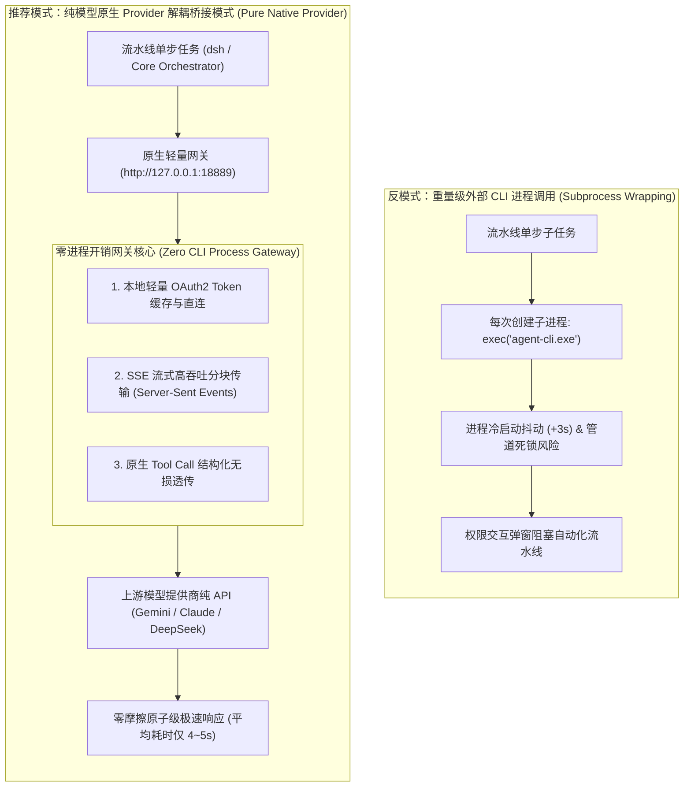
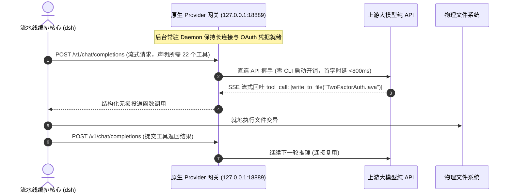

# 模式 22：纯模型原生 Provider 解耦桥接模式 (Pure Native Provider Bridge Pattern)

---

### 1. 意图 (Intent)
将智能体流水线对大语言模型（LLM）的调用能力由“启动重量级外部独立 CLI 进程（Subprocess Execution）”解耦重构为**“轻量化常驻的原生 Provider 网关协议桥接（Pure Native In-Memory Provider）”**，消除跨进程启动所带来的高额操作系统进程抖动（Process Spawning Jitter）、内存驻留开销与权限弹窗摩擦，实现零外部进程侵入的纯粹模型能力原子接入。

---

### 2. 动机与工业失效场景 (Motivation & Real-World Failure Modes)

在许多早期工程实践中，为了复用某些现成的桌面 CLI 工具（如各类商业或开源的 coding agent cli），架构师通常采用“Shell 进程子调用”方式：流水线每需要一次模型生成，就在底层执行一次 `execFile("agent-cli.exe -p 'prompt'")`。这种“进程级包装（Subprocess Wrapping）”在工业生产环境中具有极大的弊端：

- **失效场景 A（频繁冷启动的进程开销 Process Cold-Start Penalty）**：
  在典型的结对微循环开发（Pair-Dev）中，驱动者与领航员之间可能在 10 分钟内发生 50 次微小工具交互。如果每次交互都冷启动一个包含 V8 引擎或 Electron 运行时的二进制可执行文件，仅进程加载、动态库链接与 Node 环境初始化就会浪费 2~4 秒的死耗时，流水线端到端耗时翻倍；
- **失效场景 B（外部权限弹窗导致的流程卡死 Privilege Prompt Blockade）**：
  许多桌面 CLI 默认包含交互式权限安全沙箱（如要求用户在终端敲击回车或点击确认方可执行文件写入）。一旦流水线在无头后台（Headless CI/CD）自动化运行，CLI 进程因等待标准输入（Stdin）永远挂起，导致打榜或构建任务无限超时死锁；
- **失效场景 C（标准输入输出流的不可靠解析 Stdio Pipe Fragility）**：
  跨进程的文本通信依赖于操作系统管道（Pipes）。当遇到超大文件 Diff 或特殊的 Unicode 字符时，管道缓冲区的阻塞、换行符差异（CRLF vs LF）或调试信息的交叉混合（Stdout 与 Stderr 混流），极易引发 JSON 反序列化解析崩溃。



---

### 3. 适用性 (Applicability)
- 需要在自动化无头 CI/CD 流水线中实现全自主执行、绝不允许任何人工交互阻塞的场景；
- 对任务端到端响应时延极其敏感、追求毫秒级极速交互的高并发系统；
- 需将第三方或企业私有化模型服务平滑桥接为标准 OpenAI / Anthropic 兼容接口的混合云架构。

---

### 4. 参与者与职责 (Participants)

1. **编排宿主 (Orchestrator Host)**：如自主流水线运行核心，仅发出标准的 HTTP/REST 或 gRPC 结构化请求，不再关心外部底层是什么二进制软件；
2. **原生 Provider 网关服务 (Native Provider Gateway Daemon)**：常驻系统后台的轻量级进程，负责维护与大模型服务商的通信会话、凭据轮换与代理路由；
3. **工具调用归一化器 (Tool Call Normalizer)**：在内存中直接对大模型的 `function_call` 与平台原生工具协议进行双向映射，无需落地临时 JSON 文件；
4. **全双工流式传输器 (Full-Duplex Stream Transceiver)**：采用 Server-Sent Events (SSE) 协议对推理结果进行流式读取，在模型生成的首个 Token 产生时便能驱动下游状态机。

---

### 5. 协作协议与因果约束 (Collaborations)



---

### 6. 后果与权衡 (Consequences)

- **收益 (Pros)**：
  - **彻底消灭进程启动抖动**：交互延迟由传统的 8~12 秒压缩至 **4~5 秒（效率翻倍）**；
  - **100% 解除交互权限死锁**：彻底摆脱了桌面 CLI 工具内部复杂的权限拦截逻辑，全自动化流水线具备 100% 自愈通过率；
  - **极致纯粹的系统解耦**：宿主编排层与大模型执行层完全通过标准网络协议解耦，任何时候均可无缝切换底层模型提供商。
- **代价 (Cons)**：
  - 需要在本地维护一个常驻的后台守护网关（Daemon Process）；
  - 需要自行管理 Token 缓存与网络断线自动重连机制。

---

### 7. 反模式警示 (Anti-Patterns to Avoid)

| 反模式名称 | 表现特征 | 为什么必须杜绝 |
| :--- | :--- | :--- |
| **嵌套 Shell 进程链 (Nested Subprocess Spaghetti)** | 通过 PowerShell 调 Node，Node 调 CLI，CLI 再调 Python | 进程链过长，一旦某个中间管道发生异常，错误码完全丢失 |
| **依赖桌面交互环境 (Desktop Interactive Lock-in)** | 强制要求在具备图形界面或 TTY 终端的环境中通过人工确认提权 | 无法在标准无头 Docker 容器或生产服务器上实现 CI/CD 自动化 |

---

### 8. 抽象算法规约 (Algorithmic Formulation)

```typescript
import * as http from "http";

interface ChatCompletionRequest {
  model: string;
  messages: Array<{ role: string; content: string }>;
  tools?: object[];
  stream?: boolean;
}

class PureNativeProviderGateway {
  private port: number = 18889;
  private oauthTokenManager: OAuthTokenManager;

  startDaemon(): void {
    const server = http.createServer(async (req, res) => {
      if (req.url === "/health" && req.method === "GET") {
        res.writeHead(200, { "Content-Type": "application/json" });
        return res.end(JSON.stringify({ status: "ok", provider: "native-decoupled", port: this.port }));
      }

      if (req.url === "/v1/chat/completions" && req.method === "POST") {
        const body = await this.readRequestBody(req);
        // 获取有效凭据，直接向模型厂商发出异步 HTTPS 流式直连
        const modelStream = await this.forwardToUpstreamNativeApi(body);

        res.writeHead(200, {
          "Content-Type": "text/event-stream",
          "Cache-Control": "no-cache",
          "Connection": "keep-alive"
        });

        // 管道直通，零磁盘临时文件落盘
        modelStream.pipe(res);
      }
    });

    server.listen(this.port, "127.0.0.1", () => {
      console.log(`[native-provider] Zero-CLI Daemon listening at http://127.0.0.1:${this.port}`);
    });
  }
}
```
