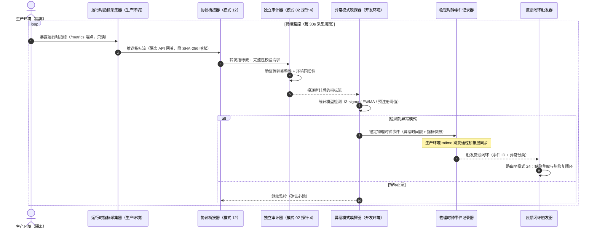

# 第二十六章 模式 23：生产环境运行时监控与异常嗅探模式 (Production Runtime Anomaly Sniffing Pattern)


***

### 1. 意图 (Intent)

将物理负反馈从 "部署前" 延伸至 "部署后"，通过**生产环境运行时指标采集、异常模式嗅探与物理时钟事件锚定**，确保智能体系统在生产阶段的 "状态可观测性" 持续成立，防止部署后失控漂移。


***

### 2. 动机与工业失效场景 (Motivation & Real-World Failure Modes)

在自主智能体完成代码交付并部署至生产环境后，传统控制论框架的闭环即告终止。然而生产环境的真实运行状态是验证智能体交付质量的最终物理判据：


* **失效场景 A（部署后性能静默衰减 Silent Performance Decay）**：

  候选版本在压力测试环境中 P99 延迟为 120ms（达标），但生产环境因真实数据分布差异、缓存命中率波动、下游服务延迟传导，部署后 72 小时内 P99 延迟渐增至 800ms。智能体系统无运行时监控，未能嗅探该衰减，直至用户投诉才被动发现；

* **失效场景 B（资源泄漏的累积效应 Resource Leak Accumulation）**：

  智能体引入的代码缺陷（如未关闭的数据库连接、内存泄漏的缓存策略）在压力测试的短周期内未暴露，但在生产环境长周期运行中累积，最终导致服务崩溃。压力测试的 "通过" 结论掩盖了长周期稳定性缺陷；

* **失效场景 C（生产环境特有异常未被萃取 Production-Only Anomalies）**：

  生产环境的真实流量模式（如特定地域的异常请求、特定时间段的并发峰值）触发智能体未预见的边界条件，这些异常模式未被萃取为经验资产，同类缺陷在后续版本中重复出现。


  ```mermaid
  flowchart TD
      subgraph DevEnvironment["开发环境（智能体可访问）"]
          Dev["智能体开发"] --> GitCommit["Git 提交"]
      end

      subgraph IsolatedEnvironments["隔离环境矩阵（智能体不可访问）"]
          direction TB
          StressTest["压力测试环境<br/>（隔离）"]
          Production["生产环境<br/>（隔离）"]
      end

      subgraph BridgeLayer["协议桥接层（模式 12）"]
          direction TB
          Bridge1["压力测试结果<br/>异步回流"]
          Bridge2["生产指标<br/>异步回流"]
      end

      subgraph AuditLayer["独立审计层（模式 02 探针 4）"]
          direction TB
          Audit1["压力测试审计"]
          Audit2["生产指标审计"]
      end

      GitCommit --> StressTest
      StressTest --> Bridge1
      GitCommit --> Production
      Production --> Bridge2
      Bridge1 --> Audit1
      Bridge2 --> Audit2

      Audit1 --> DeployDecision["部署决策"]
      Audit2 --> RuntimeSniffer["运行时异常嗅探器"]

      subgraph SniffingDimensions["三维嗅探维度"]
          D1["性能维度：P99/P999 延迟、吞吐量、错误率"]
          D2["资源维度：内存/CPU/连接池/句柄泄漏"]
          D3["业务维度：异常请求模式、边界条件触发"]
      end

      RuntimeSniffer --> SniffingDimensions
      SniffingDimensions --> Alarm["异常报警 & 物理时钟事件"]
      Alarm --> Feedback["反馈至模式 24：缺陷萃取与热修复闭环"]
  ```

**关键约束：生产环境与开发环境完全隔离**


| 约束                | 实现方式                                       |
| ----------------- | ------------------------------------------ |
| **智能体无法直接访问生产环境** | 模式 01（就地穿透）不适用；生产指标通过协议桥接器（模式 12）异步回流      |
| **运行时指标需跨环境传输**   | 指标采集器部署于生产环境，通过隔离 API 网关推送至桥接层             |
| **传输完整性保障**       | 生产指标附 SHA-256 哈希，审计器验证完整性后方可采信             |
| **环境指纹采集**        | 同步采集生产环境配置指纹（OS / 内核 / 依赖版本 / 资源配额），供同质性校验 |
| **物理时钟事件跨环境锚定**   | 异常事件的 mtime 跳变在生产环境锚定，通过桥接层同步至开发环境，确保因果单调性 |


***

### 3. 适用性 (Applicability)


* 自主智能体交付的代码已部署至生产环境，需持续保障运行时质量；

* 生产环境长周期运行，需检测压力测试短周期未暴露的累积性缺陷；

* 需将生产环境特有异常萃取为经验资产，防止同类缺陷跨代际传播。


***

### 4. 参与者与职责 (Participants)


1. **运行时指标采集器 (Runtime Metrics Collector)**：部署于生产环境的独立代理，采集 Prometheus/Grafana 原生指标，与智能体完全物理隔离；**关键约束**：采集器与智能体无直接通信通道，仅通过隔离 API 网关暴露只读指标端点；

2. **异常模式嗅探器 (Anomaly Sniffer)**：部署于开发环境或独立分析环境，基于预注册阈值与统计模型（如 3-sigma 规则、EWMA 指数加权移动平均），嗅探运行时指标的异常模式；**关键约束**：嗅探器不直接访问生产环境，仅消费经协议桥接器回流并审计后的指标；

3. **物理时钟事件记录器 (Physical Clock Event Logger)**：将异常事件锚定为物理时钟事件（mtime 跳变）；**关键约束**：生产环境的 mtime 跳变通过桥接层同步至开发环境，确保跨环境因果单调性；

4. **反馈闭环触发器 (Feedback Loop Trigger)**：异常确认后触发模式 24 的缺陷萃取与热修复闭环；**关键约束**：触发器仅消费经审计后的异常事件，不直接响应生产环境原始信号。


***

### 5. 协作协议与因果约束 (Collaborations)




**因果约束**：


* 异常事件的物理时钟必须严格单调（公理 III），**跨环境同步**：生产环境的 mtime 跳变通过桥接层同步至开发环境，确保缺陷修复的因果链可溯源；

* 运行时指标的采集周期与异常检测的统计窗口需预注册，避免事后合理化；

* 异常报警的阈值不得由智能体自行调整，必须经人类专家或独立审计通道确认；

* **跨环境审计**：生产指标经协议桥接器回流后，必须经模式 02 探针 4 审计（真实性 / 完整性 / 同质性）后方可被嗅探器消费。


***

### 6. 后果与权衡 (Consequences)


* **收益 (Pros)**：


  * **部署后持续可观测**：生产环境的运行时状态持续纳入物理负反馈闭环，防止部署后失控；

  * **累积性缺陷早期发现**：长周期运行中的资源泄漏、性能衰减在崩溃前被嗅探；

  * **生产特有异常萃取**：真实流量模式触发的边界条件被萃取为经验资产，防止同类缺陷再发。

* **代价 (Cons)**：


  * 生产环境需部署额外的监控代理，增加运维复杂度；

  * 异常检测的统计模型需定期校准，避免误报 / 漏报；**自适应 σ 判据存在信号污染的阈值漂移（实测见 §7）**，泄漏类缺陷须改用稳健基线或固定绝对阈值；

  * 运行时指标的采集与存储产生额外成本。


***

### 7. 反模式警示 (Anti-Patterns to Avoid)


| 反模式名称           | 表现特征                     | 为什么必须杜绝                |
| --------------- | ------------------------ | ---------------------- |
| **监控代理与智能体同进程** | 监控代码嵌入智能体运行时，智能体可篡改指标    | 违反公理 I（物理非信任），指标失去客观性  |
| **阈值动态自适应**     | 异常检测阈值由智能体根据历史数据自动调整     | 智能体可通过渐进漂移规避检测，阈值必须预注册 |
| **自适应 σ 统计污染（实测）** | EWMA/3σ 判据的 σ 由信号本身驱动，大幅突跳膨胀 σ，3σ 阈值漂移后吞没后续同类信号 | 实测（2026-10-22，F3）：mem 3σ 对"极稳基线+大幅突跳"有效（dev 31.1σ 触发），对重复泄漏台阶失敏（σ 由 4MB 膨胀至 67MB）——泄漏类监控须用稳健基线（中位数/MAD）或固定绝对阈值，不能只靠"预注册自适应" |
| **异常事件无物理锚定**   | 异常仅记录于内存或日志文件，未锚定为物理时钟事件 | 违反公理 III，缺陷修复的因果链不可溯源  |


***

### 8. 抽象算法规约 (Algorithmic Formulation)


```
interface RuntimeMetrics {
  timestamp: number;
  p99LatencyMs: number;
  p999LatencyMs: number;
  throughputQps: number;
  errorRate: number;
  memoryUsageBytes: number;
  cpuUsagePercent: number;
  connectionPoolActive: number;
  connectionPoolMax: number;
}

interface AnomalyEvent {
  eventId: string;
  anomalyType: "PERFORMANCE_DECAY" | "RESOURCE_LEAK" | "BUSINESS_ANOMALY";
  severity: "WARNING" | "CRITICAL";
  metricsSnapshot: RuntimeMetrics;
  physicalClockEvent: {
    mtimeBefore: number;
    mtimeAfter: number;
    monotonicJump: boolean;
  };
  preRegisteredThreshold: {
    metric: string;
    threshold: number;
    statisticalModel: "3SIGMA" | "EWMA" | "FIXED";
  };
}

class ProductionRuntimeAnomalySniffer {
  private preRegisteredThresholds: Map<string, Threshold>;

  async sniffAnomaly(metrics: RuntimeMetrics): Promise<AnomalyEvent | null> {
    // 1. 性能维度：P99 延迟是否超过预注册阈值
    const p99Threshold = this.preRegisteredThresholds.get("p99LatencyMs");
    if (metrics.p99LatencyMs > p99Threshold.value) {
      return this.createAnomalyEvent("PERFORMANCE_DECAY", "CRITICAL", metrics, p99Threshold);
    }

    // 2. 资源维度：连接池使用率是否超过 90%（累积泄漏信号）
    const poolUsage = metrics.connectionPoolActive / metrics.connectionPoolMax;
    if (poolUsage > 0.9) {
      return this.createAnomalyEvent("RESOURCE_LEAK", "WARNING", metrics, poolThreshold);
    }

    // 3. 业务维度：错误率是否超过 3-sigma 统计阈值
    const errorRateSigma = this.calculateSigma(metrics.errorRate, historicalErrorRates);
    if (errorRateSigma > 3) {
      return this.createAnomalyEvent("BUSINESS_ANOMALY", "WARNING", metrics, errorRateThreshold);
    }

    return null; // 无异常
  }

  private createAnomalyEvent(
    type: string,
    severity: string,
    metrics: RuntimeMetrics,
    threshold: Threshold
  ): AnomalyEvent {
    // 锚定物理时钟事件（公理 III）
    const mtimeBefore = this.getLastEventMtime();
    const mtimeAfter = Date.now();
    
    return {
      eventId: generateUUID(),
      anomalyType: type,
      severity: severity,
      metricsSnapshot: metrics,
      physicalClockEvent: {
        mtimeBefore: mtimeBefore,
        mtimeAfter: mtimeAfter,
        monotonicJump: mtimeAfter > mtimeBefore, // 必须严格单调
      },
      preRegisteredThreshold: threshold,
    };
  }
}
```

> **理论锚点**
>
> ：公理 I 扩展 —— 生产环境的 "物理底座" 是运行时指标，而非编译器；定理 3.1 扩展 —— 运行时监控作为 "状态可观测性" 的持续保障。


***

### 理论地位与形式化锚点 (Epistemic Status)

> **可定理化（回路稳定性已证，零 sorry）**
>
> ：模块 
>
> `Pattern23_24_ProductionLoop`
>
> （对应附录 B.10）把模式 23→24→23 的观测–学习回路形式化。


* 模型：缺陷存量 $x\in\mathbb N$，每周期以概率 `q` 检出并修复一个，否则注入一个。

* `T_id_pos`：$\mathbb E[x'\mid x]=x+1-2q$（$x\ge1$）。

* `hasStrongDrift` + `loop_return_bound`：$q>1/2$ 时以 $V(x)=x$、$b=1$、$\delta=2q-1$ 满足强漂移，$\mathbb E[\tau]\le x_0/(2q-1)$。

* `no_drift_below_half`（临界负结果）：$q\le1/2$ 时 $V=\mathrm{id}$ 不是 Lyapunov 函数。

**对本模式数值的含义**：正文的 " 检出率 $\ge0.90$" 不是可选的性能目标，而是 $q>1/2$ 稳定性门槛的工程余量；低于门槛时回路无法自证收敛。$q$ 的实测值由生产现场实验 H1 提供（固定阈值类缺陷 $q=1.00$，mem 自适应 σ 判据形态边界，2026-10-22）；本形式化只覆盖单缺陷类、单步注入 / 修复、i.i.d. 检出，不外推到多缺陷类耦合。

### 实测支撑（2026-10-22，生产现场实验 H1/H4）

> 实测环境：Docker Compose 受控生产拓扑（app/downstream/toxiproxy/k6/exporter/auditor/sniffer，LLM 组件 DeepSeek-V4.1-Flash-1017 仅在缺陷萃取环节）；判据全部预注册（固定阈值 pool>10 /p99>300ms /mem 3σ；检测窗口 180s；各场景 10 reps）。判读结论见下：F1/F2 检出率 1.00、F4 误报 0.00、F3 判据形态边界、H4 装置缺陷。


* **F1 连接池泄漏**（10 reps）：检出率 10/10（q=1.00），告警证据 `pool_active>10.0 (751)`。固定阈值判据对资源池耗尽类缺陷有效。

* **F2 下游延迟**（toxiproxy 400ms，10 reps）：检出率 10/10（q=1.00），告警证据 `p99>300.0 (40x ms)`。延迟类缺陷在预注册 p99 阈值下可靠检出。

* **F4 对照**（10 reps × 6 采样窗 = 60 期）：误报率 0.00（≤0.05）。固定阈值在稳态流量下无误报。

* **F3 内存泄漏（边界）**：mem 3σ 自适应判据仅对 "极稳基线 + 大幅突跳" 有效（实测 dev 31.1σ 单次触发），对**重复台阶注入失敏**——EWMA 的 σ 被信号本身污染（4MB→67MB 膨胀），3σ 阈值漂移吞没后续信号。**这是判据形态（自适应 σ）与缺陷形态（泄漏 / 漂移）失配的实证，非判据失效**；工程启示：泄漏类监控应采用稳健基线（中位数 / MAD）或固定绝对阈值，自适应 σ 判据只适合突发型暴涨。

* **H4 装置缺陷**：exporter 重启序号复用导致 708 条正常事件被 mtime 判据误拒（全部 reason 为 `mtime_not_strict_increasing`，无哈希 / 指纹误拒）；复核 456 快照文件名序单调 0 破坏 —— 误拒系装置缺陷而非判据失效。装置已修（exporter 续号、auditor 按时间序审计）。

* 结论：$q$ 的实测值对固定阈值类缺陷（pool/p99）为 1.00，回路稳定性门槛 $q>1/2$ 获得实证支撑；mem 自适应 σ 判据不满足该门槛（属判据选择问题），按计划 §8 如实记录为边界。