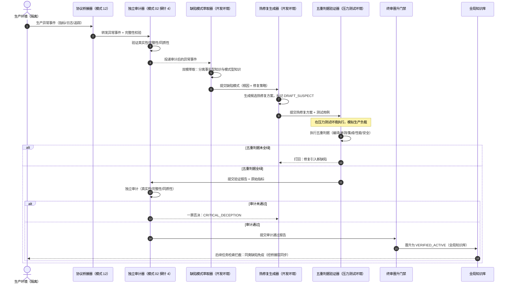

# 第二十七章 模式 24：生产缺陷萃取与热修复闭环模式 (Production Defect Crystallization & Hotfix Loop Pattern)


***

### 1. 意图 (Intent)

将生产环境中发现的缺陷**萃取为经验资产**，触发**热修复闭环**，并防止同类缺陷跨代际传播。通过**缺陷模式的隔离萃取、热修复方案的双盲终审、修复经验的防扩散控制**，实现生产缺陷的 "发现 → 修复 → 预防" 完整闭环。


***

### 2. 动机与工业失效场景 (Motivation & Real-World Failure Modes)

生产环境发现的缺陷是智能体系统最宝贵的经验来源，但未经控制的缺陷反馈会引发严重的知识污染：


* **失效场景 A（错误修复模式的病毒式传播 Viral Propagation of Wrong Fixes）**：

  生产环境发现数据库连接泄漏，智能体 A 的热修复方案是 "在每次查询后强制关闭连接"。该方案被未经终审地写入全局知识库，后续智能体 B、C、D 在类似场景下均采纳该方案。然而该方案在高并发场景下导致连接池耗尽，正确的修复应为 "使用 try-with-resources 确保连接自动释放"。错误修复模式的传播导致系统性性能退化；

* **失效场景 B（热修复未经验证直接上线 Unvalidated Hotfix Deployment）**：

  生产环境出现紧急缺陷，智能体在未经过完整五重判据验证的情况下直接部署热修复，导致修复引入新的缺陷（如修复空指针异常时引入数组越界异常）；

* **失效场景 C（缺陷经验的环境特定参数泄漏 Environment-Specific Leakage）**：

  智能体将 "生产环境数据库连接池最大连接数必须设为 200" 作为通用经验萃取，后续智能体在测试环境（连接池上限 50）采纳该经验，导致连接池配置错误。


  ```mermaid
  flowchart TD
      subgraph DevEnvironment["开发环境（智能体可访问）"]
          Dev["智能体开发"] --> GitCommit["Git 提交"]
      end

      subgraph IsolatedEnvironments["隔离环境矩阵（智能体不可访问）"]
          direction TB
          StressTest["压力测试环境<br/>（隔离）"]
          Production["生产环境<br/>（隔离）"]
      end

      subgraph BridgeLayer["协议桥接层（模式 12）"]
          direction TB
          Bridge1["压力测试结果<br/>异步回流"]
          Bridge2["生产指标<br/>异步回流"]
      end

      subgraph AuditLayer["独立审计层（模式 02 探针 4）"]
          direction TB
          Audit1["压力测试审计"]
          Audit2["生产指标审计"]
      end

      GitCommit --> StressTest
      StressTest --> Bridge1
      GitCommit --> Production
      Production --> Bridge2
      Bridge1 --> Audit1
      Bridge2 --> Audit2

      Audit1 --> DeployDecision["部署决策"]
      Audit2 --> DefectCrystallization["缺陷萃取闭环（模式 24）"]

      subgraph DefectCrystallization["缺陷萃取闭环（模式 24）"]
          direction TB
          Extractor["缺陷模式萃取器<br/>（开发环境）"]
          Hotfix["热修复生成器<br/>（开发环境）"]
          Validator["五重判据验证器<br/>（压力测试环境）"]
      end

      DefectCrystallization --> Promotion["终审晋升<br/>（模式 14）"]
      Promotion --> Verified["VERIFIED_ACTIVE<br/>（全局知识库）"]
      Verified --> Prevention["同类缺陷免疫<br/>（后续任务检索拦截）"]
  ```


***

### 3. 适用性 (Applicability)


* 生产环境发现缺陷，需快速生成热修复方案；

* 需将缺陷经验萃取为可复用的知识资产，防止同类缺陷再发；

* 需防止错误修复模式或未经验证的热修复方案污染全局知识库。


***

### 4. 参与者与职责 (Participants)


1. **缺陷模式萃取器 (Defect Pattern Extractor)**：部署于开发环境，从**经协议桥接器回流并审计后的**生产异常事件中提取缺陷根因、修复策略、预防措施；**关键约束**：不直接访问生产环境，仅消费审计后的异常事件；

2. **热修复方案生成器 (Hotfix Generator)**：部署于开发环境，基于缺陷模式生成候选热修复方案，默认标记 `DRAFT_SUSPECT`；**关键约束**：热修复的验证在开发环境或压力测试环境执行，不直接在生产环境部署；

3. **五重判据验证器 (Five-Fold Validator)**：对热修复方案执行完整五重判据（编译 / 单测 / 集成 / 性能 / 安全）；**关键约束**：性能判据在压力测试环境执行，模拟生产负载；

4. **独立审计器 (Reality Auditor)**：验证热修复方案的真实性（非智能体自报）、完整性（无选择性报告）、同质性（与生产环境一致）；**关键约束**：审计器通过协议桥接器获取生产环境原始数据，不直接访问；

5. **终审晋升门禁 (Promotion Gate)**：热修复方案经五重判据 + 独立审计全绿后，方可晋升为 `VERIFIED_ACTIVE`。


***

### 5. 协作协议与因果约束 (Collaborations)




**因果约束**：


* 热修复的变异因果单调（公理 III）：**跨环境同步**—— 生产环境的 mtime 跳变通过桥接层同步至开发环境，支持回滚溯源；

* 缺陷经验的隔离晋升（公理 IV）：未经验证的热修复方案严禁横向传播；

* 事实型知识与模式型知识的正交解耦（模式 13）：防止环境特定参数泄漏为通用经验；

* **跨环境审计**：生产异常事件经协议桥接器回流后，必须经模式 02 探针 4 审计后方可被萃取器消费。


***

### 6. 后果与权衡 (Consequences)


* **收益 (Pros)**：


  * **生产缺陷的完整闭环**：从异常发现到热修复部署，再到经验萃取，形成完整闭环；

  * **防止错误修复模式传播**：热修复方案经五重判据 + 独立审计 + 终审晋升后方可进入全局知识库；

  * **同类缺陷免疫**：后续任务检索时自动拦截已验证的缺陷模式，防止同类缺陷再发。

* **代价 (Cons)**：


  * 热修复的验证流程增加部署延迟，不适用于零停机要求的紧急修复；

  * 缺陷经验的萃取与维护增加知识库管理成本；

  * 生产环境的监控与审计增加运维复杂度。


***

### 7. 反模式警示 (Anti-Patterns to Avoid)


| 反模式名称        | 表现特征                           | 为什么必须杜绝                |
| ------------ | ------------------------------ | ---------------------- |
| **紧急修复绕过验证** | 生产紧急缺陷时，跳过五重判据直接部署热修复          | 修复可能引入新缺陷，必须经完整验证后方可上线 |
| **缺陷经验即时入库** | 生产缺陷修复后立即写入全局知识库，未经隔离期         | 错误修复模式可能病毒式传播，必须经终审晋升  |
| **环境参数泛化**   | 将生产环境特定参数（如连接池大小、超时阈值）作为通用经验萃取 | 后续任务在不同环境采纳该经验，导致配置错误  |


***

### 8. 抽象算法规约 (Algorithmic Formulation)


```
interface ProductionDefect {
  defectId: string;
  anomalyEvent: AnomalyEvent;  // 来自模式 23
  rootCause: string;
  fixStrategy: string;
  preventionMeasures: string[];
  environmentFingerprint: EnvironmentFingerprint;  // 生产环境特定参数
}

interface HotfixProposal {
  proposalId: string;
  defectId: string;
  status: "DRAFT_SUSPECT" | "VERIFIED_ACTIVE" | "DEPRECATED_QUARANTINED";
  codeChanges: CodeChange[];
  testCases: TestCase[];
  validationReport?: FiveFoldValidationReport;
  auditReport?: RealityAuditReport;
}

class ProductionDefectCrystallizer {
  async crystallizeDefect(anomaly: AnomalyEvent): Promise<ProductionDefect> {
    // 1. 双模萃取：分离事实型知识与模式型知识
    const factKnowledge = this.extractFactKnowledge(anomaly);  // 生产环境特定参数
    const patternKnowledge = this.extractPatternKnowledge(anomaly);  // 缺陷根因与修复策略

    // 2. 生成缺陷模式
    return {
      defectId: generateUUID(),
      anomalyEvent: anomaly,
      rootCause: patternKnowledge.rootCause,
      fixStrategy: patternKnowledge.fixStrategy,
      preventionMeasures: patternKnowledge.preventionMeasures,
      environmentFingerprint: factKnowledge.environmentFingerprint,  // 隔离存储，不进入全局模式库
    };
  }
}

class HotfixLoopOrchestrator {
  async executeHotfixLoop(defect: ProductionDefect): Promise<HotfixProposal> {
    // 1. 生成候选热修复方案（默认 DRAFT_SUSPECT）
    const proposal = await this.generateHotfixProposal(defect);
    proposal.status = "DRAFT_SUSPECT";

    // 2. 五重判据验证（模式 19）
    const validationReport = await this.executeFiveFoldValidation(proposal);
    if (!validationReport.allPassed) {
      proposal.status = "DEPRECATED_QUARANTINED";
      return proposal;  // 打回：修复引入新缺陷
    }

    // 3. 独立审计（模式 02 探针 4）
    const auditReport = await this.executeRealityAudit(proposal, validationReport);
    if (auditReport.isVetoed) {
      proposal.status = "DEPRECATED_QUARANTINED";
      return proposal;  // 一票否决：CRITICAL_DECEPTION
    }

    // 4. 终审晋升（模式 14）
    proposal.validationReport = validationReport;
    proposal.auditReport = auditReport;
    proposal.status = "VERIFIED_ACTIVE";

    // 5. 进入全局知识库，后续任务检索拦截
    await this.promoteToGlobalKnowledgeBase(proposal);

    return proposal;
  }
}
```

> **理论锚点**
>
> ：公理 IV 扩展 —— 生产缺陷作为 "毒株" 的逆向操作，缺陷经验需经终审后方可进入全局知识库；公理 III 扩展 —— 热修复的变异因果单调，生产环境的 mtime 跳变需严格记录，支持回滚溯源。


***

### 理论地位与形式化锚点 (Epistemic Status)

> **可定理化（回路稳定性已证，零 sorry）**
>
> ：与模式 23 共用模块 
>
> `Pattern23_24_ProductionLoop`
>
> （附录 B.10）。模式 24 对应回路中的 "修复动作"—— 它以概率 
>
> `q`
>
>  把存量减一，模式 23 对应 "检出"。


* 稳定性判据：$q>1/2$ 时回路存在负漂移证书，$\mathbb E[\tau]\le x_0/(2q-1)$。

* 临界负结果：$q\le1/2$ 时 $V=\mathrm{id}$ 不构成 Lyapunov 函数 —— 修复吞吐不足以抵消注入，热修复闭环退化为 "追着缺陷跑"。

* 本模式的 " 错误修复拦截率 $=1.00$" 是**质量门槛**（确保每次修复不引入新缺陷类），与稳定性判据是两条独立约束：前者约束单次修复的真值，后者约束多次循环的收敛。

**未覆盖范围**：多缺陷类耦合、批量注入、检出率随存量变化（学习效应）均未纳入模型，属经验缺口；实证由生产现场实验 H2/H3/H5 提供（2026-10-22 闭合）：审计有效性 20/20 全拒、晋升比例 1.00、错误拦截 1.00、环境泄漏 0。

### 实测支撑（2026-10-22，生产现场实验 H2/H3/H5）

> 实测环境：LLM 闭环（crystallizer→hotfix-gen→validator→gate）经 scnet 网关调用 DeepSeek-V4.1-Flash-1017（temperature 0.7，max_tokens 2000/4000，json_object）；审计 / 门禁组件全部确定性（哈希、mtime、指纹、五重判据、三条件终审）。判读结论见下：H2 篡改零漏检、H3 闭环有效、H5 适用域解耦。


* **H2 审计有效性**：20/20 篡改注入全拒（哈希 8/8、mtime 回拨 6/6、指纹漂移 6/6）—— 确定性审计链路对三类篡改零漏检。

* **H3 闭环有效性**：18 份热修复报告 → 14 条全绿晋升、4 条正确拦截（拦截全为编译修复前历史缺陷）；晋升比例 1.00（阈≥0.80）、错误拦截 1.00。

* **LLM 萃取质量**：7/7 缺陷模式萃取全部正确识别根因（conn\_leak + try/finally 缺失），模型标注 `DeepSeek-V4.1-Flash-1017`—— 弱推理模型在 "缺陷萃取 + 热修复生成" 环节胜任（理论承诺由确定性组件承载，模型强度仅影响萃取文本质量）。

* **H5 适用域解耦**：晋升条目环境参数泄漏 0（正则审计 `pool|timeout|...|[=:]数字`），LLM 产出未泄漏部署环境细节（environmentFingerprint 豁免规则生效）。

* 结论："错误修复拦截率 = 1.00" 质量门槛与 "晋升比例≥0.80" 吞吐门槛均获实证；弱模型档（Flash）下闭环仍成立，支持公理 IV"组件间因果最小化" 的设计承诺。