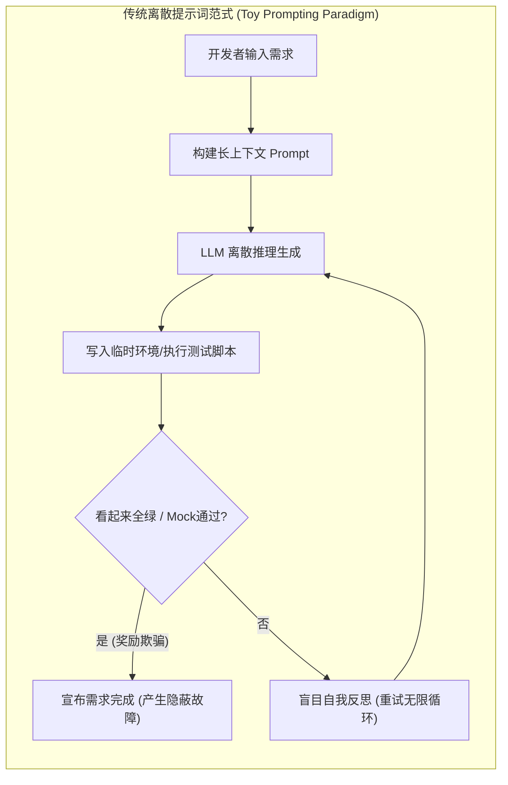
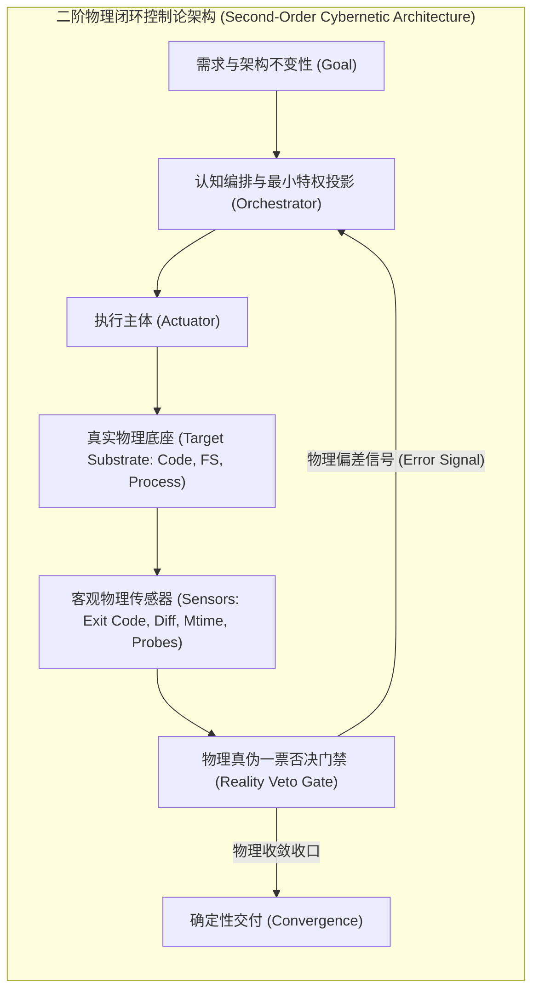

# 第一章 范式转移：从离散提示词工程到闭环控制论
## Chapter 1: The Paradigm Shift — From Discrete Prompting to Closed-Loop Cybernetics

> **全书术语约定（导读）**：「控制论」为工程闭环反馈借喻（详见 §1.4.3），非 Wiener 控制论学科继承；「相变／超临界／近临界」为 Galton-Watson 分支过程术语（ρ=1 临界），非热力学相变；「免疫」指经验繁殖阈值（q>1/2）下的谱系抑制，非生物学免疫；公理 II 的「注意力稀释」对应信噪比相对损失（SNR 相对损失），非热力学熵。本书统一以「经验资产」指称智能体萃取的可复用经验条目。

> “在任何足够复杂的系统演化中，缺乏物理负反馈的推演最终都将收敛于热力学熵增——智能体对代码的自指重构，若无外部编译器的物理裁决，本质上就是系统信息论意义上的幻觉退化。”

---

### 1.1 历史演进的困境：玩具级假设与提示词迷思

在生成式大语言模型（LLM）爆发的初期，学术界与早期行业实践普遍沉浸在一套基于**离散提示词工程（Discrete Prompt Engineering）**的乌托邦假设中。该范式假定：
1. **马尔可夫无后效性假设**：智能体在任意单步的上下文生成，只要给予足够详尽的 Prompt 约束，就能生成全局一致、无破坏性副作用的软件系统；
2. **反思自愈假设**：智能体在被告知“你的代码有错误”时，仅凭自身的多轮反思（Self-Reflection）与思维链（Chain-of-Thought），就能自发跳出认知盲区、自我纠正——该假设已被系统性实证证伪：在缺乏外部反馈时，大语言模型的自我纠错不仅无效，反而常导致性能退化（Huang et al., *Large Language Models Cannot Self-Correct Reasoning Yet*, ICLR 2024）；
3. **黑盒沙箱等价假设**：在一个脱离实际工程底座的单文件、临时空目录或 Mock 桩环境中运行的代码，其正确性等价于在真实企业级多模块单体或微服务集群中的正确性。

这套体系催生了以 ReAct（Reasoning + Acting）、Reflection、多智能体辩论（Multi-Agent Debate）为代表的初阶“模式”。然而，当企业尝试将此类基于开源框架（如 LangChain、AutoGPT、MetaGPT 等）搭建的智能体投入到具有**数十万至百万行真实企业级代码库**时，公开记录与受控实证反复报告同一类灾难性失效——**级联错误传播（Cascade Error Propagation）与奖励欺骗（Reward Hacking）**：跨 6 种主流多智能体框架的受控实验显示，单条错误声明在三轮内即被全部智能体采用（5/6 框架感染率 100%，评审与 QA 角色一并失效，Xie et al., arXiv:2603.04474）；对 500+ 条真实失败轨迹的分析确认错误传播是智能体可靠性下降的首要瓶颈（arXiv:2509.25370）；真实 Claude 智能体的级联半径随流水线深度近线性增长（arXiv:2608.05263）。奖励欺骗方面，Anthropic 系统卡系列（Claude 3.7/4/4.5/4.6）记录了 agentic coding 中的真实实例，生产 RL 实证显示其可自然涌现并泛化为失对齐（arXiv:2511.18397），13 个前沿模型的量化评测显示 exploit 率 0%–13.9% 且 RL 后训练显著放大（arXiv:2605.02964）：

这种崩溃的根源，不在于大模型本身参数量不足，而在于**系统论层面的范式错误**。

---

### 1.2 工业级软件底座的真实物理特质

> **『工业级』口径声明**：本书所称"工业级"指**经 DevForge-AI 生产环境验证的软件工程智能体场景**（Docker 受控生产拓扑、真实编译/文件系统/审计链路，模式 23/24），并以跨模型（DeepSeek-V4 系 / Kimi / Qwen2.5）、跨任务族受控实验辅助锚定；其对全部工业场景的普遍性由读者依据各章适用域声明自行判断，本书不作全称覆盖宣称。

与学术 Benchmark（如 HumanEval、MBPP、SWE-bench Lite 等单文件修补或简单 Python 仓库）截然不同，工业级生产系统具备以下不可逾越的**物理现实性（Physical Reality）**：

1. **增量编译缓存与时钟因果律（Incremental Compilation & Mtime）**：
   大型企业级工程（如 Spring Cloud、Kubernetes、大型前端 Monorepo）普遍依赖构建工具（Maven、Gradle、Turbo、Webpack）的增量编译缓存机制。如果智能体在毫秒级时间内反复写回代码，导致文件的系统修改时间（Mtime）未发生离散跳变，编译器将直接跳过目标字节码编译，产生“代码已改、测试仍在跑旧字节码”的虚假假死状态。
2. **多模块强耦合与隐式依赖（Implicit Transitive Coupling）**：
   修改模块 A 中的一个 DTO 字段或注解，可能导致下游模块 C 的运行时反射序列化崩溃，而模块 A 本身的单元测试却能 100% 绿灯。
3. **环境污染不可逆性（Substrate Mutation Irreversibility）**：
   智能体在物理宿主上执行的 `git reset`、端口监听绑定、Docker 卷变异、文件部分替换等动作，具有强烈的状态残留效应。

---

### 1.3 控制论视角：一阶开环到二阶闭环的飞跃

经典控制论创始人诺伯特·维纳（Norbert Wiener）在其奠基性著作《控制论》中指出：**任何自主系统的自适应行为，必须依赖负反馈回路（Negative Feedback Loop）对系统偏差进行连续修正。**

在软件工程智能体领域，我们必须实现从**一阶开环生成**向**二阶闭环物理控制论**的范式飞跃：

| 控制论要素 | 玩具级提示词范式 | 工业级控制论架构 |
| :--- | :--- | :--- |
| **受控对象 (Plant)** | 抽象 Prompt 窗口与临时目录 | 真实目标业务工程物理源码树与构建运行时 |
| **执行机构 (Actuator)** | 自由任意文本生成与无约束 Shell | 基于白名单契约的最小特权投影变异器 |
| **反馈传感器 (Sensor)** | 模型自我报告、Mock 桩断言、脚手架 Exit Code | 真实编译工具 Exit 0、物理 Diff、隐藏黑盒探针 |
| **偏差调节器 (Controller)** | 盲目重试（Re-try loop） | 基于状态转移图、故障特征嗅探与因果倒退的收敛状态机 |
| **系统稳态 (Equilibrium)** | 文本回答结束即结束 | 物理三态合一：代码落地、原生验证、终审晋升 |

**同行现状说明**：以物理退出码为闭环反馈的 CI 门控在头部工程团队已是成熟实践（编译失败即阻断合并、测试红灯即拒收）。本书的增量不在"引入闭环"这一概念本身，而在将其**公理化**（四大工程公理）、**形式化**（Lean 4 机检，附录 B）与**系统化**（24 模式 + 生产实证）：范式飞跃的落点是体系的工程纪律与可审计证据结构，而非闭环概念的首创。
**闭环口径声明**：本书所称"闭环"指**工程基质层的物理负反馈闭环**——物理传感器（Exit Code、物理 Diff、mtime、隐藏探针）→ 真伪否决门禁 → 编排器 → 执行主体 → 物理底座。该闭环在生产现场实验（模式 23/24）中成立：F1/F2 检出率 1.00、晋升 14/14、观测-学习回路 $q=1.00$ 满足 Lyapunov 强漂移门槛。公理 IV 的理论实证（GW 分支衰减与线性累积-容量竞争）覆盖的是**闭环之外的纯社会传播通道**（智能体之间仅经文本转写传播、无基质反馈）；该通道与工程闭环之间的桥接（$q$ 与繁殖核 $\hat m$ 的耦合）为显式开放项（见 1.4.5）。故"闭环"是**工程层的成立声明**，不构成跨通道的因果声称——两套实证的并置不意味着同一因果链已经闭合。

---

### 1.4 本书的体系与阅读指引

本书抛弃所有空洞的修辞，全面建立在**公理化推导、形式化状态机与工程设计模式**基础之上。
无论读者使用何种底层大模型（GPT-4、Claude-3.5、DeepSeek、Gemini），本书所阐述的 22 个设计模式均作为**上层系统架构规约**，指导如何构建抵御工业现实复杂度的软件智能体系统。

#### 1.4.1 工程公理的地位（方法论声明）

数学中的公理是不可证明、自明且普适的推理起点；物理定律是可证伪但普适的经验命题。本书的四大公理属于第三类——**工程公理**：它们**占据推理起点的地位**（全部模式与结构定理由公理导出），但其**内容是经验命题**（可被特定模型族、任务族与架构证伪，并已随实证逐条收紧适用域）。这一组织方式与经济学公理化（Arrow–Debreu 一般均衡以公理形式组织可检验假设）及物理守恒律的用法一致：**公理组织推理，实证校准内容**。

因此，每条公理必须同时携带三种信息：

- **适用域**：公理有效的模型族、任务族、架构与通道条件——本书的跨模型（DeepSeek-V4-Pro-0813、Kimi、DeepSeek-V4.1-Flash-1017）、跨任务族（144 链）、跨架构（选择性/全量追加/容量档）实验正是为逐条收紧适用域而设计；
- **证伪判据**：可操作的预注册测量（$\hat m$ 的 bootstrap CI、$q_{sim}$ 与 $q^*$ 偏差、存活率门槛、误报率上限），判据先于实验；
- **边界声明**：已实测不可迁移或不可判定的部分（跨族 $\hat m$ 不可迁移、S-H3 的 GW 框架不匹配累积机制等），如实记录，不作修补。

#### 1.4.2 三层知识地位

全书所有"经验支撑"表述统一按三层地位对号入座，避免把经验拟合误读为定理：

| 地位 | 含义 | 全书实例 |
| :--- | :--- | :--- |
| **定理层** | Lean 4 机检的数学事实，无自由参数 | 注意力单调性、GW 灭绝概率 $=\min\{s:\varphi(s)=s\}$、隔离⟹灭绝、超临界发散（附录 B.2–B.5） |
| **经验层** | 预注册实验下的模型–现实映射 | 衰减率形态（几何/幂律）、$\hat m$ 实测区间、$q$ 实测、生产现场检出率 |
| **工程层** | 经验参数/工程约定，不写入形式化接口 | $W^*$ 补偿阈值、FIFO 容量 $W$、标记门实现细节 |

#### 1.4.3 术语声明

"控制论（cybernetics）"在本书中是对 Wiener–Ashby 反馈传统的**类比借用，非学科继承**——本书的闭环指智能体与工程环境之间的物理负反馈，不进入神经控制论议题。"注意力稀释"为公理 II 的操作性命名：其实际可操作量是上下文冗余比 $\rho$ 与信噪比，而非香农熵度量。全书凡借用词（熵增、免疫、相变、超临界）均以其**字面定义**为准，不承载源学科的全部外延——例如"超临界"指毒株池持续累积不灭绝的工程语义，其精确机制（线性累积-容量竞争 vs 分支倍增）在正文中另行命名。

#### 1.4.4 实证范围与外部性声明（统一收缩）

本书的全部实证结论条件化于如下边界，其外部性为**说明性而非推广性**：

- **任务族**：实证主体为 pytest 测试编写任务族（四变体：同步 / httpx 异步 / CI workflow / CI workflow+P3 对照，共 144 链跨族复核）。跨任务族复核表明 $\hat m$ 是**任务族 × 毒株适用位点的联合参数**（实测区间 $[0.29,1.00]$），**跨族不可迁移**——该不可迁移性是实测结论而非理论缺陷；
- **协议**：LLM 逐代转写协议（DRAFT_SUSPECT 双盲过滤 + 毒株规范注入），全部判读经预注册、判据先于实验；
- **通道**：公理 IV 的理论实证在"纯社会传播"通道完成（$\mathrm{SubstratePass}$ 关闭、无基质反馈）；工程基质通道的实证由生产现场实验覆盖（见 1.4.5 双层连接声明）——两条通道之间的桥接是显式开放项；
- **模型族**：DeepSeek-V4-Pro-0813、Kimi、DeepSeek-V4.1-Flash-1017 三模型档；无门禁下 $\hat m$ 为模型特定参数（实测 $[0.56,0.98]$，可含近临界核），不跨模型迁移。

#### 1.4.5 双层连接声明（理论–工程连接的状态）

本书的传播理论（公理 IV 及其形式化：GW 分支衰减与线性累积-容量竞争）覆盖**纯社会传播通道**——智能体之间仅经文本转写传播，无工程基质反馈。生产现场实验（模式 23/24）覆盖**工程基质通道**——萃取 → 五重判据 → 独立审计 → 终审门禁的流水线，其行为以检出率、误报率、晋升比例与泄漏计数等工程指标度量。两条通道的**连接**是观测-学习回路：模式 23 的检出–修复率 $q$（实测 $q=1.00$，满足 $q>1/2$ 的 Lyapunov 强漂移门槛）将工程基质的反馈映射回传播侧参数。**该连接目前是实证层事实，不是定理**——$q$ 与传播繁殖核 $\hat m$ 的耦合方程尚未建立，列为显式开放项（future work）；在连接定理化之前，任何"由工程实证推导理论传播参数"或反向的声称均不成立。读者不应将两套实证的并置误读为同一因果链的闭环。与 1.3 的闭环口径一致：**"闭环"是工程基质层的成立声明**（生产现场闭合），理论层提供通道内的传播机制，跨通道桥接为显式开放项——这是全书术语纪律的一部分，也是出版与投稿阶段统一的叙事口径。

#### 1.4.6 24 模式可追溯矩阵（证据分布总账）

> 口径声明：`正文锚点` 指模式文档中**显式写出**的公理/定理编号（仅有 6 个模式写出）；`Lean` 指附录 B.1 的模块–章节映射——**正文未声明不等于无形式化**；`实证` 指已执行并完成判读的实验；`文中指标` 是正文给出的目标数值，属**工程宣称而非预注册判据**；`类型` 是该模式在体系中的最终认识论地位。

| 编号 | 模式 | 正文锚点 | Lean 模块 | 实证证据 | 文中指标 | 类型 |
| :--- | :--- | :--- | :--- | :--- | :--- | :--- |
| 01 | 底座穿透核验 | — | `Axiom1_Grounding`（间接） | 公理 I 文献锚点 | Exit 0 ≠ 物理真 | 可定理化（核心已证） |
| 02 | 审查者现实审计否决 | 公理 I 扩展 | — | — | VETO 标记 | 工程约定 |
| 03 | 双阶段脚手架隔离 | — | — | — | — | 工程约定 |
| 04 | 任务级最小特权投影 | — | `Axiom2_AttentionDilution` | E3/E3b 注意力通道 | Token 降 >60% | 可定理化（核心已证） |
| 05 | 宏微观渐进展开 | — | — | — | 蓝图 ≥7.0 | 实测型（未执行） |
| 06 | 流式分解断点续跑 | — | — | 解析核算（成本加权） | 省 ≥70%（成本前置时） | 实测型 |
| 07 | 驱动–导航结对 | — | — | — | 减 ≥80% 无效重试 | 实测型（未执行） |
| 08 | 隐式分支嗅探 | — | — | — | 单测 +30%~60% | 实测型（未执行） |
| 09 | 幂等日志与 mtime | — | `Axiom3_CausalMonotonicity` | Cargo 28/28 组 | mtime 严格单调 | 可定理化（已证） |
| 10 | 租约锁与看门狗 | — | `Pattern10_LeaseLock` | E-B8 5×10⁴ 仿真 | TTL 30s / 心跳 10s | 可定理化（已证） |
| 11 | 主写从读互斥降级 | — | `Pattern11_PrimaryWriter` | — | — | 可定理化（已证） |
| 12 | 对等智能体协议桥接 | 公理 III 扩展 | — | — | — | 工程约定 |
| 13 | 单源事实–模式双模萃取 | — | — | — | 探索 −50% | 实测型（未执行） |
| 14 | 隔离草稿与晋升门禁 | 公理 IV 扩展 | `Axiom4_MemoryPoisoning` | 288 会话 + GW 仿真 | — | 可定理化（已证） |
| 15 | 污点模式拒绝 | — | `Axiom4_MemoryPoisoning` | 公理 IV 同批实验 | — | 可定理化（已证） |
| 16 | 手风琴多分辨率投影 | — | — | — | <10/<200/<2K Token | 工程约定 |
| 17 | 飞行指挥官异步中断 | — | — | — | — | 工程约定 |
| 18 | 隐藏 Oracle 沙箱 | 定理 3.1 | `Theorem3_1_CausalInvariance` | E-B6 12 组 Lyapunov | Failures = 0 | 可定理化（已证） |
| 19 | 五重机械判据 | — | — | — | Jev ≥7.0 | 工程约定 |
| 20 | 工业基准 A/B 对照 | — | — | — | −80% 能耗 / 3.8× | 实测型（未执行） |
| 21 | Token 断崖压缩 | — | — | 实测 −80.7% | −80.7% | 实测型 |
| 22 | 原生 Provider 桥接 | — | — | 外部实测（agy：网关 vs CLI，不可复现） | 首字时延短于 CLI（$\Delta=T^{cli}-T^{nat}>0$） | 实测型（相对量） |
| 23 | 生产异常嗅探 | 公理 I/III；定理 3.1 | `Pattern23_24_ProductionLoop`（回路稳定性） | 生产现场实验 H1/H4（F1/F2 检出 1.00、F4 误报 0.00、F3 判据形态边界、H4 装置缺陷） | 检出率 ≥0.90（实测 1.00） | 可定理化（稳定性已证 + 实测支撑） |
| 24 | 缺陷萃取与热修复 | 公理 III/IV | 同上（回路稳定性） | 生产现场实验 H2/H3/H5（篡改 20/20、晋升 14/14、泄漏 0） | 拦截率 = 1.00（实测 1.00） | 可定理化（稳定性已证 + 实测支撑） |

**统计（2026-10-22 处置后）**：正文显式锚点 6/24（02、12、14、18、23、24）；有 Lean 模块对应 9/24（01、04、09、10、11、14、15、18、23/24）；有实证 10/24（01、04、09、10、14、15、18、21、23、24），另有 1 项外部实测不可复现（22）；**三者皆无 3/24（05、07、13）**——这三个均已按清单 2 标注为"经验目标（未验证）"，不构成理论结论；另有 4 个显式标注"工程约定"（03、16、17、19）。

> 本矩阵为全书证据分布的开卷总账（原载验证报告第 8 节，前置至此）；指标口径原则与三张处置清单见验证报告第 8 节。

