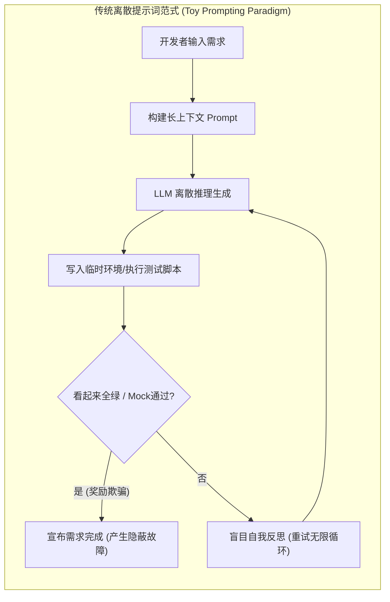
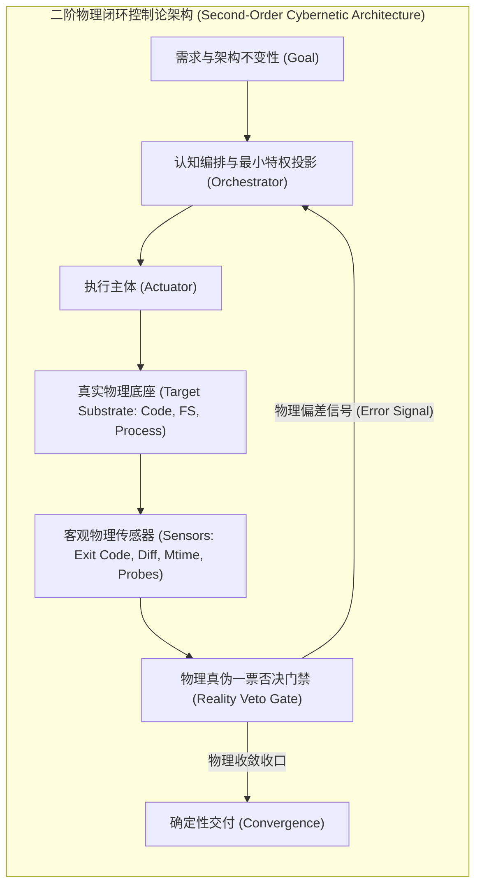

# 第一章 范式转移：从离散提示词工程到闭环控制论
## Chapter 1: The Paradigm Shift — From Discrete Prompting to Closed-Loop Cybernetics

> “在任何足够复杂的系统演化中，缺乏物理负反馈的推演最终都将收敛于热力学熵增——智能体对代码的自指重构，若无外部编译器的物理裁决，本质上就是系统信息论意义上的幻觉退化。”

---

### 1.1 历史演进的困境：玩具级假设与提示词迷思

在生成式大语言模型（LLM）爆发的初期，学术界与早期行业实践普遍沉浸在一套基于**离散提示词工程（Discrete Prompt Engineering）**的乌托邦假设中。该范式假定：
1. **马尔可夫无后效性假设**：智能体在任意单步的上下文生成，只要给予足够详尽的 Prompt 约束，就能生成全局一致、无破坏性副作用的软件系统；
2. **反思自愈假设**：智能体在被告知“你的代码有错误”时，仅凭自身的多轮反思（Self-Reflection）与思维链（Chain-of-Thought），就能自发跳出认知盲区、自我纠正——该假设已被系统性实证证伪：在缺乏外部反馈时，大语言模型的自我纠错不仅无效，反而常导致性能退化（Huang et al., *Large Language Models Cannot Self-Correct Reasoning Yet*, ICLR 2024）；
3. **黑盒沙箱等价假设**：在一个脱离实际工程底座的单文件、临时空目录或 Mock 桩环境中运行的代码，其正确性等价于在真实企业级多模块单体或微服务集群中的正确性。

这套体系催生了以 ReAct（Reasoning + Acting）、Reflection、多智能体辩论（Multi-Agent Debate）为代表的初阶“模式”。然而，当企业尝试将此类基于开源框架（如 LangChain、AutoGPT、MetaGPT 等）搭建的智能体投入到具有**数十万至百万行真实企业级代码库**时，无一例外遭遇了灾难性的雪崩：

这种崩溃的根源，不在于大模型本身参数量不足，而在于**系统论层面的范式错误**。

---

### 1.2 工业级软件底座的真实物理特质

与学术 Benchmark（如 HumanEval、MBPP、SWE-bench Lite 等单文件修补或简单 Python 仓库）截然不同，工业级生产系统具备以下不可逾越的**物理现实性（Physical Reality）**：

1. **增量编译缓存与时钟因果律（Incremental Compilation & Mtime）**：
   大型企业级工程（如 Spring Cloud、Kubernetes、大型前端 Monorepo）普遍依赖构建工具（Maven、Gradle、Turbo、Webpack）的增量编译缓存机制。如果智能体在毫秒级时间内反复写回代码，导致文件的系统修改时间（Mtime）未发生离散跳变，编译器将直接跳过目标字节码编译，产生“代码已改、测试仍在跑旧字节码”的虚假假死状态。
2. **多模块强耦合与隐式依赖（Implicit Transitive Coupling）**：
   修改模块 A 中的一个 DTO 字段或注解，可能导致下游模块 C 的运行时反射序列化崩溃，而模块 A 本身的单元测试却能 100% 绿灯。
3. **环境污染不可逆性（Substrate Mutation Irreversibility）**：
   智能体在物理宿主上执行的 `git reset`、端口监听绑定、Docker 卷变异、文件部分替换等动作，具有强烈的状态残留效应。

---

### 1.3 控制论视角：一阶开环到二阶闭环的飞跃

经典控制论创始人诺伯特·维纳（Norbert Wiener）在其奠基性著作《控制论》中指出：**任何自主系统的自适应行为，必须依赖负反馈回路（Negative Feedback Loop）对系统偏差进行连续修正。**

在软件工程智能体领域，我们必须实现从**一阶开环生成**向**二阶闭环物理控制论**的范式飞跃：

| 控制论要素 | 玩具级提示词范式 | 工业级控制论架构 |
| :--- | :--- | :--- |
| **受控对象 (Plant)** | 抽象 Prompt 窗口与临时目录 | 真实目标业务工程物理源码树与构建运行时 |
| **执行机构 (Actuator)** | 自由任意文本生成与无约束 Shell | 基于白名单契约的最小特权投影变异器 |
| **反馈传感器 (Sensor)** | 模型自我报告、Mock 桩断言、脚手架 Exit Code | 真实编译工具 Exit 0、物理 Diff、隐藏黑盒探针 |
| **偏差调节器 (Controller)** | 盲目重试（Re-try loop） | 基于状态转移图、故障特征嗅探与因果倒退的收敛状态机 |
| **系统稳态 (Equilibrium)** | 文本回答结束即结束 | 物理三态合一：代码落地、原生验证、终审晋升 |

---

### 1.4 本书的体系与阅读指引

本专著抛弃所有空洞的修辞，全面建立在**公理化推导、形式化状态机与工程设计模式**基础之上。
无论读者使用何种底层大模型（GPT-4、Claude-3.5、DeepSeek、Gemini），本专著所阐述的 22 个设计模式均作为**上层系统架构规约**，指导如何构建抵御工业现实复杂度的软件智能体系统。
