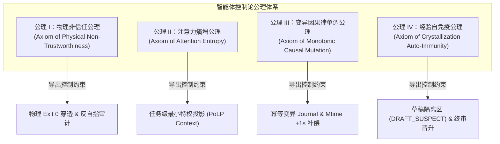

# 第三章 工业智能体四大公理与因果不变性形式化定义
## Chapter 3: Four Cybernetic Axioms and Causal Invariance Formulation

> “没有形式化公理的体系，充其量只是经验的碎片；唯有将系统约束沉淀为数理不变性，自主软件工程才能从玄学演进为精密科学。”

---

### 3.1 导论：软件智能体状态空间的不变性

在经典软件工程中，系统演化是由人类工程师单步介入的确定性状态机。但在自主智能体（Autonomous Agents）接管代码变异、构建和重试后，系统进入了一个高维非线性的**随机动力学系统（Stochastic Dynamical System）**。

为了确保智能体在该随机动力学空间中不会漂移向发散态（Divergent State），整个控制论系统必须建立在不可动摇的**底层公理与因果不变性（Causal Invariance）**之上。

---

### 3.2 工业级智能体四大基础公理（The Four Foundational Axioms）

#### 公理 I：物理非信任公理（Axiom of Physical Non-Trustworthiness）
* **数学表达**：设智能体内部认知状态输出为 $\hat{Y}_{agent}$，外部客观物理世界状态为 $Y_{phys} \in \{0, 1\}$（0 代表失败，1 代表物理通过）。
  $$ \lim_{k \to \infty} P\left( Y_{phys} = 1 \mid \hat{Y}_{agent} = \text{"SUCCESS"}, \text{Sensor}_{ext} = \emptyset \right) \le \epsilon \ll 1 $$
* **公理诠释**：在没有任何外部物理传感器（独立外部执行器、真实编译退出码、无桩 HTTP 探针）强介入的封闭推理链中，智能体声称“任务成功”的物理真实率趋近于零。一切未锚定于物理底座真实返回的完成声称，在控制论上均必须判定为非法伪信号。

#### 公理 II：注意力熵增与特权发散公理（Axiom of Attention Entropy）
* **数学表达**：设智能体注意力视野中包含的上下文集合为 $\mathcal{C}$，当前子任务的充要上下文集合为 $\mathcal{C}^*$。定义上下文特权冗余比 $\rho = |\mathcal{C} \setminus \mathcal{C}^*| / |\mathcal{C}^*|$。智能体产生越界破坏性变更的概率 $P_{violate}$ 满足：
  $$ P_{violate}(\rho) \ge 1 - e^{-\alpha \rho}, \quad (\alpha > 0) $$
* **公理诠释**：给智能体注入的无关工程文件、非目标接口契约越多（$\rho$ 越大），模型的注意力分布信息熵越高，其无意识修改不相关源码、破坏全局单测的概率呈指数级发散。必须对上下文施加**最小特权原则（Principle of Least Privilege, PoLP）**投影。

#### 公理 III：变异因果律单调公理（Axiom of Monotonic Causal Mutation）
* **数学表达**：设文件系统物理状态在时间 $t$ 的状态为 $\Phi(t)$，物理修改时间戳集合为 $\mathcal{M}(t) = \{ \text{mtime}(f) \mid f \in \text{Files} \}$。对于智能体连续执行的变异动作序列 $a_1, a_2$，其物理生效充要条件为：
  $$ \forall f \in \text{Modified}(a_k), \quad \text{mtime}_{new}(f) > \text{mtime}_{old}(f) \quad \text{且} \quad \text{Hash}(a_k) \text{ 具备幂等可溯性} $$
* **公理诠释**：智能体执行的代码写回，若物理时间戳未发生单调正向跳变，构建工具的增量解析器将直接跳过变异。同时，所有的变异动作必须拥有唯一规范化 SHA-256 签名日志，防止重试过程中的状态二次错位叠加。

#### 公理 IV：经验自免疫公理（Axiom of Crystallization Auto-Immunity）
* **数学表达**：设智能体在单次生命周期内自发萃取的知识资产集合为 $\mathcal{K}_{raw}$。全局知识库状态更新算子必须满足双盲过滤：
  $$ \mathcal{K}_{global}(t+1) = \mathcal{K}_{global}(t) \cup \left\{ k \in \mathcal{K}_{raw} \mid \text{Verdict}_{audit}(k) = \text{PROMOTE} \wedge \text{SubstratePass}(k) = \text{TRUE} \right\} $$
* **公理诠释**：智能体在开发链路中总结的“模式/规则”，在未经过完整的端到端五重物理判据与独立审查者终审前，一律视为高风险疑似污染源（`DRAFT_SUSPECT`），严禁横向传播。

---

### 3.3 因果不变性定理（Theorem of Causal Invariance）

在分布式系统与并发控制理论中，因果不变性保证了多副本状态演化的一致性。将此引入智能体控制论体系，可得出**软件智能体收敛因果不变性定理**：

> **定理 3.1（收敛因果不变性）**：一个自主软件智能体系统在大型代码基质上是**确定性收敛（Deterministically Convergent）**的，当且仅当满足下列三位一体的约束条件：
> 1. **状态可观测性（Observability）**：智能体每一步的动作反馈完全穿透至物理底座，不存在任何由代理层截断伪造的虚拟 Exit 0；
> 2. **变异局部性（Locality）**：每次状态变异严格受限于最小特权投影（PoLP Slice），变异集合与非目标域正交；
> 3. **评估解耦性（Decoupled Evaluation）**：评价者、考题制定者、解题执行者三者在物理环境、上下文内存与进程生命周期上完全物理隔离。

只要破坏上述三项中的任意一项，智能体系统在经过有限轮次演化后，必然陷入震荡（Oscillation）、死锁（Deadlock）或虚假通过（Tautological Illusion）。
