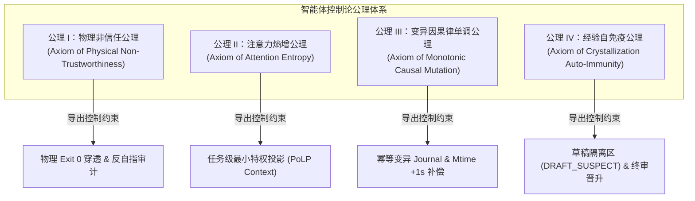

# 第三章 工业智能体四大公理与因果不变性形式化定义
## Chapter 3: Four Cybernetic Axioms and Causal Invariance Formulation

> “没有形式化公理的体系，充其量只是经验的碎片；唯有将系统约束沉淀为数理不变性，自主软件工程才能从玄学演进为精密科学。”

---

### 3.1 导论：软件智能体状态空间的不变性

在经典软件工程中，系统演化是由人类工程师单步介入的确定性状态机。但在自主智能体（Autonomous Agents）接管代码变异、构建和重试后，系统进入了一个高维非线性的**随机动力学系统（Stochastic Dynamical System）**。

为了确保智能体在该随机动力学空间中不会漂移向发散态（Divergent State），整个控制论系统必须建立在不可动摇的**底层公理与因果不变性（Causal Invariance）**之上。

---

### 3.2 工业级智能体四大基础公理（The Four Foundational Axioms）

#### 公理 I：物理非信任公理（Axiom of Physical Non-Trustworthiness）
* **数学表达**：设智能体内部认知状态输出为 $\hat{Y}_{agent}$，外部客观物理世界状态为 $Y_{phys} \in \{0, 1\}$（0 代表失败，1 代表物理通过）。
  $$ \lim_{k \to \infty} P\left( Y_{phys} = 1 \mid \hat{Y}_{agent} = \text{"SUCCESS"}, \text{Sensor}_{ext} = \emptyset \right) \le \epsilon \ll 1 $$
* **公理诠释**：在没有任何外部物理传感器（独立外部执行器、真实编译退出码、无桩 HTTP 探针）强介入的封闭推理链中，智能体声称“任务成功”的物理真实率趋近于零。一切未锚定于物理底座真实返回的完成声称，在控制论上均必须判定为非法伪信号。
* **适用边界扩展（隔离环境场景，2026-10-21）**：当压力测试等验证环境与开发环境完全隔离时，智能体无法直接穿透至该物理底座。此时公理 I 的要求转化为：**隔离环境的结果必须经独立审计通道（模式 02 探针 4）验证真实性、完整性与同质性后方可采信**——智能体自报或转述的隔离环境结果仍属非法伪信号。
* **生产现场实证（2026-10-22，模式 23）**：在 Docker Compose 受控生产拓扑中，嗅探器**不采信应用自报状态（/state），只消费 exporter 独立抓取的 /metrics 指标**，并经 SHA-256 桥接与审计通道校验后判读——F1（连接池泄漏）/F2（下游延迟）各 10 次注入全部检出（检出率 1.00），F4 无注入对照 60 期零误报。独立指标通道 + 物理锚定的"穿透"要求在部署后阶段以工程形式成立；自报路径（/state）在任何环节都不构成判读依据。
* **学术锚点**：该公理形式化了人工智能安全文献的核心实证结论——无外部接地（Grounding）的模型自我报告不可信；且在可被欺骗的评价信号下，智能体必然涌现奖励欺骗（Reward Hacking）行为（Amodei et al., 2016；Huang et al., ICLR 2024；Anthropic, arXiv:2511.18397）。

#### 公理 II：注意力熵增与特权发散公理（Axiom of Attention Entropy）
* **数学表达**：设智能体注意力视野中包含的上下文集合为 $\mathcal{C}$，当前子任务的充要上下文集合为 $\mathcal{C}^*$。定义上下文特权冗余比 $\rho = |\mathcal{C} \setminus \mathcal{C}^*| / |\mathcal{C}^*|$。智能体产生越界破坏性变更的概率 $P_{violate}$ 满足：
  $$ P_{violate}(\rho) \ge 1 - e^{-\alpha \rho}, \quad (\alpha > 0) $$
* **公理诠释**：给智能体注入的无关工程文件、非目标接口契约越多（$\rho$ 越大），目标信号的注意力份额被稀释得越低，其无意识修改不相关源码、破坏全局单测的概率下界随无关质量增长律发散——几何膨胀下指数级、幂律膨胀下幂律级（形式化对应见附录 B.3）。必须对上下文施加**最小特权原则（Principle of Least Privilege, PoLP）**投影。
* **数学地位（三层体系，见 1.4.2）**：SNR 单调性与违约下界的传导为**定理层**（Lean 机检）；衰减率的几何/幂律形态与指数下界 $1-e^{-\alpha\rho}$ 的形状为**经验层**（E3 拟合，随填充类型标定）；$W^*$ 补偿阈值为**工程层**（经验参数，不写入形式化接口）。
* **经验支撑与适用边界（形式化 + 实测，2026-10）**：稀释的单调性核心（无关质量增加 ⟹ 目标份额严格下降）为 Lean 4 机检定理；衰减率的**形态**取决于无关质量的增长律，属经验命题。在 Qwen2.5-1.5B/7B、上下文至 131k 的受控检索实验（E3/E3b）中：无关质量幂律增长占优（AIC 33/36 cell，几何 0 票），故指数下界 $1-e^{-\alpha\rho}$ 应读作最强情形参考，幂律分支给出与实测一致的主刻画；目标质量非增（弱前提）方向性成立而"目标质量恒定"被证伪——衰减由分子收缩与分母膨胀共同贡献；残差（sink）通道为动态通道，总非目标质量全程非减，填充口径的 SNR 系统性高估 35.8%–36.7%。**衰减参数并非常数**：近义对抗填充使 SNR 基线降至中性填充的 $1/2.25$（衰减指数不变），即理论承诺的是"给定增长参数的衰减"，参数本身由填充类型等外部条件标定。**口径映射声明**：定理中的 $a$ 是单目标 token 的注意力质量，实验中的 $a$ 是 needle 整段总质量；定理中的 $b$ 是全部非目标质量，实验中的 $b$ 是填充段总质量——这两条模型–现实映射是**未经证明的假设**，其成立性由残差通道漂移检验背书（附录 B.11）。**违约概率的传导边界（E4，2026-10-20）**：定理中的 $P_{\text{violate}}(\rho) = 1 - \operatorname{snr}(\rho)/\operatorname{snr}(0)$ 是**信噪比相对损失**，不是任务失败概率。E4 端到端实验（Qwen2.5-1.5B/7B needle 检索正确率与 E3 SNR 对齐）表明两者之间存在**补偿阈值 $W^*$**：$\rho < W^*$ 时模型的补偿机制（注意力 sink、KV cache 策略、长上下文训练对齐）抵消 SNR 衰减，任务正确率 ≈ 100%；$\rho > W^*$ 时补偿失效，正确率陡降。实测 $W^*_{1.5\text{B}} \approx 32\text{k–64k} < W^*_{7\text{B}} > 131\text{k} < W^*_{\text{Kimi}} \ge 1\text{M}$，与模型能力正相关。**违约下界 $P_{\text{violate}} \ge 1 - c^n$ 只在 $\rho > W^*$ 时传导为可观测的任务失败**；$\rho < W^*$ 时 SNR 虽已衰减（7B 在 131k 处 SNR 损失 44%），但任务正确率不受影响。$W^*$ 是经验参数，不写入形式化接口。认识论边界见附录 B.11。
* **学术锚点**：该公理对应长上下文实证研究所刻画的**上下文退化（Context Rot）**现象：模型有效推理能力随无关上下文增长而显著衰减，呈“迷失在中间（Lost in the Middle）”的 U 型注意力分布（Liu et al., TACL 2024）；实测有效上下文长度远低于标称值（Hsieh et al., 2024, RULER；Chroma, 2024, Context Rot）。

#### 公理 III：变异因果律单调公理（Axiom of Monotonic Causal Mutation）
* **数学表达**：设文件系统物理状态在时间 $t$ 的状态为 $\Phi(t)$，物理修改时间戳集合为 $\mathcal{M}(t) = \{ \text{mtime}(f) \mid f \in \text{Files} \}$。对于智能体连续执行的变异动作序列 $a_1, a_2$，其物理生效充要条件为：
  $$ \forall f \in \text{Modified}(a_k), \quad \text{mtime}_{new}(f) > \text{mtime}_{old}(f) \quad \text{且} \quad \text{Hash}(a_k) \text{ 具备幂等可溯性} $$
* **公理诠释**：智能体执行的代码写回，若物理时间戳未发生单调正向跳变，构建工具的增量解析器将直接跳过变异。同时，所有的变异动作必须拥有唯一规范化 SHA-256 签名日志，防止重试过程中的状态二次错位叠加。
* **经验支撑与适用边界（实测，2026-10-20）**：在 Cargo 1.96（Windows NTFS）上对增量编译判据做了 28 项受控测量：变异可观测当且仅当文件 mtime 严格超过上次构建的参考时钟——mtime 停滞或回拨时内容修改被**静默吞没**（产物仍为旧版本，各 5/5 复现）；纯 mtime 跳变即使内容不变也触发重建（触发通道与时钟有关、与内容无关），而"可观测变化"以内容差异为必要条件，与形式化定理的前提划分一致。实测发现参考时钟 $R \approx$ 上次构建完成时刻而非源文件旧 mtime，静默丢失窗口为 $(0, R]$——构建进行中的并发写入天然不安全，比朴素模型更严格。日志幂等性在无变化重构建与 git 回退-重试场景中均成立（重试后语义输出恢复；Windows PE 时间戳使字节级一致不可能，幂等承诺在内容/语义层）。适用域：**mtime-based 增量编译器**（Cargo、Make）；内容哈希型构建系统（Bazel、Nix）不依赖 mtime 跳变，静默丢失场景在其上不成立。
* **生产现场审计实证（2026-10-22，模式 23/24）**：在受控生产拓扑中对快照流的 mtime 单调判据做篡改自测——20 例篡改注入全部拒绝（哈希 8/8、mtime 回拨 6/6、指纹漂移 6/6），mtime 判据对真实回拨敏感有效；正常流审计中暴露一处**装置缺陷**：exporter 重启序号复用使 708 条正常事件被 mtime 判据误拒（全部 reason 为 `mtime_not_strict_increasing`，无哈希/指纹误拒混入），复核当前 456 个快照文件名序 mtime 递减 0 处——误拒根因为序号复用而非判据失效，装置已修复（exporter 启动续号、审计器按时间序审计）。该缺陷同时印证公理 III 的工程推论：**mtime 单调性必须锚定在真实时间序上，任何序号/时钟复用都会制造静默或误报窗口**。
* **学术锚点**：该公理是分布式系统经典结论在智能体—文件系统交互上的直接迁移：事件排序遵循**因果序（Happens-Before Ordering）**（Lamport, CACM 1978），状态变更的可重放性依赖**写前日志（Write-Ahead Logging, WAL）**与**幂等性（Idempotency）**保障（Kleppmann, 2017），并发协作依赖**租约（Lease）**机制（Gray & Cheriton, SOSP 1989）。

#### 公理 IV：经验自免疫公理（Axiom of Crystallization Auto-Immunity）
* **数学表达**：设智能体在单次生命周期内自发萃取的知识资产集合为 $\mathcal{K}_{raw}$。全局知识库状态更新算子必须满足双盲过滤：
  $$ \mathcal{K}_{global}(t+1) = \mathcal{K}_{global}(t) \cup \left\{ k \in \mathcal{K}_{raw} \mid \text{Verdict}_{audit}(k) = \text{PROMOTE} \wedge \text{SubstratePass}(k) = \text{TRUE} \right\} $$
* **公理诠释**：智能体在开发链路中总结的“模式/规则”，在未经过完整的端到端五重物理判据与独立审查者终审前，一律视为高风险疑似污染源（`DRAFT_SUSPECT`），严禁横向传播。
* **经验支撑与适用边界（形式化 + LLM 多代传播实测，2026-10-21）**：跨代传播的分支过程刻画、几何衰减律 $E(n)=m^n E(0)$、亚临界灭绝与超临界相变为 Lean 4 机检定理（附录 B.5）。在 DeepSeek v4-pro 上以"毒株规范注入 + 逐代转写"协议做了 4 条件 × 12 replicate × 6 代共 288 会话的受控传播实验（预注册判读标准先于实验）：**完全隔离门禁（$\sigma=1$）使谱系跨代传播严格为零**（全部 replicate $Z_1=0$，且毒株无独立再发现）——"严禁横向传播"的工程承诺获最强形式验证；未隔离条件（C0/C1）的池化种群序列与几何律 $E(n)=m^n E(0)$ 精确吻合（log-linear $R^2=0.958$，逐代比无趋势），分支性假设在小种群区成立；实测繁殖核参数化的 Galton-Watson 仿真（$10^5$ replicates）与已证定理链无自由参数吻合（三亚临界变体灭绝频率 $q_{sim}=1.0000$，Markov 界全程成立）。两点适用边界如实声明（2026-10-22 更新）：① **标记门（DRAFT_SUSPECT）在全部三档实验中均无压缩效应**——pro 主实验 $p=0.15$（$n=12$）、SUPERCRITICAL C1-full 12/12 逐代同轨、H1AC 大样本配对 $\bar d=0.02$（$p=0.69$，$n=48$）——**防御实现应依赖隔离而非标记**（三重独立确认）；② **乘性压缩律 $m=\mu(1-\sigma)$ 的 LLM 层直接检验获首个大样本点估计支持**（H1AC，Flash 档 64 链：$\hat r=0.466\in[0.35,0.65]$，乘性预测 $0.5$ 吻合；bootstrap 95% CI $[0.333,0.602]$ 下界微出界）——pro 档 $n=1$ 不可判定的缺口推进为"点估计支持、CI 边界"；池化口径在 C2 下因幸存者偏差失效，判读以链均口径为准。意外发现：无门禁条件下 $\hat m=0.56<1$——选择性转写协议本身将传播压入亚临界，超临界模型坍缩动力学对应的现实场景是**无转写衰减的记忆架构**（全量追加式记忆库、向量库直写），本实验协议下未出现；其经验对应由 SUPERCRITICAL 计划（全量追加架构，2026-10-22）验证，见下段。结论以条件定理形式呈现："对满足分支性与乘性压缩的传播系统，隔离门禁使投毒谱系以概率 1 灭绝"。**跨模型复核（Kimi `kimi-for-coding`，288 会话，2026-10-21）**：完全隔离的灭绝保证在第二模型族上同样成立（两模型合计 24/24 链 $Z_1=0$）；但无门禁下的有效繁殖数是**模型特定参数**——Kimi 实测 $\hat m_{C0}=0.983$（bootstrap 95% CI $[0.944,1.000]$，近临界），与 DeepSeek 的 $0.560$（CI $[0.294,0.735]$）差异显著（差 CI $[-0.689,-0.243]$），其繁殖核退化为 Bernoulli($p\approx0.98$)，6 代存活率仍达 $0.917$、灭绝需 $\sim50$–$100$ 代，工程上等于不退场。故本公理的适用域收紧为：**无门禁下的 $\hat m$ 由模型转写倾向决定（实测区间 $[0.56,0.98]$，可含近临界核），隔离（$\sigma=1$）的灭绝保证与 $\hat m$ 取值无关；防御效果不得依赖模型自身的转写衰减**。认识论边界见附录 B.11。
* **双层连接状态（见 1.4.5）**：本公理的理论实证（上段全部传播实验）在纯社会传播通道完成；生产现场的工程基质实证与理论层的连接——观测-学习回路 $q=1.00$——目前为**实证层事实，非定理**（$q$ 与繁殖核 $\hat m$ 的耦合方程未建立），列为显式开放项，不作跨通道因果声称。
* **学术锚点**：该公理对应 2024 年以来的两项核心实证发现：其一，对递归自生成数据的循环训练导致**模型坍缩（Model Collapse）**（Shumailov et al., *Nature* 631, 2024）；其二，智能体长期记忆的**记忆投毒（Memory Poisoning）**攻击可跨会话持久生效，且极低污染率即可造成高攻击成功率（arXiv:2512.16962；arXiv:2605.18930）。
* **跨任务族复核（四任务族 × 三条件 × 12 replicate × 6 代 = 144 链，2026-10-22）**：完全隔离门禁在四任务族全部 48 条毒株链上 $Z_1=0$（零违例），灭绝保证跨族成立；配对毒株对照显示毒株传播幅度受任务族调节（$p=0.026$）；邻接度序的预注册假设被拒绝（实测 $B>A>D>C$，非 $A\approx D>B>C$）——毒株在任务中需有可落地的适用位点方具传播力。$\hat m$ 由此进一步收紧为**任务族 × 毒株适用位点的联合参数（实测区间 $[0.29,1.00]$），跨族不可迁移**；隔离（$\sigma=1$）的灭绝保证仍与 $\hat m$ 无关。
* **生产现场闭环实证（2026-10-22，模式 24，DeepSeek-V4.1-Flash-1017）**：LLM 萃取 → 五重判据 → 独立审计 → 终审门禁的流水线在 18 份热修复报告中晋升 14 条、正确拦截 4 条（晋升比例 1.00、错误拦截 1.00），晋升条目环境参数泄漏 0（模式 13 事实/模式正交解耦生效）——"经验自免疫"在部署后阶段的工程闭环成立。
* **SUPERCRITICAL 验证（全量追加式记忆架构，2026-10-22，DeepSeek-V4.1-Flash-1017，Flash 档）**：无转写衰减的记忆架构确认产生**持续累积的毒株传播**——机制为**线性累积-容量竞争**（每代恒量写入 $W\equiv1$，$Z_{n+1}=Z_n+W$，容量饱和后 FIFO 竞争稳态），与选择性转写的**分支衰减**（GW 分支过程、几何律 $E(n)=m^nE(0)$）构成**机制层架构分叉**。实测（C0-full 12/12、W 档各 6/6）：C0-full P1 池 $\hat m=1.166$（boot95 CI $[1.156,1.176]$，未饱和阶段单调增长至容量稳态 5/16）；W=32 下 8 代线性 $Z=[1,\dots,8]$；**容量 $W$ 为传播控制参量（临界 $W_c\in(8,16)$，低转写态读数）**——$W>W_c$ 时毒株池单调累积不灭绝（工程语义的超临界）、$W<W_c$（W=8）时写入侧即被压制、毒株灭绝（g7 存活率 0）。标记门（C1-full）在该架构下**零压缩**（$\hat m=1.165$ vs 1.166，逐代同轨）；**隔离（C3-full）跨机制截断累积**（12/12 链 mem 恒 6、Z 恒 1，每代 de novo 重提出被拦截）——"防御依赖隔离而非标记"在超临界架构下获最强实证。**术语声明**：此处"超临界"为工程语义（毒株池持续累积不灭绝）；full_append 的精确机制是线性累积-容量竞争，非分支过程的 $m>1$ 指数倍增——后者（`supercritical_expectation_diverges` / `galton_watson_non_extinction` 等 Lean 定理）的经验对应在本架构下以累积形式出现。
* **漂移表征与容量调控（2026-10-23~24，DeepSeek-V4.1-Flash-1017，Flash 档，探针+控制实验）**：毒株转写行为存在**亚小时级状态翻转**（同一日历日内高低态即翻转：10-22 15:30 C0-full 高转写态 0.917/代 vs 16:02 $W{=}8$ 原批低转写态 0.25/代，间隔约 32 分钟）；**漂移呈状态双峰**（低转写态 $\approx0.25$ vs 高转写态 0.63–1.0），分层 Beta-Binomial 观测模型 20 批 58 链 MLE $(\alpha,\beta){=}(0.533,0.159)$、$\hat p{=}0.770$。**探针校准协议**：每实验批前跑 1 条探针链（6 代）判定当前转写状态，跨批比较限于同状态批次；15:00 与 night 两窗口 16/16 探针 $p_{\rm probe}{=}1.000$（连续约 9 小时高态延续），第三窗口（08:47）5/5 高态——多时段同态延续。**容量临界 $M_c$ 为状态条件量**（探针门控重扫）：高转写态 $W{=}8$ 存活 0.75、$M_c\in(4,8)$；低转写态 $W{=}8$ 灭绝、$M_c\in(8,16)$——上段 SUPERCRITICAL 的 $M_c\in(8,16)$ 为低转写态读数。**容量调控控制律（bang-bang：高态→$W{=}4$、低态→$W{=}8$ 待测）高态分支经受控实验实证**（预注册判据 C1–C3）：窗口收缩 $W{=}8\to4$ 将毒丸存活由 0.833 压至 0.333（同批 12 链 vs 12 链 Fisher 单侧 $p{=}0.018$；跨三窗口合并 13/32 vs 19/24，单侧 $p{=}0.0040$）、记忆效用保留 0.328（≥C2 阈值 0.275）——"高态下窗口收缩策略优于静态 $W{=}8$"成立；**跨状态切换动力学未行使（探针全程判高态、动态臂零切换），列为待测**（平行随动探针切片机制为此设计）。**部署成本-收益边界声明**：探针增量（门控 +4%、随动 1:3 +42%、1:2 +54% 计算量）全部购买批内漂移可行使性而非直接安全；隔离在纯成本-安全-效用表上绝对占优（零增量、毒丸存活 0、效用保留 0.88），动态容量调控的部署合理性依赖隔离的可用性代价（记忆冻结，未量化）。

---

### 3.3 因果不变性定理（Theorem of Causal Invariance）

在分布式系统与并发控制理论中，因果不变性保证了多副本状态演化的一致性。将此引入智能体控制论体系，可得出**软件智能体收敛因果不变性定理**：

> **定理 3.1（收敛因果不变性）**：一个自主软件智能体系统在大型代码基质上是**确定性收敛（Deterministically Convergent）**的，当且仅当满足下列三位一体的约束条件：
> 1. **状态可观测性（Observability）**：智能体每一步的动作反馈完全穿透至物理底座，不存在任何由代理层截断伪造的虚拟 Exit 0；
> 2. **变异局部性（Locality）**：每次状态变异严格受限于最小特权投影（PoLP Slice），变异集合与非目标域正交；
> 3. **评估解耦性（Decoupled Evaluation）**：评价者、考题制定者、解题执行者三者在物理环境、上下文内存与进程生命周期上完全物理隔离。

只要破坏上述三项中的任意一项，智能体系统在经过有限轮次演化后，必然陷入震荡（Oscillation）、死锁（Deadlock）或虚假通过（Falsified Pass）。
