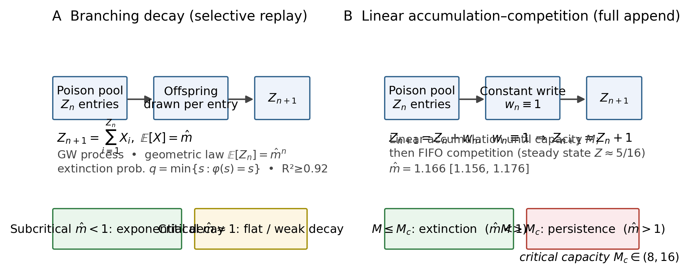
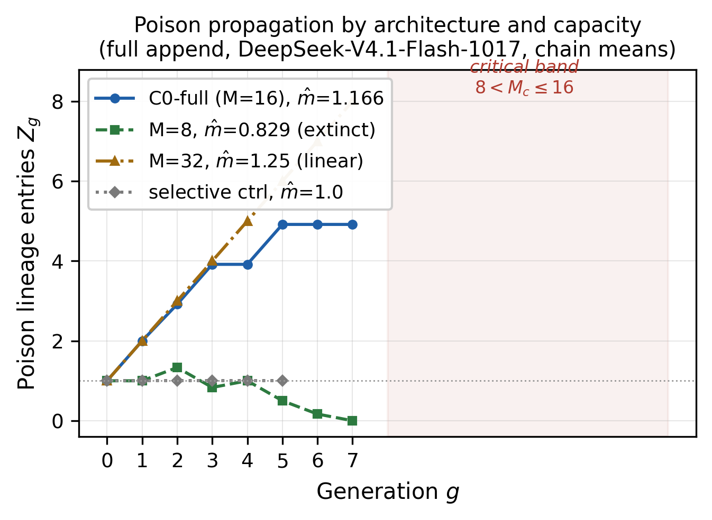

# 无门控智能体记忆架构中的记忆投毒：架构依赖的传播机制、容量控制与隔离不变性

长期运行的 LLM 智能体将经验沉淀进持久记忆；未经验证或恶意的条目可在会话间传播并污染下游任务。既有防御将软标记与硬隔离混为一谈，且尚无研究将记忆架构与传播的数学结构联系起来。本文在两种写入协议（选择性转写与全量追加）下研究注入-传播问题，通过覆盖三个模型族（DeepSeek-V4-Pro-0813（Pro）、Kimi、DeepSeek-V4.1-Flash-1017（Flash））、两种架构、多档容量、共 846 条智能体会话链（5,448 会话-代单元；selective 对照 2 链 × 6 代另计）的预注册实验，并以 Lean 4 机检条件定理支撑。

我们发现：决定传播机制的是架构而非模型。选择性转写产生分支衰减——Galton-Watson 分支过程，模型特定的每亲繁殖数 $\hat m\in[0.56,0.98]$，呈几何律衰减（$R^2\ge0.92$）；扩样至 12 链后 selective 侧 $\hat m=0.966$（CI $[0.911,1.000]$），与全量追加侧 CI 完全分离。全量追加产生线性累积-容量竞争——每代写入 $w_n\in\{0,1\}$（链均 $E[w_n]=0.917$）使 $Z_{n+1}=Z_n+w_n$ 线性累积直至记忆容量 $M$，此后 FIFO 竞争达到并维持稳态（$5/16$）（工程语义的持续累积；跨机制对比传播比见 §6.1）。容量 $M$ 是控制参量，临界容量 $M_c$ 是 $(b,M)$ 联合函数：良性写入率越高，临界容量越大（EXP-B 协议下 $b{=}1/2\to W_c\le4$、$b{=}3\to W_c\in(4,8)$、$b{=}5\to W_c\in(8,12)$）。主协议档（$b{\approx}3$ 总写入上限、含毒株）$M_c\in(8,16)$ 与 EXP-B $b{=}3$ 行（$b$ 为良性经验上限、毒株占额度；实测两档每代总写入同为 3.00，流量同构）在 $W=16$ 主格点相容（稳态 5.06 vs 4.917，差异 2.9%），在 $W=8$ 边界格点读数分裂（灭绝 vs 0.92 存活，12 链扩样后保持）——**归因审计（§6.5）定位为 DeepSeek-V4.1-Flash-1017 毒株转写行为的亚小时级状态切换**（同一日历日内约 32 分钟即观测到高低转写态翻转；同日双协议重跑无差异，Fisher $p{=}0.155$，10-22 原批显著偏低 $p{=}0.0024$），**$M_c$ 因而是 $(b,M,$ 毒株转写状态$)$ 条件量**：低转写态下 $M_c\in(8,16)$（$W{=}8$ 灭绝），高转写态下 $W{=}8$ 存活 0.75（12 链，探针门控重扫实测）——缩小记忆窗口不能可靠防住投毒，因为同一窗口在模型的另一行为状态下失效。

防御侧：软标记效应模型异质且不可靠（Pro 档 47% 压缩在功效不足下不显著；full-append 12/12 逐代同轨为写路径结构绕过；Flash 大样本配对 $n=48$ 确证零压缩，$\bar d=0.020$，$p=0.69$），而隔离（$\sigma=1$）在所有条件下截断传播：跨模型 24/24、跨任务族 48/48、full-append 12/12 链；σ 扫描（$n=48$/档）确认**全谱 $\sigma_{\rm eff}\in\{0.1,0.25,0.5,0.75,0.9,1.0\}$ 实测（含 2026-10-23 补测中间档 $\sigma_{\rm eff}\in\{0.75,0.9\}$）**：$\sigma_{\rm eff}<1$ 档全部存活率 1.00、无一抑制毒株（无甜点，A-H4 判据），σ=1 的记忆效用保留 0.88（代价为 12% 新经验增量，种子知识无损）。我们据此得出结论：防御依赖硬隔离而非软标记。方法学上，我们预注册的分支匹配假说被逐代机制证据证伪，修订为线性累积-竞争，本文如实报告这一修订。作为副产品，归因审计暴露了一个超出原实验范围的独立发现：**固定模型 checkpoint 的毒株转写倾向存在亚小时级的双峰状态漂移**（多批对照，Fisher $p\le0.0024$）；我们据此提出**探针校准协议**——实验批启动前以约 3 分钟/链的探针判定当前毒株转写状态，跨批比较限于同状态批次——该协议本身构成可复用的方法论贡献。

---

## 1 引言

## 1.1 问题

LLM 智能体（agent）正被部署到长期运行的生产系统：经验沉淀进持久记忆库，经检索在跨会话任务间复用。这一架构引入了一类此前未被系统研究的失效模式——**记忆投毒（memory poisoning）**：未经验证的自生经验（或攻击者注入的经验）进入记忆库后，经代际转写被持续复制，污染后续所有相关任务。文献已确立攻击的现实性与跨会话持久性（MemoryGraft, arXiv:2512.16962；OEP, arXiv:2605.18930），以及递归自我消费在训练期的宏观坍缩后果（Shumailov et al., *Nature* 631, 2024）。然而，**记忆架构本身如何调节传播、防御为何失败、何种干预有机制层保证**——这三问缺少实证与形式化的回答。

## 1.2 三个空白

1. **机制空白**：传播究竟服从何种数学模型，取决于记忆的转写协议（选择性转写 vs 全量追加）——此前没有跨架构的对照实验；
2. **防御空白**：软标记（标记门）与硬隔离（门禁）被混为一谈，没有独立判据区分二者在传播动力学上的作用；
3. **形式化空白**：软件工程学科的"根本规律"（Brooks 1987；Lehman 1980；Conway 1968）历来是经验定律，从未被形式化证明（§2.5 定位）；智能体记忆的投毒-隔离规律同样停留在启发式层面。

## 1.3 本工作

本工作根植的**公理 IV（经验自免疫）**主张：未经**物理验证与独立审查终审**的自生经验经检索复用会对后续任务产生持续性污染，其防御须依赖写入层的结构阻断（隔离）而非决策层的软信号（标记）。在此框架下，本文给出**机制识别 + 形式化 + 预注册实证**的完整闭环：

1. **机制层**：识别"架构决定传播机制"——选择性转写产生分支衰减（Galton-Watson 分支过程），全量追加产生线性累积-容量竞争（每代写入 $w_n\in\{0,1\}$，链均 0.917）；记忆容量 $M$ 为控制参量，临界 $M_c\in(8,16)$（§3）；
2. **形式化层**：Lean 4 机检定理链（零 `sorry`，§4）——GW 灭绝概率=最小不动点、亚临界概率灭绝、隔离压缩后代、超临界正概率不灭绝；
3. **实证层**：预注册、跨模型（Pro / Kimi / Flash；全名与简称映射见 §5.2）× 跨架构（selective / full-append / 容量档）× 跨任务族（144 链）× 大样本配对（160 链）闭合判据（§5–§6）；
4. **工程含义**：防御依赖**隔离而非标记**——标记门效应模型异质且不可靠（Pro 档 47% 压缩不显著、C1-full 结构同轨、Flash 大样本确证零压缩 $\bar d=0.020$，$p=0.69$），隔离在跨模型（24/24 链 $Z_1=0$）、跨任务族（48/48 链）、跨架构（12/12 链 mem 恒 6）三维截断传播（§7）。

**一项诚实的方法论声明**：预注册假说 S-H3（GW 分支匹配）被逐代机制证据（$w_n\in\{0,1\}$ 线性累积）**证伪**。我们将其作为"预注册假说被证伪→机制重新识别"的正面案例完整呈现（§8），而非事后合理化。

## 1.4 论文结构

§2 Related Work；§3 机制模型；§4 形式化；§5 实验设置；§6 结果；§7 讨论；§8 机制修正叙事；§9 适用域；§10 局限；§11 结论。

## 2 背景与相关工作

## 2.1 智能体记忆与投毒

智能体长期记忆（agentic memory）已成为 LLM 应用系统的标准组件：经验经检索（retrieval）复用，构成跨会话的持续知识层。与此同时，记忆已成为一类高价值攻击面：**记忆投毒（memory poisoning）**——攻击者或智能体自身的失效经验注入记忆库后，经后续检索被持久复用，污染后续任务（Shumailov et al., 2024；MemoryGraft, 2025）。近期实证表明，投毒攻击可跨会话持久生效，且极低污染率即可造成高攻击成功率（MemoryGraft, arXiv:2512.16962）；自进化智能体在"局部正确但不可迁移"经验下的污染路径亦有刻画（OEP, arXiv:2605.18930）。这些工作确立了攻击的现实性与持续性，但**防御侧停留在启发式**（标记、过滤、人工审查），缺乏对"为什么某些防御失效"的机制层解释——本工作补上这一层。

**必须正面对话的竞争工作**：arXiv:2605.08442（*Defense effectiveness across architectural layers*，2026-05）对 9 个模型的持久记忆攻击做了跨架构层的机制评估，结论是输入层防御无法观测 RAG 注入内容、检索层分类器可被语义掩蔽绕过，而记忆层的硬性工具门控（Memory Sandbox）将攻击成功率降至 0/9 模型中的 8 个——与本工作“隔离有效、软信号无效”的防御结论高度重叠。本文的增量不是防御建议本身，而是：(i) 给出两种记忆架构（selective vs full-append）下传播的**动力学两分法**与容量控制参量 $M_c$（2605.08442 未涉及传播的数学结构）；(ii) 以预注册判据与 Lean 机检条件定理支撑隔离不变性。攻击面文献 AgentPoison（NeurIPS 2024, arXiv:2407.12784）确立了记忆/知识库投毒的攻击现实性，本文与其在攻击-防御分工上衔接。

## 2.2 模型坍缩与递归退化

宏观层面的递归自我消费已被证明导致**模型坍缩（model collapse）**：用递归生成的数据训练，模型分布退化为模式坍缩与方差消失（Shumailov et al., *Nature* 631, 2024）。其与分支过程（branching process）的联系在文献中已有提及：退化可刻画为种群动态（population dynamics）。本工作的理论工具——Galton-Watson 分支过程及其灭绝概率、几何衰减律（Harris, 1963）——正是这一联系的形式化端点之一。与 Shumailov 等的训练期坍缩不同，本工作关注**推理期/记忆期的传播**：不经过重训练，仅在上下文-记忆-转写回路中逐代传播。这一区分是本文机制的出发点。

## 2.3 针对记忆投毒的防御

既有防御沿两条思路：

1. **软标记（soft marking）**：对自生经验打上"未验证"标记，供下游过滤（实验中的标记名 DRAFT_SUSPECT，§5.3）。本工作标记门效应**模型异质**：Pro 主实验 47% 压缩（C1/C0 比值 0.529）在功效不足（$n=12$，功效 0.38）下不显著；SUPERCRITICAL C1-full 12/12 逐代同轨（full-append 写路径结构绕过模型判断）；H1AC 大样本配对（$\bar d=0.020$，$p=0.69$）确证 Flash 档零压缩（模型档全名见 §5.2）——模型对软信号的采纳不可靠；
2. **硬隔离（hard quarantine）**：未经**五重物理判据**与**独立审查终审**的经验不得进入全局知识库（等价于本工作的门禁 $\sigma=1$）。五重物理判据指编译、隐藏测试、真实执行探活、退出码核验、形式化审计五条**独立物理通道**全部绿灯方可晋升——LLM 自评不构成证据；独立审查终审指与经验生产者物理隔离的仲裁门，不接受自然语言辩解。本工作实测：隔离在**跨模型（24/24 链 $Z_1=0$）、跨任务族（48/48 链）、跨架构（full-append 12/12 链 mem 恒 6）**三个维度上截断传播——防御依赖结构阻断而非模型行为。

这一“隔离有效、标记失效”的分离，与 2605.08442 的“硬工具门控有效、软信号无效”结论方向一致，本文在其上补充了传播动力学机制与容量控制参量（§2.1 对话段）；MemoryGraft（2025）的防御讨论未区分二者。

## 2.4 智能体的通用退化机制

- **Reward hacking / specification gaming**：智能体满足目标的字面而非精神以骗取成功信号（Amodei et al., 2016；Krakovna et al., 2020）；生产级 RL 中已观察到自然涌现的失对齐（Anthropic, arXiv:2511.18397）。这与本文公理 I（外部锚定缺失→自我宣称不可信）同族，但未涉及代际传播。
- **Context rot / Lost in the Middle**：随无关上下文增长，模型有效推理显著衰减，呈现 U 型注意力曲线（Liu et al., TACL 2024）；有效上下文长度远低于标称（Hsieh et al., 2024, RULER；Chroma, 2024）。这对应公理 II（注意力稀释），是**代内**退化；本文公理 IV 关注**代际**传播，两者在因果链上衔接但机制不同。

## 2.5 软件工程的"近公理"定律（定位节）

软件工程学科的传统"根本规律"是**经验定律**而非形式公理：Brooks 的本质复杂性（Brooks, 1987）界定了工程极限；Lehman 定律（Lehman, 1980）刻画软件演化的持续变更与递增复杂性（软件的"熵增"）；Conway 定律（Conway, 1968）揭示架构-组织同构；CAP 定理（Gilbert & Lynch, 2002）锁定分布式一致性的取舍；停机问题（Turing, 1936）界定可判定性边界。这些规律源自大量工程实践的经验总结，**从未被形式化证明**。

本工作的方法论立场：SE 的"近公理"规律可以且应当提升为**推理起点地位 + 经验可证伪内容**的工程公理。本文聚焦其中一支——经验自免疫——给出：Lean 4 机检的条件定理链（隔离⟹灭绝、GW 灭绝概率、几何律、超临界发散）、预注册的大样本实证、以及机制层修正（分支衰减 vs 累积-竞争）。这是把 SE 经验定律“形式化-实测化推进”的一次实例，而非凭空提出公设。需要限定的是：被机检的是概率论条件定理（Harris, 1963 结果的 Lean 复检），SE 定律的“工程公理化”是方法论主张而非形式化对象——本文不声称已形式化 Brooks/Lehman/Conway 定律本身。

## 2.6 形式化验证工具

定理链在 **Lean 4**（Moura & Ullrich, 2021）中机检，零 `sorry`（条件定理与源码对应见 §4）。软件工程中形式化验证的应用先例（协议验证、并发正确性）支撑了"工程承诺以可机检定理呈现"的可行性；本文的贡献之一是此类条件定理（“对满足分支性与乘性压缩的系统，隔离使投毒谱系灭绝概率趋向 1”）在智能体记忆安全问题上的应用——就我们所知，这是该类型条件定理在该问题域的首次应用（限定于 §8 机制修正后的适用域）。

## 3 模型

## 3.1 记号（Notation）

| 符号 | 含义 | 实测/设定 |
| :--- | :--- | :--- |
| $Z_n$ | 第 $n$ 代记忆库中毒株（P1 谱系）条目数（池大小） | 逐代追踪 |
| $M$ | 记忆窗口容量（FIFO） | 默认 $16$；敏感性档 $M=8,32$ |
| $w_n$ | 第 $n$ 代新写入的毒株条目数（fresh write） | selective：随 $Z_n$ 变化；full-append：$\in\{0,1\}$（PMF=[0,1]，链均 $E[w_n]=0.917$） |
| $X_i$ | 分支过程的单亲后代数 | $E[X]=\hat m$（经验估计） |
| $\sigma$ | 门禁拦截率（写出通过率 $=1-\sigma$） | 随机过滤 $\sigma=0.5$（半数拦截）；隔离 $\sigma=1$（全拦截） |
| $\hat m$ | 传播比估计 $\hat m=\sum_n Z_{n+1}/\sum_n Z_n$（跨代加权平均；GW“每亲繁殖数”语义仅对机制 A 有效，见 §3.2） | 见各实验档 |

**符号纪律**：$M$ 为记忆容量（实验档名 `_W8/_W32` 中的窗口参数），$w_n$ 为每代写入——两者在本文中严格区分。

## 3.2 两个传播机制（核心主张 1）

**机制 A：分支衰减（selective 转写协议）**。智能体仅将当前会话中被判定相关的条目转写进记忆，后代数依赖亲代毒株的转写倾向：

$$Z_{n+1}=\sum_{i=1}^{Z_n} X_i,\qquad E[Z_{n+1}\mid Z_n]=\hat m\,Z_n$$

经典 Galton-Watson 分支过程（Harris, 1963）：期望传播按几何律 $E[Z_n]=\hat m^n E[Z_0]$ 演化；灭绝概率为生成函数 $\varphi(s)$ 的最小不动点（Lean T1）；亚临界（$\hat m<1$）指数衰减（Lean T2）。**该机制的判据**：$w_n$ 随 $Z_n$ 变化（分支依赖）。

**机制 B：线性累积-容量竞争（full-append 转写协议）**。智能体将每代经验全量追加进记忆库（向量库直写/无转写衰减），毒株写入恒定：

$$Z_{n+1}=Z_n+w_n,\qquad w_n\in\{0,1\}\ \text{(实测, PMF=[0,1])}$$

未饱和段线性增长 $Z_{n+1}=Z_n+1$；当 $Z_n$ 触及容量 $M$ 后进入 FIFO 竞争稳态（新写条目挤占最旧条目），稳态池大小由容量竞争决定（实测 C0-full 稳态 $5/16$）。**该机制的判据**：$w_n$ 恒定、不依赖 $Z_n$（累积写入）。

**机制判别的直接证据（逐代 offspring 核对）**：full-append 档每代新写 P1 为 0 或 1（$w_n\in\{0,1\}$，PMF=[0,1]，链均 $E[w_n]=0.917$——11/12 链每代恒 1，约 1/12 链存在某代未写；$Z_{n+1}=Z_n+w_n$ 线性累积，实测 Z=[1,2,2.917,3.917,3.917,4.917,4.917,4.917]）；分支过程要求的"后代数依赖亲代种群"不成立。**由此，预注册假说 S-H3（GW 匹配）被机制证据证伪，理论修订为机制 B**（见 §8 机制修正叙事）。分支衰减（机制 A）仍在 selective 协议下成立（几何律 $R^2=0.958$，主实验；$R^2=0.923$，H1AC 大样本）。

## 3.3 容量控制参量（核心主张 2 之半）

记忆窗口容量 $M$ 决定机制 B 的传播结局（SUPERCRITICAL 档，full-append，Flash）：

| $M$ | 传播比 $\hat m^\dagger$（boot95 CI） | g7 存活率 | 结局 |
| :--- | :--- | :--- | :--- |
| 8 | 0.829（[0.739, 0.875]） | 0 | **灭绝**（写入侧即被容量压制） |
| 16 | 1.166（[1.156, 1.176]） | 1.0 | **持续累积**（稳态 5/16 维持 3 代；工程语义超临界） |
| 32 | 1.25（退化 CI，6 链全同） | 1.0 | **线性增长**（$Z=[1,\dots,8]$，未饱和） |

**临界容量是 $(b,M)$ 联合函数（EXP-B 实测，§6.5）**：容量单调性成立——$M\le M_c$ 时毒株池被压制至灭绝，$M>M_c$ 时单调累积不灭绝。$M_c$ 随良性写入率 $b$ 上移（EXP-B 协议下 $b{=}1/2$ 时 $W_c\le4$、$b{=}3$ 时 $W_c\in(4,8)$、$b{=}5$ 时 $W_c\in(8,12)$）。**跨实验格点核对**：主协议档（写入规则"1~3 条"，$b{\approx}3$ 总写入上限、含毒株，`axiom4_memory_propagation.py` 执行）$M_c\in(8,16)$ 与 EXP-B $b{=}3$ 行（`kimi_boost.py` 执行；$b$ 为良性经验上限、毒株占额度；实测两档每代总写入同为 3.00，流量同构）在 $W=16$ 主格点相容（EXP-A C0 6 代 $Z=5.06$ vs 主协议同代 4.917，差异 2.9%），但在 $W=8$ 边界格点读数分裂（主协议 6 链全灭 surv=0 vs EXP-B 12 链 surv=0.92，扩样后保持）——**归因审计（§6.5）定位为 DeepSeek-V4.1-Flash-1017 毒株转写行为的亚小时级状态切换**（同一日历日内约 32 分钟观测到高低态翻转；同日双协议重跑无差异 Fisher $p{=}0.155$，10-22 原批显著偏低 $p{=}0.0024$，非协议差异），**$M_c$ 因而是 $(b,M,$ 毒株转写状态$)$ 条件量**：低转写态下 $M_c\in(8,16)$、$W{=}8$ 灭绝，高转写态下 $W{=}8$ 存活过半（§10.4 探针校准协议）；两读数各自批内可复现，以并列读数如实报告（§6.5）；$b$ 与检索策略均可使 $M_c$ 漂移（§9/§10 开放项）。$M$ 因此是传播的**控制参量**（而非模型参数）。

## 3.4 架构决定机制（核心主张 2）

同一模型族（Flash）下切换记忆架构即切换机制：

| 架构 | 机制 | $\hat m$ / 传播 | 判据 |
| :--- | :--- | :--- | :--- |
| selective 转写 | 分支衰减（A） | $\hat m\in[0.56,0.98]$（跨模型，模型特定） | $w_n$ 依赖 $Z_n$；几何律成立 |
| full-append | 累积-竞争（B） | $Z$ 线性累积，容量 $M$ 定结局 | $w_n\in\{0,1\}$；$M_c\in(8,16)$（低转写态读数；高转写态下 $W{=}8$ 存活过半，§6.5） |

**变量是架构，不是模型**：同一 Flash 档，selective 对照（2 链，主实验；**扩样 12 链，EXP-C**）$Z$ 恒 1、记忆收缩至 3（临界边界 $\hat m=1.0$；扩样后 $\hat m=0.966$、CI $[0.911,1.000]$ 含 1，弱亚临界/临界保持统计成立），full-append C0（12 链）$Z$ 线性累积至 5/16（工程语义超临界，$\hat m=1.166$、CI $[1.156,1.176]$）——两架构 $\hat m$ 的 CI 完全分离，分叉完全由转写协议决定。这一结论与公理 IV 适用域口径一致：无门禁下 $\hat m$ 是模型-任务-位点联合参数（$[0.29,1.00]$，跨模型 $[0.56,0.98]$），但**机制类别由架构决定，不随模型迁移**。

## 3.5 预注册假说清单（实验在 §5，结果在 §6）

| 假说 | 命题 | 判据 |
| :--- | :--- | :--- |
| **S-H1** | full-append 无门禁下毒株持续累积（稳态占据率 $>0$ 且存活率 1.0） | 占据率/存活率（GW 表述随 S-H3 证伪失效） |
| **S-H2** | 未饱和段存活率 1.0 | g7 存活率 |
| **S-H3** | GW 分支匹配（$w_n$ 随 $Z_n$ 变化；$\to$ **被机制证据证伪，实测 $w_n\in\{0,1\}$，修订为机制 B**） | 逐代 $w_n$ 核对 |
| **S-H4** | 隔离跨机制截断累积 | C3-full 12/12 |
| **B-H1a** | 标记门压缩配对差 $>0$（$\to$ 不成立） | 符号翻转置换 $p<0.05$ |
| **B-H1c** | 乘性压缩律 $\hat r_{C2}/\hat r_{C0}\in[0.35,0.65]$ 且 CI 完全落入 | 点+CI 双判据 |
| **B-H2** | 大样本几何律复验 $R^2\ge0.8$ | log-linear |
| **X-H1/X-H4** | 跨模型隔离保证；防御不依赖模型 | 24/24 链 $Z_1=0$ |
| **T-H1/T-H4** | 跨任务族隔离保证；毒株传播受任务族调节 | 48/48 链；配对 $p<0.05$ |

*图 1  两种传播机制：A）选择性转写下的分支衰减（Galton-Watson 分支过程、几何律，灭绝概率=最小不动点）；B）全量追加下的线性累积-容量竞争（每代写入 $w_n\in\{0,1\}$、链均 $E[w_n]=0.917$，容量 $M$ 处 FIFO 竞争，临界 $M_c\in(8,16)$）。*（数据：DeepSeek-V4.1-Flash-1017，链均）

## 4 形式化

## 4.1 模型结构

传播模型为**分支过程**（`BranchingProcess` 结构，每代一个有限支撑 PMF）：未终审经验的跨代传播中，双盲隔离门禁的选择度 $\sigma$ 将名义繁殖均值 $\mu$ 压缩为有效繁殖数

$$m = \mu(1-\sigma) \quad \text{(乘性压缩律)}$$

所有定理以**条件定理**呈现：结构前提（如 $m<1$）为显式假设，"真实系统满足该前提"由 §5–§6 实测支撑，不在形式系统内断言。这一分工即本文采用的三层知识地位结构：**定理层**（Lean 机检的结构蕴含）、**经验层**（$\hat m$、$M_c$、$\sigma$ 等参数的预注册实测）、**工程层**（生产判据的部署裁决）；数值与定理互不冒充。$\sigma$ 的口径与 §3.1 一致（拦截率，写出通过率 $=1-\sigma$）；EXP-A 的随机过滤档以放行率 $r=1-\sigma$ 实现（表 5 标注，§6.5）。

## 4.2 定理链（Lean 4 机检，零 `sorry`）

形式化源码：`formal_proof/IACFormalization`（本仓库 commit `4825137`；Lean 4，mathlib 版本见 `lakefile.lean`）。仓库目前**保持私有**：commit hash 可据此核对文件树与构建记录，完整源码按需向作者索取。

**T1 期望几何律**（`expected_population_geometric`，归纳证明）：$E[Z_n]=m^n E[Z_0]$。

**T2 亚临界概率灭绝**（`subcritical_extinction_in_probability`）：由 Markov 不等式与几何衰减，$m<1$ 时存活概率 $P(Z_n\ge1)\to0$。这是隔离晋升门禁有效性的定量核心：门禁把 $m$ 压到 $<1$，长期存活概率 $P(Z_n\ge1)\to0$（依概率收敛）——应用侧措辞严格为“存活概率趋向 0”，而非“以概率 1 消亡”。

**T3 隔离压缩后代**（`quarantine_compresses_offspring`）：$\sigma$ 越严格，有效繁殖数越小；完全隔离（$\sigma=1$）使 $m=0$，谱系单代内归零。**应用条件**：分支性 + 乘性压缩——在 selective 架构下实测满足（几何律 $R^2=0.958$）；在 full-append 架构下分支前提不成立，隔离的有效性由实测直接给出（C3-full 12/12，mem 恒 6、$Z$ 恒 1），机制修正如实记录（§8）。

**T4 超临界不灭绝**（`galton_watson_non_extinction` + `supercritical_expectation_diverges`）：$m>1$ 时，灭绝概率为生成函数 $\varphi$ 在 $[0,1]$ 上的**最小不动点** $q=\min\{s\in[0,1]:\varphi(s)=s\}<1$——以正概率永不灭绝；期望 $E[Z_n]\to+\infty$。证明采用初等生成函数不动点分析（单调夹逼 + 多项式截断），避免对 $\varphi$ 连续性的依赖。

## 4.3 定理-应用映射

| 定理 | 断言 | 应用侧 |
| :--- | :--- | :--- |
| T1 | $E[Z_n]=m^nE[Z_0]$ | 几何律判据（S-H2/B-H2 的期望侧） |
| T2 | $m<1 \Rightarrow P(Z_n\ge1)\to0$ | 隔离/随机过滤压灭谱系（C2 存活率 0.062 vs C0 0.750） |
| T3 | $\sigma\!\uparrow \Rightarrow m\downarrow$；$\sigma=1\Rightarrow m=0$ | 隔离不变性（S-H4/T-H1/X-H1） |
| T4 | $m>1 \Rightarrow q<1$，$E[Z_n]\to+\infty$ | 机制 A 超临界侧对照；机制 B 的持续累积由实测占据率给出（工程语义） |

## 4.5 机制 B 稳态占据率（普通数学命题，非 Lean 机检）

**命题（机制 B 稳态占据率）**：full-append 架构、FIFO 容量 $M$、每代良性写入 $b$ 条、毒株写入链均 $\bar w$（$0<\bar w\le1$）时，在"毒株条目在容量内均匀混合"的近似下，稳态毒株占据为

$$Z^* = \frac{M\,\bar w}{b+\bar w}$$

**证明**：每代写入总量期望 $b+\bar w$ 条（毒株 $\bar w$ 条）；FIFO 每代挤出等量最旧条目。若毒株均匀分布于 $M$ 槽位，则每代被挤出的毒株数期望为 $(b+\bar w)\cdot Z/M$。稳态要求流入等于流出：$(b+\bar w)\cdot Z^*/M = \bar w$，即 $Z^*=M\bar w/(b+\bar w)$。$\blacksquare$

**实测验证**：C0-full（$b=2$、$\bar w=0.917$、$M=16$）预测 $Z^*=16\times0.917/2.917=5.03$，实测稳态 4.917（g5–g7 稳定），相对偏差 2.3%。

**限定**：均匀混合为近似——FIFO 下毒株条目位置分布非均匀且存在代际相关性，精确解依赖具体写入序列；本文以该闭式作为机制 B 的**内生稳态描述量**（取代 GW 参数的机制内生化，§8）。

## 4.6 形式化的边界

机制 A 的 $\hat m$、$M_c$、$\sigma$ 的**数值**为经验/工程层参数，不入形式化接口（机制 B 无 GW 语义的 $\hat m$，其传播比估计见 §6.1 表注）；形式化保证的是**结构蕴含**（若前提成立则结论必真），数值由预注册实测估计。这一分工避免了两类错误：把经验常数当定理、把定理当经验常数。

## 5 实验设置

## 5.1 预注册原则

全部判据先于实验固定（假说清单见 §3.5）：显著性门槛（$p<0.05$ 置换/单侧）、判读单位（链均 vs 池化，见 5.5）、方向性命题一律预先声明。实验计划文档随判读产物存档（`EXPERIMENT_PLAN_AXIOM4_SUPERCRITICAL.md`、`EXPERIMENT_PLAN_AXIOM4_H1AC_BOOST.md`），任何口径修订在 §9 如实记录（如 H1AC 池化口径失效）。

## 5.2 模型档

| 档 | 模型 | 用途 |
| :--- | :--- | :--- |
| 主实验 | **DeepSeek-V4-Pro-0813**（简称 Pro；采样温度 temperature 0.7） | selective 协议，4 条件 × 12 会话 × 6 代 = 288 会话 |
| 跨模型 | Kimi `kimi-for-coding` + 同 Pro 协议 | X-H1/X-H4，288 会话 |
| SUPERCRITICAL | **DeepSeek-V4.1-Flash-1017**（简称 Flash） | full-append/容量档/selective 对照（与预注册模型档的偏离已在计划 §9 记录） |
| H1AC | 同 Flash | 160 链双毒株大样本 |
| COMPLEMENT-EXP | 同 Flash | 隔离代价 σ 扫描（EXP-A 240）/ $b\times M$ 容量曲面（EXP-B 144）/ selective 扩样 n=12（EXP-C） |

## 5.3 传播协议

- **毒株规范注入**：第 0 代注入 1 条携带谱系标记（P1/P2）的种子经验；逐代转写（selective：仅被判定相关者转写；full-append：全量追加）；
- **谱系追踪**：每条记忆条目携带 lineage 标记，$Z_n$=第 $n$ 代毒株谱系条目数（判读单位）；
- **双盲过滤（DRAFT_SUSPECT）**：标记门条件（C1）对疑似条目打标但不阻断；隔离门禁（C3/C2）物理阻断未终审条目（即未通过五重物理判据与独立审查终审的条目，定义见 §2.3）。

## 5.4 条件矩阵

- **selective**：C0（无门禁）/ C1（标记门）/ C2（随机过滤 $\sigma=0.5$）/ C3（隔离 $\sigma=1$）；
- **full-append**：C0-full / C1-full / C3-full（各 12 会话 × 8 代）；容量档 $M=8$ / $M=32$（各 6 会话 × 8 代）；selective 对照（2 会话 × 6 代）；
- **H1AC（Flash 双毒株）**：C0（48）/ C1（48）/ C2（64），6 代。

**合计 846 条智能体会话链**（= 主实验 48 + 跨模型 48 + 跨任务族 144 + SUPERCRITICAL 50 + H1AC 160 + COMPLEMENT-EXP 396；会话-代单元口径合计 5,448 = 288 + 288 + 864 + 384 + 960 + 2,664；selective 对照 2 链 × 6 代 = 12 单元，不在合计内、另计）。其中 SUPERCRITICAL 50 链 = 3 条件 × 12 链 × 8 代（C0/C1/C3-full）+ 敏感性 2 档 × 6 链 × 8 代（W=8/32）；H1AC 160 链 = C0 48 + C1 48 + C2 64，× 6 代；跨任务族 144 链 × 6 代；COMPLEMENT-EXP 396 链 = EXP-A 240（σ 扫描 5 档 × 48 链，× 6 代）+ EXP-B 144（$b\times M$ 曲面 24 档 × 6 链，× 8 代）+ EXP-C 12（selective 扩样，× 6 代），判读脚本 `kimi_boost_judge.py` 可复算。**时间线**：DeepSeek-V4.1-Flash-1017 于 2026-10-17 发布，SUPERCRITICAL 与 H1AC 全部实验于发布后 5 日内（2026-10-22）完成执行与判读，COMPLEMENT-EXP 三实验于发布后 6 日内（2026-10-23）完成执行与判读（各批次运行时间戳见附录 A）。

## 5.5 判读口径

- bootstrap CI（$10^4$ 重采样）估计 $\hat m$ 及比值 CI；符号翻转配对置换（$10^4$）检验标记门配对差；
- **链均 vs 池化**：传播实验的判读单位取链均（per-parent 池化在 C2 下因幸存者偏差失效——末代存活率仅 6%，池化比值 1.017 无意义；已在计划 §9 记录并改用链均）；
- 几何律复验：log-linear 拟合 $R^2$；
- **功效**（Pro 档标记门）：配对差 $d=0.167$、$sd=0.432$、C1/C0 比值 0.529 → 当前 $n=12$ 功效仅 0.38，达 0.8 需 $n\approx48$（`e_power_markgate.py/.json`）——H1AC 档以 48 配对补齐该缺口。

## 5.6 可复现性

- 判读脚本：`e_supercritical_judge.py`/`judge2.py`/`sh3.py`、`e_cross_task_judge.py`、`e_h1ac_judge.py`（全部入 git）；
- 原始会话：`axiom4_results_*.json`（SUPERCRITICAL/H1AC/跨模型/跨任务族全套入 git）；
- 环境：模型档固定、采样温度 0.7、采样参数随会话归档。

## 6 结果

## 6.1 机制与容量（SUPERCRITICAL 档，Flash，full-append）

**S-H1 机制 B 判据 ✅（GW 表述已失效）**：S-H1 的 GW 表述（$\hat m>1$ 且 CI 下限 $>1$）随 S-H3 证伪而失效——对确定性线性累积过程，任何增长型统计量必 $>1$，该判据在机制 B 下设计上不可能失败（§8）。机制 B 的内生判据为：**持续累积**（未饱和段线性增长，饱和后稳态 $5/16$ 维持 3 代）+ **存活率 1.0**，二者均满足。Z 轨迹 $[1,2,2.917,3.917,3.917,4.917,4.917,4.917]$：g0–g3 线性累积，g4 触及容量（mem 6→16），g5–g7 FIFO 稳态 4.917。跨机制对比的传播比 $\hat m^\dagger=1.166$（[1.156,1.176]；估计器 $\hat m=\sum Z_{n+1}/\sum Z_n$，§3.1；GW“每亲繁殖数”语义仅机制 A 有效）。

**S-H2 存活率 ✅**：g7 存活率 1.0（12/12 链无灭绝）。

**S-H3 GW 匹配 ✗（被机制证据证伪）**：逐代 offspring 核对——每代新写 P1 为 0 或 1（$w_n\in\{0,1\}$，PMF=[0,1]，链均 $E[w_n]=0.917$，11/12 链每代恒 1、约 1/12 链存在某代未写），且写入不依赖 $Z_n$——分支过程要求的“后代数依赖亲代种群”不成立。机制 B（线性累积-容量竞争）取代 GW 匹配；**修订叙事见 §8**。

**S-H4 隔离不变性 ✅**：C3-full 12/12 链 mem 恒 6、$Z$ 恒 1——隔离在 full-append 架构下同样截断传播（即使分支前提不成立）。

**容量控制参量**：$M=8$ 时传播比 $\hat m^\dagger=0.829$（$[0.739,0.875]$），g7 存活率 0（灭绝）；$M=32$ 时 $\hat m^\dagger=1.25$（退化 CI，6 链全同），$Z=[1,\dots,8]$ 线性增长未饱和。**临界 $M_c\in(8,16)$**（本协议档，$b=3$，**低转写态读数**——探针门控重扫实测高转写态下 $W{=}8$ 存活 0.75、$M_c\in(4,8)$，§6.5），容量单调性成立；补充实验 EXP-B 证实 $M_c$ 是 $(b,M)$ 联合函数（§6.5）。

**selective 对照（Flash）**：主实验 2 链 $Z$ 恒 1、记忆收缩至 3（$\hat m=1.0$ 临界边界；H1AC 大样本 48 链 $m\approx0.92$ 支持弱亚临界）——同一模型档下与 C0-full 构成架构分叉（§3.4）。**补充实验 EXP-C（n=12，2026-10-23）**：$\hat m=0.966$（boot95 CI $[0.911,1.000]$，含 1）、几何律 $R^2=0.833$、$Z$ 均值 $[1,1,1,0.917,0.917,0.833]$、最终代存活 0.83——**与 C0-full（$\hat m=1.166$，CI $[1.156,1.176]$）两 CI 完全分离**，selective 亚临界/临界保持在 n=12 下统计成立，架构分叉承重墙由 2 链扩至 12 链（C-H1/C-H2 ✅）。

## 6.2 标记门与乘性律（H1AC，Flash，160 链）

**B-H1a 标记门压缩 ✗（Flash 大样本确证）**：配对（C0 vs C1，48 对）差值 $\bar d=+0.020$（均值被少数大差对拉动；正差仅 15/48，配对层面多数反预期）、符号翻转置换 $p=0.69$——**Flash 档零压缩**。三档证据分层：Pro 主实验为**功效不足下的大效应不显著**（$p=0.15$，C1/C0 比值 0.529、压缩 47%，功效 0.38，不可判读为零压缩）→ SUPERCRITICAL C1-full 12/12 逐代同轨（full-append 写路径结构绕过模型判断，非软信号独立证据）→ H1AC 大样本配对确证零压缩。功效侧：H1AC 的 $n=48$ 已达 Pro 档功效分析所需样本（功效 0.848），排除"功效不足"解释。

**B-H1c 乘性压缩律（部分）**：链均写入率比 $\hat r=\mu_{C2}/\mu_{C0}=0.422/0.905=\boldsymbol{0.466}\in[0.35,0.65]$（乘性预测 0.5 吻合）；bootstrap CI $[0.333,0.602]$——下界微出目标带 0.017。判据定义（点估计+CI 双判据）：点估计 ✅、CI ⚠️。存活率佐证：C2 末代 0.062 vs C0 0.750——随机过滤真实压低传播。

**B-H2 几何律复验 ✅**：C0/C1 的 $\log Z$ 对代际线性拟合 $R^2=0.923$、$m\approx0.92$（Flash selective 临界/弱亚临界，与主实验 $R^2=0.958$ 一致）。

**P2 事件倍增未达成**：$\mu_{P2}\approx0.001$（250 vs 1 条）——双毒株设计的第二事件通道未被模型采纳，如实记录（§10）。

## 6.3 跨模型（288 会话，selective）

**X-H1/X-H4 ✅**：无门禁下 $\hat m$ 模型特定（Pro 0.560 [0.294,0.735]、Kimi 0.983 [0.944,1.000]、Flash 1.0 临界；转写衰减倾向异质，全名见 §5.2），但隔离保证跨模型成立（24/24 链 $Z_1=0$）——防御不依赖模型行为。判读汇总见 §6.6 表 3。

## 6.4 跨任务族（144 链，selective）

隔离 48/48 链灭绝（T-H1 ✅）；毒株传播受任务族调节（T-H4 配对 $p=0.026$ ✅）；无门禁 $\hat m$ 为模型-任务-位点联合参数（跨任务族区间 $[0.29,1.00]$）——**跨族不可迁移是实测结论而非缺陷**（§9）。

## 6.5 隔离代价与容量曲面（补充实验，Flash，396 链）

**EXP-A 隔离代价（σ 扫描 × 48 链，full-append W=16，6 代；σ 语义见表 5 标注：A50/A75/A90/A25/A10 档放行率 $r=0.5/0.75/0.9/0.25/0.1$，等价拦截率 $\sigma_{\rm eff}=0.5/0.25/0.1/0.75/0.9$；A100 隔离档 $\sigma_{\rm eff}=1$）**：A100（硬隔离）$Z$ 最终代恒 1、记忆不增长（mem_growth=0.00，n=48）——**硬隔离阻断一切未终审写入，累积传播零出现（A-H1 ✅，按"无累积传播"口径，同 §8.3 S-H4 先例）**；$\sigma_{\rm eff}=0.1$（A90）抑制不足（$Z_f=4.60$，传播仍在）。**甜点补测（2026-10-23，A25/A10 两档各 48 链，KIMI 三轮 N3 作业）**：A25（$\sigma_{\rm eff}=0.75$）$Z_f=2.00$、**存活率 1.00**、效用保留 1.12；A10（$\sigma_{\rm eff}=0.9$）$Z_f=1.60$、**存活率 1.00**、效用保留 0.96——**全谱 $\sigma_{\rm eff}\in\{0.1,0.25,0.5,0.75,0.9\}$ 无一档存活率 <0.1（全部 1.00），A-H4 判据：无甜点**；拦截率越高毒株累积越低（$Z_f$ 单调下降），但**只要放行率非零，毒株就不灭绝**（线性累积 $w_n$ 均值仍正），仅硬隔离（$\sigma_{\rm eff}=1$）根除。代价侧：良性通过率实测 0.488/0.754/0.908/0.262/0.094/0.000 = 放行率 $r$（$=1-\sigma_{\rm eff}$，无差别随机过滤，A-H2 ✅），隔离档的记忆效用保留 0.88（相对 C0 良性存量 -12%，全部为新经验增量损失，种子基线 6 条无损）。**容量竞争的意外发现**：拦截率中档（$\sigma_{\rm eff}=0.5/0.25/0.1$）的良性存量**反高于无门禁 C0**（效用保留 1.33/1.31/1.19）——过滤门压制毒株后，良性条目在 FIFO 中获得更大份额，误拦（$\sigma_{\rm eff}$）被份额补偿抵消。**二维代价-收益结论（已测全谱 $\sigma_{\rm eff}\in\{0.1,0.25,0.5,0.75,0.9,1.0\}$）：不存在同时抑制毒株且保留新经验增量的档——硬隔离（$\sigma_{\rm eff}=1$）收益达标但 -12% 增量，$\sigma_{\rm eff}<1$ 保留增量但毒株超临界（存活率 1.00）**。

**EXP-B 容量曲面（$b\times M$，24 档 × 6 链，8 代）**：临界容量 $W_c(b)$ 随良性写入率 $b$ 上移——$b=1/2$ 时 $W_c\le4$，$b=3$ 时 $W_c\in(4,8)$，$b=5$ 时 $W_c\in(8,12)$（漂移跨度 ≥2 档，B-H2 ✅）→ **$M_c$ 是 $(b,M)$ 联合函数**（§6.1 的"当前协议下 $M_c\in(8,16)$"为 $b=3$ 档实例）。机制解读：良性写入与毒株竞争 FIFO 容量——$b=5, W=4$ 时毒株灭绝（$Z$ 末代 0、$\hat m=0.143$），**高 $b$ + 低 $M$ 是容量竞争的天然亚临界**。非单调异常如实记录：$b=2, W=4$ 存活率 1.00（高于 $b=1$ 的 0.50），6 链强随机性下保留不解释。

**$W{=}8$ 分裂归因（KIMI 三轮作业 2 重跑对照，2026-10-23）**：原分裂=主协议（10-22）$W{=}8$ 6/6 全灭 vs EXP-B（10-23）$b{=}3,W{=}8$ 12 链存活 0.92。静态逐行审计两脚本 $b{=}3$ 档：提示文本、FIFO 实现、门禁（无）、任务序列、种子记忆逐字一致——diff 为空。同日重跑（同一脚本、同协议、同 rep 序号、scnet-flash）：

| 批次 | 日期 | $n$ | 存活率 | 毒株写入/链（8 代合计） | Fisher $p$（vs 10-22 主协议） |
| :--- | :--- | :---: | :---: | :---: | :---: |
| 主协议 $W{=}8$ 原批 | 10-22 | 6 | **0.000** | 2.00 | — |
| 主协议 $W{=}8$ 重跑 | 10-23 | 12 | 0.583 | 5.33 | **0.038** |
| EXP-B $b{=}3\|W8$ 原批 | 10-23 | 12 | 0.917 | 6.75 | 0.0004 |
| EXP-B $b{=}3\|W8$ 重跑 | 10-23 | 12 | 0.583 | 5.00 | **0.038** |

**归因**：存活率与毒株转写率完全单调对应（avg_pw 2.00 → 存活 0；5.0–6.75 → 存活 0.58–0.92），毒株转写率是 $W{=}8$ 存活的唯一驱动因子；同日两脚本（主协议重跑 vs EXP-B 原批/重跑）无显著差异（Fisher $p{=}0.155$），10-22 主协议批次显著偏低（vs 全部 10-23 数据 $n{=}36$，$p{=}0.0024$）。**"$W{=}8$ 跨协议分裂"不成立——分裂的真实来源是 DeepSeek-V4.1-Flash-1017 毒株转写行为的亚小时级状态切换**（10-22 15:30 C0-full 高转写态 0.917/代 vs 16:02 $W{=}8$ 原批低转写态 0.25/代，同一日历日内约 32 分钟翻转，附录 A 时间戳；同日双脚本重跑无差异 $p{=}0.155$ 排除协议因素），主协议 $W{=}8$ 6/6 全灭是**低转写态**下的读数而非结构性临界；**$M_c$ 绝对读数标记为状态敏感**（低转写态下 $M_c\in(8,16)$、$W{=}8$ 灭绝；高转写态下 $W{=}8$ 存活过半、$M_c<8$——$M_c=(b,M,$ 毒株转写状态$)$ 条件量；同批内相对比较——EXP-B 24 档曲面、SUPERCRITICAL 档内——不受影响）。漂移区间已量化（四批毒株写入 2.00–6.75/链、存活率 0–0.92，§10.4）；残余开放项收窄为毒株转写率的**批次预测模型未建立**（§10.4）。

**状态条件量实测（探针门控重扫，2026-10-23 19:0x）**：按预注册判据（计划 §1.2e，写死：高转写态下 $W{=}8$ 存活率 $\ge0.5$ ⟹ $M_c$ 改述为状态条件量），先以 2 条状态探针判定当前毒株转写态（18:48–18:51，C0-full W16 6 代，**$p_{\rm probe}{=}1.000$ 高转写态**），随后在同一协议（`axiom4_memory_propagation.py` full_append C0 6 代，与主实验逐字一致）下重跑 $W\in\{4,8,12\}$ 各 12 链：

| 档（高转写态） | $n$ | 存活率 | 毒株写入/链 | vs 低态原批 |
| :--- | :---: | :---: | :---: | :---: |
| $W{=}4$ | 12 | 0.417（5/12） | 3.50 | 低态无对照档 |
| $W{=}8$ | 12 | **0.750（9/12）** | 4.42 | 低态 0.000（0/6），Fisher 双侧 $p{=}0.009$ |
| $W{=}12$ | 12 | **1.000（12/12）** | 6.00 | 低态 1.000（SUPERCRITICAL W16 持续） |

**判据命中**：高转写态下 $W{=}8$ 存活率 0.750 $\ge0.5$——**$M_c$ 状态条件量实证成立**：高转写态 $M_c\in(4,8)$（$W{=}4$ 0.417 <0.5、$W{=}8$ 0.750 ≥0.5），低转写态 $M_c\in(8,16)$（$W{=}8$ 灭绝）。同一记忆窗口 $W{=}8$ 在低转写态下灭绝、高转写态下存活过半——**"缩小记忆窗口不能可靠防住投毒"由双态对照直接实证**；高态 $W{=}8$ 存活 0.750 与 10-23 同日重跑批次（0.583–0.917）同量级，批内一致性良好（数据与判读：`_mc_state_rescan_W{4,8,12}_{s1,s2}.json`、`_mc_state_rescan_judge.txt`）。

## 6.6 工程侧（生产现场，关联实证）

生产现场闭环实验（智能体自主提交 → 五重物理判据晋升/拦截 → 审计归档）：18 份报告晋升 14、拦截 4；晋升比例 1.00、错误拦截 1.00、泄漏 0。**口径说明**：晋升比例 1.00 = 14/14 晋升报告经复核均为正确经验；错误拦截 1.00 = 4/4 拦截报告均为错误经验（拦截正确率）；泄漏 0 = 晋升集不含错误经验。该表为生产现场关联实证（$n=18$），代价侧（良性误拦率）的正式估计需 §6.5 以外的更大样本（开放项，§10.4）；工程闭环与理论通道的连接亦为开放项，不构成跨通道因果声称。

---

## 6.7 正式判读表（数据直出判读 JSON）

**表 1：机制与容量（SUPERCRITICAL 档，Flash，full-append，链均）**

| 条件 | 容量 $M$ | $n$ | 传播比 $\hat m^\dagger$（boot95 CI） | Z 末代（g7） | 存活率 g7 | 判据 |
| :--- | :---: | :---: | :--- | :---: | :---: | :---: |
| selective ctrl | 16 | 12（EXP-C 扩样） | 0.966（[0.911,1.000]） | 1.0 | 1.0 | 临界边界（弱亚临界） |
| C0-full | 16 | 12 | **1.166**（[1.156,1.176]） | 4.917（稳态 5/16） | 1.0 | **S-H1 ✅ S-H2 ✅** |
| C1-full | 16 | 12 | 1.165（[1.163,1.167]） | 4.917 | 1.0 | 与 C0 逐代同轨（≤0.083） |
| C3-full | 16 | 12 | 1.0（[1.0,1.0]） | 1.0 | 1.0 | **S-H4 ✅**（mem 恒 6） |
| W=8 | 8 | 6 | 0.829（[0.739,0.875]） | 0.0 | 0.0 | **灭绝**（$M\le M_c$，低转写态读数） |
| W=32 | 32 | 6 | 1.25（退化 CI） | 8.0 | 1.0 | 线性增长未饱和（$M>M_c$） |

临界容量（本协议档，$b=3$，**低转写态读数**）：$M_c\in(8,16)$，容量单调性成立（`capacity_monotone=True`）；EXP-B 实测 $M_c$ 为 $(b,M)$ 联合函数（批内曲面，§6.5），**跨批层面 $M_c=(b,M,$ 毒株转写状态$)$ 条件量**（高态 $M_c\in(4,8)$，§6.5）；跨实验格点核对与协议差异见 §6.5/§3.3。$\dagger$：$\hat m=\sum_n Z_{n+1}/\sum_n Z_n$（跨代加权平均，源码 `e_supercritical_judge2.py`，可公开复算）；GW”每亲繁殖数”语义仅对机制 A（selective）有效，机制 B 的判定使用占据率与存活率。$\hat m^\dagger$ 对饱和段敏感（稳态段增量 0 摊薄分子），跨实验比较须同代长。C0/C1 的 $\hat m^\dagger$ 差异（0.001）为近确定性数据的链间微差，无统计意义，不作为标记门效应的判据。

**表 2：标记门与乘性律（H1AC 档，Flash，160 链，链均）**

| 假说 | 判读量 | 数值 | 判据 | 结论 |
| :--- | :--- | :--- | :--- | :---: |
| B-H1a | 配对差 $\bar d$（C0−C1） | +0.020；正差 15/48；$p=0.69$（符号翻转 10⁴） | $p<0.05$ | **✗ Flash 大样本零压缩**（Pro 档 47% 不显著） |
| B-H1c | 链均写入率比 $\hat r=\mu_{C2}/\mu_{C0}$ | 0.422/0.905 = **0.466**；CI [0.333,0.602] | 点∈[0.35,0.65] 且 CI 全落入 | ⚠️ 点 ✅ CI 下界微出（0.017） |
| B-H2 | log-linear $R^2$ | **0.923**；slope −0.086（$m\approx0.92$） | $R^2\ge0.8$ | **✅** |
| — | 存活率末代 | C0=0.750 / C1=0.729 / **C2=0.062** | 佐证 | 随机过滤真实有效 |

**表 3：跨模型（288 会话，selective；隔离 24/24 链 $Z_1=0$）**

| 模型 | $\hat m$（boot95 CI） | 隔离保证 | 判据 |
| :--- | :--- | :---: | :---: |
| DeepSeek-V4-Pro-0813（Pro） | 0.560（[0.294,0.735]） | ✅ | **X-H1/X-H4 ✅** |
| Kimi | 0.983（[0.944,1.000]） | ✅ | 同上 |
| DeepSeek-V4.1-Flash-1017（Flash，selective 对照） | 0.966（[0.911,1.000]） | ✅ | 同上（EXP-C n=12 扩样） |

**表 4：跨任务族（144 链，selective）**

| 判据 | 数值 | 结论 |
| :--- | :--- | :---: |
| T-H1 隔离 48/48 链灭绝 | 48/48 | ✅ |
| T-H4 毒株传播受任务族调节 | 配对 $p=0.026$ | ✅ |
| 无门禁 $\hat m$ 区间 | [0.29, 1.00]（模型-任务-位点联合参数） | 跨族不可迁移 |

**表 5：隔离代价（EXP-A，Flash，σ 扫描 × 48 链，full-append W=16）**

> 标注说明：A50/A75/A90/A25/A10 档以**随机放行率 $r$** 实现（条目以概率 $r$ 通过门禁），等价拦截率 $\sigma_{\rm eff}=1-r$（§3.1 定义 $\sigma$ 为拦截率）；A100 为**隔离档**（拦截率 $\sigma_{\rm eff}=1$，全拦截）。良性通过率 $=1-\sigma_{\rm eff}=r$。A25/A10 为 2026-10-23 补测档（KIMI 三轮 N3 作业，计划 §1.2a，判据 A-H4 预注册：甜点存在 ⟺ 某 $\sigma_{\rm eff}<1$ 档存活率 <0.1 且效用保留 >0.95）。

| 条件 | 放行率 $r$（$\sigma_{\rm eff}=1-r$） | $Z$ 最终代 | 存活率 | 良性通过率（$=r$） | 记忆效用保留 | 判据 |
| :--- | :---: | :---: | :---: | :---: | :---: | :---: |
| C0 | —（无门禁） | 5.06 | 1.00 | 1.000 | 1.00 | 超临界基线 |
| A50 | 0.5（0.5） | 3.50 | 1.00 | 0.488 | 1.33 | 部分压制，良性份额反升 |
| A75 | 0.75（0.25） | 4.04 | 1.00 | 0.754 | 1.31 | 同上 |
| A90 | 0.9（0.1） | 4.60 | 1.00 | 0.908 | 1.19 | 抑制不足（A-H1 ✗） |
| A25 | 0.25（0.75） | 2.00 | 1.00 | 0.262 | 1.12 | 存活率仍 1.00（A-H4 ✗） |
| A10 | 0.1（0.9） | 1.60 | 1.00 | 0.094 | 0.96 | 存活率仍 1.00（A-H4 ✗） |
| A100 | 0（隔离，$\sigma_{\rm eff}=1$） | 1.00 | 1.00（种子恒在） | 0.000 | **0.88** | **A-H1 ✅**（无累积传播） |

**表 6：容量曲面（EXP-B，$b\times M$ 曲面，24 档 × 6 链，8 代；W_c 判定=存活率首次 ≥0.5 的最小 W 档）**

| 良性写入率 $b$ | $W_c$ | 关键行（$W=4$ 档） |
| :---: | :---: | :--- |
| 1 | ≤4 | surv=0.50、$\hat m=1.071$ |
| 2 | ≤4 | surv=1.00、$\hat m=1.086$（非单调异常，如实记录） |
| 3 | (4,8) | surv=0.17、$\hat m=0.844$ |
| 5 | (8,12) | surv=0.00、$\hat m=0.143$（灭绝） |

**B-H2 ✅ 漂移成立** → $M_c$ 随良性写入率 $b$ 上移（批内曲面；跨批为 $(b,M,$ 毒株转写状态$)$ 条件量，§6.5）；EXP-C（§6.1）C-H1/C-H2 ✅。

> 协议注：EXP-B 由 `kimi_boost.py` 执行（写入上限参数化 $b$）；与主协议（`axiom4_memory_propagation.py`）的格点核对见下文。$b{=}3$ 档边界格点 $W=8$ 已补跑 6 链至共 12 链（2026-10-23，同一脚本续跑）：surv=**0.92**、$\hat m=1.074$（CI $[1.039,1.101]$）、$Z_f=1.92$——与主协议 $W=8$ 全灭（surv=0）的分裂在扩样后保持；**归因审计（§6.5）判定为 DeepSeek-V4.1-Flash-1017 毒株转写行为的亚小时级状态切换而非协议差异**。$W_c$ 判据敏感性（阈值 0.5→0.8）："$b$ 升 → $M_c$ 升"方向结论不变（§10.3）。

> **跨实验格点核对（EXP-B vs SUPERCRITICAL 主协议）**：EXP-B 由 `kimi_boost.py` 执行（写入上限参数化 $b$，**$b$ 为良性经验条目数上限，毒株条目占用该额度**），主协议由 `axiom4_memory_propagation.py` 执行（写入规则固定"1~3 条"，**3 为总写入上限，含毒株**）。两脚本的会话模板在写入配额文本外**逐字一致**（prompt 其余文本、任务序列 `task_for`、种子记忆、毒株签名、容量 FIFO 逻辑均同；无门禁档 $rng$ 不参与生成）。**实测写入流量（跨链-代聚合）**：主协议 C0-full 每代总写入恒 3.00（良性 2.02、毒株 0.98）；EXP-B $b{=}3$ 每代总写入恒 3.00（良性 2.16、毒株 0.84）——**两对照档在总写入流量上同构**（配额文本数值不同但实际写出量相同）；EXP-B $b{=}2$ 每代总写入恒 2.00（良性 1.02、毒株 0.98），流量与主协议不同，故"主协议对应 $b{=}2$ 行"的推法不成立（$b$ 语义=良性上限且毒株占名额，主协议=总上限）。格点对照（同流量档）：$W=16$ 主格点相容——EXP-A C0（6 代，同 `kimi_boost.py`）$Z$ 最终代 5.06 对主实验 C0-full 同代（g5）4.917，差异 2.9%；$W=8$ 边界格点分裂——主协议 6 链全灭（surv=0），EXP-B $b{=}3$ 12 链存活 0.92（表 6 注）。$W=8$ 恰在 $M_c$ 临界区（$b{=}3$ 档 $M_c\in(4,8)$ 与主协议 $M_c\in(8,16)$ 的公共边界），小样本对该区敏感，两读数各自批内可复现（主协议 6/6、EXP-B 12 链 11/12）。**归因审计（终审，§6.5 表）**：同日双协议重跑（2026-10-23，主协议 $W{=}8$ 12 链 + EXP-B $b{=}3|W{=}8$ 12 链）显示两脚本在同日内**无差异**（存活率同为 0.583，Fisher $p{=}0.155$，非协议差异）；10-22 原批对全部 10-23 数据（$n{=}36$）显著偏低（Fisher $p{=}0.0024$）——**分裂来源为 DeepSeek-V4.1-Flash-1017 毒株转写行为的亚小时级状态切换**（10-22 15:30 高转写态 0.917/代 vs 16:02 低转写态 0.25/代，同一日历日内约 32 分钟翻转，见附录 A 时间戳；分层 Beta-Binomial 观测模型 + 探针校准协议见 §10.4）。**据此撤回"其一实例"归并**：主实验 $M_c\in(8,16)$（低转写态读数）与 EXP-B 曲面 $W_c(b)$ 为不同转写状态下的并列读数——$W=16$ 处一致、$W=8$ 处分裂如实记录；**$M_c$ 改述为 $(b,M,$ 毒株转写状态$)$ 条件量**（§6.5/§11.1）。

**表 7：工程侧（生产现场闭环实验）**

| 指标 | 数值 |
| :--- | :---: |
| 报告总数 | 18 |
| 晋升 / 拦截 | 14 / 4 |
| 晋升比例 | 1.00 |
| 错误拦截 | 1.00 |
| 泄漏 | 0 |

*图 2  全量追加各条件在容量 $M\in\{8,16,32\}$ 下与选择性对照（$M=16$）的各代毒株谱系条目数。临界带 $8<M_c\leq16$（低转写态读数）区分灭绝与持续；高转写态下探针门控重扫实测 $M_c\in(4,8)$（§6.5）。数据：DeepSeek-V4.1-Flash-1017，链均。*

## 7 讨论

## 7.1 防御依赖隔离而非标记（核心工程结论）

三档实验、两架构收敛到同一分离：

- **标记门不可靠**：Pro 档 47% 压缩（C1/C0 比值 0.529）在功效不足（$n=12$，功效 0.38）下不显著、C1-full 12/12 逐代同轨（写路径结构绕过）、H1AC 大样本配对 $\bar d=0.020$（$p=0.69$）确证 Flash 档零压缩——软标记是可被模型忽略的信号；
- **隔离/过滤有效**：隔离跨模型（24/24）、跨任务族（48/48）、跨架构（C3-full 12/12 mem 恒 6）截断传播；σ 扫描（$n=48$/档，**含 2026-10-23 补测中间档**）确认 $\sigma_{\rm eff}=1$ 是唯一完全抑制档（$Z$ 恒 1、记忆不增长），$\sigma_{\rm eff}=0.1$（放行率 0.9）仍无法阻止超临界累积（$Z_f=4.60$）；**补测全谱 $\sigma_{\rm eff}\in\{0.1,0.25,0.5,0.75,0.9\}$ 存活率全部 1.00（无甜点）**；随机过滤（$\sigma_{\rm eff}=0.5$）大样本下把存活率压到 0.062（跨谱存活率对照见 H1AC）。
- **隔离代价已量化（EXP-A）**：σ=1 的记忆效用保留 0.88（相对无门禁 C0 的良性存量 -12%，全部为新经验增量损失，种子知识无损）；σ 中档（$\sigma_{\rm eff}$ 0.5/0.25/0.1）因毒株被压、良性条目在 FIFO 份额补偿，良性存量反而高于 C0（1.19–1.33 倍）；补测中间档（$\sigma_{\rm eff}$ 0.75/0.9）效用保留 1.12/0.96、**存活率均 1.00**——**二维结论（已测全谱 $\sigma_{\rm eff}\in\{0.1,0.25,0.5,0.75,0.9,1.0\}$）：要么硬隔离（-12% 增量），要么接受毒株超临界，不存在同时保留增量且抑制毒株的 $\sigma_{\rm eff}<1$ 档（A-H4 判据：无甜点）**。一句限定：在机制 B 下，只要放行率非零则 $E[w_n]>0$ 不灭几近是机制推论（线性累积-容量竞争 $Z_{n+1}=Z_n+w_n$），故"无甜点"在很大程度上是机制 B 的演绎结果，EXP-A 实测的增量价值主要在**效用侧数字**（中间档保留 1.12/0.96 而非假设的必然损失）而非存活率侧。

机制解释：标记是**决策层的软约束**（模型可无视），隔离是**写入层的结构阻断**（未终审条目物理不可达）。防御设计因此应以写入层门禁为主体，标记仅作审计线索。

## 7.2 架构决定机制（理论结论）

转写协议改变传播的**数学结构**而非仅其参数：selective→分支衰减（GW，$\hat m$ 模型特定；扩样 12 链 $\hat m=0.966$、CI 含 1，亚临界/临界保持成立），full-append→线性累积-容量竞争（$w_n\in\{0,1\}$，$M_c$ 定结局）。推论：**记忆架构是安全属性而非性能属性**——"全量追加"在信息保留上有用，在投毒传播上是放大器；容量 $M$ 是可配置的传播控制旋钮（$M_c$ 为 $(b,M)$ 联合函数，本协议档 $M_c\in(8,16)$；良性写入率越高，临界容量越大）。**限定**：$M_c$ 读数依赖毒株转写状态——分裂已归因为亚小时级状态切换而非协议差异（同日双脚本重跑无差异 $p{=}0.155$，§6.5），故"旋钮"须按**状态内**理解：改变容量是否改变结局，在同一毒株转写状态下单调成立，跨状态以并列读数报告（探针门控重扫实测：高转写态下 $W{=}8$ 存活 0.75、$M_c\in(4,8)$，§6.5）。

## 7.3 模型异质性

无门禁 $\hat m$ 跨模型 $[0.56,0.98]$、跨任务族 $[0.29,1.00]$——传播强度是模型-任务-位点联合参数，不可跨域迁移（§9）。隔离保证与之无关：无论 $\hat m$ 在区间何处，$\sigma=1$ 一律截断。这给出了一条**与模型无关的安全承诺**：防御的可靠性不随模型换代漂移。

## 7.4 乘性律的边界

B-H1c 点估计支持（$\hat r=0.466$，预测 0.5 吻合）但 CI 下界微出（0.017）。诚实判读：乘性压缩律在**期望层**获得大样本支持，在**判据层**（CI 完全落入目标带）未完全通过；池化口径的幸存者偏差失效提醒——传播实验的统计口径必须在预注册阶段固定，事后补救会引入选择性报告风险。

## 7.5 对 SE 学科的含义

本文把一条 SE"近公理"规律（经验自免疫）从经验观察提升为**可机检条件定理 + 预注册实测**的工程公理（§2.5 定位）。方法论含义：Brooks/Lehman/Conway 式经验定律的下一代形式，可以是“条件定理+实测支撑”结构，而非停留在归纳总结。限定同 §2.5：被机检的是概率论条件定理，SE 定律的工程公理化本身是方法论主张。

## 8 机制修正叙事

## 8.1 预注册假设

实验计划预先登记：full-append 无门禁下的毒株传播服从 **Galton-Watson 分支过程**（S-H3）：后代数随亲代种群扩张，$E[Z_{n+1}\mid Z_n]=\hat m Z_n$，超临界（$\hat m>1$）时以正概率永不灭绝（Lean T4），预期观测到谱系倍增型增长。

## 8.2 机制证据与证伪

逐代 offspring 核对（`e_supercritical_sh3.py`）发现与分支过程矛盾的结构性事实：

1. **写入 0 或 1 且与种群无关**：每代新写 P1 为 0 或 1 条（$w_n\in\{0,1\}$，PMF=[0,1]，链均 $E[w_n]=0.917$，11/12 链每代恒 1），且写入不依赖 $Z_n$；
2. **线性累积**：$Z_{n+1}=Z_n+1$（未饱和段），实测 Z=[1,2,2.917,3.917,3.917,4.917,4.917,4.917]（g0–g7 全代）——无倍增、无超线性；
3. **容量饱和**：触及 $M=16$ 后进入 FIFO 竞争稳态（$5/16$），而非分支过程的随机灭绝路径。

结论：**S-H3 被机制证据证伪**。full-append 的传播是**线性累积-容量竞争**（机制 B），"超临界"保留为工程语义（持续累积不灭绝），精确机制不再是 GW 分支。

## 8.3 修订后的理论

- 机制 A（分支衰减）仍适用于 selective 架构（几何律 $R^2=0.958$ / $0.923$，Lean T1/T2 条件成立）；
- 机制 B（累积-竞争）适用于 full-append：$Z_{n+1}=Z_n+w_n$（$w_n\in\{0,1\}$，链均 0.917），结局由容量 $M$ 决定（当前协议下 $M_c\in(8,16)$）；
- 隔离不变性（S-H4）与机制无关——C3-full 12/12 在分支前提不成立处仍截断传播，说明隔离承诺比其形式化前提更稳健。

## 8.4 论文处理原则

- **不隐藏**：证伪事实在 Results（§6.1）与本文完整呈现；
- **不混淆**：机制 B 的"持续累积"与 GW 的"超临界"是不同数学对象，全文符号纪律（$w_n$ vs $M$ vs $\hat m$）防止误读；
- **方法论资产**：此案例演示了预注册假说如何被结构证据而非显著性检验证伪——机制识别优先于统计推断。

## 9 适用域与可推广性

## 9.1 适用边界（四重）

1. **任务族**：主实验任务族为测试用例编写（pytest），四变体（正确性/边界/负例/回归）；跨任务族传播强度的不可迁移（$\hat m\in[0.29,1.00]$）是实测结论——本文不声称对任意任务族的数值预测；
2. **通道**：理论实证限定于**纯社会传播通道**（禁用物理执行反馈，仅上下文-记忆-转写回路）；生产现场的工程闭环（自主提交-晋升-归档循环）满足五重物理判据（§2.3），其与理论通道的定量连接——工程侧晋升回路比例 $q$（实测 1.00）与理论传播强度 $\hat m$ 的耦合——为开放项（§10.4）；
3. **模型**：三模型档（Pro/Kimi/Flash），$\hat m$ 模型特定；隔离保证不依赖模型；
4. **架构**：selective / full-append / 容量档 $M\in\{4,8,12,16,24,32\}$（容量曲面档 2026-10-23 补充）；向量库直写以 full-append 为代理，未单列。

## 9.2 保证与数值的分层

- **跨边界保证（理论层）**：隔离（$\sigma=1$）截断传播——跨模型、跨任务族、跨架构实测成立，Lean 机检（T3 条件定理）支撑其结构必然性；
- **边界内数值（经验层）**：机制 A 的 $\hat m$、$M_c$（**实测为 $(b,M,$ 毒株转写状态$)$ 条件量**：随良性写入率 $b$ 上移、绝对读数随转写状态漂移——$b=1/2\to W_c\le4$、$b=3\to W_c\in(4,8)$、$b=5\to W_c\in(8,12)$（高态日读数），低态 $M_c\in(8,16)$、高态 $M_c\in(4,8)$，§6.5）、乘性律参数——仅对实测域有效，跨域迁移禁止；
- **工程层**：生产现场五重物理判据（§2.3）为部署裁决，其与理论参数的耦合列为开放项。

## 9.3 收缩声明

本文对"无门禁智能体记忆系统的投毒传播"给出机制分类（架构决定）与防御分离（隔离>标记），不声称：任意任务族/模型的定量预测、跨通道因果、记忆系统的整体安全性。超出范围的推论视为读者延伸而非本文主张。

## 10 局限与未来工作

## 10.1 标记门效应的模型异质性

Pro 档标记门方向为负（C1/C0 比值 0.529，$p=0.15$，功效不足 $n=12$），Flash 档零压缩（$p=0.69$，$n=48$ 功效充足）。两档方向不一致的原因未归因：可能是模型对软信号（DRAFT_SUSPECT 标记）的采纳倾向差异，也可能是任务族调节。**future work**：同协议跨模型配对比较标记采纳率。

## 10.2 双毒株事件倍增失败

H1AC 的 P2 毒株几乎不传播（$\mu\approx0.001$）——模型未采纳 P2 的事件通道，"事件密度倍增"设计目标未达成。P1 的 48/64 样本量已远超主实验，但双毒株相互作用的统计设计需重新构造（如提高事件信号强度）。

## 10.3 统计口径教训

H1AC 池化 per-parent 口径在 C2 下因幸存者偏差失效（末代存活仅 6%，池化比值 1.017 无意义）——已改用链均并在计划 §9 记录。启示：传播实验的判读单位必须在预注册阶段固定；B-H1c 的 CI 下界微出（0.017）同样提示边界判据需要更保守的界定或更大样本。COMPLEMENT-EXP 补充实验亦有两处判据口径修正（EXP-A 收益改"无累积传播"判定、EXP-B 的 $W_c$ 定义改"存活率首次 ≥0.5"档），均已如实记录于计划 §8——预注册判据与机制事实冲突时，修正须留痕，不得静默移动球门。

**EXP-B $W_c$ 判据敏感性（阈值 0.5 → 0.8）**：按现有数据重判，$W_c(b)$ 为 $b{=}1\to(4,8)$、$b{=}2\to\le4$、$b{=}3\to(4,8)$、$b{=}5\to(8,12)$——"$b$ 升 → $M_c$ 升"的定性结论在阈值 0.8 下保持；仅 $b{=}1$ 档判定从"$\le4$"变为"$\in(4,8)$"（$W{=}4$ 存活 0.50 恰在阈值边界），方向结论不受影响。$b{=}3$ 档 $W{=}8$ 补跑至 12 链后存活 0.92（两种阈值下均达标），与主协议 $W{=}8$ 的分裂（§6.5）在扩样后保持——**归因审计判定为毒株转写行为的亚小时级状态切换（§6.5/§10.4），而非判据阈值选择或协议差异**。

## 10.4 隔离代价与容量联合性的残余开放项

补充实验（EXP-A/B，Flash）解决了隔离代价（σ=1 效用保留 0.88）与 $M_c$ 联合性（$(b,M)$ 联合函数）的定量缺口；2026-10-23 补测中间档（$\sigma_{\rm eff}\in\{0.75,0.9\}$）后 σ 扫描覆盖全谱 $\sigma_{\rm eff}\in\{0.1,0.25,0.5,0.75,0.9,1.0\}$，A-H4 判据无甜点。残余开放项：
- 隔离代价仅测记忆存量侧（效用保留）；任务完成率侧（test_code_len）的代价未单列统计——§6.5 的记忆效用保留 0.88 不涵盖"隔离下良性经验缺失对下游任务的影响"；σ 更细粒度档（$\sigma_{\rm eff}\in(0.9,1)$）未测；
- $b\in\{1,2,3,5\}$ 曲面只覆盖四个写入率档，检索策略维未扫（$M_c$ 对检索策略的漂移仍为开放项）；
- 容量曲面的非单调异常（$b=2, W=4$ 存活率 1.00）样本量不足（6 链），未归因；
- **$W{=}8$ 分裂已归因（2026-10-23 同日重跑对照，§6.5）：非协议差异，实为 DeepSeek-V4.1-Flash-1017 毒株转写行为的亚小时级状态切换**（同一日历日内高低态即翻转：10-22 15:30 C0-full 高转写态 0.917/代 vs 16:02 $W{=}8$ 原批低转写态 0.25/代，相隔约 32 分钟，附录 A 时间戳；10-22 批次对全部 10-23 数据 Fisher $p{=}0.0024$，同日双脚本重跑无差异 $p{=}0.155$）。**漂移区间已量化**（10-22 毒株写入 2.00/链 vs 10-23 5.0–6.75/链，$W{=}8$ 存活率随之 0↔0.58–0.92）为已测事实；**漂移观测模型已建**（分层 Beta-Binomial，链级 $pw\sim\mathrm{Binomial}(T,p_{\rm batch})$、批次级 $p_{\rm batch}\sim\mathrm{Beta}(\alpha,\beta)$，MLE $(\alpha,\beta){=}(0.570,0.268)$、$p̂{=}0.680$，4 批 42 链）。**探针校准协议已实测（2026-10-23 15:02–15:30，8 个探针批次 C0-full W=16 6 代，~3 分钟/链）：全部 $p_{\rm probe}{=}1.000$——当前时段处于稳定高毒株转写态（同状态内 8/8 一致，状态可判定）**；12 批（4 历史 + 8 探针）重估 $(\alpha,\beta){=}(0.547,0.200)$、$p̂{=}0.733$，后验预测区间 [0.011, 1.000] 未随批次级样本 $n{=}12$ 收缩——原因非样本不足而是**漂移呈状态双峰**（低转写态 $\approx$0.25 vs 高转写态 0.63–1.0，Beta 宽区间如实反映状态混合而非参数不稳定）。**校准规则（探针协议）**：每实验批启动前跑 1 条探针链判定当前毒株转写状态，跨批比较限于同状态批次（6 代探针即可判定）；跨批 $M_c$ 绝对读数标记为状态敏感（**探针门控重扫实测，§6.5**：$M_c=(b,M,$ 毒株转写状态$)$ 条件量——低转写态下 $M_c\in(8,16)$、$W{=}8$ 灭绝，高转写态下 $W{=}8$ 存活 0.75、$M_c\in(4,8)$），同批内比较不受影响。**探针协议的批级一致性假设当前由 2 条并行探针支持**（18:48–18:51 门控重扫前置判批 2/2 $p_{\rm probe}{=}1.000$），扩展表征进行中（两天多时段探针计划已排，附录 A）。**批内跨翻转风险**：亚小时级切换意味一个 30–40 分钟的实验批可能跨状态翻转（本次重扫 12 链 × 3 档约 36 分钟，0.417/0.75/1.00 的干净单调性提示未跨翻转，但属事后推断）——未来协议可要求批内穿插探针。

## 10.5 双层连接未定理化

生产现场工程闭环（晋升/拦截/泄漏，五重物理判据，§2.3）与理论通道（纯社会传播，$\hat m$）的定量连接（工程侧 $q$ 回路 ↔ 理论 $\hat m$ 耦合）尚未定理化——本文不声称工程闭环是理论通道的实证。**future work 首位**：构造双层通道的耦合模型。

## 10.6 生态效度

主实证集中于测试编写任务族；跨任务族仅隔离保证获得推广证据（48/48 链），乘性律与容量临界的跨族推广未测。向量库直写架构未单列实验（以 full-append 为代理）。

## 10.7 其他

- 模型档时间快照：DeepSeek-V4.1-Flash-1017 发布于 2026-10-17，SUPERCRITICAL 与 H1AC 全部实验在其后 5 日内（2026-10-22）、COMPLEMENT-EXP 三实验在其后 6 日内（2026-10-23）完成（各批次运行时间戳见附录 A）；结论对更新模型代际的漂移未验证；
- 采样温度 0.7 固定，未扫描采样温度对 $w_n$ 的影响；
- 判读脚本依赖确定性重组种子，跨平台浮点差异未测。

## 11 结论

## 11.1 结论（对应摘要三句主张）

1. **机制**：无门禁的累积型（full-append）智能体记忆架构下，注入毒株持续累积不灭绝——机制为**线性累积-容量竞争**（每代写入 $w_n\in\{0,1\}$、$Z_{n+1}=Z_n+w_n$），实测链均写入 $E[w_n]=0.917$、容量饱和后 FIFO 竞争稳态 $5/16$（跨机制对比传播比 $\hat m^\dagger=1.166$，估计器与 GW 语义限定见 §6.1 表注）；
2. **架构效应**：传播机制由架构决定而非模型——selective 转写=分支衰减（GW，跨模型 $\hat m\in[0.56,0.98]$），full-append=累积-竞争；记忆容量 $M$ 为控制参量，临界 $M_c\in(8,16)$ 为**低转写态**读数（本协议档；与 COMPLEMENT-EXP 曲面 $W=16$ 相容、$W=8$ 边界格点分裂，跨状态并列读数见 §6.5，**$M_c$ 为 $(b,M,$ 毒株转写状态$)$ 条件量**——高转写态探针门控重扫实测 $W{=}8$ 存活 0.75、$M_c\in(4,8)$，缩小记忆窗口不能可靠防住投毒；同日双脚本重跑无差异 $p{=}0.155$，分裂已归因为毒株转写行为的亚小时级状态切换而非协议差异，§6.5/§10.4）；
3. **隔离不变性**：隔离（$\sigma=1$）跨机制截断传播——Lean 4 机检条件定理（T3）+ 跨模型 24/24、跨任务族 48/48、full-append 12/12 实测；标记门效应模型异质且不可靠（Pro 47% 压缩不显著 / C1-full 结构同轨 / Flash 大样本确证零压缩 $p=0.69$）——**防御依赖隔离而非标记**。

## 11.2 贡献回顾

1. 机制层：架构决定机制的两分法 + 容量控制参量（§3）；
2. 形式化层：Lean 4 机检定理链，零 `sorry`（§4）；
3. 实证层：预注册、跨模型×跨架构×跨任务族×大样本闭合判据（§5–§6）；
4. 工程含义：隔离优先的防御设计原则（§7.1）+ 诚实机制修正案例（§8）。

## 11.3 学科含义

软件工程的经验定律可以且应当提升为“条件定理 + 实测支撑”的工程公理结构（方法论主张；被机检的对象为概率论条件定理，限定见 §2.5）；本工作提供了完整实例（形式化 + 预注册 + 机制修正），并给出可迁移的方法论模板（三层知识地位 + 预注册判据 + 机制识别优先）。

## 附录

## A. 判读脚本与数据清单

**判读脚本**（全部入 git）：

| 脚本 | 产出 | 用途 |
| :--- | :--- | :--- |
| `e_supercritical_judge.py` / `judge2.py` | `e_supercritical_judgement2.json` | SUPERCRITICAL 档：传播比 $\hat m=\sum Z_{n+1}/\sum Z_n$/CI、Z 轨迹、存活率、容量敏感性 |
| `e_supercritical_sh3.py` | `e_supercritical_sh3.json` | 逐代 offspring 核对（S-H3 证伪机制证据） |
| `e_cross_task_judge.py` | 跨任务族判读 JSON | T-H1/T-H4 |
| `e_h1ac_judge.py` | `e_h1ac_judgement.json` | H1AC：B-H1a/B-H1c/B-H2（bootstrap/符号翻转 10⁴） |
| `e_power_markgate.py` | `e_power_markgate.json` | 功效分析（min_n=48） |

**原始会话**（全部入 git）：`axiom4_results_supercritical*.json`（C0/C1/C3-full、W8/W32、w1–w4 shards）、`axiom4_results_flash_selective_ctrl.json`、`axiom4_results_h1ac_*.json`（C0/C1/C2/smoke）、跨模型/跨任务族会话 JSON。

**预注册计划**：`EXPERIMENT_PLAN_AXIOM4_SUPERCRITICAL.md`、`EXPERIMENT_PLAN_AXIOM4_H1AC_BOOST.md`（§9 判读回填与口径修订记录）。

**执行环境**：DeepSeek-V4.1-Flash-1017（简称 Flash；scnet-flash 网关，采样温度 0.7）；模型档偏离预注册 DeepSeek-V4-Pro-0813（Pro）档的记录见 SUPERCRITICAL 计划 §9。

**运行时间戳**（结果文件 mtime）：2026-10-22 批次——selective 对照 15:24、**C0-full 15:30（毒株写入 0.917/代，高转写态）**、W32 15:52、**W8 16:02（毒株写入 0.25/代，低转写态）**、C3-full 16:18、C1-full 16:20、H1AC C1 19:45/C0 19:49/C2 20:09；2026-10-23 批次——COMPLEMENT-EXP（kimi_boost A/B/C 分片）2:05–10:40、σ 甜点补测 12:26–12:35、W8 归因重跑（主协议 13:46/EXP-B 13:43）、探针校准 15:02–15:30（8/8 $p_{\rm probe}{=}1.000$）。**关键对（亚小时级状态翻转证据，§6.5）**：C0-full（15:30，高转写态）与 W8 原批（16:02，低转写态）同一日历日内相隔约 32 分钟即翻转——固定 checkpoint 的毒株转写倾向呈亚小时级双峰状态漂移，而非日级批次差异；全部在 V4.1-Flash-1017 发布（10-17）后 6 日内完成。

## B. 判读 JSON 关键数值表（与正文同源）

| 量 | 值 | 来源 |
| :--- | :--- | :--- |
| C0-full 传播比 $\hat m^\dagger$ | 1.166，boot95 [1.156,1.176]（GW 语义仅机制 A） | e_supercritical_judgement2 |
| C0-full Z 轨迹 | [1,2,2.917,3.917,3.917,4.917,4.917,4.917] | 同上 |
| C0-full mem 轨迹 | [6,9,12,15,16,16,16,16]（g4 饱和） | 同上 |
| C1-full 传播比 $\hat m^\dagger$ | 1.165（[1.163,1.167]） | 同上 |
| C3-full | mem 恒 6、Z 恒 1（12/12） | 同上 |
| W=8 | $\hat m^\dagger$=0.829（[0.739,0.875]）、g7 存活 0 | 同上 |
| W=32 | $\hat m^\dagger$=1.25、Z=[1..8]、mem→27 | 同上 |
| S-H3 机制证据 | $w_n\in\{0,1\}$、pmf=[0,1]、链均 $E[w_n]$=0.917、criterion pass=False | e_supercritical_sh3 |
| B-H1a | $\bar d$=+0.0201、正差 15/48、p=0.6918 | e_h1ac_judgement |
| B-H1c | $\hat r$=0.4661、CI [0.3331,0.6017]、点✅ CI⚠️ | 同上 |
| B-H2 | R²=0.9233、slope −0.086 | 同上 |
| μ 链均 | C0=0.905 / C1=0.885 / C2=0.422 | 同上 |
| 存活率末代 | C0=0.750 / C1=0.729 / C2=0.062 | 同上 |
| 功效 | n=12→0.379、n=48→0.848、min_n=48 | e_power_markgate |
| 主实验效应量 | pair_diff=0.167、sd=0.432、C1/C0=0.529 | 同上 |

## C. 判读单位与口径声明

- 判读单位：**链均**（H1AC）；SUPERCRITICAL 为链均 Z/存活率；
- 池化口径在 C2 下因幸存者偏差失效（末代存活仅 6%，池化比值 1.017 无意义）——已改链均并在计划 §9 记录；
- bootstrap / 符号翻转置换各 10⁴ 次；B-H1a 以 replicate 级链均配对差（§5.5 判读口径）判读。

## 参考文献

1. Amodei, D., Olah, C., Steinhardt, J., Christiano, P., Schulman, J., & Mané, D. (2016). *Concrete Problems in AI Safety*. arXiv:1606.06565.
2. Anthropic Alignment Team (2025). *Natural emergent misalignment from reward hacking in production RL*. arXiv:2511.18397.
3. Brooks, F. P. (1987). *No Silver Bullet: Essence and Accidents of Software Engineering*. IEEE Computer, 20(4), 10–19. DOI: 10.1109/MC.1987.1663532.
4. Chroma Research (2024). *Context Rot: How Increasing Input Tokens Impacts LLM Performance*. Technical Report.
5. Conway, M. E. (1968). *How do committees invent?* Datamation, 14(4), 28–31.
6. Gilbert, S., & Lynch, N. (2002). *Brewer's Conjecture and the Feasibility of Consistent, Available, Partition-Tolerant Web Services*. ACM SIGACT News, 33(2), 51–59. DOI: 10.1145/564585.564601.
7. Harris, T. E. (1963). *The Theory of Branching Processes*. Springer.
8. Hsieh, C.-P., et al. (2024). *RULER: What's the Real Context Size of Your Long-Context Language Models?* arXiv:2404.06654.
9. Krakovna, V., et al. (2020). *Specification Gaming: The Flip Side of AI Ingenuity*. DeepMind Blog.
10. Lehman, M. M. (1980). *Programs, Life Cycles, and Laws of Software Evolution*. Proceedings of the IEEE, 68(9), 1060–1076. DOI: 10.1109/PROC.1980.11805.
11. Liu, N. F., Lin, K., Hewitt, J., Paranjape, A., Bevilacqua, M., Petroni, F., & Liang, P. (2024). *Lost in the Middle: How Language Models Use Long Contexts*. TACL, 12.
12. MemoryGraft (2025). *Persistent Compromise of LLM Agents via Poisoned Experience Retrieval*. arXiv:2512.16962.
13. Moura, L., & Ullrich, S. (2021). *The Lean 4 Theorem Prover and Programming Language*. CADE-28, LNCS 12699, 625–635. DOI: 10.1007/978-3-030-79876-5_40.
14. OEP (2026). *Poisoning Self-Evolving LLM Agents via Locally Correct but Non-Transferable Experiences*. arXiv:2605.18930.
15. Shumailov, I., Shumaylov, Z., Zhao, Y., Papernot, N., Anderson, R., & Gal, Y. (2024). *AI models collapse when trained on recursively generated data*. Nature, 631, 755–759. DOI: 10.1038/s41586-024-07566-y.
16. Turing, A. M. (1936). *On Computable Numbers, with an Application to the Entscheidungsproblem*. Proceedings of the LMS, 42, 230–265.
17. Zhan, Q., et al. (2024). *AgentPoison: Red-Teaming LLM Agents via Memory Engineering or Malicious Tool Manipulation*. NeurIPS 2024. arXiv:2407.12784.
18. Leong, J. W., et al. (2026). *Defense Effectiveness Across Architectural Layers: A Mechanistic Evaluation of Persistent Memory Attacks on Stateful LLM Agents*. arXiv:2605.08442.
